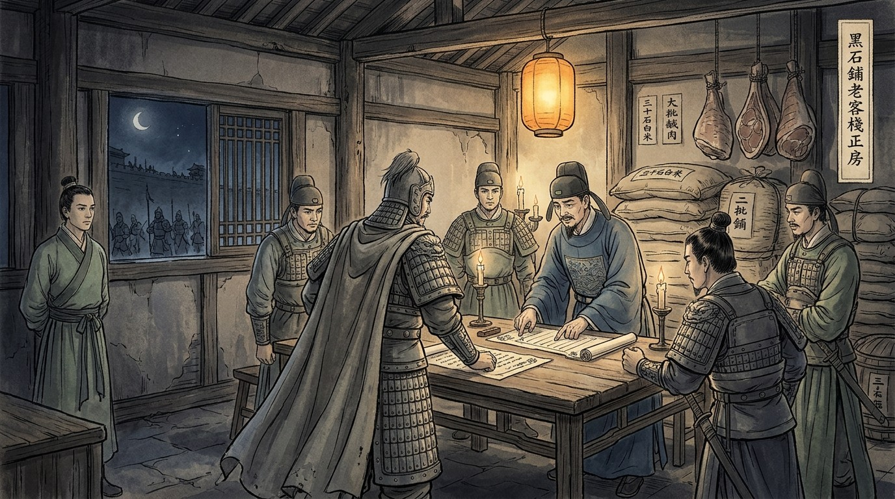

# 第 36 章：商會殘骨・利益之毒

[← 上一章](ch0035.md) ｜ [本卷目錄](00_intro.md) ｜ [下一章 →](ch0037.md)

*章首插畫：第 36 章 商會殘骨・利益之毒*

關前對質落幕的當天深夜，黑石鋪老客棧正房內，燭火通明。

陳鎮山的八百先鋒精兵已奉命移駐黑石關，依律接管了關卡防務，並由隨軍督糧官李大人親自押運商會調撥的三十石白米與大批鹹肉犒勞三軍。

飽餐戰飯後的官軍士卒與黑石鋪百姓秋毫無犯，一場原本可能將全鎮夷為平地的血腥屠殺，終於徹底消弭於無形。

然而，在老客棧那間封閉的青石廂房之內，空氣卻比白日的陣前對質更為凝重。

房間中央擺著那尊自周家翻覆馬車夾層裡起出的【金石內造・丙字柒號】紫銅除渣坩堝。

在坩堝旁邊，趙德貴披頭散髮、渾身戴著沉重的死囚鐵鐐，面如死灰地癱跪在地上。

胡百戶已被陳鎮山的親衛單獨押解回黑石關死牢，而身為金石商隊叛徒的趙德貴，則在陳鎮山的特許下，由蘇凝霜親自提審。

「趙德貴，到了這步田地，你還想替背後的人瞞著麼？」

蘇凝霜一身素縞，目光冰冷如寒冰，白皙修長的手指輕輕撫摸著亡父蘇遠山生前遺留的那枚「紫金雙龍信印」：

「我父親為人剛正，執掌商會大掌櫃之位十二年，從不涉足任何違禁走私。半個月前，他突然拋下府城全部公務，單人匹馬趕赴這窮鄉僻壤的黑石鋪，不到三天便暴斃在客棧廂房之內，死時七竅發黑、肺腑成灰！」

蘇凝霜猛地一掌拍在方桌上，厲聲喝問：

「他究竟發現了什麼？！到底是誰指使你在他的參湯裡下的慢毒？！」

跪在地上的趙德貴猛地打了個寒噤，抬起那張滿是涕淚與血污的老臉，眼底深處滿是絕望與恐懼。

他知道，胡百戶已經完了，若是自己再不吐出真東西，一旦被押解上府城公堂，背後那些位高權重的巨擘有一百種法子讓他在牢房裡無聲無息地「暴斃」！

「大、大小姐……饒命啊！小的……小的一開始真的不知道他們要殺大掌櫃啊！」

趙德貴狠狠磕了幾個響頭，聲音發顫地吐露出了深藏半年的黑幕：

「這條線……根本不是小的和胡百戶能做主的！北崖地下三百米的這處太古血精礦脈，早在半年前就被府城那邊的人暗中探明了！」

「血精……那可是能夠讓鍛造靈兵、淬鍊極品破障火器的上古奇物，在府城黑市裡，一兩純度九成以上的血精晶錠，就能換足足五十兩紋銀！」

趙德貴指著桌上的紫銅坩堝，顫聲道：

「原礦蘊含大量暴虐雜質，極難熔煉。所以府城那邊特意派人送來了這四尊『除渣坩堝』和高階耐火泥，由小的負責在黑石鋪秘密招募老礦工下井偷採，胡百戶負責提供軍器局的生鐵雷管開山，再由周員外和王員外用特製馬車將除渣後的晶錠藏在夾層裡，藉著官商採辦的名義運出關卡……」

「那這尊坩堝，究竟是府城哪座作坊鑄造的？！」林鐵生站在一旁，指著坩堝底部一處極其隱蔽的捲雲暗紋，沉聲問道。身為打鐵學徒，他一眼就看出這絕非尋常鐵匠的手筆。

蘇凝霜拿起那半本父親用鮮血染紅的商會暗賬，翻到最後一頁，將其與坩堝底部的暗記嚴格比對。

只見暗賬摺頁中央，赫然印著一個由精鋼雕刻的私章拓印——一朵被三枚金刀環繞的纏枝金蓮！

「金蓮環刀印……」

蘇凝霜的瞳孔驟然收縮，呼吸在一瞬間變得無比急促，指尖甚至因用力過度而泛白：

「這是……金石商會副會長、內堂三長老錢百川的私庫印鑑！」

「錢百川？！」

站在後方的顧玄與柳清虛對視一眼。

即便身處邊陲，他們也聽聞過這位金石府商界巨頭的大名——錢百川掌控著金石府半數以上的礦山冶煉與車馬行，在府城樹大根深，連官府府尹都要給他三分薄面！

「沒錯……就是錢三爺！」

趙德貴像倒豆子一般瘋狂招供：

「半月前，大掌櫃查到了商會內堂有大筆礦木與火藥虧空，察覺到了黑石鋪這條走私暗線，親自帶著信印前來捉拿盤查！錢三爺得知消息後，連夜派快馬給小的送來了一瓶無色無味的『地陰腐骨散』，命小的務必將大掌櫃截殺在山裡！」

「錢三爺說……只要大掌櫃死了，黑石鋪這處血精礦就能借著地動的名義徹底炸塌掩埋，所有的走私帳目全都能推到死去的胡百戶或者逃亡的礦匪身上，死無對證！」

真相大白！

沒有神鬼作祟，沒有荒誕奇談。

這場幾乎讓黑石鋪家破人亡的滔天巨禍，源頭不過是府城權貴為了私吞暴利，聯手邊關貪官布下的一場骯髒血腥的走私陰謀！

他們把這座聚落當成隨意碾碎的螻蟻，將二十三名礦工當成用完即棄的耗材，在利益即將敗露之際，甚至不惜借陳鎮山的刀行屠村之舉！

「好一個錢百川……好一個金石商會內堂！」

蘇凝霜咬碎銀牙，眼眶泛紅，雙手緊緊握住紫金信印，骨節發白。

「但是……大小姐，」沈泥雙手抱胸，背靠著門扉，清澈銳利的眸子冷靜地看著滿地狼藉，「單憑趙德貴的一面之詞，和這本沒蓋府城官印的半截暗賬，到了府城公堂上，恐怕扳不倒這位錢三爺。」

沈泥雖然年僅十四五歲，但多年在後巷乞食、察言觀色的市井本能，讓她對人性的卑劣與權力的殘酷有著最敏銳的直覺：

「趙德貴是個死囚，到了府城，錢百川完全可以反咬一口，說趙德貴是攜款潛逃的叛奴、栽贓陷害；而這尊坩堝，他也可以推說是商會庫房被盜的外流物。」

「如果沒有能直接證明錢百川收受血精現銀的『總堂交割正底單』，到了八百里外的金石府城，我們很可能會被他們反咬一口！」

沈泥這番冷靜到近乎殘酷的剖析，讓原本悲憤的蘇凝霜心中猛地一凜。

蘇凝霜深吸一口氣，壓下心頭翻湧的恨意，讚許地看著沈泥：

「沈泥說得沒錯。錢百川在金石城經營了數十年，盤根錯節，若沒有致死鐵證，貿然發難只會打草驚蛇。」

說著，蘇凝霜緩緩從衣領內襯中取出一枚精巧細長、用太古隕鐵打造的青銅小鑰匙：

「這是我父親臨終前死死攥在掌心裡的金匱密鑰。在金石商會總堂的地底，有一座歷代大掌櫃共管的『天字一號密室』，裡面封存著商會立會以來所有的原始交易合約與內堂密卷。」

「父親在暗賬密信中留下了暗語——錢百川過去三年走私的所有真實收支底單，全部被他用商會暗鎖鎖死在了那間密室的一號保險鐵櫃裡！只有拿著這枚鑰匙，配合掌櫃信印，才能開箱取證！」

說到這裡，這位在關前八百鐵甲面前都未曾低頭半分的商會千金，看著桌上那本染著父親暗紅血跡的半截帳冊，聲音終究還是微微哽咽了一下。她用指腹輕輕摩挲著青銅鑰匙上父親留下的齒痕，眼底透出一股孤女獨撐危局的空茫與倔強。

站在門扉邊的沈泥看著蘇凝霜指尖的那枚鑰匙，心頭亦是一動。

她下意識地隔著粗布破襖，摸了摸貼肉藏著的那枚青金古令——【萬物行商・天門引】，以及頸間那塊只露出一個「沈」字與半截裂紋的殘缺舊玉佩。

她記得很清楚，前夜在地窖密室裡，蘇凝霜看到天門引邊緣的古篆密文時曾提過，商會總堂地底那座密室最深處，還有一道前朝舊商盟留下來的古老玄鐵重門。

蘇凝霜至少還知道自己的父親是誰、仇人是誰；而她沈泥，連自己父母的模樣都從未見過，只知道莫三把這塊要命的古令埋在柴房黑泥底下整整三十年。

沈泥低垂著眼簾，將手從衣襟上慢慢移開，沒有開口，更沒有在眾人面前表露分毫。

在市井爛泥裡長大的丫頭比誰都明白：眼下她連黑石關都還沒走出去，過去的血帳不是拿來博人同情的談資，唯有活著走進金石府城、站穩腳跟，她才有資格去撬開那扇埋在暗渠底下的玄鐵門。

屋外的風雪漸漸小了。

林鐵生和燕隼蹲在院子角落裡，正幫著商隊老管事把那四尊【丙字柒號】紫銅坩堝和雷管引信筒裝進塞滿乾草的木箱，免得在八百里山路上顛碎了邊角；顧玄則與柳清虛在廊下清點著陳鎮山剛批下來的行軍傷藥，將幾味能治肺傷的甘草與麥冬分揀出來留給鎮上的草廬。

「這趟去府城，路遠得很。」林鐵生用左手拉緊木箱上的麻繩，看了一眼自己還綁著夾板的右腕，「但這口坩堝既然是府城內造局打出來的，我們就得親手把它送回府城的公堂上去。」

顧玄將分揀好的藥包繫緊，輕聲道：「胡百戶和趙德貴只是看門的惡犬。如果不把府城裡那個簽發調撥令的人揪出來，黑石鋪的礦工和死在虎跳峽的四十多名兵卒，就白死了。」

燕隼把捆好的鐵箱抬上板車，拍了拍背後的蛟骨大弓，只說了一句：「大伯五年前也是去了府城方向。正好順路。」

柳清虛將最後一卷地形圖收進青布包袱，望向關外蜿蜒伸向南方的漫漫驛道。

在經歷了生死礦難、煞潮改道與關前博弈之後，黑石鋪這座狹窄的邊陲聚落，已經無法再擋住他們走向山外風暴的腳步。

蘇凝霜站在廊下，看著這四個默不作聲收拾證物箱籠的少年，又看了一眼在門邊核對車馬數目的沈泥，深吸一口氣，鄭重地朝著五人深深屈膝一禮：

「待虎跳峽棧道便道搶通之日，凝霜懇請五位同袍，與我同赴金石府城！」

「這筆血債，我們去府城，當面跟他們算個乾淨！」

---

[← 上一章](ch0035.md) ｜ [本卷目錄](00_intro.md) ｜ [下一章 →](ch0037.md)
