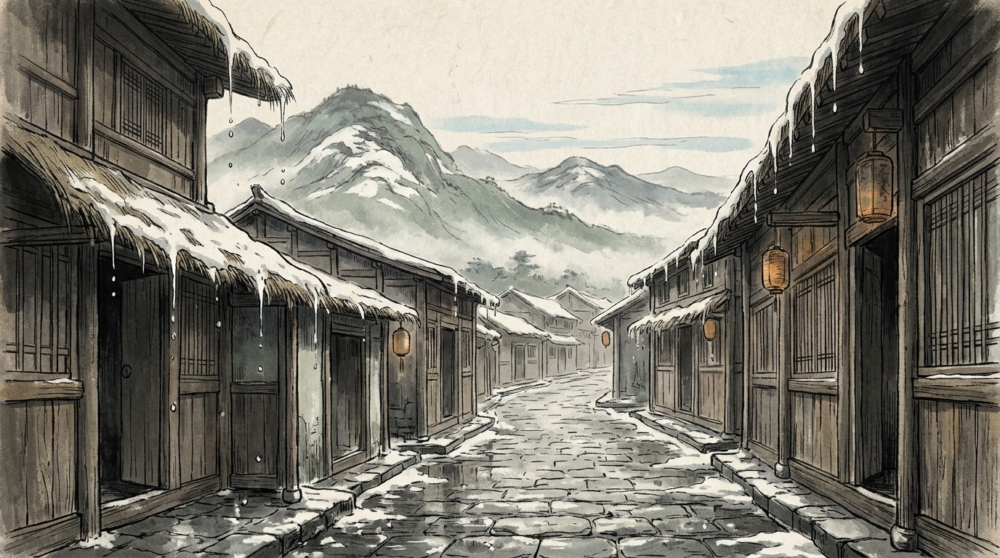

# 第 37 章：回首黑石・凡胎圓滿

[← 上一章](ch0036.md) ｜ [本卷目錄](00_intro.md) ｜ [下一章 →](ch0038.md)

*章首插畫：第 37 章 回首黑石・凡胎圓滿*

第七天的清晨，大荒邊陲迎來了久違的大晴天。

積雪在屋簷上緩緩消融，化作清冽的水滴，滴滴答答地打在青石板街面上。

陽光穿透薄霧，將這座經歷了礦難崩塌、煞潮衝擊與大軍扣關的邊陲小鎮，鍍上了一層溫暖的金色。

聚落並沒有在一夜之間變成太平仙境，泥濘的土地上依然瀰漫著人間煙火的雜駁與瑣碎——

水井坪周圍，叮叮噹噹的敲打聲此起彼伏。十幾名漢子正赤著膀子幫王寡婦和劉老漢修補被狂暴野豬撞塌的半邊土牆；街角的肉案前，幾名婦人正為分到自家手裡的那幾斤醃臘野豬肉是肥是瘦而爭得面紅耳赤；街巷深處，孩童們追逐著嬉笑打鬧，手裡甩著用野豬尾巴編成的玩具。

然而，在這看似如常的市井煙火之下，整座聚落的骨架卻已經悄然發生了翻天覆地的質變。

老鐵匠鋪的打鐵棚前，老礦工魯大山左肩纏著厚實的繃帶，正坐在長凳上，就著一碗熱騰騰的苞穀糝，與二十幾名劫後餘生的老弟兄大聲商議著未來的生計：

北崖的三號廢坑徹底被泥石封死了，但黑石鋪不能沒有營生。眾人商議已定，由魯大山帶隊，在南山向陽坡重新開闢一座安全的露天青石場，讓傷了肺的年輕學徒柱子、斷了右腿的孫大牛等傷殘礦工也能在棚下做些分揀石料、記帳看堆的輕巧活計，維持全家溫飽，同時把老李頭和木匠老陳兩家的孤寡老小一併照應下來。

而在後巷那間漏風的土坯小屋裡，顧玄正蹲在灶台前，把最後兩罐熬好的蜜炙枇杷膏與十斤精白米留在矮几上，握著瞎眼孫婆婆枯瘦的手輕聲道別。孫婆婆摸索著把一雙她憑著手感納了半個月的厚底千層布鞋塞進顧玄懷裡，嘴裡不住地念叨著「出門在外別再光著腳踩冰水」。

十幾步外的燕家舊院裡，燕隼的大伯母也正紅著眼眶，把連夜用老狼皮縫製的一對護腕繫在燕隼手腕上，千叮嚀萬囑咐他到了府城萬事小心，若大伯燕山真不在人世了，也一定要活著回黑石鋪來。

「呼哧——！呼哧——！」

一人高的老牛皮風箱再次被大力拉響，發出沉雄有力的喘息聲。

老鐵匠阿鐵站在熊熊燃燒的地爐前，額角淌著汗水，左手熟鐵重錘每一次落下，都激盪起漫天耀眼的火星，金鐵交鳴之聲清脆響亮，在整個山谷上空久久回盪。

那不是單純的打鐵聲，而是黑石鋪這具歷經浩劫的血肉之軀，重新搏動而起的堅韌心跳！

就在這煙火蒸騰的晨光之中，後山一處向陽的殘破石坪上，五道年輕的身影並肩而立。

在短短七天之前，他們還只是生活在聚落最底層、各自在飢餓、凍餒、官府苛稅與猛獸陰霾中掙扎求存的微末少年；而如今，在經歷了暴雨夜救商隊、北崖深井鑿巖救險、落龍天塹借風導獸、窄巷車陣生死搏殺、暗渠潛渡多點投書，以及黑石關前以如山鐵證迫退八百鐵甲的重重死生淬礪之後，五人身上的氣息已然沉凝如山！

林鐵生低頭握了握左拳，骨節間傳來一聲沉悶如生鐵咬合的低響。過去打鐵，他只知憑一身蠻力硬砸；如今在勘破北崖古暗渠與落龍口危岩的吃力關節後，他體內奔湧的氣血已與周身筋骨融為一體，一拳一腳皆如千錘鍛打的熟鐵般渾然天成。

顧玄腳上穿著孫婆婆剛給他換上的千層布鞋，靜靜立於風中。當他微闔雙目，十丈外凍土下草根的微弱生機、山風裡殘留的硫煙與松針氣息，皆在他的心神感知中纖毫畢現。

石坪右側，燕隼反手按在百斤牛筋蛟骨重弓上，原本外露的孤狼戾氣已盡數斂入骨髓，呼吸綿長得與山林風聲合而為一，胸口那枚獵獸圖騰印記在皮下散發著沉穩滾燙的暖流；柳清虛則立於青石邊緣，將過往對天羅道化的恐懼盡數踩入腳下實地，眉宇間一片空靈澄澈；而站在最邊緣的沈泥，雙手插在破襖兜裡，指尖摩挲著溫潤的【天門引】古令，晶亮的黑眸裡透著在混亂泥潭中梳理秩序、算清人心籌碼的篤定與從容。

五道氣息在石坪之上交相輝映。

自大清洗抹去通天大道三百年以來，這片被視為罪血與放逐之地的八百里大荒深處，五位凡胎少年憑藉著自己的血肉雙手、泥濘生計與極致心力，終於將一身凡骨打磨到了圓滿無瑕的極境！

「踏踏踏……」

一陣清脆的馬蹄聲自驛道方向傳來。

只見金石商會大小姐蘇凝霜在兩名全副武裝的商隊護衛策應下，策馬來到了石坪下方。

蘇凝霜翻身下馬，一身幹練的藏青色騎裝，越發顯得身姿修長英氣。

在她的手中，托著五面用熟銅打底、正面雕刻著金石城防司猛虎官印、背面刻著持有人籍貫姓名的精緻腰牌，以及一疊蓋滿按察使司朱紅大印的公文勘牒！

「諸位同袍！」

蘇凝霜走上石坪，清麗的面容上帶著發自肺腑的敬重，將五面腰牌與勘牒鄭重地遞到五位少年面前：

「陳鎮山參將已然正式行文！虎跳峽木棧道搶修便道已然完成大半，大軍將於明晨辰時拔營，正式押解胡德海、趙德貴及全部走私物證起程赴省！」

「這是陳參將依據大乾軍律親筆簽發的——【金石府城三司會審・特許證民隨軍出鄉路引】！」

看著那五面金燦燦的銅製腰牌，五位少年的呼吸都不由自主地微微一凝。

在大乾律法森嚴的世界裡，邊陲流民一生都被死死鎖在戶籍所在的荒野與礦坑之中，擅自翻越黑石關者，皆依逃民論斬。

而眼前這五面沉甸甸的腰牌，代表的不僅僅是隨軍作證的資格。

它代表著這五位生於泥濘、長於大荒的凡胎少年，終於堂堂正正地撕碎了困鎖了他們十六年的命運枷鎖！

走出黑石，踏入繁華浩瀚的金石府城，去直面那更加波瀾壯闊、也更加兇險萬分的天下大局，已然化作了平鋪在他們腳下的通天大道！

---

[← 上一章](ch0036.md) ｜ [本卷目錄](00_intro.md) ｜ [下一章 →](ch0038.md)
