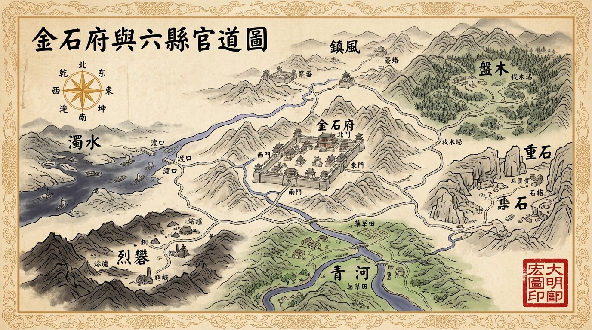

# 第二卷：金石風雲・六縣連環

> 府城制度網羅、六縣民變實證與三方會審（第 39–82 章）

*金石府與大荒六縣官道圖*

## 本卷目錄

- [第 39 章：殘雪驛道・證物同行](ch0039.md)
- [第 40 章：墜崖之家](ch0040.md)
- [第 41 章：夜半鐵檻](ch0041.md)
- [第 42 章：盤木林道・木價之痕](ch0042.md)
- [第 43 章：南關入城・濁氣初嚐](ch0043.md)
- [第 44 章：證物入庫・兩面主簿](ch0044.md)
- [第 45 章：總堂吊唁・金蓮微笑](ch0045.md)
- [第 46 章：三日通牒・分途之約 (第一幕終章)](ch0046.md)
- [第 47 章：學徒登記・阿鐵的記號](ch0047.md)
- [第 48 章：杏林藥囊・城裡的病](ch0048.md)
- [第 49 章：大校場・百斤石鎖](ch0049.md)
- [第 50 章：宣道司五殿・借鏡觀象](ch0050.md)
- [第 51 章：舊帳微塵・雲妮之名](ch0051.md)
- [第 52 章：擂台再試・磐石與軍陣](ch0052.md)
- [第 53 章：屋頂觀風・假天道辯證](ch0053.md)
- [第 54 章：地火殘渣・丙字第七](ch0054.md)
- [第 55 章：辨症行針・毒囊與洗靈草](ch0055.md)
- [第 56 章：西水門閘・三道合力](ch0056.md)
- [第 57 章：暗紋有主・六項缺口 (第二幕終章)](ch0057.md)
- [第 58 章：分頭啟程・路引、假條與信印](ch0058.md)
- [第 59 章：青河水霧・爭水與歉收之價](ch0059.md)
- [第 60 章：九城藥材・三路急信與各有各的難](ch0060.md)
- [第 61 章：天風谷口・頂風採石](ch0061.md)
- [第 62 章：走山令・衛所舊檔與殘牌](ch0062.md)
- [第 63 章：地火堡・耐火泥與減爐之痛](ch0063.md)
- [第 64 章：浮橋濁水・金砂、廢水與毒囊](ch0064.md)
- [第 65 章：舊盟殘部・「雲記」名冊與雙來源核實](ch0065.md)
- [第 66 章：重石台地・崩斷的絞盤與虎跳峽條石](ch0066.md)
- [第 67 章：歸途匯流・證據成鏈與凍結反擊](ch0067.md)
- [第 68 章：信用凍結・飛錢成紙與現銀擠兌](ch0068.md)
- [第 69 章：平糶之議・常平倉與誰來買單](ch0069.md)
- [第 70 章：瘴氣入城・西水門藥荒之夜](ch0070.md)
- [第 71 章：閘渠斷流・金剛砂磨痕與淹庫倒數](ch0071.md)
- [第 72 章：北關烽煙・雙聯火印與軍需鐵證](ch0072.md)
- [第 73 章：暗渠夜行・公證火漆與玄鐵重門](ch0073.md)
- [第 74 章：會審前夜・雙帳比對與籌碼分層](ch0074.md)
- [第 75 章：三方會審・三印合符與風險天平](ch0075.md)
- [第 76 章：餘波・傷痕未平的世道](ch0076.md)
- [第 77 章：鬼市餘震・共鳴之物與無標記經生](ch0077.md)
- [第 78 章：莫三往事・舊商盟之夜](ch0078.md)
- [第 79 章：精金淬鍊・藥性逆行（物道雙傑破障）](ch0079.md)
- [第 80 章：氣血逆沖・心魔叩問（力法雙傑破障）](ch0080.md)
- [第 81 章：使者入城・人間根基與名山考核令](ch0081.md)
- [第 82 章：初秋城門・分途之前（第二卷終章）](ch0082.md)
