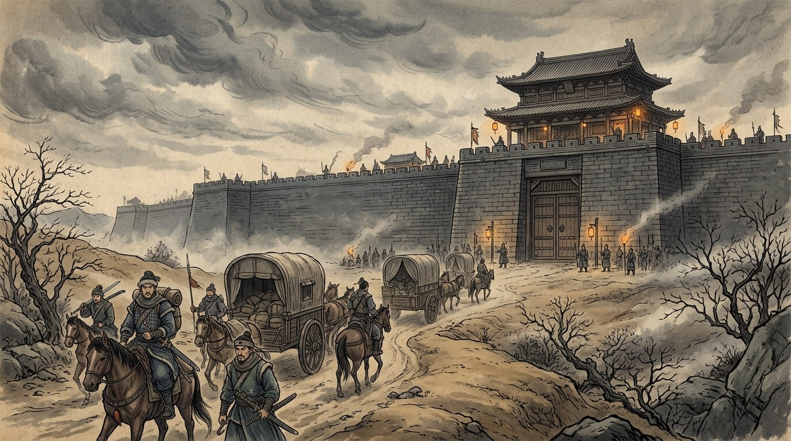

# 第 43 章：南關入城・濁氣初嚐

[← 上一章](ch0042.md) ｜ [本卷目錄](00_intro.md) ｜ [下一章 →](ch0044.md)

*章首插畫：第 43 章 南關入城・濁氣初嚐*

盤木南嶺兩百六十里官道的盡頭，天地被一座拔地而起的龐然巨物生生截斷。

那是金石府城。

歷經東線四百五十里整整十日的風雪跋涉，當重裝車隊轉過最後一道黃土丘陵時，一座高達五丈、由千百萬塊重達數噸的灰黑條石壘砌而成的雄偉城牆，宛如一條沉睡的遠古巨龍，橫亙在蒼茫的天地之間。

青銅包角的南關箭樓高聳入雲，八面巨大的「金石共治盟約」玄底金紋旌旗在獵獵寒風中狂舞。城門洞開如巨獸之口，城前三道跨過深邃護城河的生鐵吊橋上，車水馬龍，推車的腳夫、吆喝的商販、馱著沉重貨物的騾馬隊伍，在寬達十丈的青石馳道上排開了足有兩里長的扭曲長龍。城牆外側貼牆搭著成排潮濕低矮的土坯棚屋與免費熬粗湯的施藥義棚，流民與挑夫正守著泥爐縮肩候活；再往河埠那頭飄來漁市掀簍開秤的水腥氣與魚販吆喝，將內城與關外劃出兩重截然不同的凡俗天地。

喧囂、嘈雜、馬嘶、怒罵，夾雜著城內飄來的煎炸油煙、馬糞焦臭與生鐵熔爐的硫磺氣息，化作一股磅礴的人間巨浪，撲面而來！

五位黑石鋪少年站在隊列之中，微微仰著頭，眼神中滿是難以言喻的震撼。

在他們的認知裡，黑石鋪已是一處方圓十里的聚落，盤木縣更是大得驚人；但與眼前這座容納了十餘萬生靈、分管六大次級縣城的雄偉都城相比，黑石鋪不過是山野深處一撮微不足道的泥土。

「嗡……」

就在這時，站在最後方的柳清虛身形猛地一晃，臉色在剎那間變得慘白如紙！

年輕的破落道童猛地抬起右手，死死按住了自己的胸口。

在他體內，那股在黑石鋪迎風孤岩歷經十六年打磨、好不容易才養出幾分純淨底氣的真氣，在踏入南關百丈範圍的一瞬間，竟劇烈地痙攣、沉滯起來！

天地變了。

在柳清虛那雙修煉過道門觀氣之術的眼眸中，金石府城的蒼穹之上，根本沒有山野間那清冽純淨的星光與山風。

頭頂彷彿平空壓著一張厚重的灰黃油布，市井的煙火氣、煤煙味、官府衙役身上的鐵鏽銅臭，將整座都城悶在裡頭；而在那層濁氣天幕的正中央，隱隱約約垂落著無數條冰冷細密的鎖鏈虛影，自城西懸空張開，扣住了整座城池——

那是城西宣道司布下的「絕靈法網」。

「呼……呼……」柳清虛喉頭滾動，冷汗浸透了道袍後背。他吸了一口氣，喉嚨裡竟像吸進了一捧濕潤的煤灰，肺葉發緊。

「清虛，怎麼了？」顧玄第一時間察覺到了他的異樣，伸手扶住了他的胳膊，指尖順勢搭在他腕口脈門上一探，眉頭微微蹙起——脈象浮得緊，卻像被一塊冷石頭壓住，落不下來。

柳清虛咬著牙，抬眼看了看城門樓上筆直垂落的測風旗，又低頭望向自己胸口微滯的起伏，聲音乾澀：

「山野的風是往上散的，這城裡的氣……全往下沉，像頭頂蓋了一面打不穿的石篩子。天地間的清氣進不來，在裡頭多待一個時辰，肺管子就像多積了一層濕煤灰，連呼吸都發沉。」

走在一旁的沈泥卻深深吸了一口氣，微黑的小臉上泛起了一抹野貓進巷子時特有的警覺神采：

「這才是大城裡的味兒——煤灰、馬糞、銅臭、血氣，全攪在一塊兒。」

……

「閃開！軍鎮辦差，都給老子閃開！」

陳鎮山的親衛校尉揮舞馬鞭，護著四輛蒙著牛皮的證物重車與兩輛死囚鐵檻，穿過熙熙攘攘的人流，直奔南關正門。

城門兩側，立著六座用巨石雕刻而成的「金石共治告示碑」。

數十名身穿灰藍公服、腰懸鐵尺與長算盤的稅吏，正帶著披甲城防衛兵，對每一輛入城的貨車進行敲骨吸髓般的盤查。

「站住！車隊卸轅，按章過磅！」

一名身著深青色稅吏公服、面容枯瘦、鼻樑上架著一副黃銅框老花眼鏡的漢子大步攔在了隊伍前方。他右手拎著一支沉甸甸的長桿地磅秤錘，腰帶上插著一柄烏木算盤，手指在算珠上撥得噼啪作響，眼角吊起，眼神刻薄得像把尺子。

南關守城兼度支部徵稅稅吏——**宋算子**。

「瞎了你的狗眼！鎮武軍左參將陳大人親自押解邊防重囚，憑軍鎮公文入城，何人敢攔？！」親衛校尉按刀怒斥。

宋算子眼皮都沒抬，手中的算盤「啪」地一收，依足規矩拱了拱手，語氣公事公辦得不帶半點人情：

「陳參將當面，卑職失禮。但按《金石共治盟約》度支條款，非戰時狀態，四關過磅課稅與違禁稽查由南關稅司與府衙共掌。」

宋算子扶了扶鼻樑上的黃銅老花鏡，那雙算計得一絲不苟的細眼，冷冷掃過後方四輛沉甸甸的牛皮大車：

「軍爺押解要犯，有軍鎮路引自然走得；但這後頭四輛重車……車轍深壓三寸，顯然載著未提純的重礦與大件銅鐵！南關稅則明擺著：外縣入城重木課一成，生銅、特種礦石與耐火土料課兩成，嚴查夾層夾帶私鹽硝石！照章——車上牛皮得解開一角過秤，箱數重量落冊存底！」

十幾名稅司差役提著地秤鉤與長鐵籤圍了上來。

「放肆！」

蘇凝霜勒馬上前，青色斗篷翻飛，厲聲道：

「車中所載乃是黑石關軍械走私案的公堂鐵證！每一件皆有鎮武軍鎮與金石商會聯署火漆封緘！誰敢擅自挑開火漆，便是毀壞公堂證物！」

宋算子看了一眼蘇凝霜，神情依舊冷硬刻板，絲毫不為所動：

「蘇大小姐守孝歸城，卑職按章問一句——火漆是你們私下在關外封的，還是府衙案牘庫驗過？關外私封未經府衙登錄，照關稅舊例，這四車大件照樣算無稅貨車！就算今日坐堂的是商會大掌櫃，過南關地磅也得依律登冊過數！」

沈泥站在車旁，瞇眼打量著這個瘦老頭。

這宋算子嘴皮子刻薄得討厭，眼神卻乾淨得只認帳本與條文——他倒不像錢百川派來砸鎖毀證的惡狗，更像是個認死理、恨不得把全天下過門的車輪都拆下來稱斤兩的鐵桿稅官。可問題在於，這火漆一旦讓他按尋常商貨規矩當街挑開，到了公堂上，蘇凝霜費盡心血守了一路的**保管鏈**就真破了口子！

「錚——！」

一聲清脆霸道的拔刀出鞘聲，毫無預兆地在城門洞裡炸響！

一道森寒的黑鐵刀芒貼著宋算子的鼻尖斬落，將他腳前三寸的青石磚「喀嚓」劈出一道半尺深的裂縫！

兩旁的稅吏雜役嚇得齊刷刷後退。宋算子本人卻只是鏡片微震，往後退了半步，竟沒有如尋常貪官那般跪地求饒，只是臉色發白、嘴唇緊抿著抬起頭來。

陳鎮山手握黑鐵斬馬刀，坐在高頭戰馬上，另手摸出那方沉重的「伏魔副將銅印」連同府衙行文提審令，重重拍在稅關木案上：

「本將奉金石府尹秦大人提審令、鎮武軍統帥霸山將軍軍令，押解死囚胡德海、趙德貴進城會審。」

「車裡是涉案封緘重物，非是行商貨物，火漆印記由本將與蘇大小姐對簽押封。」

陳鎮山刀尖斜指青石板，沉聲喝道：

「照《共治盟約》軍法轉運例，軍司法封緘證物免開箱、免卸秤，只核車數、封條完好與路引番號！宋稅吏，你若要驗重量——連車帶封上你的大地磅！想撬開火漆？那便先寫一張『毀壞三方會審證物責任狀』，明日跟著本將一起去見秦府尹！」

空氣僵持了兩息。

宋算子死死盯著桌案上那枚血紅色的軍鎮司法副印與秦府尹簽發的提審令，又掏出放大銅鏡細細核對了半晌防偽暗記。

確認印信無訛，這個枯瘦的稅吏才緩緩吐出一口氣，冷冰冰地收起長秤鉤：

「既是有府衙提審正令與軍鎮雙聯封條，合該依《軍政涉案免拆例》辦理。」

他摸出毛筆，在南關當日的厚重稅冊上飛快寫下四行端正小楷：「黑石關重車四輛、囚車兩輛，辰時後自南關入，連車過大地磅記總重，軍鎮司法火漆六道俱全無損，免拆箱。」隨即撥動算盤核對了兩聲，冷冷抬頭：「五個跟車的外鄉泥腿子，沒戶籍？照規矩領五面黃木通牒——」

他隨手從木匣裡甩出五面巴掌大的黃木牌，上頭烙著南關過關日期：

「蓋章！放行！」

城防守備校尉鬆了口氣，趕緊接過文牒蓋上通關硃砂印，高聲唱喏：

「鎮武軍重犯車隊——放行——！！」

……

車輪滾滾，重裝車隊穿過了深邃陰暗的南關城門洞。

而在城門兩側的殘垣陰影下，卻聚集著數十個面黃肌瘦、身披破絮麻袋的人影。

「行行好……給口吃的吧……」

「官爺！買個丫頭吧，只要八十文，能洗衣服能做飯啊……」

哀求聲不絕於耳。

一名身材精瘦、穿著油膩百衲衣、脖子上掛著一串假桃木符的乾癟漢子，正倚在牆角，眼珠子滴溜溜亂轉，正是南關一帶有名的流民牙子——**刁小七**。

刁小七看著跟在車隊兩側的顧玄、鐵生等五人，一眼便認出這群少年穿著粗劣的山野土布、眼神中帶著初入大城的警惕，顯然是沒有本地戶籍的外來肥羊。

他提著兩卷發黃的舊紙，像一條黏膩的泥鰍般湊了上來，壓低聲音諂笑道：

「幾位小爺！外鄉來的吧？沒本地保甲戶籍可進不了內城啊！」

「小七手裡有上好的『金石四坊假路引』，只要五錢銀子一張，保證巡防營查不出破綻！要是嫌貴，小七這兒還有城南車馬大院的『終身黑工契』，按個手印，管一頓稀粥，免得被城防司當成無籍流民抓去挖暗渠啊！」

「滾！」

燕隼冷冷吐出一個字，手掌輕輕按在腰間短刀上，身上那股在深山與群狼廝殺沉澱出的兇煞野性轟然釋放！

刁小七臉色一僵，被燕隼那如猛獸般的眼神嚇得一哆嗦，暗罵了一聲「晦氣的鄉巴佬」，轉身縮回了陰影之中。

……

天色漸漸昏黑。

陳鎮山將死囚與重車暫時安置在南關軍鎮專屬的臨時衛所內，派重兵把守。

由於案情跨越商會、軍鎮與府衙三方，需明日辰時由陳鎮山遞交三方會審公文後，才能正式將人犯與證物移交金石府衙案卷庫。

蘇凝霜自去接洽蘇氏在城南的舊部，五位少年則被安排在南關內側的一處偏僻小客棧落腳——「南關車馬小棧」。

小棧掌櫃是個五十多歲的駝背老漢，人稱**老劉**。

老劉以前也是黑石鋪走出來的採藥人，三十年前在山裡摔斷了腿才流落府城開了這家泥巴小店。看在黑石鋪老鄉的情分上，老劉收了極微薄的房錢，給五人騰出了一間乾淨的閣樓，端上了一大盆熱氣騰騰的糙米飯與鹹菜。

昏暗的油燈下，五個少年圍坐在一張掉漆的粗木桌旁，狼吞虎嚥地扒著飯。

老劉抽著一桿旱煙，坐在門檻上，看著眼前這五個眼神堅毅的少年，煙鍋裡的火星明明滅滅。

良久，老劉吐出一口濃濃的白煙，聲音沉重而沙啞地開了口：

「娃兒們，黑石鋪的事情……我聽南來北往的商客說了。」

「你們能把二十幾個老兄弟從地底下挖出來，能頂著獸潮護住村子，是條漢子，是黑石鋪的種。」

老劉放下煙桿，轉過頭來，昏黃的老眼無比肅穆地盯著每一個人：

「但老漢得把醜話說在前面。」

「老漢能給你們一碗熱飯，能給你們一張草席，但這間小店……**保不了你們的籍**。」

「老劉叔，這話是啥意思？」林鐵生放下了碗筷，皺眉問道。

老劉嘆了一口氣，伸手在桌上重重叩了三下：

「金石府城，不是黑石鋪，也不是盤木縣。」

「大乾崩解之後，五方共治立下鐵律——凡外縣無正式公文與保甲之人，拿著城門口那面黃木牌，自踏進南關城門洞起算……**三日（三十六個時辰）之內，必須找到落腳的正式擔保**！」

「若是過了這三十六個時辰，你們手裡沒有正式行會、醫館、學塾或大車行的擔保腰牌……」

老劉的眼神深處露出一抹濃濃的忌憚：

「城防營每夜子時大搜全城。凡無擔保登錄者，一律列為『無籍流民』！」

「男人押去地下暗渠挑淤泥、挖死礦，女人賣進窯子，到死都出不來！」

「哪怕你們是陳參將帶進來的人，到了第三天頭上，若是沒有正經的世俗行會給你們作保……官府的鐵鎖鏈，一樣會套在你們的脖子上！」

老劉的話宛如一記重錘，狠狠砸在五個少年的心口。

窗外，金石府城的夜色深沉如墨。

遠處城樓上，傳來了沉悶而悠長的暮鼓三通，隨之而來的，是巡防營甲胄鏗鏘的巡邏腳步聲。

屋內的一盞油燈在風中劇烈搖曳。

沈泥摸了摸懷裡冰涼的「天門引」古令，又摸了摸那枚「沈雲妮」玉佩；

林鐵生握緊了腰間那柄左手小錘；

顧玄看著自己那雙略顯粗糙、卻能辨識百草的雙手；

燕隼撫摸著蛟骨弓那堅硬冰冷的弓弦；

柳清虛則閉上雙眼，靠著牆根調整著胸口滯重的呼吸節律。

整整三十六個時辰。

南關城樓上的更鼓一聲接一聲敲進寒夜，像一根套在無籍外鄉人脖頸上的冷繩，開始一寸一寸地收緊。

---

**（第 43 章完）**

---

[← 上一章](ch0042.md) ｜ [本卷目錄](00_intro.md) ｜ [下一章 →](ch0044.md)
