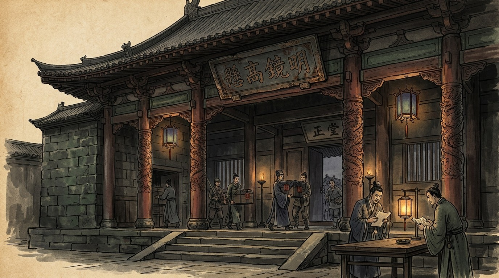

# 第 44 章：證物入庫・兩面主簿

[← 上一章](ch0043.md) ｜ [本卷目錄](00_intro.md) ｜ [下一章 →](ch0045.md)

*章首插畫：第 44 章 證物入庫・兩面主簿*

金石府城的心臟，是一座由黑青雙色巨石砌築的宏偉建築群——金石府衙。

正堂坐北朝南，六根二人合抱粗的朱漆蟠龍重木柱撐起重檐歇山頂。高懸在明堂正上方的「明鏡高懸」生鐵大匾，由大乾開國名相親筆題寫，字跡在歲月的侵蝕下帶著刀劈斧鑿般的冷硬殺伐之氣。

堂前兩尊丈許高的鎮水生鐵獅子威嚴盤踞，數十名手按水火水火棍、腰懸雁翎快刀的府衙差役分列兩側，肅殺森嚴。

辰時三刻，晨霧尚未散盡。

陳鎮山一身正三品平寇將軍甲胄，手按佩刀，大步踏上府衙石階。在他身後，親衛軍卒推著兩輛囚車與四輛密封重車，在府衙大坪前整齊列陣。

按大乾律例與《金石共治盟約》，民間布衣無傳喚不得隨意擅登府衙大堂。林鐵生、顧玄、燕隼與柳清虛四人只能留在堂外石獅子下候命；而沈泥則換上了一件蘇凝霜提供的乾淨青布婢女夾襖，將破氈帽收起，頭髮梳成了整齊的雙環髻，低眉順眼地提著那隻裝滿證物冊頁與取樣印信的生皮公文匣，以「蘇大小姐隨身貼身侍女」的身份，亦步亦趨地跟在蘇凝霜身側。

「升——堂——！」

三十二名差役齊聲頓杖，水火棍重重搗在青石磚上，發出雷鳴般的震響。

正堂明鏡之下，一張寬達八尺的金絲楠木公案後，端坐著整個金石府城最高行政與司法長官——金石府尹，**秦正明**。

秦正明已過知天命之年，頭戴進賢冠，身著正四品緋色孔雀補子公服，面容清瘦冷峻，頜下一縷長鬚打理得一絲不苟。那一雙深邃如古潭的眼睛，在陳鎮山與蘇凝霜踏入大堂的一瞬間，宛如兩道冷電，自眾人身上緩緩掃過。

而在秦正明身側，侍立著兩道極具辨識度的人影：

左側按刀而立的魁梧捕頭，面色黑如重鐵，眉骨處有一道橫貫右眼的猙獰刀疤，眼神冷厲如獵鷹，正是名震六縣的府衙總捕頭——「鐵面捕頭」**周鐵**（周捕頭）；

右側則是一位年過五旬的案牘主簿，手持一卷厚重的羊皮公文卷宗，面容清癯沉穩，鼻樑上架著一副玳瑁框老花眼鏡，指甲縫裡常年沁著一抹洗不掉的陳年墨痕。他垂手立在陰影邊緣，整個人安靜得像半截縮進半舊青袍裡的舊竹簡，正是執掌金石府衙全部司法檔案與會審底冊的——**文承敬**。

「鎮武軍左營參將陳鎮山，參見府尹大人！」陳鎮山抱拳行軍禮，聲若洪鐘。

「民女蘇凝霜，代先父金石商會第一大掌櫃蘇遠山，叩見府尹大人！」蘇凝霜盈盈下拜，語氣悲切卻字字沉穩。

秦正明微微抬手：「陳將軍免禮，蘇小姐請起。陳將軍動用八百輕騎與鎮武軍司法副印，千里迢迢自黑石關押解要犯與重車進城，所為何事？」

陳鎮山從懷中取出厚厚一疊軍鎮軍報，雙手呈上：

「啟稟府尹大人！黑石關守備百戶胡德海，勾結商會黑石鋪掌櫃趙德貴，私鑿北崖古礦盜採地煞血精；更私領軍器局連號雷管炸毀礦井、企圖封山滅口二十三名老礦工！」

「先鋒軍奉命前進，遭胡德海誣告謀反；黑石鋪五名民間義民冒死鑿穿暗渠救出全員礦工，並於虎跳峽大營獻出連號雷管、紫銅坩堝暗帳等如山鐵證！末將依盟約條例，將首犯胡德海、趙德貴，以及四車證物押解進城，請大人主持三方會審，明正典刑！」

周捕頭大步走下堂來，雙手接過軍報，轉呈公案之上。

秦正明展開公文，目光飛速在那些密密麻麻的口供、雷管編號與血手印上掃過。他的神色沒有半點波瀾，甚至連眉頭都未曾動一下，整個人宛如一尊沒有情緒的石雕。

良久，秦正明放下公文，目光落在堂下跪著的蘇凝霜身上：

「蘇小姐，趙德貴乃金石商會內堂委派之分號掌櫃。依共治盟約，商會內部人事與財帛之爭，商會內堂有先行自查之權。先父蘇大掌櫃不幸於黑石驛暴斃，商會副會長錢百川已三次向本府遞交狀子，聲稱黑石鋪有暴民聚眾抗稅、殺害大掌櫃……如今陳將軍卻呈上完全相反的供詞，妳作何解釋？」

「大人明鑒！」蘇凝霜抬起頭來，清麗的面龐上一片凜然：

「先父非是死於暴民之手，而是死於商會內堂有人蓄意投毒滅口！趙德貴在黑石鋪公然亮出副會長錢百川的私令；北崖起獲之紫銅除渣坩堝，烙有『金石內造・丙字柒號』暗印，乃商會內堂專用器物！」

「昨夜在松崖驛，趙德貴更是夜半突遭『地陰腐骨散』劇毒暗算，七竅滲黑血！若非隨隊採藥人竭力救治，人證昨夜便已化作一具死屍！種種跡象表明，商會內堂有人欲將黑石鋪全鎮滅口，死無對證！」

堂上一片寂靜。

周捕頭眼神一凝，下意識地按緊了刀柄；案牘主簿文承敬則微微低頭，手中的毛筆在空白冊頁上飛快記錄，墨跡無聲流淌。

秦正明坐在高堂之上，手指在公案上有節奏地輕輕敲擊了三下。

「涉案之深，跨越軍鎮、商會與礦政三方。」

秦正明終於緩緩開口，聲音平靜如冰，帶著不容置疑的帝國法威：

「人命關天，軍械更關乎大荒防線之根本。此案本府準予受理。」

「周捕頭！」

「在！」鐵面周捕頭抱拳應命。

「帶刑房仵作與差役，即刻出堂清點人犯與車輛！人犯胡德海暫押城防營天字牢；趙德貴移交死牢，著獄頭**鐵鐐張**嚴加看管，飲食醫藥由周捕頭親信專責，若有差池，唯鐵鐐張是問！」

「四車證物，暫移府衙甲字大庫查封，落府衙、軍鎮、商會三方重鎖，任何人不得私自調閱！」

「得令！」周鐵領命，雷厲風行地大步出堂。

然而，蘇凝霜與陳鎮山期盼的「三方會審日期」，秦正明卻隻字未提。

「大人……那三方會審……」陳鎮山忍不住開口。

秦正明目光深邃地看了陳鎮山一眼，淡淡道：

「錢副會長已向本府報備，正會長虛位，商會需召開內堂長老會核驗帳目。加之軍器局雷管簽領簿需工部與兵部派員核查、趙德貴重傷昏迷口供殘缺……」

「證據尚待跨機構比對核驗。待三方文卷齊備，本府自會擇期開庭。退堂！」

驚堂木一聲脆響。

秦正明起身，拂袖轉入後堂。

……

「唉。」陳鎮山看著秦正明的背影，無奈地嘆了口氣，低聲對蘇凝霜道，「這老狐狸，一如既往地滑不留手。他在等錢百川出招，也在看軍鎮統帥霸山將軍的態度。在他眼裡，沒有百分之百閉合的死證，他絕不會輕易掀開這張桌子。」

「能將證物鎖入府衙甲庫，已是最好的結果。」蘇凝霜低聲道。

「隨我去案卷庫交割手續吧，文主簿在等著了。」

穿過深邃幽暗的青石回廊，一行人來到了位於府衙西側偏院的「案卷庫」。

這裡是一座幾乎沒有窗戶的巨大石殿，殿內高達數丈的生鐵架子上，密密麻麻碼放著數以萬計的黃絹冊頁、羊皮案卷與生鐵印匣。空氣中瀰漫著濃烈的樟腦丸、防蟲藥粉與陳年舊紙特有的腐朽墨香。

案牘主簿文承敬正坐在一張寬大的楠木長案後，長案兩側整齊擺著幾方硃砂印泥與青瓷水盂，除了手頭正要填錄的幾本新冊，桌面乾淨得連一張多餘的草紙都不見。三十年前大清洗、十五年前餘波清查，府衙裡換了三撥人，唯獨文承敬把自己的骨頭縮進這堆紙墨裡，安安穩穩坐了三十年。

「蘇小姐，陳將軍請留步於屏風外。按府衙規矩，登錄保管鏈底冊，需證物持有方親筆簽署見證。」文承敬聲音平緩，說話時連頭都沒怎麼抬，只抬手朝蘇凝霜與沈泥微微示意。

蘇凝霜點頭，領著沈泥走到了長案前。

沈泥將生皮公文匣放在桌上，打開銅扣，將顧玄昨夜親筆書寫的驗毒黃紙單、二十二名礦工的血手印名冊、雷管拓片與半本暗帳逐一取出，整齊碼放。

文承敬扶正了玳瑁框老花鏡，用生滿厚繭的修長手指捏起毛筆，仔細核對著每一件物品的尺寸、封口火漆與拓印編號，筆尖在厚實的《甲字庫物證備忘錄》上沙沙作響。

整個案卷庫內安靜得只能聽見水漏滴答的聲音。

就在沈泥把最後一卷暗帳輕輕推過去時，一粒從匣底帶出來的碎蠟渣滾落在案角邊緣。她下意識地伸出左手小指，極熟稔地用指節背側將蠟渣撥進掌心，眼睛還習慣性地在硯台與紙角間掃了一寸，確認那墨痕沒沾到火漆騎縫。

案後沙沙的落筆聲，忽然停了。

並不刺耳，只是一點極輕微的頓筆。一滴濃墨在筆尖垂而未落，在粗紙邊緣洇出半顆豆大的黑點。

文承敬慢慢把毛筆擱回青瓷筆山，又抽出手邊一塊洗得發白的麻布，不緊不慢地擦了擦指腹。然後他才隔著玳瑁鏡片，抬眼看向站在桌旁低眉順眼的「小丫鬟」。

他的目光沒帶半點官威，也不像獵鷹那樣咄咄逼人，倒像個老帳房在陰暗油燈下辨認一張浸過水、墨跡發毛的舊當票——先看她那雙指節帶凍瘡、虎口卻乾淨無粗繭的手，再往上看，落在她略微瘦削的鼻樑與左眉尾那道極淡的弧度上。

「小娘子手腳很穩。」

文承敬的聲音乾乾的，像翻動陳年舊紙一樣平靜無波：

「撥蠟不沾泥，落手先顧騎縫……這不是粗使丫鬟在灶房裡學出來的手勢。」

沈泥垂在身側的指尖猛地一緊，隨即又軟了下來。

文承敬卻沒等她回話，只是伸手輕輕按了按身旁那疊厚實的新冊子，像是隨口跟旁人感嘆這石殿裡的陰濕氣：

「按大乾律例及共治盟約，凡入甲字庫之重案見證人，皆需登記本名、原籍與三代戶籍。只是這名字一旦落進府衙正冊，就跟刻在石頭上一樣，往後誰查都查得著。」

他取下老花鏡，拿布角慢條斯理地擦著鏡片，眼簾半垂著，嗓音壓低了幾分，既像自言自語，又像隔著紙墨遞過來一句誰也抓不住把柄的提醒：

「我在這屋裡抄了三十年卷宗。天興十四年那批南河清查的舊名冊，至今還鎖在我背後第三排生鐵架最底層。當年那些活在紙面上的姓名，後來大半沒了蹤影，只剩下幾口連字跡都泡糊了的舊箱子。小娘子看著面善……有些陳年灰塵，人沒事別往裡頭吹，吹起來，嗆得可不只是自己。」

最後一句落得極輕，像是連他自己都不願多擔半個字的干係。說罷，他重新架上老花鏡，沾了點墨，看向沈泥：

「敢問小娘子本名何許？原籍何處？」

蘇凝霜臉色微微一變，剛要開口替沈泥遮掩：「文主簿，她只是我……」

「回大老爺的話。」

沈泥已經先一步怯生生地開了口。

小姑娘的身子微微瑟縮了一下，雙手慌亂地在粗布圍裙上擦了擦，眼底那抹銳利瞬間收進一層惶恐、自卑與茫然的市井底層神態裡，聲音細若蚊蠅：

「回老爺……奴婢沒有大名，村裡人都叫奴婢沈泥，是爛泥巴的泥。奴婢打小在黑石鋪客棧後巷討飯長大，是個吃百家飯的孤兒……不知道爹娘是誰，更不知道老爺說的什麼南河舊冊……」

「若不是蘇大小姐心善，賞了奴婢這口飽飯吃，奴婢現在還在黑石鋪柴房裡凍著呢……老爺明鑒，奴婢真的什麼都不知道啊……」

沈泥一邊說著，眼眶裡竟硬生生擠出了兩滴晶瑩的淚珠，整個人顯得膽小無助至極。

文承敬握著毛筆的手指在半空中停了一息。

他的視線靜靜停在沈泥那張滿是惶恐的淚臉上，彷彿看透了這層偽裝，又彷彿壓根不想撕破它。那雙縮在老花鏡後的眼睛裡沒有殺意，只有一種活了半輩子才磨出來的疲憊與謹慎。

「哦？吃百家飯的孤兒……」

良久，文承敬極輕地嘆了一聲，像是把剛才那半句試探連同空氣裡的灰塵一起咽回了肚子裡：

「倒是我多心了。荒山野嶺，生民多艱，名字輕賤些……反倒好活。」

文承敬筆鋒一轉，在冊頁右下角工整寫下兩行小字：

*「見證侍女：沈氏孤女，籍隸黑石鋪。」*

「啪。」

文承敬合上了物證底冊，扣上了生鐵印章，雙手將回執公文遞給了蘇凝霜：

「蘇小姐，物證已正式入庫。趙德貴與胡百戶已移交死牢與天字營。城內風大，小姐守孝之身，還請多加保重。」

「多謝文主簿。」蘇凝霜接過公文，拉著沈泥微微欠身，退出了案卷庫。

……

走出府衙森嚴的大門，頭頂正午的陽光刺得人有些睜不開眼。

四個少年立刻從石獅子下迎了上來。

「怎麼樣？順利嗎？」林鐵生急忙問道。

蘇凝霜點了點頭，臉上卻沒有絲毫輕鬆之色：「物證進了甲字庫，趙德貴關進了死牢，有周捕頭親自盯著，錢百川暫時伸不進手去。但是……秦正明壓下了三方會審的日期，顯然是要等各方博弈出結果。」

沈泥站在一旁，深深吸了一口冰冷的空氣。

她的後背早已被冷汗浸得冰涼。

「沈泥，妳臉色怎麼這麼難看？」顧玄敏銳地察覺到了她的異常。

沈泥回頭看了一眼身後那座宛如巨獸般盤踞的黑色府衙，壓低了聲音，指尖無意識地隔著粗布衣衫按緊了懷裡那枚冷玉：

「那個案牘主簿文承敬……不是尋常書吏。」

「他盯著我的手和眉眼看了半天，還特意點出了天興十四年南河清查的舊卷宗……」沈泥咬了咬嘴唇，眼底閃過一絲冷光，「那老頭在案卷庫裡縮了三十年沒被掃出去，嘴上提醒我別亂吹陳年灰塵，鬼知道他究竟是在護著自己那口安穩飯碗，還是在暗中替誰看著這張臉。」

遠處，城樓上的午時鐘聲沉悶而悠長地敲響。

沈泥緊了緊領口，迎著正午帶著煤煙味的冷風，轉頭看向身旁同樣沒半點著落的四個少年——進城三日的頭一天，已經悄無聲息地過去一半了。

---

**（第 44 章完）**

---

[← 上一章](ch0043.md) ｜ [本卷目錄](00_intro.md) ｜ [下一章 →](ch0045.md)
