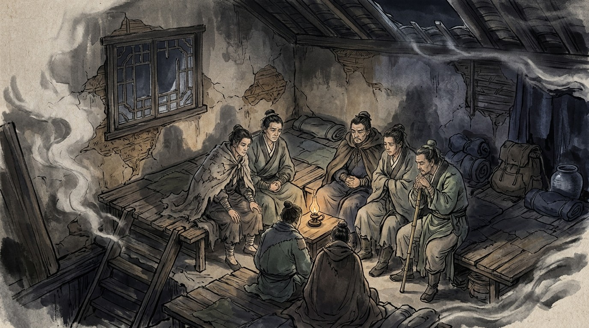
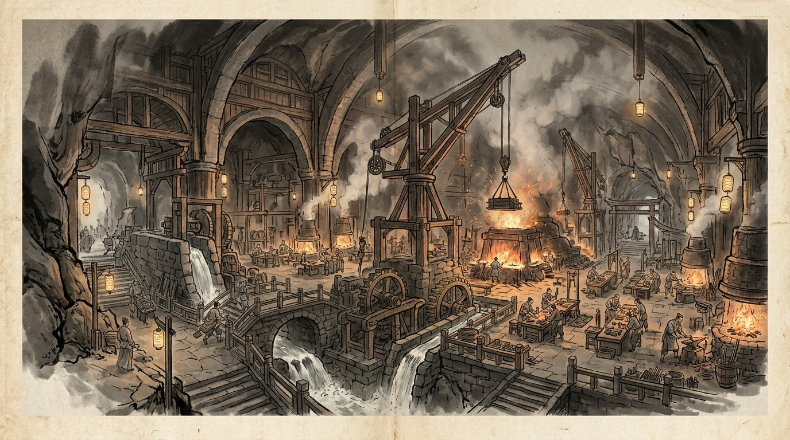

# 第 46 章：三日通牒・分途之約 (第一幕終章)

[← 上一章](ch0045.md) ｜ [本卷目錄](00_intro.md) ｜ [下一章 →](ch0047.md)

*章首插畫：第 46 章 三日通牒・分途之約 (第一幕終章)*

入夜時分，南關車馬小棧二樓的窄閣樓裡冷得像冰窖。

屋頂瓦縫漏進來的北風帶著整座城池特有的潮濕煤煙氣，將桌心那盞小油燈的火苗壓得矮矮的一豆。牆皮剝落處露出裡頭夾著麥秸的黃土，五張拼在一起的舊木板床佔滿了大半間屋子，地上只剩下一條勉強能轉身的窄縫。

屋裡很安靜，偶爾只有炭盆底下那幾塊半濕的碎炭發出極細微的劈啪聲。

自從踏進南關算起，這已是第三日入夜。外面長街上傳來巡防營鐵靴踏過青石板的脆響，馬蹄聲得得地停在巷口茶棚前，問了幾句保甲冊號，又遠遠地去了。

屋裡的五個人沒有急著去拉門栓。

「把銅板都倒出來吧。」沈泥盤腿坐在吱呀作響的木板沿上，最先解開腰間那隻油膩的布袋，往桌面上嘩啦一聲抖出十幾枚泛青帶泥的銅錢。

幾個少年累了一整天，眼皮都有些發沉。聽了這話，各自伸手進懷裡摸索。

林鐵生用完好的左手從圍裙內袋裡掏出四枚；顧玄從藥簍底層摸出六枚沾著乾草碎屑的；燕隼一言不發，把獵襖內袋僅剩的八枚碎錢拍在桌上，指節上還留著白日扛石袋磨破的紅印；柳清虛則從青布道袍袖口摸出兩枚，加上一枚用黃紙包著、邊角被咬掉一點的乾饃饃。

沈泥伸出兩根沾著薄墨的細指頭，在油燈昏黃的影子下把潮濕的銅錢一枚枚撥開，嘴裡極快地念著數：

「開元通寶二十七枚，剪邊劣錢五枚——按城南飯鋪折半算，湊夠兩枚半。一共二十九文半。」

她抬眼瞥了瞥角落裡那口歪斜的泥火爐：「剛在樓下跟店夥計賒了半壺冷水，白菜湯一鍋要八文，兩碗糙米乾飯十二文，剩下的九文……給燈盞添半杯豆油，明兒早上還能買四個冷饅頭。」

「火沒點著。」林鐵生蹲在炭盆邊，額頭上冒出一層細汗。

他的右手小臂死死綁在夾板和麻布裡吊在胸前，光靠左手拿火鐮撞火石，角度總是不對。連敲了五下，火星子全蹦在了青磚縫裡，差點燙著袖口。

「我來。」燕隼走過去蹲下，沒搶他的火石，只伸出兩根粗硬的手指替他按穩了底下的乾艾草絨。

林鐵生盯著艾絨，左手手腕沉下一寸，重新敲了一下。這回一簇橘紅的火星正正落進草絨心裡，一縷淡青色的煙慢慢升了起來。林鐵生抿著嘴把火石塞回懷裡，順手抓過桌上一雙毛刺刺的竹筷，嘗試著用左手去夾瓷碗裡剛端上來的那根水煮白蘿蔔條，夾了兩回都從筷尖滑落下去，碗沿碰出一聲悶響。

他索性放下筷子，直接拿手抓起半塊乾饃饃啃了兩口。

屋角裡，顧玄面前擺著一隻裂了口的木盆。盆裡盛著半溫的淡鹽水，他將一雙泡得發白起皺的手掌浸在裡頭。指縫和指甲根部全染成了深褐帶黑的藥漬——白日在杏林醫館後院那口大石槽邊，他整整洗了一下午浸過潮水的苦參與生南星，手背上被寒風吹裂了幾道細口子，這會兒一沾鹽水，疼得他指尖微不可察地抽了一下，臉上卻依舊平靜。

「這草汁咬皮肉。」顧玄淡淡說了一句，把雙手從水裡抽出來，在粗布衣角上慢慢擦乾。

「咳……咳咳……」

靠牆坐在草席上的柳清虛忽然偏過頭，掩著嘴低聲咳嗽了兩陣。

那咳聲不算重，吐進帕子裡的卻是一口帶著淡淡黑灰色的濁痰。自進城以來，整座城池裡燒不完的煙煤氣和無處不在的悶濁感一直壓在肺葉上，白日裡他在蒙學塾偏廳整整抄了一天經卷，窗戶不敢開大，墨煙混著煤灰吸進肺裡，這會兒兩邊太陽穴還一跳一跳地脹痛。

沈泥把最後一點熱白菜湯分進五個豁口粗陶碗裡，一人面前推了一碗，然後抓過桌邊那幾枚剛剛捂出點體溫的木牌和布牌，一字排開壓在油燈腳下：

兩面寫著「蒙學塾・抄書償債生員」的白木腰牌；

一面浸過艾草油、刻著小小藥囊紋的「杏林試藥童」木牌；

還有兩面滿是汗泥味的「車馬行・七日短工」粗麻布條。

「總算趕在第三天太陽落山前，把這張死牌換下來了。」沈泥捧著熱陶碗暖手，聲音不高，眉頭卻依舊皺著，「只是那幾個看門的老鬼，眼睛一個比一個毒。」

「學塾門房一瞧見我是個道童打扮，連紙筆都不肯借。」柳清虛接過熱湯抿了一口，總算把喉頭那股乾癢壓下去些，低聲道，「後來沈泥替我在巷口買了半方便宜的宿墨，我當場替陸夫子抄了兩頁《大乾通禮》，才換來這兩塊白木牌子——算上今夜，寬限期共是十四日，合一百六十八個時辰。代價是往後三個月裡，每逢單日清晨得替學塾抄完十卷舊冊。」

「沈泥呢？他們也讓你抄書？」林鐵生咬著饃饃問。

「哪有那麼好說話。」沈泥撇了撇嘴，把湯碗裡的最後一點菜葉撥進嘴裡，「陸夫子嫌我字寫得像狗爬，一腳就把我踹出來了。幸虧我替他磨墨洗硯時順手把架子上積了三年的借書簽條理清了三摞，才算掛了個雜役名頭，混進這一百六十八個時辰的寬限裡。回頭還得去城心當鋪找門路——學塾這地方養不活人，一個銅板都不給。」

顧玄垂眼看著自己腰間那面沾著泥點的杏林木牌：

「杏林醫館比學塾更難進門。城裡藥行認的是師承字據，我走過兩家大藥鋪，夥計聞見我身上帶著山溝泥味，連門檻都不讓踏。」他聲音平緩，指腹輕輕摩挲著木牌邊緣，「後來在白先生門前等了一上午，替他們挑出兩筐混在甘草裡的發霉老柴胡，白先生才點了頭，准我做十日洗藥試藥童——一百二十個時辰。十日之內若考不過採百草分堂的名牒，這塊牌子照樣收回。」

燕隼靠在木板床柱上，目光穿過昏暗的油燈落在自己那面粗麻短工牌上，說話照舊簡短：

「車馬大院那位駱鏢頭，嫌鐵生右手廢了。」

林鐵生悶聲接了一句：「他看不上斷臂的，我就拿左手替他把後院那輛軋偏軸的杉木車楔緊了，一錘到位。那鏢頭這才給了牌子。」

「我扛了兩百斤的青石包繞院走一圈，氣沒喘。」燕隼補了一句，低頭看了眼自己掌心被粗麻繩勒出的血泡，「七日，八十四個時辰。夠了。」

屋裡一時又安靜下來。

十四日一百六十八個時辰，十日一百二十個時辰，七日八十四個時辰。

沒有一個能讓他們安安心心躺下來歇氣的去處。每一塊木牌背後，都是壓得死緊的期限與白日裡吞下去的冷眼。

門外長街上，巡夜的甲士腳步聲「踏、踏、踏」地從客棧窗根底下走了過去。那幾聲沉重的生鐵鎖鏈碰撞聲在夜色裡格外出挑，停在了兩步外的街門前。

五個人同時屏住呼吸，沒有人去摸兵器，只是各自把腰間新換上的行會與學塾牌子捏緊了幾分。

片刻後，巡防營小校在樓下櫃檯瞄了一眼老劉遞上去的五張擔保錄名紙，哼了一聲，帶著隊伍轉身進了隔壁那條更黑的暗巷，馬蹄聲漸行漸遠。

屋裡五人慢慢吐出一口氣。

油燈芯爆出一朵小小的燈花，碗底的白菜湯也徹底涼透了。

「各自藏好黑石鋪帶出來的東西。」沈泥打了個哈欠，眼皮終於垂下來一半，順手把桌上那幾枚剩餘的銅板用破布包好塞進枕頭底下，「鐵生哥和燕隼只有七天工夫，明早天不亮就得往城北、城東去；我跟清虛哥抄完早課也要分頭跑當鋪和城西。」

林鐵生點了點頭，將左手小錘解下來壓在床頭棉絮底下，身子往硬木板上一歪，連被角都沒扯平，呼吸沒過幾息便沉了下去——這十來天從盤木嶺一路修車、扛木、熬夜走過來，這群十六七歲的少年早就累到了骨頭縫裡。

燕隼把蛟骨弓倚在床頭伸手可及的地方，閉上眼睛前只低低說了一聲：「初一、十五，回這兒碰頭。」

「嗯。」顧玄吹熄了桌心那盞只剩半指燈油的小燈。

閣樓裡陷入一片深沉而安靜的黑暗。

窗外仍有城防更鼓在寒夜裡隱隱傳來，但這間窄小潮濕的閣樓裡，五個背井離鄉的少年總算在這座冰冷龐大的城池裡，頭一回安安穩穩地閉上了眼睛。

---

**《遺忘的世界》第二卷第一幕：入城立籍・三日通牒（全八章完）**

---

*場域圖誌：金石府城・百工總會千錘地爐坊*

---

[← 上一章](ch0045.md) ｜ [本卷目錄](00_intro.md) ｜ [下一章 →](ch0047.md)
