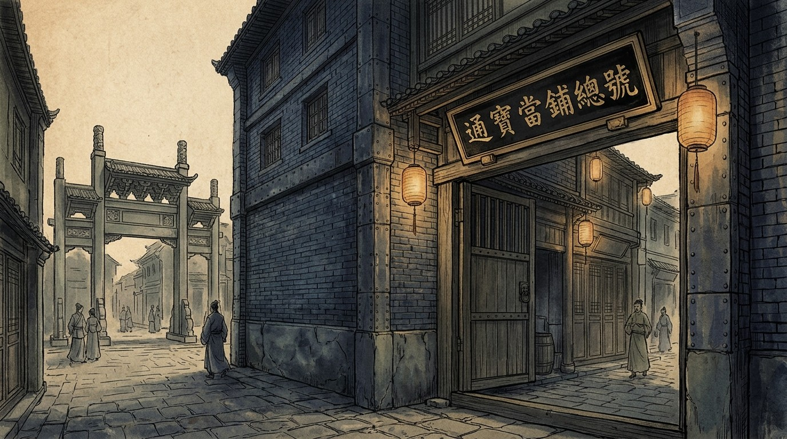

# 第 51 章：舊帳微塵・雲妮之名

[← 上一章](ch0050.md) ｜ [本卷目錄](00_intro.md) ｜ [下一章 →](ch0052.md)

*章首插畫：第 51 章 舊帳微塵・雲妮之名*

金石府城中區與南區交界的四牌樓下，立著一座通體由青磚包鐵皮構築的三層高樓。

門楣上方高懸著一塊黑漆金字的大匾——「通寶當鋪總號」。

大門內側是一排高達六尺、由胳膊粗的生鐵柵欄死死封閉的厚重櫃檯。櫃檯上方只留出三個僅容人頭大小的半圓形窗口，居高臨下地俯視著前來典當借貸的平民與落魄客。

這裡，是整座金石府城世俗市井中，計算人間得失與命運折價最殘酷的地方。

清晨時分，沈泥剛在蒙學塾替塾師陸夫子工工整整抄寫完了三卷《大乾通禮》，換來了學塾在「白鹿青衿生員簿」上的一枚核驗朱印；午後未時，她已然換上了一身俐落的灰布牙人小褂，鑽進了通寶當鋪後院陰暗潮濕的庫房裡。

庫房深處，一名年過六旬、右眼戴著一副單片厚水晶放大鏡的乾癟老者，正手持一桿精巧的小骨秤，仔細稱量著一錠被剪碎的發暗銀角子。

通寶當鋪首席大朝奉——**賈富春**（賈朝奉）。

賈朝奉在金石當鋪界滾打了四十年，人送外號「賈鐵秤」。傳聞這老頭一隻眼能看穿金銀成色，另一隻眼能看穿人的肺腑心腸。

「啪。」

賈朝奉將骨秤隨手扔在案上，眼皮都沒抬一下，乾癟的手指指向身後那堆幾乎快要頂到房樑的發霉木箱：

「小泥子，學塾陸夫子說妳心細如髮，算籌打得比老帳房還精。但當鋪的飯，不是靠念四書五經就能吃得上的。」

賈朝奉自牙縫裡擠出一聲冷笑：

「後院這十二箱，是天興十三年至十五年、也就是十五年前舊商盟遭查抄時，官府查扣轉給咱們總號的『死當爛帳』。」

「那些帳頁被潮氣泡了十五年，字跡發霉，典當人十之七八死在了當年的大火裡。老夫給妳兩天時間——給老子把它們按『金石器物』、『田產地契』與『無主死帳』分揀造冊！」

賈朝奉那隻戴著單片水晶鏡的眼睛，如同老禿鷲般斜斜睨著沈泥：

「這叫『練眼』。」

「要是連死人的帳都理不順，就別想在老夫手裡拿到通寶行的【掛名牙人信印】！」

「得嘞，朝奉爺您瞧好。」

沈泥脆生生應了一聲，臉上掛著市井底層最標準的討喜笑容，沒有半點嬌氣，挽起袖子便蹲在了發霉的木箱旁。

十六年來，她在黑石鋪垃圾堆裡翻找過無數殘羹冷炙，這點陳年霉味對她而言連給她撓癢癢都不夠。

沈泥自懷中掏出一柄精巧的小竹刮刀、一塊乾棉布與一盒自醫館顧玄那裡順來的防腐樟腦粉。

她小心翼翼地掀開第一隻木箱。

刺鼻的霉菌灰塵撲面而來，沈泥用竹刀輕輕挑開粘連在一起的泛黃羊皮紙與生宣帳頁，手指快如穿梭，將一張張脆如蟬翼的殘破當票分類碼放。

在沈泥那雙看慣了市井斤兩的眼眸中，這些發黃的爛帳根本不是廢紙。

每一張當票背後，皆記錄著十五年前那場席捲西南的滔天血雨——

「天興十四年三月，金石商會前身舊商盟執事周氏，質押祖傳赤銅香爐一尊，當銀十二兩，三月後絕當，備注：全家失蹤。」

「天興十四年六月，濁水採藥幫副舵主，質押蛇皮百草圖半卷，當銀三十兩，未贖，備注：死於黑水埗械鬥。」

然而，枯燥的分揀遠沒有想像中那般輕鬆。

整整三個時辰過去，庫房裡連半點風都不透。陳年霉粉混著樟腦味直往鼻腔裡鑽，嗆得沈泥太陽穴突突直跳，早起在蒙學塾抄了三卷書的右手腕更是酸得連竹刮刀都快捏不住。第六隻木箱裡全是蟲蛀成碎渣的鹽引廢票，她趴在地上對著油燈一頁頁拼了大半個時辰，揉了十幾次酸澀流淚的眼睛，拼出來的卻全是些早已斷了根的油鹽爛帳。

直到夕陽的餘暉透過庫房高處的狹窄氣窗灑落進來，沈泥才揉著僵硬發麻的後腰，挪到了第七隻最沉重、通體用厚牛皮包邊的樟木大箱前。

這隻箱子底部沉積著一層厚厚的乾枯泥漿，顯然當年曾被浸泡在運河深水之中。

沈泥用竹刀輕輕撥開一卷發黑結塊的生絹帳頁。

突然！

沈泥的手指猛地僵住了！

她的呼吸在剎那間徹底屏住，渾身的血液彷彿在一瞬間直衝頭頂！

在那卷殘破生絹的折疊處，露出了半行被泥水浸染得略顯模糊、卻依然依稀可辨的小楷墨跡——

*【大乾天興十四年，秋九月十四日，總號死當錄第七宗】*
*【質押人】：行商沈氏（自濁水黑水埗攜眷赴金石府城避難）。*
*【質當物】：前朝青金雲紋長命鎖一事（連斷裂生玉佩一角），刻印『沈氏長女』字樣。*
*【隨行備注】：同行幼女，年不及歲，襁褓啼哭，乳名喚作……**『雲妮』**。*
*【當期與本金】：典當通寶雪花銀八十兩，約定百日取贖。*
*【處置結果】：天興十四年冬十月，沈氏商隊於城南運河遭遇暴徒截殺翻船，人皆下落不明；質物封存總堂密室，息未清，入死帳。*

雲妮！

沈氏行商……隨行幼女……乳名雲妮！

沈泥的右手瘋狂地顫抖起來，她下意識地將手掌探進了自己內襯最深處。

指尖隔著單薄的棉布，死死握住了那枚貼身藏了十五年、邊緣殘破、背面隱隱雕刻著「沈雲妮」三個模糊小字的嬰兒玉佩！

那是她記事起便貼身拴在破襖內襯裡的東西！

莫三從來沒跟她講清過這塊玉佩的來歷，每回她問起，那老瘸子總是灌一口劣酒、抓著蝨子罵一句「路邊野狗堆裡撿來的賠錢貨，問那麼多作甚」，卻又在每年冬至夜裡偷偷對著柴房火苗發呆。

淚水毫無預兆地湧上了沈泥的眼眶。

十五年了！

在黑石鋪的爛泥溝裡，所有人都喊她「泥丫頭」、「小叫花子」、「沒爹沒娘的小野種」；她一直以為自己這輩子就是一截爛在黑石鋪後巷裡的泥巴！

而今天，在這座冰冷陰暗的當鋪庫房裡，在這張沾滿泥漿的舊帳頁上，她第一次真真切切地看到了那個名字！

卻也在同一瞬間，感到了一股從腳底板直竄後脊背的徹骨寒意與抗拒——

「沈雲妮……」

沈泥蹲在陰暗的木箱夾縫裡，死死咬著嘴唇，直到口腔裡漫開一股鐵鏽般的血腥味。她心裡湧起的不是什麼「原來我是富商千金」的狂喜，而是一種近乎本能的恐懼與疏離：那個在襁褓裡哭啼的「沈雲妮」，早在十五年前城南運河的血水裡就該死了；在黑石鋪泔水桶邊跟野狗搶骨頭、在排沙暗渠裡拿指甲刨泥活下來的，是「沈泥」！

如果她認了這張紙，如果她真去掀開十五年前那場把整支商隊連船帶人吞沒的運河血案……「沈雲妮」這三個字，會不會像一塊千斤巨石一樣，把她好不容易在人間掙出來的這口活氣徹底壓碎？還有莫三——那個在黑石鋪護了她十五年的老瘸子，到底瞞了她多少事？！

好半晌，沈泥才抬起粗糙的衣袖，將眼角那一點還沒掉下來的濕意狠狠擦乾。

老瘸子平日裡教她的市井規矩，在她腦海中冷冷浮現：

*「泥丫頭，記住！在大城裡，單憑一張紙證明不了任何事！」*

*「當鋪的死帳，有的是商人為了避債寫下的假名字，有的是仇家為了釣魚留下的假餌！單憑這一張發霉的死當票，最多只能算個問路的單邊疑竇！」*

*「在沒有第二樁毫不相干的鐵證互相印證之前，誰敢隨便伸手去認死人的名字，骨頭早就被扔在城外餵野狗了！」*

沈泥深吸了一口混著霉味的冷氣，強行將狂跳的心臟按回胸膛深處。

這張帳頁，只能證明十五年前有一個乳名「雲妮」的沈氏幼女曾出現在這座當鋪裡。

至於那個沈氏商隊究竟是哪一號字號、為何在城南運河遭截殺、自己的半塊玉佩是不是那把青金長命鎖上的斷角，乃至昨日在府衙案卷庫裡文承敬案頭壓著的那本「舊商盟查抄名冊」與此有何牽連——在沒有交叉查實之前，她誰也不能信，更不能改口。

她依然是黑石鋪的沈泥。

沈泥動作極其迅速而隱蔽，用隨身的小竹刀將這半張發霉的當票附聯輕輕裁下，疊成極小的一方藏入鞋底夾層，隨後將剩餘帳頁按原樣歸位。

「收拾得怎麼樣了？」

身後傳來沉重的腳步聲。賈朝奉背著雙手，緩緩走進了庫房。

沈泥轉過身來，臉上早已重新掛上市井小廝最標準的討喜笑容，雙手將一本字跡清秀、分類無比嚴謹的登記簿遞了上去：

「朝奉爺，十二箱死帳全理清了！金石器物共計三百二十件，地契四十七份，無主死帳八百一十宗，每一宗的典當年份與原號，皆已用硃砂標明！」

賈朝奉接過帳簿，戴上水晶放大鏡隨手翻閱了十幾頁。

他的手掌微微一頓。

帳目清晰條理分明，連每一筆死當的折價成色與折損年限都算得分毫不差！

「好苗子……」賈朝奉喉嚨裡擠出一聲低沉的讚嘆，深深看了沈泥一眼。

他從袖中掏出一枚寸半大小、由生青銅澆鑄而成、正面刻著一枚古錢與「通寶牙人」四個小字的腰牌，隨手扔給了沈泥：

「拿著。」

「從今日起，妳便是通寶當鋪總號掛名的【初級商貿牙人】！」

賈朝奉面無表情地指了指外頭的大街：

「六縣專材長街的總採辦**程通四海**，正愁手底下缺個腳力麻利的盤口跑腿。拿著牌子去找他，只要妳能在專材集市談成三筆大宗原料盤口……」

賈朝奉那隻獨眼閃爍著精明算計的光芒：

「老夫親自給妳在金石商會商務司立戶入籍！」

「多謝朝奉爺賞識！」

沈泥雙手接過青銅信印，躬身行禮。

信印入手微沉，帶著一股青銅特有的冷硬氣息。

壓在頭頂的流民清剿大限，至此被她親手踏碎！

走出通寶當鋪那扇沉重的鐵皮大門，外頭的夕陽如血。

沈泥將青銅牙人信印掛在腰間，右手隔著胸口的粗布衣衫，摸了摸那枚邊緣割手的殘缺玉佩，卻沒有在街頭露出半點悲戚，只是壓低氈帽，一頭扎進了南城暮色下喧囂的人潮裡。

不管十五年前那條船上發生過什麼，現在活著站在這條街上算帳的人，叫沈泥。

**（第 51 章完）**

---

[← 上一章](ch0050.md) ｜ [本卷目錄](00_intro.md) ｜ [下一章 →](ch0052.md)
