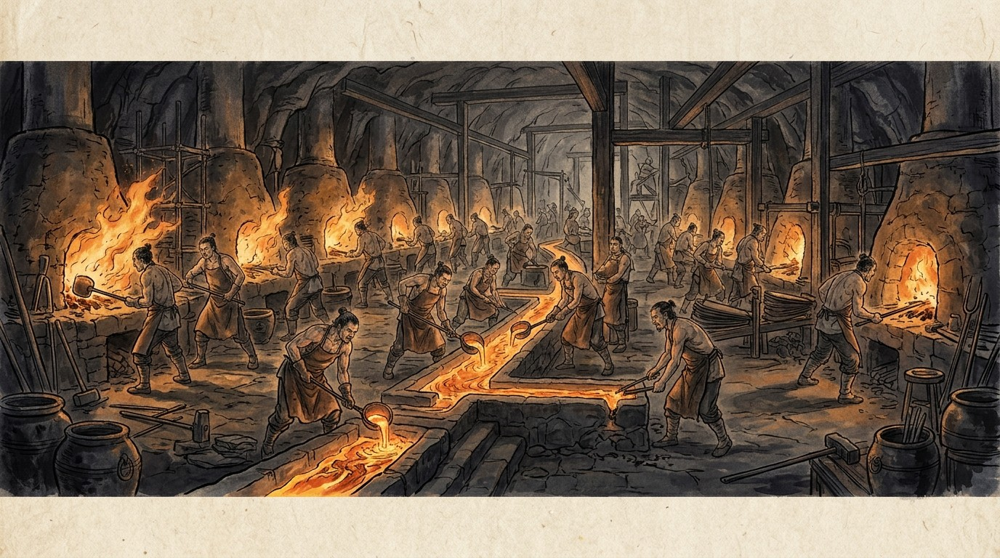

# 第 54 章：地火殘渣・丙字第七

[← 上一章](ch0053.md) ｜ [本卷目錄](00_intro.md) ｜ [下一章 →](ch0055.md)

*章首插畫：第 54 章 地火殘渣・丙字第七*

千錘地爐第三坊的深處，烈焰滔天，熱浪滾滾。

足足三十名身披重革圍裙的百工學徒，正大汗淋漓地圍在十二座巨大的化鐵爐旁，鐵水在溝槽中如赤龍般奔騰咆哮。

而在最深處的一張生鐵檢驗台前，林鐵生赤裸著上身，吊在胸前的右臂用乾淨的麻布緊緊縛死，完好的左手握著一柄冰冷沉重的雙頭精鋼分寸卡尺。

這已經是他熬在檢驗台前的第二個通宵。

兩天兩夜未曾合眼，地爐坊裡的硫磺熱風烤得他嘴唇乾裂起皮，左手虎口與食指內側被冰冷粗糙的生鐵毛坯磨出了三層血泡，血泡破了又被鐵灰糊成黑痂。光是昨天後半夜，他便因為手指酸顫、卡尺滑了半絲，不得不把已經挫磨好的四十多根生鐵銷推倒重測。

此刻，在他面前整整齊齊碼放著五百根散發著幽藍回火光芒的合格機括銷，腳邊廢料筐裡還堆著七十多根被他挑出暗裂與偏心的次品。

「第四百九十九根，直徑二分三厘五毫，誤差零絲半，正品。」

「第五百根，直徑二分三厘五毫，誤差……零絲！」

林鐵生放下卡尺，長長吐出了一口夾雜著鐵屑腥味的灼熱白氣。

在他身側，百工總會大知事鐵尺公手持生鐵長尺，親手拿起最後一根生鐵銷，在水晶放大鏡與標準生鐵規孔中反覆抽插了三次。

規孔嚴絲合縫，光滑無阻！

整整五百根機括銷，由一個右手骨裂、僅憑單手操作的十六歲少年，在兩天兩夜之內全部校準完畢，誤差連千分之一寸都不到！

「神乎其技……」

司匠簿吏方矩站在一旁，拿著硃砂筆的手指微微發顫，滿臉漲得通紅，再也說不出半句譏諷的話來。

「啪！」

鍛造大師莫錘將一塊沉甸甸、通體由純青銅鑄造、正面雕刻著雙錘交錯與司匠印鑑的厚實腰牌，重重拍在了林鐵生胸膛前：

「林鐵生！」

莫錘的大嗓門在地爐穹頂下轟鳴震顫：

「聽聲辨料一百副甲片，火候無一錯漏；左手校準五百根生鐵銷，分毫不差！」

「老子當著百工祖師爺的面，正式授予你百工總會【初級司匠文牒】！」

「從今日起，你便是司匠局在冊正等匠師！全城官私鐵坊任你行走，誰敢扣你流民大帽，老子拿大鐵錘砸爛他的狗頭！」

「多謝莫大師，多謝鐵尺公。」

林鐵生雙手接過青銅腰牌，深深一拜。

腰牌入手冰涼而厚重。

這枚文牒，宣告著他在金石府城的百工世俗秩序中，真正堂堂正正地扎下了第一根鐵樁！

……

當天深夜，地爐坊停火清渣。

按照百工總會的規矩，新晉司匠需輪值清掏爐底積累的「重熔死渣」，以熟悉不同金屬熔液在地火極限高溫下的沉降規律。

林鐵生腰懸青銅司匠牌，手持一桿長達丈許的生鐵耙，順著狹窄濕滑的玄鐵階梯，獨自一人下到了千錘地爐最底層的「排渣暗溝」。

這裡地處城北地下兩丈深處，上方是數十座萬斤高爐的基座，腳下則是一條條散發著刺鼻硫磺與重金屬焦臭的廢渣溝槽。

林鐵生一邊用鐵耙清理著冷卻成黑灰色的生鐵殘渣，一邊用敏銳的目光觀察著四周的磚石結構。

突然，林鐵生手中的鐵耙在暗溝最外側的一處廢棄排煙豎井旁猛地一頓。

借著手中風燈微弱的火光，林鐵生注意到，這處排煙豎井的耐火磚壁呈現出一種極其罕見的暗赤紫色！

尋常生鐵熔煉，爐渣多為灰黑色或墨綠色琉璃質；

但這裡的殘渣……竟然泛著一層宛如凝固血塊般妖異的紫紅光澤，質地沉重無比，甚至連堅硬的耐火磚表面都被高溫生生燒蝕出了一道道深達數寸的蜂窩狀孔洞！

「這是……」

林鐵生心中劇震，迅速扔下鐵耙，蹲下身子。

他從腰間摸出一柄精緻的生鐵小刮刀，小心翼翼地從磚縫深處刮下了一小撮暗紅色的結晶粉末，放在掌心搓了搓。

粉末細膩冰涼，哪怕歷經高溫鍛燒，內部竟然依舊隱隱散發出一種令人心悸的寒煞之氣！

高純度地煞血精滲碳！

這與黑石鋪北崖塌方現場起獲的血紋生礦熔渣……成分完全一模一樣！

這座官府設立的千錘地爐底層，竟然在不久前，秘密熔煉過來自黑石鋪的違禁血精！

林鐵生呼吸急促起來，他舉起風燈，順著排煙豎井的廢棄滑道向內部深處仔細照去。

在滑道最內側一塊尚未被高溫完全燒熔的生鐵翻砂模具殘片上，赫然殘留著半道巴掌大小的凸起印記——

那是三朵精巧繁複的捲雲紋，環繞著兩行清晰冰冷的官鑄正楷小字：

**【金石內造・丙字柒號】**！

轟——！

林鐵生的腦海宛如被萬斤重錘狠狠砸中！

丙字柒號！

這四個字，與當初王周兩家在黑石鋪南谷私逃翻車、自夾層中搜出的那四尊紫銅除渣坩堝上的銘文……連筆鋒的磨損瑕疵都分毫不差！

這批專門用來替黑石鋪盜採血精進行高溫去硫、提純除渣的特種紫銅坩堝，根本不是什麼山野私梟的土造器物！

它們，就是從眼前這座百工總會最高規格的千錘地爐裡，由最頂尖的大師親手翻砂澆鑄出來的官造重器！

「誰在那裡？！」

上方突然傳來一陣急促的腳步聲。

林鐵生眼神如電，沒有絲毫慌亂。他迅速從懷中掏出一張柔軟的生牛皮紙與一塊特製的拓印黑炭條，以驚人的速度覆在那塊模具殘片上，手腕沉穩發力，將【金石內造・丙字柒號】的捲雲暗紋與殘留的熔渣痕跡，完完整整地拓印了下來！

隨後，他將拓片與地火殘渣樣本塞進靴筒深處，抓起鐵耙，若無其事地轉過身來。

來人是司匠簿吏方矩，手提風燈，神色警惕地走下階梯：「林司匠，深更半夜，你在廢滑道旁摸索什麼？」

林鐵生揚了揚手中的鐵耙，神色平靜坦蕩：

「回方大人，爐底第三滑道積渣太厚，堵塞了通風孔，下官正在清理。」

方矩看了一眼乾淨整齊的溝槽，臉色稍緩，但眼神中卻掠過一抹不自然的慌亂，走上前來催促道：

「此處靠近地下古暗渠的洩水閘，地煞陰氣重，不是你該待的地方！清完了趕緊上去，明日還有城防營的戰車要修配。」

林鐵生點了點頭，順著方矩的目光，看了一眼排渣暗溝盡頭那一扇被重重生鐵鎖鏈封死的鐵柵欄門。

在那扇鐵門背後，隱隱傳來了地下暗河湍急的流水聲——那正是通往金石府城地底脈絡最深處的「地下古暗渠樞紐」！

……

回到司匠局值房後，林鐵生借著油燈，將那張拓片與從黑石鋪帶來的坩堝圖樣平鋪在桌上。

捲雲紋的弧度與「丙字柒號」四個字的刀口缺角，分毫不差地咬合在一起。

林鐵生取出一張厚實的麻紙，用左手握著炭筆，一筆一劃寫下簡短卻紮實的匠人記檔：

「千錘地爐第三坊廢滑道，起獲高純度血精滲碳殘渣一包、丙字柒號翻砂模具殘印一紙。與黑石鋪南谷翻車所獲紫銅除渣坩堝同模同源，確係府城百工官爐翻砂所出。」

寫到這裡，林鐵生停下炭筆，看著紙上的拓印，眉頭依然沉穩地鎖著。

這張拓片能釘死「丙字柒號坩堝出自千錘地爐」，讓錢百川日後在公堂上絕沒法把坩堝推給什麼「山野野匠私鑄」；但光憑一塊廢模具和一撮爐渣，還抓不住是誰偷用了地爐模具、又是誰出銀子買走了這批坩堝。

要想把這根鐵釘真正釘進幕後主使的骨頭裡，還得找出那批特級耐火白泥的原始提貨底單，以及商會內堂調撥的真帳。

林鐵生吹乾炭跡，將拓片與爐渣小包妥善收進貼身牛皮囊中。

百工總會的火，已經照亮了這條黑鏈的第一道接口。

---

**（第 54 章完）**

---

[← 上一章](ch0053.md) ｜ [本卷目錄](00_intro.md) ｜ [下一章 →](ch0055.md)
