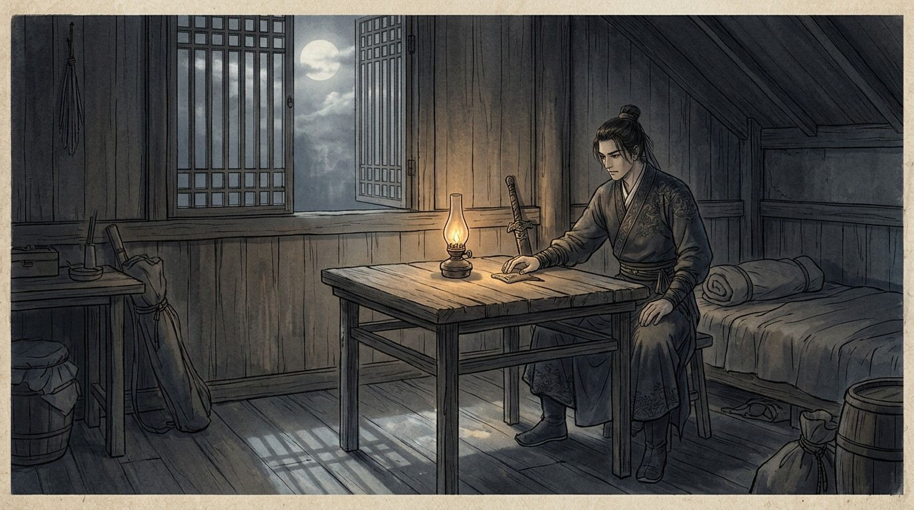

# 第 57 章：暗紋有主・六項缺口 (第二幕終章)

[← 上一章](ch0056.md) ｜ [本卷目錄](00_intro.md) ｜ [下一章 →](ch0058.md)

*章首插畫：第 57 章 暗紋有主・六項缺口 (第二幕終章)*

夜深了。

南關車馬小棧的二樓小閣樓上，一盞昏黃的油燈靜靜燃燒著。

窗外的暴雨早已停歇，清冷的月光穿透薄雲，灑在斑駁的粗木桌面上。

桌案正中央，鋪開了一張整整四尺寬的雪白生宣。

蘇凝霜一身素黑衣裙，青絲用一根白玉簪簡單束起，手持毛筆，在宣紙最上方工工整整寫下了四個朱紅大字——**【會審案櫝】**。

圍坐在桌旁的五位少年，各自將這數日來在城東、城西、城北與市井中用命換來的所有文牒、拓片與物證，逐一擺在了桌面上。

氣氛凝重得宛如三軍陣前。

林鐵生率先伸出左手，將那張自千錘地爐排渣井拓下的【金石內造・丙字柒號】捲雲暗紋拓片，輕輕推到了宣紙左側：

「莫錘大師與方大人已認出，這是三個月前內堂執事錢算子持錢百川手條，委由司匠局秘密澆鑄的三十尊紫銅除渣坩堝。但那一天的『司匠局出庫簽領正本』，半月前已被商會內堂以『年終核帳』為由秘密調走封存。」

燕隼也將兩張生鐵雷管火印的比對圖紙按在桌上，聲音簡短冷硬：

「披甲兵器庫與官禁硝火作的兩張底冊編號一致，但騎縫的『雙聯火印』有半分の錯位。黑石關起獲的三枚連號雷管，是出庫後被人用假存根調包替換的。簽領的孫姓軍需官，三天前剛被調去了北塞邊軍。」

顧玄則將孫先生與白先生聯署的《濁水黑水埗毒理會診公證書》放在中央，輕聲嘆息：

「趙德貴與蘇老會長體內的『地陰腐骨散』確係濁水黑水埗的二次提純之物，半月前內堂也有採辦隊去過濁水。但孫先生說，單憑毒理同源，對方的訟師隨時可以推說是下人私仇或半路掉包。」

全場陷入了短暫的寂靜。

桌面上的物證不可謂不硬：

官造坩堝模具拓片、雷管雙聯錯位火印、毒理同源公證、二十二名老礦工的血手印供詞；

甚至連西水門古石閘的斷軸上，鐵生都檢出了人為摻入烈礬金剛砂的破壞痕跡。

然而，沈泥坐在角落的陰影裡，手中把玩著那枚青銅牙人信印，嘴角卻浮起了一抹極其冷靜的譏誚：

「不夠。」

小姑娘抬起頭來，那雙在市井底層摸爬滾打了十六年的黑眸，比這屋裡的任何人都看得更透徹：

「這些東西，在我們眼裡是鐵證；但在金石府尹秦大人那張明鏡高懸的公案前……全都是旁證！」

沈泥站起身來，拿過蘇凝霜手中的毛筆，在宣紙中央重重畫了一個圈：

「錢百川在金石商會坐了二十年的第二把交椅，他在官府、軍鎮和商會裡養了幾百個替死鬼！」

「若是我們現在拿著這堆東西衝上三方會審庭，他的大狀只需要站出來說三句話：」

「第一，雷管是孫軍需官私自盜賣，與副會長無關；」

「第二，坩堝是趙德貴私下借商會名義委造，內堂不知情；」

「第三，毒藥是濁水私梟流毒，甚至反咬一口是黑石鋪刁民投毒謀害大掌櫃！」

沈泥手裡的毛筆在宣紙上重重一點，墨汁迸濺：

「到了那個時候，秦正明為了維持金石城邦的五方平衡，只會當場把胡德海和趙德貴斬首結案，把所有的罪名扣在這兩個死人頭上！而錢百川……他依然會坐在總堂的太師椅上，戴著他的金蓮戒指，舒舒服服地當他的第一大掌櫃！」

蘇凝霜握著筆架的指節驟然泛白。她低頭看著宣紙上那滴暈開的黑墨，彷彿又看到父親臨終前枯瘦焦黑的手指死死抓著帳冊卻發不出半點聲音的模樣。她曾在總堂的錦衣玉食裡以為商會是講規矩的地方，直到父親暴斃、內堂長老一個個冷眼旁觀，她才看清那座朱門高院底下全是吃人的暗流。

她緩緩閉了閉眼，再睜開時，眼底的脆弱與惶然已化作徹骨的冷硬：

「沈泥說得對。拔樹，必須斷其根！我們現在缺的……是能將錢百川本人與這條利益鏈死死釘在一起的【閉環死證】！」

「六項缺口。」

柳清虛忽然平靜地開了口。

少年道童伸出修長的手指，依循道門陰陽推衍之理，在生宣的空白處，條分縷析地劃出了六道橫線：

「要想在三方會審庭上徹底定死錢百川，我們必須集齊這**六項關鍵證據缺口**：」

「其一：**【濁水毒囊出貨單】**！必須前往東南濁水縣黑水埗，起獲當年毒坊賣給商會內堂專用採辦隊的原始買賣字據，坐實毒源由內堂採辦！」

「其二：**【烈礬耐火泥採辦存根】**！前往東麓烈礬縣地火堡，查獲商會內堂向私爐供應特級耐火泥的調撥底單，徹底封死丙字柒號坩堝的推諉空間！」

「其三：**【鎮風邊防走山令】**！燕隼的大伯燕山五年前持走山令入外荒失蹤，那支隊伍正是由商會內堂出資！查出衛所舊檔，方能查清他們盜採地煞血精的最早源頭！」

「其四：**【重石條石暗帳】**！重石縣穿山寨私採花崗岩修築地下暗渠私爐，必有夾帶私銀的對沖暗帳！」

「其五：**【商會天字一號密室正底單】**！錢百川親手蓋上金蓮環刀印的總堂交割正底單，必然藏在蘇老會長遺留的一號密室深處！必須取得這份正底單，才能鎖定主謀身份！」

「其六：**【趙德貴之親筆口供】**！顧玄需盡快醫好趙德貴受損的聲帶，或由周捕頭公證，取下他蘸血寫下的完整供狀！」

字字如鐵！

整整六項證據缺口，如同一柄出鞘的利刃，將錢百川精心構築了二十年的防禦壁壘，剖開得淋漓盡致！

「這座城裡的迷局，在城內解不開。」

顧玄背負藥簍，眼神深邃得宛如深山寒潭：

「毒在濁水，火在烈礬，令在鎮風，石在重石。」

「錢百川的根鬚扎在周圍的六大次級縣城之中；要想掀開這座都城的鐵幕，我們就必須踏出四關，把這六條暗線一條一條生生拽出來！」

林鐵生左手提起小鍛錘，嘴角揚起一抹堅毅的弧度：「千錘地爐的考核我已經過了，莫錘大師答應替我向百工總會請出一張『巡察六縣工坊出巡令』！」

燕隼按著腰間的黑鐵令：「鎮武軍北關防線換防，岳都尉正要派一支精銳斥候巡查鎮風衛所，我拿下了第一把交椅！」

沈泥嘿嘿一笑，拍了拍腰間的牙人信印：「通寶當鋪的賈朝奉給了我三張前往外縣調度大宗專材的商業信照，正愁沒人陪我去呢！」

柳清虛打了一個稽首，神色淡然：「宣道司三日後發放度牒，我亦領命赴青河古道勘測天時水脈。」

五位少年再次相視一笑。

這一次，他們的眼神中不再有初出黑石時的茫然，也沒有了三日前在南關小棧立約時的沉重。

五印在手，各司其職！

匠籍、藥師、護衛、牙人、度牒！

他們已經擁有了足夠堂堂正正行走在陽光之下、調閱官府文卷、踏足六縣關隘的世俗憑依！

「啪！」

蘇凝霜將毛筆重重擱在筆架之上，美眸中淚光閃爍，卻無比驕傲地看著眼前的五位生死同袍：

「諸位兄弟，凝霜在金石府城總堂……等你們凱旋歸來！」

「到了三方會審開庭之日——」

「我們六人，親手為這座都城……重定乾坤！」

晨光破曉。

金石府城的四座巍峨城門，在沉悶悠長的號角聲中緩緩開啟。

五位少年各攜行囊，迎著浩蕩的晨曦，分別踏上了通往大荒東南西北六大次級縣城的古老驛道！

長風萬里，雷動九霄；

金石風雲正盛，大荒龍蛇起陸！

---

**《遺忘的世界》第二卷第二幕：分途立業・五方立籍（第四十七至五十七章・完）**

---

[← 上一章](ch0056.md) ｜ [本卷目錄](00_intro.md) ｜ [下一章 →](ch0058.md)
