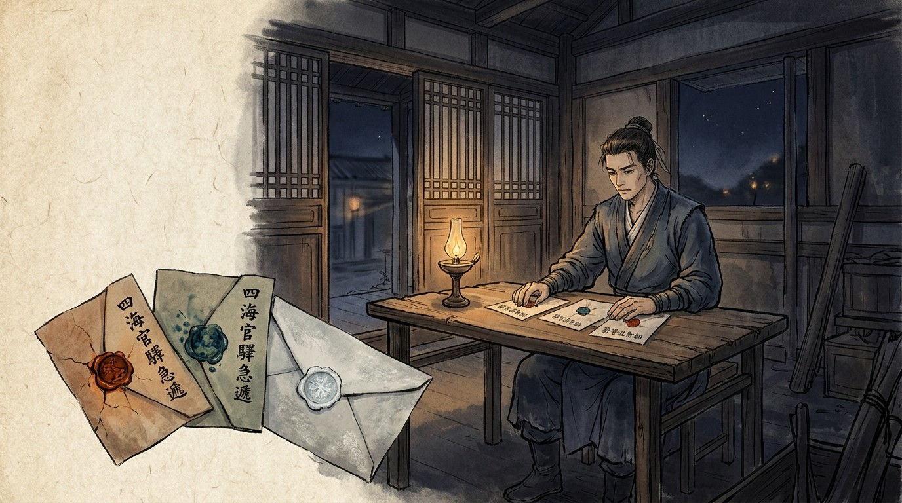

# 第 60 章：九城藥材・三路急信與各有各的難

[← 上一章](ch0059.md) ｜ [本卷目錄](00_intro.md) ｜ [下一章 →](ch0061.md)

*章首插畫：第 60 章 九城藥材・三路急信與各有各的難*

夜幕降臨，青河縣官設驛館二樓的油燈在穿堂風中撲朔微顫。

顧玄坐在簡陋的杉木公案前，面前攤開著三封由「四海官驛急遞」剛剛送達的加急信件。信封上蓋著不同顏色的火漆印記，散發著大荒東南西北各異的氣息——烈礬的硫磺焦土、濁水的潮濕魚腥，以及北塞風沙的冷冽霜雪。

桌案中央，放著一張由顧玄親筆繪製的【金石府六縣藥材流向與市價對照單】。

這便是整個金石六縣眼下最真實、也最殘酷的面貌。

初出黑石鋪時，少年們以為只要手握銀兩與路引，便能如尋常行商般在各大藥市買齊黑石鋪急需的「避煞救命藥材」。然而，當他們真正分散到六大次級縣城的鄉野市集，才發現離了府城十幾日，每一座縣城都早已被各自的困局死死鎖住。

顧玄展開第一封信。信紙粗糙厚重，那是產自烈礬縣的灰黃麻紙，字跡歪歪斜斜，顯然是林鐵生用粗大的左手握筆極力寫下的：

> *「顧玄兄弟：*  
> *老子剛摸進烈礬縣地界，前頭便是紅砂坳。還沒進礦區，就先聞見一股嗆人的硫磺臭！沿路聽逃出來的窯工說，這幾個月下頭地火愈發反常，好些爐坊都在減爐熄火，大夥手腳胸背被火毒燎得潰爛一片。本地藥鋪裡的清心散、甘草和降火石膏，早就被礦工們當成保命根子攥著，哪怕砸雙倍雪花銀也買不到半錢！*  
> *但莫慌！老子前日途經東線岔口，撞見盤木縣下來拉料的老木匠，便掏出前番在盤木天車絞盤救險換來的那面『盤木大木作工牌』去通融，硬是從他們採伐公庫裡替你換出了五十斤年份極好的【赤松茯苓】！盤木縣那邊如今被獸潮餘患逼得縮回次生林，早就嫌府城銀票不頂事，只認自家百工的『木作抵帳籌』。這批茯苓已經託驛馬先發去青河，切記接應！」*

顧玄輕輕撫摸著隨信附帶的一小塊赤松茯苓切片，指尖微顫。鐵生沒有用蠻力硬搶，而是懂得拿手藝換來的信物在規矩夾縫裡以物易物。

他放下鐵生的信，拆開了第二封。信紙輕薄如蟬翼，邊角沾著淡淡的潮氣與苦澀灰味，是沈泥剛抵濁水縣便託快馬寄出的密函：

> *「顧玄：*  
> *我與老牙人方平斗剛進黑水埗。這鬼地方比府城傳聞還要爛上十倍！淘金幫為了洗金砂，日夜往河道裡倒水銀與生綠礬，整座高腳浮橋底下泛著黑油光，岸邊死魚臭鳥堆成半尺高。這座縣城大半平民的井水全被毒水滲透，碼頭苦力與漁夫個個手腳發抖、身上起爛瘡。*  
> *通寶濁水分號被一幫討債漢子堵死大門，根本無人收兌銀票；街上連最尋常的防腐艾草都被炒到了八十文一斤，本地藥行閉門歇業，別指望從濁水買出半錢藥草回去了。*  
> *那老牙人方平斗一路攛掇我去高腳水樓裡買什麼線索單據，手裡卻攥得極緊、眼神飄忽，這趟水怕是渾得很。我自會留神，你在青河自己小心。」*

顧玄捏著信紙的手指微微收緊，眉宇間浮出一層陰翳。

沈泥那邊連落腳都未穩，便已嗅到了暗巷裡的殺機。

他深吸一口氣，展開了第三封來自北塞方向、字跡清峻而紙角微微捲曲的書信。那是柳清虛與燕隼合寫的便箋：

> *「顧道兄如晤：*  
> *貧道與燕兄弟已近鎮風縣境，再往前數十里便是天風谷口。連日北風刮面如刀，沿途聽逃難散人與過往軍卒言及，北塞邊軍已拖欠兩月冬餉，衛所糧草告急，連鷹嘴崖出產的石英與各家草藥都被軍屯強徵八成抵餉。塞外雪狼近來頻頻躁動，北塞防風定煞之川芎、蒼朮早被巡防營劃為列管軍需，民間一兩難求。*  
> *前路谷口聽聞已有大批採石散人堵門爭執，貧道與燕兄弟正趕赴營前查探。北塞草藥一時恐難大宗入手，望道兄在青河另作籌謀。」*

三封急信，四方困局。

青河截水漲價、烈礬火毒減爐、盤木只認木作抵帳籌、濁水水銀爛瘡與閉市、鎮風軍管封鎖。

顧玄閉上雙眼，靠在微涼的木椅背上。

如果他只是一個尋常採藥童，此刻早已被這幅龐大而絕望的死局徹底壓垮。他沒有無窮無盡的銀兩，沒有調兵遣將的虎符，這片天地也絕不會因為幾個少年的悲憫，就停下各自崩壞的腳步。

「救急……不救窮。」

顧玄猛然睜開雙眸，目光澄澈如寒潭古井。

想一口氣按平價買齊各縣良藥，本就是異想天開。六縣各有各的難處，各有各的底線；想讓對方交出救命的藥，就必須先替對方解開眼前最迫切的死結。

他霍然起身，提筆在白麻紙上疾書。

他不打算在青河藥市硬搶那被炒到一百四十文的乾洗靈草。他依據在黑石鋪葛半仙處學到的民間偏方，結合白先生傳授的《神農本草析理》，迅速擬定了一張全新的【次級替代分調方】：

1. **以青河次級苦參替代高價洗靈草**：苦參性極寒，雖傷脾胃，但若佐以林鐵生自盤木換來的五十斤「赤松茯苓」，便能以茯苓的甘溫健脾化解苦參之燥烈，其清解地脈濁煞的藥效，絲毫不遜於昂貴的道地洗靈草！
2. **分批調劑，精準救急**：放棄大宗成噸購買，改為向青河各小藥農零散收購被商會判定為「不合規格」的次等碎草，既替底層藥農解了燃眉之急，又避開了商會的價格封鎖！
3. **撬動上游道觀**：顧玄從懷中取出了百草堂孫先生在出發前親手簽發的【採百草分堂執照公函】與一包自府城帶來的極品「透骨龍涎香」。青河靈植道觀截水，是為了培植進貢宣道司的定神靈竹；而靈竹結筍最忌根系積酸，孫先生的公函中正好有破除竹根積酸的秘法！

天光破曉。

青河靈植道觀朱紅的大門前，顧玄長身直立。

經過兩個時辰的激烈交涉，道觀執事道長手握孫先生的秘法竹簡與龍涎香，神色複雜地看著眼前的清瘦少年，終於在會商公文上重重蓋下了道觀的大印：

「宣道司百藥門既有法旨……貧道今日便開中閘放水三個時辰！百草坪藥農可得春灌活水；道觀藥圃亦可先行墊付三成洗靈草鮮品，由小先生按官定八十文平價起運！」

轟隆隆！

沉寂了二十日的青河水閘轟然抬起！奔騰咆哮的大江活水如一條銀龍，咆哮著衝向下游乾涸的百草坪與蘆花渡！

「水來了！開閘了！」

「活了！草苗活了啊！」

晨曦中，數千名藥農丟下扁擔跪地狂呼，奔流的春水滋潤著龜裂的黑土，枯萎的洗靈草在水霧中重新舒展出翠綠的生機！

而在青河縣官驛門前，由顧玄親自驗收、蓋有青河道觀大印與百草堂火漆封條的十二隻大木藥箱，整整齊齊裝上了北上的急遞快馬。

望著絕塵而去的驛馬煙塵，顧玄長長吐出了一口白氣。

寄往黑石鋪的救命藥箱，終於衝破了重重封鎖，正式發出！

然而，顧玄的眉頭卻沒有絲毫放鬆。他低頭看著案上攤開的那三封書信與一紙藥價對照單——青河道觀截水、烈礬減爐、濁水封行、鎮風欠餉……看似散在四方的災難，偏偏在同一段日子裡齊齊繃緊了弦。

「不知鐵生他們幾個……在各縣裡究竟撞上了什麼。」

顧玄吹熄油燈，迎著清晨冷冽的水霧大步踏出驛館，背影挺拔如竹。

---

**（第 60 章完・待續）**

---

[← 上一章](ch0059.md) ｜ [本卷目錄](00_intro.md) ｜ [下一章 →](ch0061.md)
