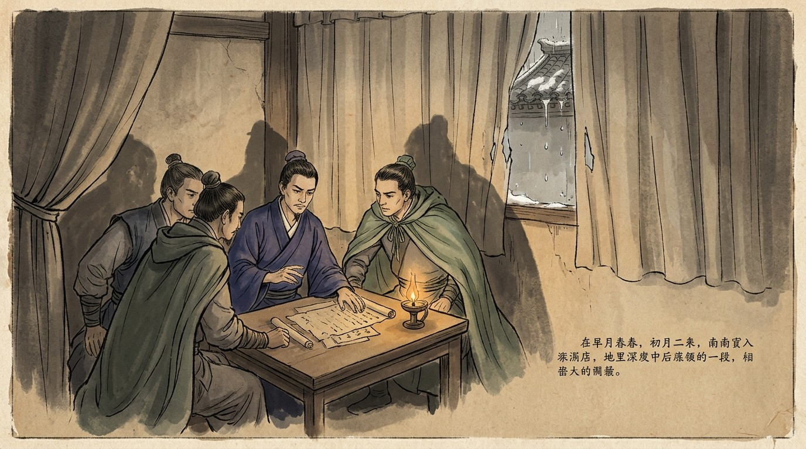

# 第 67 章：歸途匯流・證據成鏈與凍結反擊

[← 上一章](ch0066.md) ｜ [本卷目錄](00_intro.md) ｜ [下一章 →](ch0068.md)

*章首插畫：第 67 章 歸途匯流・證據成鏈與凍結反擊*

早春二月，金石府城的殘雪在房簷瓦當間悄然融化，滴落成一道道冰涼刺骨的細流。

南關車馬小棧後院的一間隱蔽客房內，厚重的棉布窗簾被拉得嚴嚴實實，桌上一盞菜油燈散發著昏黃的光暈，將圍坐在一起的幾道身影拉得極長。

四路人馬，歷時半月，終於全數回抵府城！

顧玄風塵僕僕，青布藥囊上沾滿了青河的蘆花水草與泥漿，但他帶回了整整十二大箱救命藥材與青河靈植道觀的親筆批函；

柳清虛的道袍下擺被天風谷的烈風撕開了幾道口子，燕隼的皮甲上還殘留著狼血乾涸後的暗紅斑塊，兩人將四枚晶瑩剔透的極品風蝕石英核與那半枚刻有大伯箭記的玄鐵走山令殘牌穩穩放在桌上；

林鐵生渾身散發著地火爐的焦炭味與重石採石場的石粉氣息，他的手掌布滿了新結的血痂，身側放著蓋有商會內堂金蓮環刀印的特級耐火白泥出貨單，以及穿山寨少工頭杜小山用鮮血畫押的「抽減北崖三成鐵木支護」秘密指令拓本；

而沈泥安靜地坐在角落裡，身形依舊纖瘦，但那一雙眸子卻比出發前更加幽深如寒潭。

「嘩啦。」

蘇凝霜一身素白孝服，披著一件灰黑色的不起眼斗篷，推門而入。她為了避開總堂護衛的耳目，是從後巷翻牆進來的，絕美的容顏上帶著幾分疲憊，但眼眸中卻燃燒著決然的烈焰。

「凝霜姐！」五人齊齊起身。

蘇凝霜擺了擺手，示意大家坐下。她快步走到桌案前，目光在眾人帶回的一件件物證上逐一掠過，呼吸不由自主地微微顫抖。

桌案正中央，鋪開了一張巨大的白麻紙。

沈泥提起炭筆，將這半個月來跨越六縣數千里帶回的四樣核心鐵證，一字排開擺在麻紙之上：

左首是沾著綠礬毒汁的**【濁水黑水埗・劇毒交割底單】**，直接坐實商會後勤房在事發前調撥六十斤高純度地陰腐骨散混入黑石關犒軍鹹肉，與蘇遠山中毒殘留、趙德貴嘔吐物三方互鎖；

次席是蓋有內堂金蓮環刀印的**【烈礬地火堡・特級耐火泥出貨單】**，三萬斤私爐耐火白泥的去向與黑石鋪【丙字柒號】坩堝完全吻合；

第三件是燕隼從沙暴死士手裡奪回的**【鎮風邊防衛所・出關舊檔與走山令殘牌】**，證實五年前正是商會內堂出資三萬兩組建勘探隊，誘使大伯燕山深入外荒探明北崖血精礦脈；

最右側則是杜小山按了血手印的**【重石穿山寨・抽減鐵木指令拓本】**，揭開了礦難前兩個月內堂強令抽走北崖古礦三成沉陰鐵木支護、換成白蟻爛木的蓄意謀殺！

「六項證據缺口……我們已經補齊了整整四項！」顧玄凝視著桌上的四份鐵證，清秀的臉龐上湧現出激動的潮紅，「毒藥、坩堝、盜採預謀、塌方黑手……全都被釘死了！」

「但還不夠。」

沈泥平靜地開口，聲音不大，卻如同寒冰落入沸水，讓屋內的狂熱瞬間降溫。

她指著麻紙最後空出的兩格，冷靜地道：

「錢百川是坐在金石商會常務長老位置上整整二十年的老狐狸。這四份證據，足以在輿論上讓他身敗名裂，但在三方會審庭上，他依然可以推給已死的趙德貴、推給管後勤的執事、推給前線工頭擅作主張，說自己『失察』而非『主謀』！」

「要徹底扳倒他，讓他連壯士斷腕的機會都沒有，我們還缺最後兩塊最致命的拼圖——」

「第一，軍器局與硝火作調撥特種雷管的【雙聯火印申領存根】，證明炸毀北崖的雷管批號直接出自內堂長老親手簽押；」

「第二，商會總堂地下『天字一號密室』內，那份記錄著三十年來所有見不得光交易的【總堂交割正底單】！」

屋內頓時一片肅靜。

燕隼眉頭緊鎖，低沉道：「軍器局的雷管存根我可以想辦法。我是八方武館黑鐵護衛，又是巡防協查使，可以藉由兵器庫校驗軍械的由頭，讓石老兵與霸山將軍的親兵幫忙調檔。但商會總堂的天字一號密室……那是龍潭虎穴，四周全是由重石花崗岩堆砌的死牆，只有一道萬斤玄鐵重門，根本不可能強攻！」

蘇凝霜神色黯然，苦澀地道：「那座密室……連我都沒有進去過。父親在世時曾說過，天字一號密室設在府城古暗渠最深處，外層是三道暗鎖保險櫃，內層是前朝舊商盟留下來的子母玄鐵門，尋常鑰匙根本插不進去……」

「我知道怎麼開。」

一道清脆冷靜的聲音忽然打斷了蘇凝霜的話。

所有人齊齊轉頭，震驚地看向沈泥。

沈泥迎著五人驚疑不定的目光，緩緩自頸間解下了那枚殘缺的嬰兒玉佩，隨後又從懷中取出了柯九算親筆抄錄的那份薄薄的油紙——《舊商盟十三行原籍掌理手抄名冊・雲記底單》。

「沈泥，你這是……」林鐵生怔住了。

沈泥沒有絲毫猶豫，將自己的玉佩與手抄名冊輕輕推到了蘇凝霜的面前。

「凝霜姐，各位。」沈泥的聲音平靜無波，但每一個字都重若千鈞，「我不是黑石鋪土生土長的野丫頭。」

「十五年前，黑石嶺有一家因不肯交出商路與秘鑰而被滿門焚殺的舊商號，叫『雲記』。雲記少東沈懷安，有一個未滿周歲的長女，乳名雲妮。」

沈泥指著自己的玉佩，又指了指名冊上的硃砂血記：

「案卷庫的刑部底檔、通寶當鋪的死當陳帳、以及濁水暗渠前朝舊盟老帳房的手抄名冊……三方互鎖證實，我就是沈雲妮。」

「天字一號密室內層的那道子母玄鐵門，不是鎖，而是一道前朝舊商盟的『七星合契子母扣』！外層保險櫃防的是外人，而內層重門，需要當年前朝商盟十三行掌櫃嫡系的信物印信，以特殊的步法與暗勁切換機括，才能開啟！」

「這不是我為了邀功或者博取同情才說出來的秘密。」

沈泥直視著蘇凝霜的眼睛，目光純粹而坦蕩：「既然我們要同生共死，既然我們要去闖那座地底龍潭，我就必須把這張底牌亮給你們看。因為一旦踏入那條暗渠，我們面對的不僅是錢百川，還有十五年前埋葬我全家的滔天血仇！」

屋內陷入了長久的沉寂。

沒有人說話。

林鐵生默默握緊了手中的鍛錘；燕隼的眼中爆發出同仇敵愾的凶光；顧玄輕輕將手搭在沈泥的肩頭，目光溫柔而堅定；柳清虛端正打了一個道門稽首，默然致意。

而蘇凝霜看著那份名冊上「雲記少東沈懷安，妻蘇氏，三十四口俱焚」的硃砂小字，臉色在剎那間褪盡了血色。

她的指尖劇烈顫抖著，彷彿那張薄薄的油紙有千斤之重。作為蘇遠山的女兒、金石商會的大小姐，她比誰都清楚——她這十幾年穿的錦緞、住的深宅、甚至通寶當鋪如今掛著的金字招牌，底下都壓著十五年前雲記被吞併瓜分的帶血商路！

「對不起……」

蘇凝霜的聲音顫抖得不成調，淚水大顆大顆地砸在油紙邊緣。她沒有像高高在上的東家那樣去拍沈泥的肩，而是雙膝一軟，竟在粗木桌前朝著沈泥深深跪拜了下去：

「雲妮……父親臨終前拉著我的手，反覆念著『對不起雲記、對不起沈兄』……我那時以為他只是病中囈語，直到今天我才知道，蘇家欠你的，是整整三十四條人命的沈默！」

沈泥心頭劇震，連忙伸出那雙生滿凍瘡老繭的小手，死死托住了蘇凝霜的雙臂：「凝霜姐，你別這樣！十五年前你也只是個孩子，蘇伯父若不是為了查清舊帳、護住最後一線良知，也不會被錢百川下毒害死！」

蘇凝霜反手握住沈泥冰涼粗糙的手掌，將額頭抵在少女單薄的肩頭，壓抑了半個月的悲痛與羞愧在這一刻盡數化作滾燙的淚水：

「這座密室，我陪你闖！哪怕天字一號密室裡翻出來的舊帳會把蘇家最後一點體面也燒得乾乾淨淨……這筆血債，我也陪你一筆一筆討回來！」

就在屋內六人雙手緊握的同一瞬間——

「咚——！咚——！咚——！」

南關大街上，驟然爆發出震耳欲聾的急促銅鑼聲！

伴隨著一陣陣狂暴的馬蹄聲，數十名身披金石商會錦繡武士袍的執法騎士高舉火把掠過長街，尖厲的喝令聲撕裂了寒夜：

「總堂內堂長老會緊急告諭——！六縣押銀鏢車在途遭劫，府城庫銀告急！自明晨起，全面凍結六縣通寶【飛錢】異地匯兌與行會遠期帳期！原通寶掌理蘇凝霜擅調公款、圖謀不軌，即刻革職軟禁，限三日內候審——！」

屋內，蘇凝霜的臉色瞬間一片煞白！

錢百川的反擊來了！他甚至不惜直接砍斷六縣飛錢信用、掀翻整座府城的市井銀根，也要在三方會審之前把蘇凝霜釘死在替罪羊的柱子上！

沈泥緩緩將桌上的名冊與交割單收回懷中，眼眸中沒有絲毫慌亂，反而燃起了一抹極致的森寒與平靜：

「他急了。若不是我們拿回來的鐵證踩中了他的死穴，他絕不敢冒天下之大不韙去凍結飛錢。」

她轉頭看向窗外瞬間喧騰起來的南關長街：

「今夜過後，滿城的飛錢都會變成廢紙。既然他想用銀根擠兌壓垮我們……那我們就在明晨的擠兌風暴與三方會審庭上，把他的老底徹底掀開！」

---

**（第二卷・第三幕完・待續）**

---

[← 上一章](ch0066.md) ｜ [本卷目錄](00_intro.md) ｜ [下一章 →](ch0068.md)
