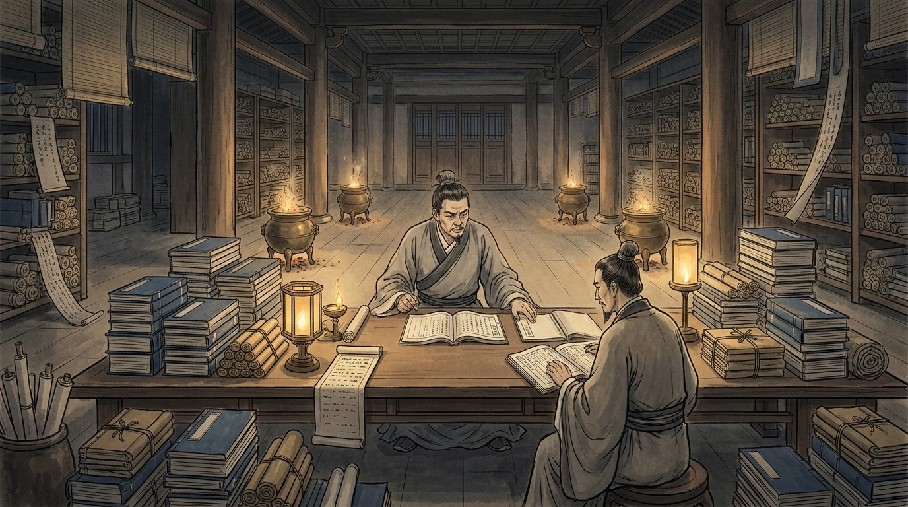

# 第 74 章：會審前夜・雙帳比對與籌碼分層

[← 上一章](ch0073.md) ｜ [本卷目錄](00_intro.md) ｜ [下一章 →](ch0075.md)

*章首插畫：第 74 章 會審前夜・雙帳比對與籌碼分層*

會審前夜，金石府衙案牘總庫的大殿內，燈火通明如晝。

長達丈餘的楠木公案兩側，堆滿了半人高的文卷與公牘。四座黃銅暖爐靜靜燃燒著無煙銀絲炭，卻驅不散空氣中那股令人窒息的決戰肅殺之氣。

五子齊聚，衣衫上猶帶泥水與風霜，但每個人的雙眼，都亮得如同淬火後的百煉精鋼。

而在公案的正中央，案牘主簿**文承敬**親自執筆，將這半個月來跨越六縣數千里、歷經生死起獲的幾宗關鍵鐵證逐一核驗封卷：

西城宣道司玄機真人與百工匠首歐陽大師聯署簽押了【丙字柒號坩堝與地煞晶錠鑑定書】；杏林醫館白先生與百草堂孫先生加蓋了【濁水黑水埗毒囊與松崖驛毒樣同源會診印】；東關督稅官褚嚴移交了與【烈礬耐火泥出貨單】互鎖的私礦生銅扣繳冊；而左參將陳鎮山與北關副將雷震則在【城防軍需雷管雙聯火印申領存根】上親筆用印作保。

四份封卷旁，鋪開著第五份尚未乾透的長卷——《黑石鋪北崖礦坑反鎖、抽減鐵木與蓄意引爆結狀》。

大殿內沒有人說話。

老礦工**魯大山**站在公案前，左肩上還纏著厚厚的滲血粗布。他身後，二十二名從北崖塌方地火中九死一生爬出來的黑石鋪老礦工排成兩列。這些一輩子在千丈地底刨食的漢子，有的缺了兩根手指，有的半邊臉被地火燎成了紫黑色的硬疤，有的拄著粗木拐杖連站都站不直。

魯大山低下頭，看了一眼站在公案左側的林鐵生與顧玄，粗糙的大手在破麻衣上用力擦了三遍，像是怕手上的煤灰弄髒了府衙的白麻紙。隨後，他伸出僅剩半截指甲的右手大拇指，重重按進了那盒鮮紅刺目的官印硃砂泥裡。

「咚。」

第一枚歪斜、粗大、邊緣裂著深口子的血紅指印，按在了結狀的首行。

緊接著，第二個老礦工拄著拐上前，一言不發地按下指印；第三個、第四個……

大殿裡只有粗重如破風箱般的喘息聲，以及一隻隻殘缺粗糙的大手按在麻紙上的沉悶聲響。二十二枚帶著老繭裂紋的紅指印，在燈火下排成了一片泣血的紅雲，連同重石縣杜小山送來的「抽減北崖三成鐵木支護」指令拓本一起，被文承敬鄭重地收進了第五隻火漆封套。

林鐵生站在桌旁，看著那些打小看著自己長大的叔伯手背上的燒傷疤痕，垂在身側的左拳攥得指節泛白；顧玄則默默替最後一名咳嗽不止的老礦工遞上一盞溫熱的潤肺茶，眼底深沉如水。

「五大罪證，皆已封卷入匣。」

文承敬放下狼毫，長長吐出一口濁氣，目光卻無比凝重地望向沈泥與剛剛借著夜色潛入案牘庫的蘇凝霜：

「但是，錢百川眼下手裡還扣著『六縣鏢車遭劫、準備金不足』這張逼宮底牌，正用全城飛錢凍結的恐慌，逼迫秦府尹與商會內堂三老投鼠忌器。明日公堂之上，他必定會拿全城銀根崩盤相要挾！」

就在這時，案牘庫側門處傳來一聲冷硬的通傳。

南關主稅吏**宋算子**身穿洗得發白但漿洗得筆挺的度支公服，手裡捧著一隻上了鉛封的鐵皮公文匣，神色冷峻地邁步入殿。

這位向來鐵面無私、連黑石鋪流民一文錢路引稅都要摳到底的死板稅吏，連看都沒看沈泥與林鐵生一眼，只是依足了官場規矩，朝著文承敬拱手一禮，冷冷開口：

「文主簿，依你案牘庫午後發下的《度支關防調卷傳票》，下官已將天興三十年四月二十三日南關正門的所有重車入城稱重底單、驗銀火耗存根全數封匣帶來。下官醜話說在前頭——南關稅卡只認秤砣與官印，不摻和你們商會內堂的奪權官司。誰若敢在稅單上塗改半個字，下官一樣參他！」

「宋稅吏放心，我們要的，正是你南關稅卡一分一毫都不差的原秤底單！」

沈泥走上前，接過宋算子核驗開鎖後的南關入城稅單存根，又將昨夜從賈朝奉處取得的《通寶總號準備金底冊》與蘇凝霜暗中帶出的《內堂三號大庫夜間調撥暗記》並排合在一處。

宋算子原本冷漠的目光無意間掃過並排的兩頁帳目，臉色猛地一僵。

他死死盯著自己十日前親手批註的那行「官鑄足色條銀入城關防印」，又看了看通寶準備金底冊上的調撥去向，花白的鬍鬚劇烈抽動了一下，重重哼了一聲：

「好一個『鏢車在途遭劫』！把過了老夫南關大秤的足色官銀，當成死帳往自家私庫裡搬，還敢賴在關防馳道頭上！文主簿，這份南關稅單存根，明日公堂之上，老夫親自出庭作證！」

沈泥沒有在殿內多說半句廢話，只是與蘇凝霜相視一眼，親手將這兩份足以在明日公堂上掀翻整座棋盤的對照帳冊，連同剛剛從地下暗渠起獲、滴滿硃砂火漆的【天字一號密室正底單】木匣，一併鎖進了文承敬那隻千斤生鐵卷宗箱內！

「喀噠！」

生鐵重鎖落下。

文承敬撫摸著冰冷的鐵箱，深吸了一口氣，轉身對著府衙正堂方向深深一躬：

「明日辰時三刻，府衙鳴冤大鼓一響，本官將親自掌卷，向金石府尹、鎮武軍鎮、宣道司、百工總會呈遞這隻鐵箱！」

「這場審判，不再是黑石鋪草民向商會老爺討公道。」

文承敬挺直脊樑，一字一頓，擲地有聲：

「而是這座城邦的百萬生民，以法度、以百工、以軍武、以本草之名……對竊據高位二十年的吸血巨蠹，發起的當堂總清算！」

窗外，破曉前的最後一抹黑暗正在無聲退去。

東方的地平線上，一道撕裂蒼穹的金紅色晨曦，正自巍峨的南關城牆之上，磅礴升起！

金石城邦，三方會審——

開庭在即！

---

**（第 74 章完・待續）**

---

[← 上一章](ch0073.md) ｜ [本卷目錄](00_intro.md) ｜ [下一章 →](ch0075.md)
