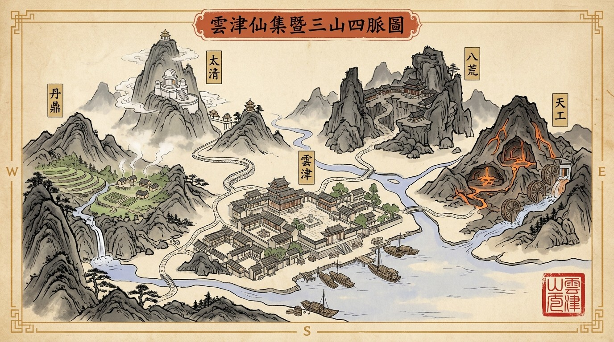

# 第三卷：名山問道・五器開門

> 雲津仙集、三宗暗流、北荒母脈與桃花源單向古陣（第 83–126 章）

*雲津仙集暨三山四脈輿圖*

## 本卷目錄

- [第 83 章：風雪北境・八百里寒原](ch0083.md)
- [第 84 章：雲津仙集・萬山商埠的規矩](ch0084.md)
- [第 85 章：三山開門・仙凡分界線](ch0085.md)
- [第 86 章：千丈登天梯・太清問心鏡](ch0086.md)
- [第 87 章：萬鈞問心谷・煞血試煉場](ch0087.md)
- [第 88 章：千鍛地火廊・萬機拆解考](ch0088.md)
- [第 89 章：百毒試藥谷・生機辨偽考](ch0089.md)
- [第 90 章：泥途立契・五子暗網初成](ch0090.md)
- [第 91 章：藏星秘閣・被篡改的星曆](ch0091.md)
- [第 92 章：坐化真相・紫霄殿後的玉雕長老](ch0092.md)
- [第 93 章：煞血霸體・黑山長城的咳血宿將](ch0093.md)
- [第 94 章：斷崖骨箭・五年前的走山血痕](ch0094.md)
- [第 95 章：萬機地窟・同源的太古黑鐵](ch0095.md)
- [第 96 章：地肺丹火・逆道延命的血爐](ch0096.md)
- [第 97 章：廢丹崖下・道化與血毒的剖脈驗症](ch0097.md)
- [第 98 章：萬山匯兌・無標記經生的尾巴](ch0098.md)
- [第 99 章：風雪夜聚・泥途商棧的五方對帳](ch0099.md)
- [第 100 章：三元互濟・初試剝離道化晶絲](ch0100.md)
- [第 101 章：暗流反撲・延命私盟的警覺](ch0101.md)
- [第 102 章：北荒冬獵・三宗聯合勘探隊](ch0102.md)
- [第 103 章：萬丈凍土・大荒凶獸之威](ch0103.md)
- [第 104 章：走山絕谷・五年前的背叛現場](ch0104.md)
- [第 105 章：荒古戰神遺塚・不屈的血脈共鳴](ch0105.md)
- [第 106 章：地底方舟艙段・北荒破界主陣基](ch0106.md)
- [第 107 章：五件遺物再鳴・太古影像殘篇](ch0107.md)
- [第 108 章：九城銅券合璧・雲記舊約重現](ch0108.md)
- [第 109 章：母脈危機・赤煉長老的瘋狂盜掘](ch0109.md)
- [第 110 章：冰谷伏擊・斬殺滅口私盟執事](ch0110.md)
- [第 111 章：攜證歸山・暴風雨前的寧靜](ch0111.md)
- [第 112 章：雲頂盛會・十年一度的三宗會武](ch0112.md)
- [第 113 章：百工丹器試・不融黑鐵與無瑕清丹](ch0113.md)
- [第 114 章：雲頂演武・破軍重弓對決紫霄神雷](ch0114.md)
- [第 115 章：萬山商戰・靈石期貨與血精斷供](ch0115.md)
- [第 116 章：當眾質證・三十年血債與走山鐵證](ch0116.md)
- [第 117 章：道化驚變・半山晶簇的活體地獄](ch0117.md)
- [第 118 章：北荒破關・內外夾擊的滅頂之災](ch0118.md)
- [第 119 章：五子合擊・三元大陣鎮山河](ch0119.md)
- [第 120 章：名山重整・雲津新約與舊案昭雪](ch0120.md)
- [第 121 章：百草通玄與天工開物](ch0121.md)
- [第 122 章：八荒不滅與紫微破妄](ch0122.md)
- [第 123 章：萬山執牛耳・不入仙門的極境](ch0123.md)
- [第 124 章：天道排斥・滅世劫雲的鎖定](ch0124.md)
- [第 125 章：泥途託付・莫三與故人們的守望](ch0125.md)
- [第 126 章：五件遺物開門・踏入桃花源洞天（第三卷終）](ch0126.md)
