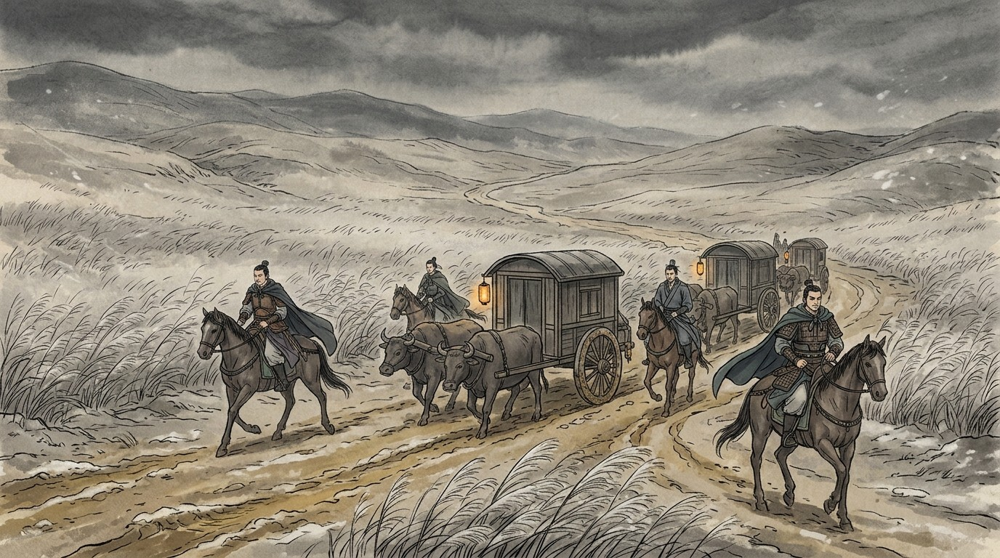

# 第 83 章：風雪北境・八百里寒原

[← 上一章](../02_volume2/ch0082.md) ｜ [本卷目錄](00_intro.md) ｜ [下一章 →](ch0084.md)

*章首插畫：第 83 章 風雪北境・八百里寒原*

離開金石府城北關的第六日午後，天色終於徹底沉了下來。

官道兩側不再是府城外圍成片的秋收麥茬與黃土坡，而是連綿起伏、寸草枯黃的高寒丘陵。枯死的狼尾草在刮過山梁的北風裡伏成一片灰白，車輪碾過漸漸凍硬的黃泥轍印，發出乾澀刺耳的咯吱聲。

從金石府北關到三大名山交匯的雲津仙集，官書上記為八百里。前四百里尚屬初秋尾韻，晝間日頭照在石道上還能曬出一層薄汗；可一旦翻過北境分水嶺、踏入高寒地界，地勢驟然拔高、寒氣直壓下來，節氣彷彿憑空往前推了整整一個月。

「收篷！把油布邊角壓實，雪粒子要下來了！」

車隊領隊穆雪跨坐在一匹四蹄粗壯的北地矮腳駑馬上，扯起羊毛圍脖裹住半張臉。這位四十歲上下的行腳隊女領隊皮膚被長年風霜打磨得像塊老松皮，說話乾脆得不帶半點多餘水分——在金石北關談妥這趟附帶搭夥北上的工價時，她就把車馬折舊、每人每日兩升糙米配額與遇險免責寫進了粗麻紙契，一文錢也不肯含糊。

「穆大姐，前頭那道黑風口怕是不對勁。」

走在隊列最前側的燕隼停下腳步，左手按住背後的重石鐵胎弓，眼神落在路旁一處被風吹開的淺雪窪地裡。他今天沒穿八方武館那身顯眼的黑鐵短打，只罩了件趙老獵寄來的灰狼皮坎肩，腰間掛著剛領到手不過十日的八荒武山考核令。

窪地鬆軟的灰塵上，印著一串梅花狀的足印——掌寬約莫四寸，指尖爪痕收得極淺，後腳幾乎精準落進前腳的印窩裡。足印一路斜切過官道，往西北側那片亂石坡去了。

「二階雪豹，成年公豹，體重在兩百三十斤上下。」燕隼蹲下身，指腹輕輕捻起印緣一撮還沒完全凍僵的浮土，「腳印間距短，步幅不急，不是剛捕食完的飽豹，是在跟著咱們的騾馬味兒吊尾巴。」

幾個牽著馱馬的腳夫頓時臉色發白，下意識往車隊中央縮了縮。

「這畜生要撲人？」一名年輕腳夫攥緊手裡的防身木棍，嗓音發緊。

「還沒。」燕隼站起身，目光往亂石坡上方一掃。灰白的亂石縫隙在陰雲下顯得森冷，幾株枯松歪斜地掛在岩壁上，「雪線剛壓下來，山裡黃羊還沒聚群。它不敢正面衝車陣，在等哪頭馱馬踩滑了蹄子，或者哪個人落了單。」

林鐵生聞言，順手將腰間那根纏了牛皮的熟鐵短棍抽出一寸，又把綁在車轅上的鐵鍊扣了扣，沉聲問燕隼：「要去趕一趕？還是繞過去？」

燕隼盯著那排通往亂石坡的足印，指節微微動了動。那是他大伯燕山當年教過、趙老獵也反覆叮囑過的獵戶老規矩：順著雪豹足印摸上坡頂，往往能看見北荒外圍獸群遷徙的風向，說不定還能順道探一探北方山勢究竟冷到了什麼地步。

「不行。」燕隼還沒開口，走上來的顧玄已經搖了搖頭，背上的青竹藥簍隨著喘息輕輕晃動，「天要落雪了。你離隊去追一頭二階雪豹，萬一驚動了岩縫裡過冬的別種畜生，或者把咱們的體力耗在無謂的追獵上，後面這二十里沒遮沒攔的寒原怎麼走？穆大姐的車隊裡還有三個帶傷的腳夫。」

燕隼沉默了一息。他看向車隊末尾那兩輛吱呀作響的木板車，上面坐著三個裹在破羊皮襖裡直打顫的漢子，嘴唇都已凍得發紫。他沒再堅持，只從箭壺裡抽出一支木桿鳴鏑，搭弓朝著西北亂石坡上空的枯松梢頭拉開半弦——

「咻——啪！」

尖銳的骨哨聲撕裂陰沉的寒風，箭矢精準釘進離雪豹足印三十步外的一塊灰岩縫裡，震落一蓬碎雪與枯松針。下一刻，亂石坡深處隱約閃過一抹灰白色的影子，無聲無息地竄進了更高處的石林。

「它這半個時辰內不會再靠過來。」燕隼收弓，對穆雪點了點頭，「車隊別停，趕在雪落實之前進前頭的石棚驛。」

……

天黑前一個時辰，鵝毛般的早雪終究還是砸了下來。

這並非江南那種軟綿綿的濕雪，而是裹在北風裡的乾硬雪粒，抽在臉上像一把細碎的砂礫。一行人頂著狂風好不容易摸進被廢棄了一半的「斷崖石棚」時，驛站那兩扇用厚柏木釘成的門板早已擠滿了先一步避雪的南下人馬。

火塘邊的空氣混雜著汗臭、濕羊皮的腥羶與劣質松柴的濃煙。

沈泥縮在牆角一捆乾草旁，解開頭上那頂半舊氈帽抖了抖雪水。她拿出一個巴掌大的黑油布本子，借著火塘跳動的微光，一筆一劃記下今日在路上支出的數目——剛才過黑風口時，那名年輕腳夫左腳腳踝凍得發黑失去知覺，險些拖垮整輛貨車的進度。穆雪按行規本打算直接把人留在石棚等後面南歸車隊捎回，是顧玄堅持要救，沈泥便當場掏出八錢碎銀，替那個叫小柱子的腳夫墊付了兩日份的炭火折價與車位貼補。

「一共八錢銀子，外加三兩老薑和半包乾草籽。」沈泥合上本子，壓低聲音對正在火邊烤乾藥包的顧玄道，「穆大姐說得對，這條道上不講交情，連炭火都是按斤算的。我們帶出來的盤纏看著寬裕，真要沿路這麼貼補，還沒到雲津就得先喝西北風。」

顧玄沒有反駁，只把陶罐架在火塘邊緣的石塊上。罐裡滾著沸水，裡頭浮沉著葛半仙臨別時塞給他的幾撮金石野菊花與防瘴草籽，又切了幾片生薑和一點陳皮，淡淡的辛香順著水汽散開，壓過了屋裡難聞的汗味。

「小柱子才十七歲，脚趾還沒徹底壞死，若不趁這兩天把寒毒逼出來，回到金石府也是個殘廢。」顧玄將滾熱的草藥湯倒進粗陶碗，遞過去給縮在草堆裡發抖的腳夫，又摸出兩根細長的銀針，在火苗上燎過，「這份帳記在我們頭上，到了雲津我替你掙回來。」

「不用算這麼清。」柳清虛坐在火塘另一側，正低頭將一塊烤熱的雜麵餅掰成五份。他的道袍下擺已被雪水濺濕了一圈，眉宇間卻比在金石府城時清爽了許多——離開那座籠罩著絕靈法網與紅塵濁氣的都城後，這片雖然酷寒卻稀薄乾淨的天地風氣，反而讓他的神識運轉順暢了不少，「既然上了同一條船，總不能看著同車的人死在路邊。只是顧玄，這味防瘴草籽你省著點用，誰知道往北還會遇上什麼氣候。」

就在這時，火塘對面一處背風的土炕角裡，傳來一陣壓抑不住的悶咳。

那是一名三十五六歲的壯碩漢子，身上穿著一件洗得發白、胸口位置卻留著一塊明顯被撕去徽記痕跡的粗布武服。他身邊蜷著一個裹著棉被的婦人，懷裡還抱著個約莫五六歲的小女孩，正一口一口地咬著冷硬的麥餅。

漢子的右肩袖管空蕩蕩地垂著一半，露出的左手手腕上綁著一圈發黑的粗布條，看那滲出的淡淡暗紫血跡，顯然剛拆過外門傷藥不久。

「兄弟，這碗熱薑菊湯，給孩子暖暖胃吧。」顧玄盛起第二碗藥湯，起身走過去遞給那婦人。

漢子猛地抬起頭，一雙佈滿血絲的眼睛像受傷的孤狼般死死盯著顧玄，直到看清顧玄腰間掛著的杏林醫籍銅牌與背後那隻寒酸的青竹藥簍，緊繃的肩背才緩緩鬆了下來。

「多謝小大夫。」婦人趕忙伸出滿是凍瘡的手接過陶碗，先吹涼了些才餵給孩子。

燕隼的目光卻一直停留在那漢子胸口撕去徽記的位置——那塊針腳的形狀他認得，八方武館的教頭說過，北方八荒武山外門武卒的製式服，左胸口繡的就是一柄雙刃開山斧。

「兄台是從雲津那邊下來的？」燕隼抱著雙臂走近兩步，聲音放得平緩，「看這身架子和服色，莫非是……八荒武山？」

漢子嘴角扯出一抹苦澀的自嘲，伸出完好的左手在火堆邊烤了烤，卻半點暖意也感不到似的：「別提『八荒』兩個字了，晦氣。我叫周鐵山，原本是武山外門黑山營的備補武卒。」

「備補武卒？」林鐵生也抬起頭，「不是說入了外門便能吃宗門糧餉、領煞血丹熬筋骨麼？」

「熬筋骨？」周鐵山冷笑一聲，從懷裡掏出一份捲得皺巴巴的黃紙退籍文書，隨手往火邊一揚又收了回來，「三年前我賣了家裡兩畝薄田，交足了入門的五枚靈石折銀，拼死熬過萬鈞谷才進了黑山營。頭一年確實威風，每月有兩份肉食、半瓶低階行血散。可到了第二年，營裡開始催繳『煞血歲貢』——想進內營學正經功法，要麼每月交三枚下品靈石的香火折銀，要麼領那些沒人敢接的北荒巡哨苦差。」

他頓了頓，垂眼看著自己空蕩蕩的右袖：「去年冬天一場小股雪獸突襲，營頭派我們十個交不出歲貢的外門卒頂在最前頭的塌牆缺口。我的右臂被鐵背荒狼生生咬碎了骨頭，退下來之後，養息院的醫官只給了一貼最便宜的止血灰，說廢了條胳膊不值當浪費靈藥，讓我自己選——要麼去炊事房劈一輩子柴還之前欠的丹藥債，要麼簽字畫押，領十兩銀子遣散費滾下山。」

火塘邊一時安靜得只剩下木柴噼啪爆裂的聲響。

連一向寡言的林鐵生，握著小鍛錘的手指都緊了幾分。

「可我看你左手腕上還綁著紗布，不是舊傷？」顧玄皺眉問道。

「不是我的。」周鐵山扭頭看了一眼角落裡另一個一直低頭沉默的年輕書生模樣男子，「那是陳青，原本在千機百巧門丹鼎宗的外門藥田當雜役學徒。半個月前山裡藥田水脈發酸，管事非要他們這批交不起歲貢的雜役赤手進水溝挖根。他雙手爛得見了骨頭，還被管事扣了半個月工錢賠毀掉的兩株靈草。我們在雲津仙集門口碰上的，索性搭個伴一塊兒往南逃。」

那個叫陳青的年輕男子一直把臉埋在膝蓋間，聽到這話才抬起一雙腫得發亮的眼睛。他的兩隻手腕裹著層層髒布，指縫間隱隱滲出一股帶著鐵鏽和硫磺味的酸氣——顧玄的鼻翼微不可察地動了一下，那股氣味，他只在濁水縣那條被毒水滲透的爛泥溝裡聞過一點影子。

「你們帶著孩子，這大雪天的要走八百里回南方？」沈泥開口了，她的眼神落在婦人懷裡的小女孩身上，小姑娘的鞋底早已磨穿，露出半截凍紅的腳跟。

「不回南方能去哪兒？」周鐵山苦笑，「雲津仙集裡一斗粗米要賣三十文，住一晚通鋪要十五文。沒宗門護身符，又沒手藝本錢，留在那兒連冬天都熬不過去。老家好歹還有間漏風的祖屋。」

沈泥沉默了片刻。她忽然從懷裡摸出一張蓋著金石商會印記的粗紙條，藉著火光在上面飛快寫下兩行地址與落款，又從隨身小包裹裡拿出一對給自己備用的厚毛氈襪子，連同半串穿好的開元銅錢遞了過去。

「這雙襪子給孩子穿上。至於你們——」沈泥看著周鐵山，「你既然在黑山營待過三年，懂不懂修補雪橇皮帶、熬製馬蹄防滑膏、還有怎麼綁紮長途貨箱？」

周鐵山一愣：「行軍後勤那一套，老子用左手也能幹得利索。怎麼？」

「雲津西街貨棧區現在最缺幹實事的短工。」沈泥在火光下神色平靜，沒有絲毫施捨的居高臨下，只有算計分明的買賣語氣，「我過兩天要在雲津開一間小貨棧，叫『泥途商棧』。若你們不想頂著大雪拿妻小的命去賭這八百里南歸路，明早雪歇便帶著我這封親筆字條折回雲津西街尋我，連同陳青兄弟的手傷也能在棧裡先將息養著。每天工錢三十文現銅，管兩頓熱飯，不問你是不是外門退籍，只看你修的皮帶斷不斷。若你們還是鐵了心往南走，也可拿這紙去金石府南關外小棧尋老劉掌櫃、或往城裡車馬大院找蘇忠大掌櫃，提我名字，總能替你們先討口安穩營生。」

周鐵山盯著沈泥看了半晌，那張瘦小蠟黃的臉上，卻有一雙比軍中老卒還沉得住氣的眼睛。

「三十文一天……還管飯？」周鐵山喉結滾動了一下，旋即搖了搖頭，拍了拍身邊婦人的肩，「好意心領了，姑娘。可我這回走都走了半百里，再折回去，萬一你們這貨棧在雲津站不住腳，被萬寶閣那些大商號吞了呢？我妻兒經不起再折騰一次。」

「說得在理。」沈泥點頭，並未強求，只替他將那張寫著金石商會南關字號與老劉、蘇忠聯絡處的字條折好塞進周鐵山掌心，「我不畫大餅。那你們便先回金石府南關外的小棧找老劉掌櫃——虎跳峽便道這兩年剛修通，蘇忠大掌櫃那邊山貨來往正缺熟手護車。等哪天你們聽說雲津西街『泥途商棧』真的掛穩了牌子，要是還想回北境掙口飯吃，拿這張紙來找我。」

周鐵山緊緊攥住那張字條，喉嚨裡哽了一下，終究沒再多說，只重重抱拳行了一個軍中單手禮。

夜更深了。

石棚外風雪呼嘯如鬼哭，屋內卻因為一罐熱草藥湯與幾句實打實的盤算，多了幾分難得的微溫。

顧玄蹲在火塘邊，小心地替陳青重新清洗手上的腐瘡，用銀針挑開兩處化膿的死皮，順手將一點刮下來的灰黃色膿痂裝進一只極小的瓷瓶裡封好。柳清虛坐在他身後，默默看著這兩個被三大名山吐出來的「殘次品」，又摸了摸懷裡那枚印著周天星紋的青玉考核令。

令牌冰冷刺骨。

他們五人歷經生死破障、在金石府城憑實績掙來這塊扣門磚時，曾以為名山是超脫凡俗、講求公道與大道的地方。可還沒真正踏進山門，這八百里風雪官道就已經給他們上了第一課——

仙凡之間的門檻從來不是免費跨過去的；那些跨不過去、或者交不起代價的人，全都默默落在了這片無人問津的寒原上。

天亮雪勢稍歇，穆雪催促車隊上路。

越往北走，山勢越是險峻奇絕。直到第十七日的正午時分，當車隊艱難地爬上一座覆滿白雪的青石埡口時，狂暴的北風突然被兩側高達千仞的懸崖擋在了外面。

眼前豁然開朗。

一片巨大的雲海峽谷盆地橫亙在群山環抱之中。盆地正上方，三座氣勢磅礴到令人窒息的巨峰鼎足而立——北側雲頂天柱峰直插九霄雷雲，山巔隱隱可見飛簷斗拱的紫霄道宮輪廓；西側黑雲壓城般的大黑山綿延向北荒深處，山脊上蜿蜒著一道由巨石築成的黑色長城；東側萬仞天工山則冒著衝破積雪的滾滾地肺白煙，山腹內隱約傳來沉悶如雷的地火鍛打轟鳴。

而在這三座通天名山交匯的谷底盆地裡，密密麻麻矗立著無數青瓦飛簷的商棧、票號與交割大倉，街市縱橫如棋盤，人聲與駝鈴聲順著谷風隱約飄上埡口。

雲津仙集。北境萬山商埠。

到了。

---

[← 上一章](../02_volume2/ch0082.md) ｜ [本卷目錄](00_intro.md) ｜ [下一章 →](ch0084.md)
