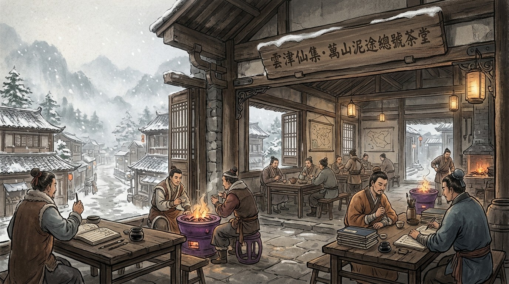

# 第 84 章：雲津仙集・萬山商埠的規矩

[← 上一章](ch0083.md) ｜ [本卷目錄](00_intro.md) ｜ [下一章 →](ch0085.md)

*章首插畫：第 84 章 雲津仙集・萬山商埠的規矩*

從青石埡口沿著緩坡下行十餘里，便到了雲津仙集最南端的北境商旅入口。

明明還是深秋剛過、霜降後十餘日的節氣，可峽谷四週的高峰積雪早已垂到了半山腰，唯有盆地正中因為地下有幾條分支火脈穿行，氣溫比外面寒原反倒高出幾分，街道兩旁的青石板濕漉漉的，踩上去帶著一股混雜著煤煙、藥草乾貨與靈石粉塵的奇異氣息。

沈泥站在高大宏偉的牌樓下，抬起頭仔細打量著匾額上「萬山交匯」四個遒勁的篆字。

與金石府城那種官府衙門、武館、道壇緊挨著市井米行的格局截然不同，雲津仙集沒有縣衙，也沒有穿青衣的捕快。維持這座萬山商埠秩序的，是兩側掛著鐵甲牌的「商埠巡檢丁」，以及廣場正中央那座氣派非凡的三層青石大殿——「萬山商埠公所／三宗交割廳」。

「咱們得先分頭落腳。」沈泥回頭看向身後四位風塵僕僕的同伴，伸手替林鐵生整了整被雪水打濕的衣襟，「距離今年立冬的三山開門大考還有不到二十天。這二十天你們四個先去西街那邊的客棧住下，我去商埠公所把執照和貨棧的事辦妥。」

「我陪你去。」林鐵生拎起牛皮工具囊，站到沈泥身側半步，「人多有個照應。」

「公所談買賣講的是契書和籌碼，帶把鐵錘去只會讓人以為咱們是來砸場子的。」沈泥笑了笑，拍拍他那隻依舊習慣性護在身前的右手，「放心，我有蘇姐姐和賈朝奉聯署的特等通行信印。何況真要談不攏，咱們還有顧玄在百草街認路，燕隼在車馬行看價，清虛在牌樓口盯著進出的採辦貨單——這才叫五方分頭摸底。」

四人對視一眼，沒再堅持。一路從黑石鋪走到金石府城，再從金石北關走到這座雲海峽谷，沈泥在市井商道上的分寸感從未讓他們失望過。

告別四人後，沈泥獨自一人穿過人頭攢動的萬山廣場。

廣場上來往的人客與金石府城大不相同：穿粗布短褐的普通山民腳夫只占三成，其餘大多是衣袍袖口繡著星紋、火紋或藥鼎徽記的三宗外門雜役與採辦弟子，甚至偶爾能看見幾名腰懸長劍、神色冷傲的內門修士踏步而過，周身散發著二階靈息獨有的壓迫感，尋常商販見了皆須側身讓道。廣場西南側未完全封凍的冰河木筏碼頭上，披著破羊皮襖的苦力正喊著沙啞號子扛凍紅杉木、捏著木籌排隊對帳；街西老山神廟前坪支起十幾張喝熱磚茶的小桌，散修與腳夫邊暖手邊聽鼓詞——仙山再高，底下照樣得靠這群凡夫俗子的肩膀一點點抬起來。

沈泥不動聲色地縮了縮肩膀，把破氈帽的帽簷壓低半寸，順著人流拐進了萬山商埠公所的大門。

公所正堂極為寬敞，迎面是一整排紅漆木櫃檯，櫃檯後方掛著一塊巨大的烏木牌價板。沈泥只是掃了一眼，瞳孔便微微收縮。

牌價板上用的計價單位，根本不是大乾官鑄的開元通寶或白銀錠，而是分成上下兩欄寫著：

> **【萬山靈石票】**：一兩上等金石官銀，折兌下品靈石票二枚（浮動折算，日結）；  
> **【三宗外門供奉額】**：太清符紙十刀、八荒箭簇五百支、千機耐火泥三百斤，可於交割廳當場核銷宗門歲貢。

「難怪在這裡光靠白銀走不動道……」沈泥心中暗自記下這層規則。在凡俗府城，銀子是硬通貨；可到了三宗山腳下，商會與票號的根基卻是「靈石票」和「三宗歲貢折額」。如果只拿金石府的銀兩進貨，每一次兌換都要被票號和萬寶閣扒掉一層匯水。

她走到寫著「新商號掛牌核驗」的櫃檯前，將懷裡那枚深海玄鐵精鑄、鑲嵌赤金滾邊的【金石商會與通寶跨州特等通行信印】連同路引文書一併推了過去。

櫃檯後面坐著一位約莫五十五歲的瘦削老吏，雙眼微垂，手裡正捏著一桿紫銅小秤仔細核對一份羊皮契約。他就是雲津商埠公所的掌印——羅九秤。

羅九秤看也沒看沈泥那身不起眼的粗布棉襖，只用兩根枯瘦的手指夾起那枚通行信印，翻過來照著窗光看了一眼背面的雙重飛錢暗記，隨後便輕輕放回紅木托盤裡。

「金石商會與通寶總號聯署的跨州信印，是真的。」羅九秤的聲音平淡得像在念帳本，「按萬山商埠公約，持此印者免去外來行商的三年觀察期，准許在西街貨棧區租賃倉房、參與三宗外門普通採買。不過……」

他抬起眼皮，淡淡地掃了沈泥一眼：「信印只證明你在金石府城有根基、有路引，不代表雲津公所替你擔保。要想掛牌開棧，三日內需向公所指定票號繳足兩千枚下品靈石票的『履約保證金』，或由本地兩家乙等以上商號出具連帶保結；否則，只能按流動行腳小販算，不得設固定倉儲，也不准接三宗交割廳的月結單。」

「兩千枚下品靈石票？」沈泥心頭一沉。按今日牌價，兩千枚下品靈石票折合足色官銀整整一千兩！她與蘇凝霜、賈朝奉臨別時籌措的啟動銀兩與貨本加在一起也不過八百兩出頭，若全押在保證金上，貨棧還沒開張就要斷了流動資金。

還沒等沈泥開口周旋，側旁雅座的布簾突然被人掀開，一陣濃郁的沉香味道迎面撲來。

「哎呀，我當是哪路新來的豪商，原來是金石府城新晉的才俊小姑娘。」

走出來的是個四十九歲上下的胖大掌櫃，身上穿著一件簇新的寶藍暗花緞袍，十根手指戴了三枚成色極佳的翡翠玉扳指，臉上堆著和氣生財的笑意，正是萬寶閣雲津分號的掌櫃——何萬金。

何萬金笑眯眯地走到櫃檯邊，看都沒看沈泥那頂沾了雪泥的舊氈帽，只朝羅九秤拱了拱手：「羅掌印，今日這張西街甲字七號空倉的租契，我們萬寶閣先替貴公所收著吧？畢竟這小姑娘初來乍到，連雲津仙集『貨損自負、逾期三日扣倉』的規矩都還沒摸清，萬一接了三宗外門的炭火單卻交不出貨，砸的可是咱們西街商戶的臉面。」

這話聽著像是替人著想，實則句句都在堵沈泥的路。

西街甲字倉位置最好、通風乾燥，適合存放藥材和精鐵，若是被萬寶閣搶先包圓，沈泥要麼去租偏遠潮濕的爛倉房，要麼只能捏著鼻子去接萬寶閣轉包出來的二手散單——從此被人死死掐住脖子。

沈泥沒有露出半點慌亂，也沒當場跟何萬金爭執，更沒拿出蘇凝霜的名字去壓人。她只是安靜地看著羅九秤，問了一句：

「羅掌印，公所的條例裡，除了交足兩千枚靈石票保證金，還有沒有別的法子能立戶？」

羅九秤看了何萬金一眼，又轉回來看著眼前這個矮他一頭多的少女，手指在契約邊緣輕輕敲了兩下：「有。持跨州信印者，若能在『雲海票號』設立專戶，把你上游六縣的實物倉單做抵押擔保，經票號掌櫃核實產權與貨源真實無誤，保證金可減半至一千枚靈石票——但前提是，貨未進庫前，不得虛報帳目，一旦延誤交割，票號有權當場查封抵債。」

「多謝羅掌印指點。」沈泥俐落地收回信印與文書，朝何萬金微微一笑，「何掌櫃，西街甲字七號倉租太貴，小本生意用不起，您請便。不過這雲津仙集這麼大，想來不會只有萬寶閣一家說了算。」

轉身走出公所時，何萬金身後的笑容已經淡了下來。他沒去追，只對身邊的帳房低聲吩咐了一句：「去跟西街的幾個牙人打聲招呼，金石府來的這丫頭，倉租照市價上浮三成，現銀結算，不准賒欠。」

沈泥當然猜得到這一步。她在黑石鋪討飯的時候就懂一個道理：大商號最怕的不是你跟你講道理，而是你真的繞過他的門檻自己活下來。

整個下午，沈泥先是踩遍了雲津仙集的三宗交割廳、雲海票號與山道車馬行，在每個地方都沒急著簽字，而是花了整整兩個時辰坐在茶攤邊聽腳夫、外門採買弟子與倉管算帳。

她很快摸清了雲津的死穴所在：

三大名山清高，不直接管凡俗貨殖，但每年入冬前後，太清、八荒與千機百巧門的數千名外門弟子對三樣東西需求極大——**烈礬縣產的無煙耐火炭**、**青河縣產的平價防寒藥材**，以及**能耐高溫低溫交替的生鐵雪橇修補件**。萬寶閣把持著這幾條大宗貨源，加價四成賣給外門管事，卻不肯接小宗散單，更不願保證偏遠哨站的及時送貨。

傍晚時分，沈泥走進了位於廣場東南角的「雲海票號」。

票號內沒有萬寶閣那種鋪張的沉香氣，只有一股淡淡的油墨與冷鐵味道。櫃檯後的女掌櫃顧蘭舟年約四十一歲，梳著一絲不苟的烏黑圓髻，一件青灰布衫洗得發白，手裡撥弄著一把黃楊木大算盤，頭也不抬地道：「開戶最低存五百枚靈石票，匯兌扣三分匯水，概不接無實物擔保的口頭票據。」

「我不借錢，也不開空頭票。」沈泥走上前，將一疊厚實的雙聯契書推到櫃檯上，「這是金石府烈礬縣窯坊、青河縣百草市集以及盤木縣車馬行開具的實物直供契紙，上頭有金石商會總堂與通寶總號的聯署驗印。三個月內，每旬可穩定發出五千斤無煙耐火炭、三百斤止血乾草與五百套鐵木修補件。」

顧蘭舟這才停下撥算盤的手指，抬起一雙沉靜精明的眸子，拿過那疊契書一頁一頁翻看。足足過了半盞茶工夫，她才將契書按在桌上。

「契紙是真的，六縣印鑑也做不得假。」顧蘭舟的聲音依然不帶太多溫度，「但從金石府到雲津有八百里寒原，大雪一封山，車隊隨時會晚十天半個月。五年前我就被一張北境空頭糧單連累過一次擠兌，差點關門。你憑什麼讓我信你按期交割？」

「我不靠您信我這張嘴，靠貨損自負。」沈泥眼神清亮，「我在雲海票號開立專用押金戶，把我手頭這六百兩現銀全數折算成一千二百枚下品靈石票存進死帳，連同這批六縣貨單一併押在您這裡做雙重擔保。只要有一單貨遲到三日，您直接從我押金戶裡劃扣賠償給買家，不必經我點頭；但作為條件，您得替我出具一份『實物足額準備金驗明保書』，交給羅掌印核驗。」

顧蘭舟盯著這個瘦得像根柴火棍、實際年齡不過十五六歲的少女，嘴角極其難得地鬆動了一絲。這丫頭不是來求施捨的，她是把所有退路和身家都押在檯面上，只換一個合規進場的資格。

「算盤打得夠狠。」顧蘭舟拿起朱筆，在帳冊上刷刷寫下一行字，重重蓋上雲海票號的私印，「保書我給你開，押金戶每日結息照常算。不過有一句話說在前頭——雲津不認英雄，只認帳本。哪天你賠穿了底，票號照樣封你的門。」

「一言為定。」

拿到了雲海票號的保書，又去公所讓羅九秤蓋下紅印後，沈泥沒有再去碰萬寶閣盯死的那幾間甲字大倉，而是直接繞到西街貨棧區最末端，租下了一間原本用來堆放舊馬鞍與碎煤、屋頂還漏了兩塊瓦片的偏僻石砌舊貨棧。

房租每月只要二十枚靈石票，前院只能勉強停兩輛雪橇，後院卻帶著一間乾燥結實的地下石窖。

門口一塊舊木板被林鐵生晚間幫忙刨去朽皮，用黑墨寫上四個字，第二天一早正式掛了起來——**【泥途商棧】**。

開張第一天，沒有鞭炮，也沒有賀客。

只有一個穿得像隻灰熊、身材結實的年輕婦人拎著一把雪鏟站在門口。她叫邱禾，三十二歲，原本在北境雪橇車隊裡當過七年壓車副手，因為上一家東家在雪崩裡甩鍋不肯付撫恤金，自己辭工出來打零工。

「每月兩百文底錢外加每單貨千分之三的抽成，這是我看過最寒酸的東家。」邱禾靠著門框，先把手裡自己寫好的一張短契紙拍在門板上，「但我看過你昨天在車馬行替那個凍傷腳夫墊的藥錢。先說好，我只簽三個月短契。雪天壓車若出了貨損，非我偷懶造成的不能扣我工錢；若商棧撐不到年底發不出工錢，我拿你院裡那兩張新榆木桌子抵債，扭頭就走。」

沈泥接過契約仔細看完每一個字，拿起毛筆乾脆利落地簽下名字，按上指印。

「只要我活著，就不會欠底下幹活的人一文工錢。」沈泥推開門，晨光照進這間空蕩蕩、只擺了兩張舊木桌與一隻算盤的貨棧，「走吧，邱管事。第一批十筐外門雜役要的耐火炭和粗布護膝，萬寶閣嫌利薄不肯接，咱們今天天黑前得自己扛著送去八荒武山山腳。」

這就是泥途商棧的第一天。沒有一飛沖天，沒有大單上門，一切從最卑微的苦力活、最脆弱的信用與兩千斤需要自己清點背負的煤炭開始。

---

*場域圖誌：雲津仙集・萬山泥途總號茶堂*

---

[← 上一章](ch0083.md) ｜ [本卷目錄](00_intro.md) ｜ [下一章 →](ch0085.md)
