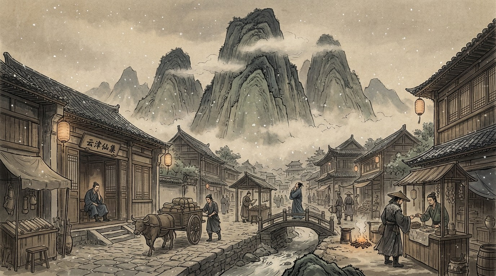

# 第 85 章：三山開門・仙凡分界線

[← 上一章](ch0084.md) ｜ [本卷目錄](00_intro.md) ｜ [下一章 →](ch0086.md)

*章首插畫：第 85 章 三山開門・仙凡分界線*

立冬前一日，雲津仙集上空飄起了入冬以來的第一場正式細雪。

自五人抵達雲津至今，已悄然過去整整二十日。這二十天裡，他們沒有像無頭蒼蠅般在山腳下空等，而是順著這座萬山商埠的脈絡，各自安頓出了第一層腳跟。

林鐵生在西街的車馬行找了個替雪橇包鐵皮、修補鐵軸的零活，每日靠著左手那柄小鍛錘和從故鄉帶來的阿鐵精鋼分寸卡尺，掙回來的銅錢一文不落全交給泥途商棧充作修屋頂的瓦片錢；顧玄一半時間留在商棧後院整理草藥乾燥架，另一半時間替西街幾戶苦力看診風寒，順便將北境常見的凍瘡草藥配比逐一記進手札；燕隼則跟著邱禾熟識的幾名老雪橇車夫跑了兩趟短途外圍貨運，把通往八荒武山與北荒南沿的幾條山道積雪深度、避風岩壁與狼群出沒點摸得一清二楚；柳清虛每日寅時便登上雲津西側那座荒廢的石望樓觀星測風，把雲海峽谷清晨的風候盈縮與降雪規律整理成半張紙條，讓沈泥能趕在萬寶閣漲價前半日收購避寒炭。

靠著這二十天的死磕與一點一點攢起來的小額履約，泥途商棧總算沒在頭一個月倒閉。那間原本漏風的石屋補齊了瓦片，院角碼起了十幾垛整齊的烈礬耐火炭與青河苦參乾貨，門前也開始偶爾有三宗外門的雜役管事停下腳步問價。

直到立冬前夜，從北境最高峰太清玄天宮方向傳來一聲沉渾悠長、穿透整個雲海峽谷的青銅鐘響——

**三年一度的北境三大名山外門大考，明日卯時三刻，三山同時開門！**

消息一出，整個雲津仙集頓時沸騰起來。原本冷清的客棧與茶肆瞬間擠滿了從十三府各地趕來的世家子弟、江湖散修與隨行家僕，連西街的碎米價都在半個時辰內跳漲了五文。

入夜後，泥途商棧的後院小屋卻格外安靜。

屋中央架起了一口黑鐵小炭爐，上面燉著滿滿一鍋切得厚實的羊肉湯，裡頭放了顧玄切好的薑片、當歸和一點驅寒野菊。沈泥沒有拿公帳的銀子擺闊，這頓飯是她拿自己私底下替雲海票號顧蘭舟校對舊帳掙來的紅利買的肉。旁邊的小泥壺裡，正滾著最後一小撮莫三臨別時塞給她的黑石鋪粗炒秋茶。

「來，先喝一口熱湯暖暖胃。」

沈泥給每人盛了一碗濃白的肉湯，又將五份疊得整整齊齊的油紙包放到桌上。打開油紙，裡面是一疊印著「泥途商棧・十日貨單」的粗麻紙條，每張紙條的邊角處，都用極細的炭筆劃了一道極不易察覺的刻度斜線。

「明天起，你們四個就要進三山山門了。」沈泥坐在板凳上，眼神平靜地看著四位從黑石鋪一起摸爬滾打走出來的同袍，「名山外門門規森嚴，進了山，少不了有人盯著你們的一舉一動，書信往來肯定會被盤查。所以以後我們不用普通家信。」

她拿起最上面一張貨單指了指邊角：「每逢初一、十五朔望兩日，各宗門外門照例要向雲津採辦日常雜物。我會派邱禾或車馬行的熟手按規矩往各山門送炭送藥。貨單上列幾斤幾兩都是真帳，但左下角這道筆劃傾斜的度數、以及貨包裡綁繩的結扣數目，是咱們自家人看的暗語——三道單結代表『平安無事、照舊修行』；一個反扣結代表『有急事、需人手支援』；如果連貨單右下角都劃了雙線，那就說明宗門內有大變故，必須想辦法在三日內下山碰頭。」

「這法子穩妥。」柳清虛接過屬於太清玄天宮的那一疊紙條，仔細看過邊角的微細刻痕，「外門執事查得了私信內容，查不出採買貨單上的繩結習慣。就算有人起疑，大不了說腳夫綁繩手重。」

「倒是你，沈泥。」燕隼大口喝乾碗裡的肉湯，眉頭卻一直緊鎖著，目光掃過這間並不算寬敞、牆角還堆著待發煤炭的屋子，「萬寶閣那個姓何的胖子前天剛因為搶不到西街兩處炭行在公所裡使絆子，我們四個一進山，這雲津仙集裡就只剩你跟莫三……莫三叔又不在，只有邱禾一個剛簽了三個月短契的外人。你自己留在這裡撐著這麼大個攤子，我們心裡不踏實。」

「我什麼時候成了留在後院等你們撐腰的丫頭了？」

沈泥挑了挑眉，手裡的木筷輕輕在碗沿上一磕，語氣聽不出火氣，卻帶著一股不容退讓的硬氣：「燕隼，你們在金石府城拿外門考核令的時候我就說過——這道考驗不是你們四個去前線打仗、我在後方替你們燒水做飯。三大名山捏著修行界的功法與武力，可他們山下這三千名弟子的吃穿用度、藥材丹炭、軍需票據，哪一樣離得開雲津這口鍋？」

她站起身，走過去拍了拍牆上掛著的那塊寫著「跨州特等通行信印」的木牌拓影，眼底閃過一絲清亮的光：「我不是在這裡替你們看店，我是在這座三宗交匯的盆地裡，替咱們五個人立起第四條不受宗門規矩轄制的腿。再說了，邱禾雖只簽了三個月契，但她算帳比我還實誠，只要我按期付得起工錢、擔得住風險，這座商棧就散不了。」

林鐵生悶聲點了點頭，從身邊工具囊裡拿出一副親手打好的精鋼連環門栓與兩把暗藏機括的鐵鎖，放到沈泥手邊：「明天走之前，我把前後門的門軸和地窖暗門全給你換成這套雙契鎖。外頭用蠻力撞不開，真遇上事，反鎖進去能撐到街坊巡丁趕來。」

顧玄則放下一只沉甸甸的扁平木匣，裡面分門別類擺了三十個標著編號的粗瓷藥瓶：「這十瓶是治風寒凍傷的，這十瓶是外傷止血粉，另外十瓶是我用金石府帶來的水銀中和法配的緊急解毒散，不管誰來買，寫清病症和禁忌再賣。遇到實在不對勁的藥材或傷者，留一丁點樣本給我，初一十五送貨的時候帶上山。」

沈泥看著面前那副精鋼鎖與沉甸甸的藥匣，眼眶微微一熱，卻只是用力把兩樣東西抱進懷裡，嘴角揚起一抹熟悉的狡黠笑意：「行啊，那咱們就各自管好自己那攤子事。不過先把醜話說在前頭——」

她指了指桌上那四塊非金非木、刻著青紫雲紋的【名山外門考核令】：

「這塊牌子只是準考證，不是護身符，更不是已經錄取的保證書。明天進了山門，要是誰沒考過被人家從山道上趕下來，回來泥途商棧可不收吃白飯的，自己找邱禾領一把雪鏟掃院子去。」

「放心！」燕隼哈哈大笑，舉起粗瓷茶碗重重一碰，「明天這時候，老子一定已經把黑山營的門檻踩熱了！」

「五人同行，各走各路，山高水長，不負當初。」柳清虛舉杯相和。

五隻盛著黑石鋪粗炒秋茶的陶碗，在立冬前夜的微弱燭火下輕輕碰在一起。窗外細雪漸濃，悄無聲息地覆蓋了整座雲津峽谷。

次日黎明，天色尚未放亮，萬山廣場的鐘聲再次長鳴。

四人換上各自準備妥當的簡便行裝，在商棧門前與沈泥並肩揮別，隨即沿著三條截然不同的積雪山道大步而去——柳清虛折向正北直插雲霄的天柱山道；燕隼大步踏往西北方瀰漫著煞氣與鐵鏽味的大黑山谷；林鐵生與顧玄則並肩走向東側地肺白煙繚繞的千機百巧門山腳分岔口。

沈泥站在門前的石階上，目送四道身影漸漸融入清晨的飛雪與山嵐之中。

冷風吹動她單薄的棉襖下擺。她轉過身，深吸了一口清冷的空氣，推開貨棧吱呀作響的木門。帳房桌上，已經擺好了今日要清點的第一批三十袋耐火炭貨單，以及邱禾剛剛送進來的一份公所最新通知——

「東家，萬寶閣那邊把這個月山道車馬行的冬草料收購價抬高了兩成，咱們雇的那兩輛雪橇車，明天早上的租金怕是要跟著漲。」

沈泥沒有停頓，直接抓起桌上的毛筆與算盤，沉聲應道：「把帳本拿來，我們一筆一筆重新核算成本。既然進了場，就沒道理第一天就讓別人嚇住。」

屬於五個少年的北境求索征途，在這一刻，於三座高峰與一座山腳商棧之間，同時拉開了序幕。

---

[← 上一章](ch0084.md) ｜ [本卷目錄](00_intro.md) ｜ [下一章 →](ch0086.md)
