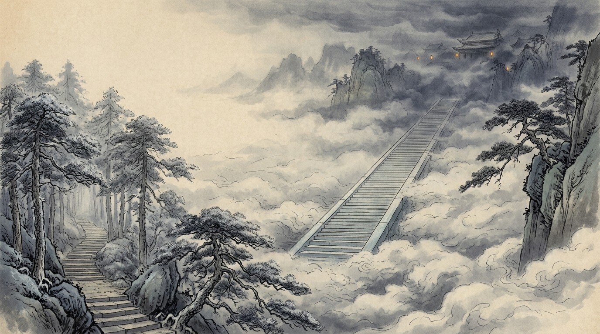
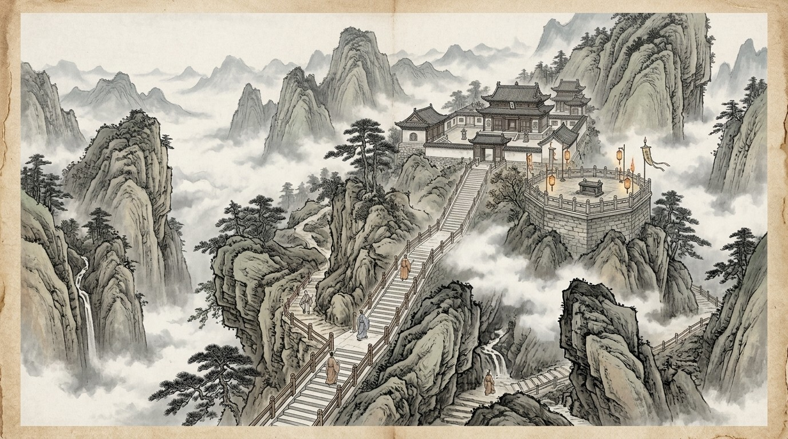

# 第 86 章：千丈登天梯・太清問心鏡

[← 上一章](ch0085.md) ｜ [本卷目錄](00_intro.md) ｜ [下一章 →](ch0087.md)

*章首插畫：第 86 章 千丈登天梯・太清問心鏡*

太清玄天宮的山門，不在山腳，而在雲海之上。

從雲津盆地北側出發，穿過兩里覆滿霧凇的松林石階後，山勢驟然變得近乎垂直。抬頭望去，一條寬約丈餘、由整塊整塊青白漢白玉鑿砌而成的石階一路筆直向上刺破灰白色的雲層，看不見盡頭，彷彿一道從九天垂落人間的脊樑——這便是太清玄天宮赫赫有名的山門考場，千丈登天雲梯。

此刻，雲梯起點的青石平台上已聚集了百餘名來自北境十三府與周邊州縣的青年才俊。有人身披描金鶴氅、身邊跟著兩名替他提劍匣的家僕；有人站在人群邊緣緊張地反覆檢查腰間的靜心玉符。

柳清虛站在最不起眼的角落裡，一身漿洗得泛白的青布舊道袍在山風中獵獵作響。他沒有像其他人那樣急著熱身或攀交情，只是仰起頭，默默估算著上方雲層的高度、風速與雲梯兩側每隔三十丈便立著一根的青銅測星柱位置。

「都安靜。」

石階上方傳來一道清冷平淡的女聲。說話的是一名約莫三十六歲的藍袍女道官，眉目溫和，束髮的木簪樸素無華，正是太清宮負責外門初試的授業師——陸觀瀾。她身旁還站著兩名年輕道士，以及一名負手而立、神色嚴肅的中年清瘦女掌院，左手袖口隱約露出一截常年磨蹭墨錠留下的淡黑印痕。

「手持各地宣道司所頒外門考核令者，上前驗牒。」陸觀瀾聲音不高，卻清楚地落進每個人耳中，「太清玄天宮三年開門一次，不看家世，不論資財，只問道心與定數。千丈雲梯共有三百六十五階主陣眼，暗合周天度數，梯上引動九天星煞與清靈問心鏡照拂神魂。爾等須在午時三刻前憑自身之力登頂。途中若心神失守、自行叩首退下者，保命無虞，但三年內不得再試。」

驗牒之後，陸觀瀾輕輕敲響身邊的青銅小磬。

「開陣，登梯。」

百餘名考生立刻如潮水般湧上第一級漢白玉階。

柳清虛故意放慢半步，排在隊伍中後段。當他的左腳踏上第十級石階的剎那，頭頂原本灰濛濛的雲層驟然一沉，一股冰冷刺骨、卻又奇異地帶著威嚴與秩序感的無形壓力，如水銀瀉地般順著天靈蓋直灌而下！

那不是純粹的重量，而是一種直接作用於神識深處的「雜念剝離」。

耳邊瞬間響起低沉而宏大的誦經回音，彷彿天地本身正在對著每一個踏上石階的生靈低聲喝問：

*『凡塵皆濁，親緣皆妄。捨爾執念，順應天律，方可登仙——』*

「啊……我撐不住了！」走在前排一名身材微胖的富家少年才走到第七十階，突然雙膝一軟，整個人重重砸在玉階上，面無人色地抱住腦袋大喊。兩名守在梯側的外門道士面無表情地上前，像拎小雞一樣將他架出陣外。

而在隊伍最前方，一名年約十九、身穿月白雲紋道袍的北境世家少年卻穩穩咬緊牙關。他名叫沈照塵，每當頭頂星煞威壓驟然增強一分，他便會從容不迫地停下腳步，面對上方紫霄宮的方向恭恭敬敬地磕下一個長頭，口中低誦太清順天銘文。

每逢他磕頭伏拜一次，頭頂懸浮的問心鏡光柱便會柔和三分，壓在他肩上的星煞重量竟肉眼可見地卸去四成！其餘幾名出身大府道門世家的弟子見狀，也紛紛效仿，一邊叩拜一邊頂著減輕後的威壓穩步上攀。

「順從者減壓，質疑者受罰……」

柳清虛停在第一百二十級石階上，雙腿微沉，青筋在清瘦的額角隱隱跳動。他沒有半點要彎腰的意思，反而直挺挺地仰起頭，望向雲梯上方那面在霧氣中若隱若現的巨大青銅鏡影。

腦海裡，突然響起黑石鋪西面破落道觀裡，那個自剜雙目、終日蜷縮在漏風殿角裡的枯木老道，用沙啞得像砂紙一樣的聲音對他說過的那句話：

*「清虛，想活命，就別信這片天。」*

「嗡——」

或許是因為他體內沒有順從問心鏡的誘導、反而主動生出一絲警惕與質疑，上方的星煞威壓猛地加重一倍！一口逆血瞬間湧上柳清虛的喉頭，左肩胛骨傳來一陣細密的撕裂痛楚，彷彿有無數根無形的冰針正試圖刺進他的神識裡，強行抹掉黑石鋪、沈泥、顧玄、鐵生與燕隼的臉孔，只留下冰冷整齊的星宿刻度。

「想讓我忘掉山下那些人……好讓腦子裡只剩你們畫好的規矩？」

柳清虛嘴角滲出一絲血跡，眼神卻冷靜得可怕。他沒有硬碰硬地拿神識去頂撞整個問心陣，而是猛地閉上雙眼，將全部心神沉入在金石府摘星台上苦練兩百日的實證心算之中！

他不再去「聽」那陣法灌進腦海的宏大囈語，而是把壓在自己肩頭、背脊、雙膝上的每一分無形重力，當成一組隨時刻推移而變的星力測算數去推演。

一息、兩息、三息……

風速在變，高空雲層遮擋日照的角度在變，就連雲梯兩側青銅測星柱在寒氣下的熱脹冷縮也在變！

「不對……」

閉目靜立了十餘息的柳清虛，瞳孔猛然在眼皮底下縮緊。

在他的心算推演裡，這座號稱「完全順應周天運轉、無懈可擊」的太清問心陣，每隔三十六息完成一次大週期星力交接時，從東北方位第三根測星柱傳導過來的星煞氣流，竟然比西南方位的柱子**固定慢了千分之三息**！

這點微乎其微的延遲對凡夫俗子毫無意義，可在這千丈雲梯的高壓之下，那千分之三息的分寸誤差，就是兩股星煞相互對沖、短暫出現「中空無壓縫隙」的死角！

「原來如此……這根本不是不可質疑的天道。」柳清虛緩緩吐出一口濁氣，將喉頭的血腥味咽了回去，「只是一座需要靠柱子、陣盤與時間節點拼起來的龐大機關法陣。只要是造出來的東西，就一定有誤差！」

他不再抗拒威壓，也不學沈照塵等人磕頭求饒。就在三十六息周期交匯、東北測星柱微不可察地顫動了一下的剎那，柳清虛腳下步法陡然一變，沿著漢白玉階右側邊緣那道看似最險峻的陰影斜線，一口氣連跨七級石階！

奇妙的事情發生了。

本該如山嶽般壓下來的星煞之力，在接觸到他身體的瞬間，竟然順著那道千分之三息的縫隙滑向了兩側！原本舉步維艱的身影，驟然化作一道在狂風中逆流而上的青色孤影，不卑不亢、脊背筆直得像一桿長槍，踩著精準到毫釐的節拍一路向上！

「這小子……他沒拜？」

先一步登到七百階的沈照塵正準備再行一次叩拜禮，眼角餘光瞥見後方一道青影竟連一絲停頓都沒有，頂著全額威壓以一種近乎詭異的節奏從他身旁三尺處擦肩而過，甚至連呼吸都保持著穩定的勻速！

沈照塵臉色微變，氣機一岔，膝蓋差點磕在台階稜角上，眼睜睜看著柳清虛一聲不吭地將自己甩在身後。

巳時末刻，當鐘聲再次響起時，千丈雲梯頂端那座雲霧繚繞的青玉廣場上，陸陸續續爬上來了四十二名滿頭大汗、衣衫濕透的年輕人。

沈照塵是第三個踏上雲頂的，他深吸幾口氣平復胸膛起伏，目光卻不由自主地投向最前方那個早就已經站定、正低頭拿炭筆在一小塊碎布上快速記錄數字的瘦削少年。

「你在寫什麼？」授業師陸觀瀾走了過來，語氣裡帶著幾分驚異與審視。方才在山頂水鏡裡，她清清楚楚地看見，所有上來的考生裡，只有這一個少年從頭到尾連半次腰都沒彎過。

柳清虛聞聲收起炭筆，拱手行了一個標準的道家稽首禮，神色不卑不亢，既沒有通過考核的狂喜，也沒有刻意討好：「回稟師長，弟子方才登梯時，發現雲梯自四百三十階至六百二十階之間，東北側星力傳導固定滯後約千分之三息，疑與今年北境偏早降雪、測星柱北陰面結冰導致導氣不均有關。弟子隨手記下偏差值，免得日後師兄們巡檢時踩空。」

場邊幾名維持秩序的外門道士頓時倒抽一口涼氣，看向柳清虛的眼神像在看一個瘋子——人家考問心梯考的是對仙門的敬畏順從，這土包子竟然拿著炭筆在算人家護山大陣的誤差？！

站在陸觀瀾身後那名左手沾著淡黑墨痕的中年女掌院——周天星律院掌院宋知微，卻在這時緩緩走上前兩步。

她沒有訓斥柳清虛大不敬，而是伸出清瘦的手指，從柳清虛手裡接過那塊寫滿密密麻麻數字與星位角度的粗麻布，足足盯著看了半晌。

「四百三十階處，的確有一道前年修補過但尚未重新校準的舊裂紋；東北陰面結冰導致導氣遲滯，也確實是近三十年沒人再去細算過的小毛病。」

宋知微抬起頭，那雙清冷的眸子深處閃過一絲極難察覺的震動：「能算得快，太清宮裡每年都能挑出十幾個；但能在星煞壓頂時不肯磕頭，還能冷靜把誤差數字老老實實抄下來的人，十幾年沒見過了。」

她轉頭對陸觀瀾點了點頭：「此子歸入我周天星律院，定為外門上等經生，領外門玉牌，明日辰時來院裡領《初階觀測誤差核校簿》。」

「是，宋掌院。」陸觀瀾微微頷首，轉而遞給柳清虛一枚溫潤的青色玉牌，同時低聲叮囑了一句：「記住，外門玉牌只管衣食宿與外院課業，未經掌院批令，不得擅入藏星秘閣。還有……莫要在人前隨便議論『天數有誤』四個字。」

柳清虛雙手接過玉牌，觸手一片清涼。他看了一眼遠處站著、正緊盯著自己的沈照塵，又抬頭望了一眼這座雲霧遮天、處處講究「順從與秩序」的紫霄仙宮。

他沒有問為什麼那三百六十階的星力會恰巧滯後，更沒有說出懷裡那張【逆星斷碑拓片】在剛才登頂那一刻微微發熱的異狀。他只將那塊沾滿字跡的布收進袖中，平靜稽首：

「弟子領教。」

---

*場域圖誌：太清玄天宮・千丈雲梯與升仙台*

---

[← 上一章](ch0085.md) ｜ [本卷目錄](00_intro.md) ｜ [下一章 →](ch0087.md)
