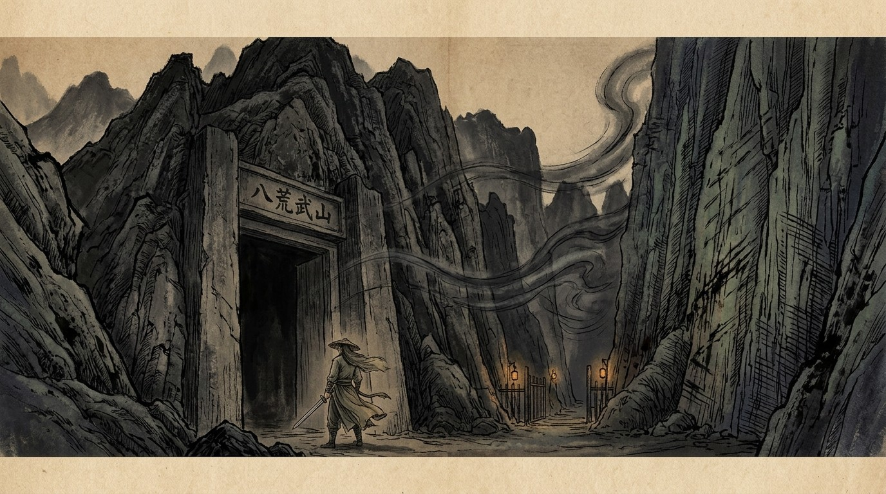
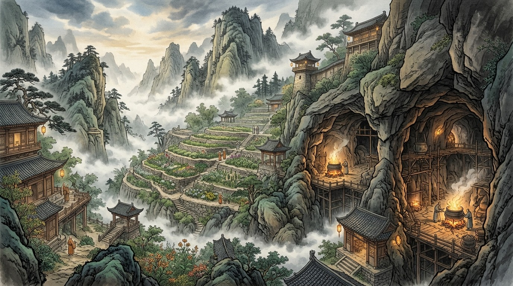

# 第 87 章：萬鈞問心谷・煞血試煉場

[← 上一章](ch0086.md) ｜ [本卷目錄](00_intro.md) ｜ [下一章 →](ch0088.md)

*章首插畫：第 87 章 萬鈞問心谷・煞血試煉場*

八荒武山的山門，沒有雲海仙氣，只有撲面而來的鐵鏽味與陳年血氣。

大黑山南麓的「萬鈞問心谷」像是一道被巨斧硬生生劈開的黑石裂口，兩側百丈高的墨色岩壁終年不見陽光，壁面上佈滿了密密麻麻的爪痕、刀劈痕與早就發黑的血漬。山風從北面外荒裂谷倒灌進來，裹著濃重刺鼻的灰色地煞寒氣，吹在臉上如刀割一般。

峽谷入口的石台上，站著三名氣息沉凝的八荒武山軍官。

為首一人約莫五十歲上下，肩背厚重如一堵鐵牆，左臂袖管卻齊肘空蕩蕩地垂著，腰間佩著一柄極為寬厚的黑鞘單刀——正是鎮守黑山營的獨臂老將，雷烈。在他左側站著身材高大、右膝行走時微有僵滯的煞血營教頭岳停山；右側則是個二十七歲左右的冷峻女校尉，右眼眉骨處有一道明顯的凍傷疤痕，背負著一張牛角長弓與一面測距紅旗，乃是破軍重弓塞的女校尉唐映。

「外門入山試煉，規矩只有三條。」岳停山的嗓音沙啞低沉，像兩塊生鐵在互相摩擦，「第一，不准穿戴甲冑，不准攜帶私丹毒藥，只准領取一把木胎角弓與五支白羽鐵箭；自己帶了本命重弓的，照規矩留三支箭在壺裡，餘下封存入庫。」

他伸手指向黑霧繚繞、深不見底的黑石峽谷口：「第二，穿過前面八十里黑石峽，到達黑山前哨鐘台。峽裡頭有三十多頭二階鐵背荒狼，還有順著裂縫滲出來的北荒地煞。真氣催得太急，地煞就會順著毛孔往你心肺裡鑽；步子太慢，天黑前就等著餵狼。」

「第三，」一直沒開口的女校尉唐映冷冷補上一句，「配給的箭支射完不補，別指望同行的考生分你半根羽毛。出了谷口沒人替你收屍，真撐不住了，捏碎腰牌邊上的響箭，會有巡哨隊把你拖出去——當然，從此跟八荒武山無緣。」

校驗過考核令後，四十多名來自各府武館與軍鎮的漢子深吸一口氣，紛紛卸下皮甲與包袱，只提著弓箭踏入谷中。

燕隼沒有換領武山發的那種輕飄飄的木胎弓。他按規矩封存了大部分箭支，只留下自己那張百斤重石鐵胎柘木弓，箭壺裡插著三支不帶趙伯狼骨簇的普通三稜鐵箭——在沒摸清對手之前，底牌不能輕易亮在眾目睽睽之下。

「呼……」

才走進黑石峽不到五里，空氣陡然變沉。

這不是金石府城那種讓人胸悶的市井濁氣，而是一種極端狂暴、帶著硫磺與冷鐵腥氣的地煞氣流。一旦呼吸稍亂，體內的氣血便像被潑了一瓢熱油的炭火般轟然沸騰，讓人莫名生出一股想抓起石頭砸碎點什麼的暴戾衝動。

「吼！老子氣血起來了！滾開！」

走在前面不遠處一名來自鎮北武館的壯漢雙眼瞬間赤紅，渾身青筋暴起，竟主動甩開大步朝前狂奔，試圖靠這股狂暴的煞氣一口氣衝出峽谷。可才跑出半里地，前面黑岩亂石後面突然竄出四條灰背如鐵、體型足有牛犢大小的二階鐵背荒狼！

那壯漢仗著氣血沸騰，不閃不避，一拳砸在領頭荒狼的肩胛上，竟只砸出一聲悶響。反倒是另外兩頭荒狼從側翼撲上，利爪撕開他肩背皮肉的同時，壯漢體內強行催谷的燥火瞬間逆沖心脈，整個人噴出一口帶著黑色血塊的淤血，當場踉蹌跪倒！

「蠢貨。」燕隼在三丈外的陰影岩壁下壓低身形，眼神沒有半點波動。

在八荒山林裡追了十幾年野物，他比誰都清楚：氣血不是拿來燒給外人看的煙火，是冬夜裡保命的柴火。燒完一捆少一捆，越是在這種煞氣撲面的鬼地方，越要把呼吸壓得像石頭一樣慢。

燕隼腳下踩著在八方武館苦練數月的「磐石步」，重心沉在雙膝與腳跟之間，脊背微微前傾，讓每一口吸進肺裡的混濁煞氣都在橫膈膜處轉上半圈才緩緩吐出。體內那枚貼身藏在胸口皮囊裡的【獵獸圖騰骨片】，此時正散發著一縷極為微弱卻穩定的溫熱，替他穩住震盪的血脈，卻並不替他多出半點蠻力。

就這樣不緊不慢地穿行了三十餘里，天色漸暗，峽谷兩側岩壁的狼嚎聲越來越密。

前方一道叫作「鬼門彎」的窄峽口處，突然傳來一聲淒厲的慘呼和弓弦崩斷的脆響。

燕隼足尖點地，藉著兩塊風化黑岩無聲躍上一處丈許高的岩石凸起，向下望去。

下方碎石灘上，三名同樣參加考核的武修背靠背縮成一團。其中一人左小腿已經被咬斷了半截筋腱，另兩人死命揮舞著空弓抵擋七頭鐵背荒狼的輪番撲咬——他們已經把配給的箭全射空了，且體內的氣血顯然在先前奔逃中透支過度，每一次出拳都虎口崩裂，黑紅的血順著指縫往下淌。

而在他們身後不到三十步的地方，另一組兩名世家出身的武師卻正趁著狼群被那三人拖住的空檔，頭也不回地加速朝峽谷深處狂奔！

「走啊！只要先跑過那道坡就是黑山營哨線！」其中一名年輕武師頭也沒回地甩下一句。

燕隼盯著下方那七頭荒狼，又看了一眼遠處已經漸漸模糊的峽谷出口。

若是換作平時單獨趕路，趁現在繞過左側高坡，他能連一支箭都不消耗，輕輕鬆鬆第一個踩到黑山前哨鐘台，拿個風頭十足的頭名。

可下方那七頭狼裡，有一頭體型大出半圈、左耳缺了一塊的公狼，此刻並沒有急著撲上去咬死那三個傷員，而是站在十步外的石堆上，一雙泛著幽綠冷光的眼珠死死盯著那三個獵物腰間還未捏碎的求救響箭——它在拖延時間，等遠處另兩支小狼群圍合過來，把這三個人連同趕來救援的巡哨兵一塊兒留在這裡。

「跟大荒裡的雪狼一個德行。」

燕隼低聲罵了一句。他要是就這麼走了，不出半炷香，就算那三個人捏碎響箭，黑山營巡哨隊趕到時大概也只剩三具啃爛的骨頭——而且那種死法，他兩年前在黑石鋪山外見過太多次了。

沒有半點猶豫，燕隼雙腿微曲，整個人順著斜坡滑落，在距離狼群四十步外的一處亂石堆後穩穩站定。他沒去浪費力氣大喊，只從箭壺裡抽出第一支三稜鐵箭，搭在重石鐵胎弓上。

「嗡——」

百斤硬弓在雙臂穩定如鐵的拉扯下瞬間滿月。

燕隼的呼吸在這一息之間徹底停滯。胸腹間被圖騰骨片溫養出來的那一絲陽剛血氣，沒有散向四肢百骸炫耀聲勢，而是全數收束在右肩與扣弦的三根手指上！

「嗖！」

箭矢破空，沒有多餘的鳴嘯，精準無比地從前方兩頭正在試探撲擊的荒狼耳側穿過，在所有人還沒反應過來之前，硬生生釘進十步外石堆上那頭缺耳頭狼張開了一半的血盆大口裡！

「噗嗤！」

箭簇從頭狼後頸貫穿而出，將這頭重逾兩百斤的二階頭狼連同半截脊骨死死釘在身後的黑岩壁上！頭狼四肢抽搐了兩下，連半聲嚎叫都沒發出來便徹底斷了氣。

剩下的六頭荒狼驟然受驚，頓時停下撲擊，圍著石堆轉起圈來，喉嚨裡發出不安的低吼。

「別亂動，退到我身後岩壁凹處！」燕隼聲音不高，卻像一塊石頭砸進三名幾乎絕望的考生耳朵裡。他迅速抽出第二支箭搭上弓弦，弓尖微微下垂，緩緩向前踏出兩步，眼神比黑石峽裡的寒風還冷，「你們誰身上還有備用布條，先替那位斷腳的兄弟把腿動脈勒住。」

見頭狼暴斃、眼前這個背弓少年氣血沉穩得深不見底，剩餘幾頭原本就有退意的荒狼夾起尾巴，發出一聲哀鳴，迅速竄進兩側漆黑的石縫裡消失不見。

危機解除。那三名年輕武修癱坐在碎石灘上大口喘氣，好半天才反應過來要捏碎響箭棄考求援——腿斷了一個，另外兩個經脈震傷，是不可能再撐過後面四十里山道的。

「小兄弟，你不先走嗎？剛才那兩個已經跑遠了……」腿傷漢子看著燕隼，語氣裡滿是愧疚。

「不差這半個時辰。」燕隼走過去，伸手把釘在頭狼屍體上的那支三稜鐵箭拔了出來，在雪地上蹭掉血污，重新插回箭壺裡。既然規定箭射完不補，能回收的箭，一支也不能留在野外，「這具狼屍你們守著，靠它這身血氣，外圍小獸半個時辰內不敢靠近。我替你們發信號。」

他抬手摘下對方腰間那枚木製響箭，用力拉斷底線。尖銳的赤紅火花直衝峽谷上方灰暗的天穹。

直到遠處傳來黑山營巡哨隊的沉重馬蹄聲與呼喝聲，燕隼這才轉身背起弓，獨自一人重新沒入通往黑山前哨的濃重暮色之中。

……

酉時末刻，黑山前哨鐘台。

最後一名拖著步子的考生撞響銅鐘時，鐘台前方已經站了十七個臉色蒼白、氣喘吁吁的通過者。大多數人肩背上都帶著血痕，甚至有兩名剛過線的武師一口氣鬆懈下來，直接跪倒在雪地上大口吐血，被一旁的傷兵抬上擔架。

燕隼站在人群末尾，身上只沾了些黑岩灰塵和一點乾涸的狼血，呼吸平穩得不像剛跑完八十里地煞峽谷。

「這小子……一共只用了一支箭？」

校場高台上，唐映手裡拿著巡哨隊剛剛送上來的戰損登記木牌，挑眉看著下方那個年輕得有些過分的獵戶少年，「救了三個棄考的廢人，拔回自己那支箭，後面四十里遇見兩撥散狼全憑石塊和身法繞開，最後進哨線時氣血波動比進谷前還低了兩成。」

「這份節制氣血的本事，不是一般武館教得出來的。」岳停山沉聲說了一句，順手把登記冊遞給身側的獨臂老將。

雷烈沒有立刻說話。這位見慣了北荒死人的老將，此刻一雙虎目卻死死鎖在燕隼左肩下方那段極為別扭、卻又偏偏穩如老松的扣弓壓腕習慣上，以及剛才他隨手把箭插回箭壺時，指節微微向內扣了一下箭羽的動作。

那是五年前，大黑山雪線之外那個永遠喜歡叼著半根枯草根、笑嘻嘻喊他「雷老栓」的漢子，親口教出來的小動作。

「你叫什麼名字？哪個武館推薦來的？」雷烈跨下石階，厚重的鐵靴踩在凍雪上發出喀嚓悶響，徑直走到燕隼面前。

「金石府城八方武館，燕隼。」少年的背脊站得筆直，不卑不亢地抱拳行禮，目光迎上這位獨臂老將如刀鋒般的視線。

雷烈盯著燕隼的眉眼看了整整三息。那雙像極了故人的黑眸裡沒有世家子弟的油滑，只有大荒山民與生俱來的野性與倔強。老將胸口微微一震，嘴唇動了動，終究沒當場問出口，只是從腰間解下一枚沉甸甸的黑鐵製式腰牌，親手按進燕隼掌心。

「八方武館霸山推薦的人，果然沒丟老子的臉。」雷烈聲音壓得低沉厚重，「拿著黑山營的牌子，明日卯時去煞血營點卯領棉甲。記住一點——進了黑山營，以後上陣殺敵，別光顧著替旁人賣命，先把你大……先把你這條命給老子留好！」

燕隼接過冰冷沉重的黑鐵腰牌，指尖猛地一收。雷烈最後那半句幾乎脫口而出的稱呼，他聽得清清楚楚。

他沒有當場追問，只是重重抱拳低頭：「是！」

高台另一側，幾名剛被抬出峽谷的受傷考生正發出低低的呻吟，一名雙腿經脈俱廢的年輕武修被兩名雜役架著往山下送，連回頭看一眼鐘台的力氣都沒有。山門口沒有慶功的酒肉，只有冷風捲著血腥味吹過每一張沉默的臉。

這就是八荒武山。它給了你鎮守北疆的筋骨與兵刃，也從來不問你為了跨進這道門，身後究竟踩碎了多少人的前程。

---

*場域圖誌：丹鼎宗・百草藥谷與地肺丹窟*

---

[← 上一章](ch0086.md) ｜ [本卷目錄](00_intro.md) ｜ [下一章 →](ch0088.md)
