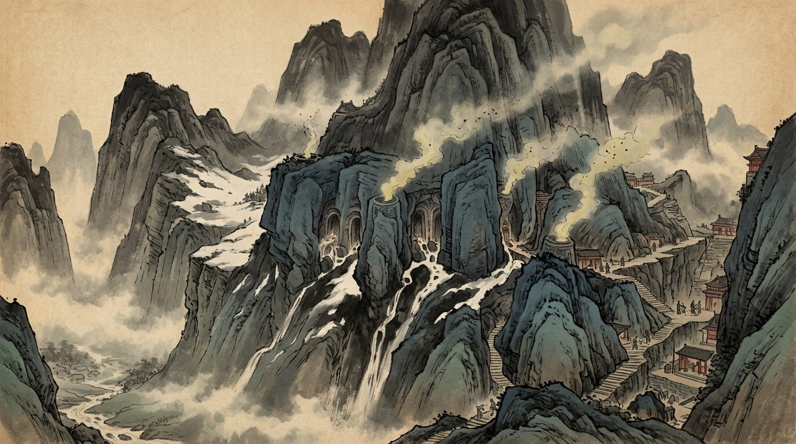
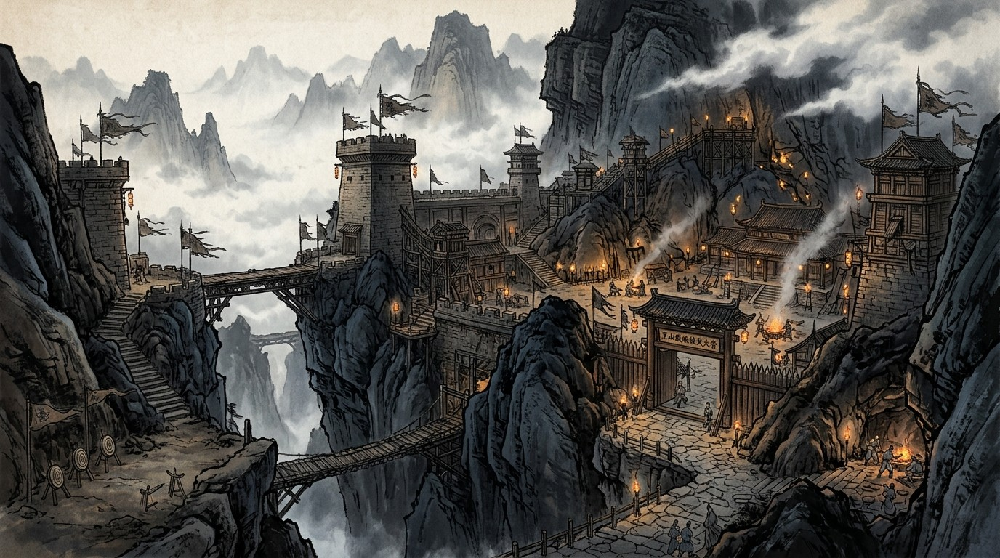

# 第 88 章：千鍛地火廊・萬機拆解考

[← 上一章](ch0087.md) ｜ [本卷目錄](00_intro.md) ｜ [下一章 →](ch0089.md)

*章首插畫：第 88 章 千鍛地火廊・萬機拆解考*

千機百巧門所在的萬仞天工山，遠遠望去便與太清、八荒兩座名山截然不同。

這裡的雪往往還沒落實就被山腹裡散出的滾滾地熱融成了黑水。山腰處鑿開了數十座巨大的青石通風煙道，晝夜不停地噴吐著淡淡的煤灰與地肺硫磺白煙，空氣裡永遠跳動著叮叮噹噹、連綿不絕的金屬敲擊回響。

林鐵生站在天工閣山門「千鍛百巧門」下的長廊邊，卻覺得這裡比金石府城北邊的百工坊還讓自己心裡踏實。

天工閣的考核不考什麼玄妙虛無的星辰心算，也不考赤手空拳在死人堆裡殺出血路。穿過刻滿齒輪紋路的厚重青銅門樓後，二十餘名手持各府百工行會推薦信的年輕匠師，直接被帶進了一座熱浪逼人的長條形地下石廊——千鍛地火廊。

石廊兩側排列著十二座燃著橙紅色地肺火舌的鍛造爐台。每座石台正中央，都並排架著一具半人多高、通體由厚重青銅與精鐵鑄成的二階工程機械局部殘件——一具「青銅搬山傀儡」的右臂驅動肩肘關節。

主考臺上站著兩位氣勢沉穩的老匠師。左邊那位約莫六十歲上下，身材乾瘦，十根手指指節粗大且微有變形，一看便知是打了一輩子重鐵的老把式，正是千機院的魯長老；右邊站著的則是地火鍛兵台的總匠章百鍊，左臉頰有一道醒目的舊火灼疤，腰間掛著一排擦拭得鋥亮的測溫銅棒與精鋼分寸卡尺。

「規矩很簡單。」魯長老的聲音不像太清宮執事那樣飄渺，而是精確得像敲在鐵砧上的鑿子，「兩個時辰內，各自修好眼前這具『青銅搬山傀儡』的右臂傳動關節。修好之後，必須承受住三百斤重鐵塊連續三十次起落不卡齒、不崩軸、不炸膛。能過關的，領天工閣外門匠牌；炸爐傷人或者逾期修不好的，自己收拾包袱下山。」

話音剛落，鑼聲一響，廊內頓時熱火朝天。

身旁幾名出身北境大鍛造世家的年輕弟子顯然有備而來。左邊一名錦衣少年打開隨身攜帶的檀木匣，竟直接取出兩塊價值不菲的「流銀精礦」與一疊預先畫好的二階聚火符紙，熟練地催動地肺火舌熔化流銀，試圖靠貴重金屬強行填補青銅齒輪咬合處的裂縫，再用符紙強行鎮壓軸承震動。

「哼，不過是個二階外門貨色，也敢拿出來考校？」錦衣少年擦了擦額角汗水，瞥了一眼身旁那個只穿了件粗布短褂、連一件像樣法器鍛錘都沒帶來的黑大個，嘴角露出幾分輕蔑。

林鐵生根本沒留意旁邊的動靜。

他照例用那條從黑石鋪一直纏到現在的布條護緊右腕舊傷，左手卻穩穩拿起那柄老鐵匠阿鐵給他的小鍛錘，另一隻手從懷裡掏出阿鐵最近才捎寄給他的那把南山冷鐵精鋼分寸卡尺。

「手莫抖，心莫偏。」

鐵生在心裡默唸了一遍師父刻在卡尺邊緣的那六個字，俯下身，先沒急著點燃面前的地火爐，而是將耳朵緊貼在冰涼的青銅關節外殼上，左手捏著小錘柄，極輕極緩地順著齒輪外緣敲了一圈。

「叮……叮……咔。」

第三聲敲在肩肘傳動主軸外側時，聲音突然沉悶了半分，尾音裡還帶著一絲微弱的沙啞顫音。

林鐵生眉頭微皺，立刻放下錘子，動手拆開關節外層的三顆固定六角鐵栓。等外殼敞開，裡頭一根腕口粗細的精鋼主軸頓時暴露在火光下。

表面上看去，這根軸承完好無損，僅僅在邊緣有幾道正常磨損的擦痕。換作一般匠師，多半以為只要抹點潤滑獸油、把邊緣兩顆歪掉的銅牙敲正便完事了。

可林鐵生拿出阿鐵精鋼分寸卡尺，沿著主軸與軸套之間的四個方位逐一卡量過去——

「不對。」

少年的指尖頓時停住。

「主軸沒彎，但軸套內壁的承壓坡度，比標準幾何弧線偏了**整整半厘**。」

林鐵生順手用乾淨麻布抹去軸套內側那層黑膩膩的油泥，湊到火盆前仔細看去。藉著橘紅色的火光，他這才震驚地發現，原本應該泛著均勻青灰色的精鋼軸套內壁上，竟然附著著一圈極其細微、呈現暗紫焦黑顏色的奇怪脆化麻點！

那些脆化點把整塊精鋼的韌性啃掉了一截，才讓軸承在受力時悄無聲息地偏出半厘分寸誤差；如果不解決這個偏角，哪怕往外面糊上十斤秘銀、貼滿鎮壓符紙，傀儡一扛起三百斤鐵塊，失衡的橫劈硬勁就會像鐵鎚一樣把整條主軸從裡面生生震斷！

「轟——！」

就在這時，左邊那名錦衣少年的爐台突然傳來一聲劇烈的悶響！

滾燙的青銅碎屑伴著撕裂的符紙四散飛濺。那少年慌忙舉起銅盾格擋，雖然沒受傷，可那具剛被他強行點火測試的傀儡關節卻已經徹底卡死變形，原本填上去的流銀在高壓剪切下直接崩裂飛出，差點砸到後面督考的章百鍊。

「光會往表面糊貴金屬和貼符紙，連內腔受力方向都沒量清楚，炸膛活該！」章百鍊板著一張被火灼傷的臉，冷哼一聲，直接讓人將那少年的牌子收走。

周圍幾名原本也打算用符文和高級秘金硬堆的考生頓時手忙腳亂，趕緊把爐火熄了一半，重新拿尺子去量裡頭的軸承。

而林鐵生早已算清了整套結構。

他沒有選擇昂貴的秘銀，甚至沒有浪費一滴流銀。他從自己隨身的麻布袋裡翻出兩塊在雲津西街花十文錢收來的普通「百煉精鋼條」，放在地火爐裡退火去脆，再用阿鐵小錘一寸一寸地鍛打成兩枚極薄、斜度精準控制在半厘以內的**雙契榫楔**。

每一錘落下，都不靠蠻力砸，而是順著鐵紋的結晶脈絡調整韌性與硬度。

「淬水用溫油，別下冷水，否則接觸軸套那半厘邊緣會脆裂……」鐵生低聲自語，準確控住地肺火候降溫回火，隨即用分寸卡尺再次複驗了三遍毫釐分寸，確認無絲毫誤差後，這才將雙契榫楔精準嵌進偏角的軸套空隙裡，重新鎖緊六角鐵栓。

兩個時辰未到，林鐵生起身舉手示意測驗。

章百鍊親自走上前來，神色嚴肅地讓人往那具青銅搬山傀儡的鐵爪上掛上一塊整整三百斤重的生鐵坨。

「拉動主閥，三十次起落。」

鐵生雙手扣住操縱拉桿，穩穩發力。

「嘎吱——鏗！嘎吱——鏗！」

那條方才還卡死脆響的青銅傀儡手臂，此刻竟像被注入了全新的滑油一般，每一次提拉三百斤生鐵都流暢穩重到了極點，傳動齒輪咬合發出的清脆節拍甚至連半絲雜音都沒有。三十次起落完畢，拆開外殼再測，那兩枚熟鐵雙契榫楔與原軸套嚴絲合縫，半毫沒移位，也沒半點過熱變形！

「用尋常百煉精鋼修出了天工級的毫釐咬合？」一名負責記錄成績的外門執事看傻了眼，隨即皺眉開口質疑，「林鐵生，你這手法雖巧，可全憑你自己那把土尺子和手感敲出來的。天工閣一年要造上百具搬山傀儡，難不成每具壞了都得等你親自拿耳朵去聽？這種只靠個人手藝的土法子，能照單照樣做出第二份嗎？」

這話問得極為尖銳，也是天工閣內門一直看不起民間鐵匠的根本原因。

林鐵生沒有生氣，更沒有拿什麼「匠心」大道理頂回去。他安靜地擦乾淨右手上的油污，從懷裡拿出一張疊得方方正正的粗紙，雙手遞了過去。

上面用工整卻略顯笨拙的炭筆字跡，密密麻麻寫著四行實測數目：

> **【損壞部位】**：青銅搬山傀儡右肘第三軸套內壁  
> **【實測偏差】**：偏角 0.5 厘，內壁見不明暗紫焦黑脆化麻點（深度約 0.2 厘，疑為曾接觸高腐蝕性礦渣或異常猛烈高熱所致）  
> **【修正方案】**：以百煉精鋼打製雙契榫楔（斜度 1:200），經橘紅退火、溫油慢淬保留韌性，鎖入軸套負壓側  
> **【複驗紀錄】**：負重三百斤連起三十次，微溫不燙，無異常震顫。

站在後方的魯長老接過那張沾著黑炭與獸油味道的粗紙，那雙因長年打鐵而變形的粗大手指輕輕摩挲過「疑為曾接觸高腐蝕性礦渣或異常猛烈高熱所致」那一行字，渾濁的眼眸深處猛然掠過一絲不易察覺的精芒。

「寫得清清楚楚，量得明明白白，誰拿著這張紙照著圖紙尺寸打，誰就能修好。」魯長老抬頭看了一眼沉默厚實的林鐵生，又看了一眼旁邊點頭認可的章百鍊，當場開口，「把這種暗紫脆化麻點的零件編號記進千機院損耗檔！至於這小子——」

魯長老從桌上挑出一枚刻著齒輪與鐵砧圖樣的精銅匠牌，直接扔進林鐵生手裡：「進天工閣千機院外門，明日一早跟章百鍊去地火鍛兵台報到。記住，在我們這裡，光會修機器還不夠，以後要把為什麼會壞、哪批材料偷工減料也給老子盯緊了。」

「是！」林鐵生緊緊攥住那枚還帶著爐火餘溫的匠牌。

而在他轉身收拾自己那只舊工具囊時，目光忍不住又掃了一眼那幾處擦出來的暗紫脆化鐵屑——這股焦黑脆化鐵粉的質感，跟他在金石府城千錘地爐坊排水溝裡撈出來的【地煞血精滲碳熔渣】，像得讓人脊背發涼。

他沒聲張，只是悄悄用一張油紙把抹布上沾的一點黑屑包好，塞進腰間皮囊最底層。

---

*場域圖誌：八荒武宗・黑山鐵峽練武大營*

---

[← 上一章](ch0087.md) ｜ [本卷目錄](00_intro.md) ｜ [下一章 →](ch0089.md)
