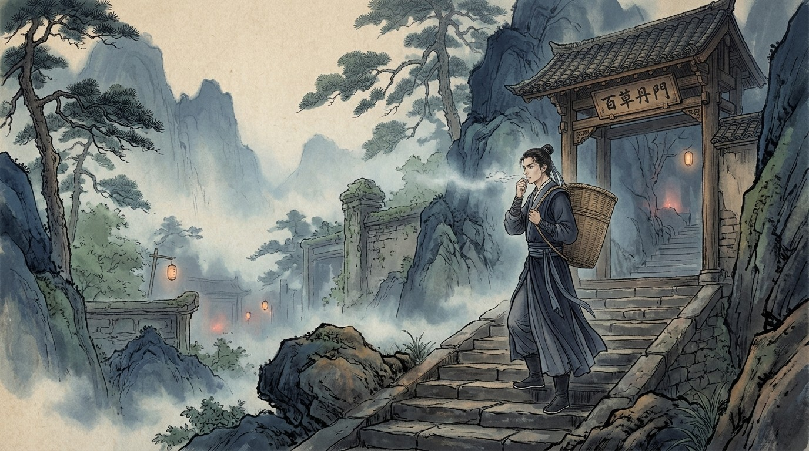
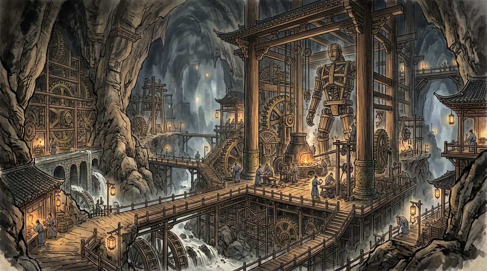

# 第 89 章：百毒試藥谷・生機辨偽考

[← 上一章](ch0088.md) ｜ [本卷目錄](00_intro.md) ｜ [下一章 →](ch0090.md)

*章首插畫：第 89 章 百毒試藥谷・生機辨偽考*

千機百巧門的另一條山谷，完全不見天工閣那種煙塵滾滾的鐵火氣，而是被一層終年不散的淡淡青白藥霧籠罩著。

這便是丹鼎宗山門外圍的「百毒試藥谷」。

顧玄背著那隻從黑石鋪一直帶到現在的青竹藥簍，站在百草丹門下的石階邊，鼻尖輕輕抽動了幾下，眉心便微不可察地蹙了起來。

按理說，名門大派培養二階靈草的藥谷，空氣裡應當滿是純淨清冽的草木生機與水土濕氣。可此時吹過鼻端的霧氣中，卻除了濃郁的藥香之外，隱約夾雜著一絲極淡、極冷的澀口礦酸氣息——就好像整條山谷底下的泥土和水脈，常年都在被某種沉重的地下火煙慢慢燻蒸著。

高台上，主考官並沒有露面太多人，除了幾名身著綠袍的丹鼎宗藥師執事外，顧玄竟意外地在側旁觀禮席上看見了一張極為熟悉的面孔——

白鶴年。

金石府城杏林醫館的館主，顧玄在府城時最敬重的引路恩師。只是今日的白先生身上並未穿杏林館的素白長衫，而是換了一件綴著銀邊藥葉紋的深青外聘客卿長袍，與一名身材瘦長、鬚髮皆白卻雙眼異常精亮的老者並肩而立。

那老者身穿丹鼎宗大長老獨有的紫金暗紋藥袍，正是丹鼎宗執掌地肺丹火窟的實權長老——鶴壽真人。

白鶴年遠遠看見台下的顧玄，僅僅微不可察地點了點頭，神情公私分明到了極點，既沒有絲毫熱絡招呼，更沒有半分私相授受的跡象。他身旁還站著一名年約二十六歲、手裡抱著一厚疊硬皮病案冊子的年輕女醫官（孫聞露），以及一名挽著褲腳、指縫裡滿是泥土的三十八歲靈植管事（葉青枝）。

「百草谷入門考核，取題於眼下真實病患與藥田之難。」

主持考核的執事指向考生面前擺放的十個青瓷藥盤，每個盤裡都躺著一株根莖發黑、葉片卻泛著詭異紫紅斑紋的二階「寒髓草」：「此批寒髓草近日因地氣變異，根脈染上地煞濁毒。考題要求：在一炷香內，以面前的藥鼎提取其中有效生機，煉製出一份可供內傷弟子直接吞服、且不損及脆弱經脈的『辟煞散』。凡成散藥力不足三成、或殘留火毒與地煞餘毒者，皆落選。」

話音方落，五十多名藥童、散修丹師立刻點燃腳下的小丹爐，各自抓起桌上配發的石臼與銀剪。

顧玄左右兩邊的考生動作快得驚人。左邊一名世家丹徒直接打開猛火，將三株受染寒髓草一股腦丟進滾燙的銅鼎裡，撒入一把「烈陽化毒砂」，企圖以霸道至極的陽火強行將葉片上的紫紅斑紋燒成灰燼；右邊另一人更是直接切掉整段發黑的根部，只留下頂端兩片稍微翠綠的嫩葉猛火煎煉。

「燒成這樣，藥性還能剩幾分？」

顧玄站在自己的泥爐前，既沒有急著點火，也沒有拿刀去切那株變異的寒髓草。他戴上一雙用厚油紙泡過的指套，湊近藥盤，先拿銀針極輕地挑開葉片表面那層詭異的紫紅斑點，湊在鼻尖仔細嗅了一息，又抓起一撮黏在根鬚最底端、幾乎看不出顏色的濕潤泥巴放在掌心裡搓捻。

「不是單純的地煞侵蝕。」顧玄心裡瞬間明瞭。

那些直接用烈陽火去焚燒紫斑的人，只看著葉片發紫就當成毒煞來殺，殊不知地煞滲進靈草脈絡之後早就與寒髓草的生機絞在了一起。一旦用猛火硬燒，確實能把表面的濁氣燒掉，可連同草裡頭那點原本用來護脈的寒涼生機也被一併烤成了焦炭，煉出來的不是救命的辟煞散，而是會把傷兵胃壁燒穿的焦灰毒渣！

顧玄的目光繼續順著根鬚往下找，忽然在最末端一處不起眼的鬚根結節上停了下來。

那裡黏附著幾片細小得像灰塵一樣、泛著淡淡冰藍色的半透明苔蘚——他在雪線草坡上曾經見過這種極耐寒的寄生微苔，叫「雪線苔」。

顧玄小心翼翼地用銀針挑下一丁點雪線苔，放到一旁清水碗裡，再從染毒的寒髓草根部滴入一滴黑濁汁液。

只見原本渾濁刺鼻的黑汁在碰到那一點點冰藍苔蘚的剎那，竟然發出一陣極其微弱的氣泡聲，混在裡頭的紫紅地煞濁氣彷彿找到了吸附的靶子，迅速聚成幾顆細小的暗色絮狀物沉到碗底，上面浮出來的水液瞬間變得清澈微涼！

「原來如此……草自己早就找到了活路。」

顧玄眼中閃過一抹亮光。萬物生息相剋，百草谷這批靈草雖然因為地下微弱地脈滲漏染上了濁毒，可在長期受壓之下，根部卻共生出了這層專門吸附礦酸地煞的「雪線苔」。

他沒有去點那口容易失控的猛火炭爐，而是直接從藥簍裡摸出一個小陶壺，把溫火炭撥散成文火微溫，將寒髓草連同根鬚上那層原本被所有考生當成髒泥巴洗掉的雪線苔一併放入冷泉水中慢浸冷萃！

一炷香時間將盡，左邊那名世家丹徒的丹爐突然冒出一股刺鼻的黑煙，雖然勉強烘出了一撮看似乾燥雪白的藥粉，可旁邊的試藥銅針一插進去，針尖立刻泛起一層焦黑的火毒鏽斑；而右邊切掉根部的考生煉出來的藥水清淡如白水，藥力測試連一成半都不到。

唯有顧玄的陶壺裡，緩緩析出一小碗色澤淡青微涼、清香純淨的藥散。

負責驗藥的白鶴年親自走下高台，在數十雙眼睛的注視下，捏起一撮顧玄煉出來的辟煞散放進自己口中細細品味，隨即又拿過一枚專門測毒的活血試針刺入藥汁。

試針拔出，銀光澄澈，沒有半絲變黑，也沒有一毫火燥反應！

「好一個不毀原根、借苔化煞的溫火冷萃法。」白鶴年收起銀針，面上雖然依舊保持著公允的平靜，眼底卻藏不住一絲深深的欣慰，隨即轉向身旁的鶴壽長老，「長老，這份成藥生機保全七成半，且無半點火毒留存，比今年試藥谷頭一名的成方還要穩妥。」

鶴壽長老背著手緩緩走過來，那雙深邃渾濁的老眼在顧玄身上打量了兩圈，目光尤其在顧玄背後那隻舊藥簍和沾著些微草灰的手指上停留了片刻。

「手法雖然偏僻野路，倒也確實懂幾分『毒生於土、藥亦生於土』的道理。」鶴壽長老聲音溫和得像個慈祥的鄰家老醫，「只是年輕人，你這法子只怕挑材料吧？若是山裡換一處沒長雪線苔的藥田，你又待如何？」

顧玄沒有半點被大長老誇獎後的得意忘形，也沒有為了討好而吹噓自己找到什麼萬靈解方。他恭恭敬敬地躬身一禮，老老實實回答道：「回長老的話，弟子只是發現這十盤樣本裡剛好帶著雪線苔，才借來一用；若是別處沒這種共生苔，這法子就用不得了。弟子剛才在考卷背面記了這幾株草根部泥土的酸澀味，依弟子愚見，比起改煉丹火，或許更該去查查這座藥谷上游的水渠是不是滲進了別的東西。」

此言一出，站在高台後側一直沉默不語的靈植管事葉青枝，指尖猛地抓緊了手裡的竹籃邊緣，臉色微微一變，朝顧玄多看了一眼。

鶴壽長老臉上的笑意卻絲毫沒減，只是輕輕點了點頭：「有這份仔細眼力是好事。不過百草谷藥田的事，自有管事與宗門處理，你初入山門，先把基本藥理和控火功課學踏實了再說。」

說完，鶴壽長老拂袖轉身對執事吩咐道：「此子歸入百草谷外門，賜藥牌。往後醫理院那邊若缺個辨藥手穩的弟子，讓他跟著白醫師多跑跑腿。」

「弟子領命。」

顧玄接過那枚溫潤的木質百草谷藥牌，心裡卻一點沒輕鬆下來。

剛才他在提起「上游水渠滲進東西」的時候，他清清楚楚地看見，鶴壽長老雖然嘴上誇他仔細，眼角餘光卻冷冷地掃了靈植管事葉青枝一眼；而旁邊那位抱著病案冊子的年輕女醫官孫聞露，則飛快地低下頭，在自己的袖口處遮住了半頁寫著紅字的單據。

散場之際，顧玄趁著收拾藥盤的空檔，悄無聲息地從那十盤未用完的寒髓草根底下，撥出半指甲蓋大小、帶著雪線苔與酸澀水垢的濕泥，封進小瓷管裡貼身收好。

丹鼎宗確實掌握著天下最精妙的藥理與生機法門，可這座終年藥霧繚繞的藥谷地下，藏著的病灶顯然比藥草本身複雜得多。

---

*場域圖誌：天工閣・萬機地窟神機工坊*

---

[← 上一章](ch0088.md) ｜ [本卷目錄](00_intro.md) ｜ [下一章 →](ch0090.md)
