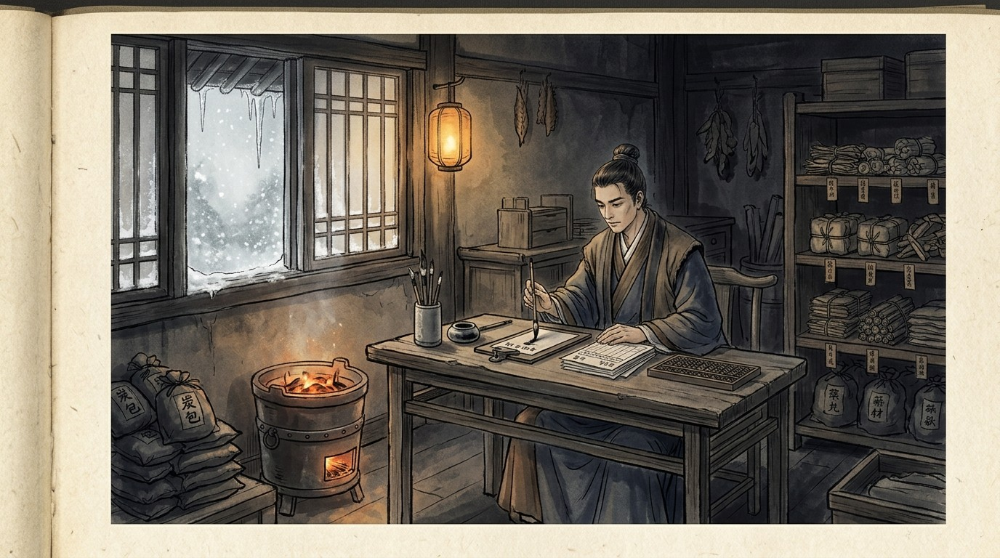

# 第 90 章：泥途立契・五子暗網初成

[← 上一章](ch0089.md) ｜ [本卷目錄](00_intro.md) ｜ [下一章 →](ch0091.md)

*章首插畫：第 90 章 泥途立契・五子暗網初成*

距離立冬開山大考過去已近半月，雲津峽谷的積雪越積越厚，西街屋簷下垂起了尺許長的冰凌。

泥途商棧的堂屋裡卻比剛開張時暖和了許多。牆角堆著整整齊齊的兩百斤耐火炭包、幾排貼著編號標籤的藥材木架，靠窗那張榆木帳桌旁，邱禾正把剛結算完的一疊貨單按日期夾進木夾板裡。

「東家，昨天那一撥四宗外門的採買貨車已經全都回去了。」

邱禾揉了揉凍得發紅的鼻尖，把一壺熱開水推到沈泥手邊，語氣卻並不算輕鬆，「帳面上看著熱鬧，可實際核對下來，四條線全都有麻煩事。」

沈泥身上披著件從街尾買來的舊灰鼠皮坎肩，正低頭撥動手裡那把小黃楊木算盤。聽到這話，她沒有停手，只抬起眼眸：「說仔細些。」

「太清宮那邊的採買管事最難纏。」邱禾翻開帳本，「他們要了二十刀上等朱砂符紙和五百斤無煙碳，可交割廳核銷的『外門供奉額』只肯記八成，剩下兩成說是要扣作山道風雪損耗。我聽送貨的腳夫私下說，這批新入門的外門弟子如果月底繳不齊歲貢課額，輕則扣減月例、罰去寒風最烈的觀測哨站抄寫枯燥的舊星圖，重則被降回記名雜役。」

沈泥的指尖微微一頓，看向帳桌另一側擺著的四張「泥途商棧送貨副單」。

「八荒武山更直接。」邱禾繼續念道，「他們不扣貨價，但黑山營派來的採買兵頭要求把肉乾和烈酒的價錢壓低一成，說是前線歲貢吃緊，若弟子完不成巡哨歲貢，就得拿私錢補貼營裡箭矢損耗，否則直接延長兩年外門苦役期。至於千機百巧門那兩脈——天工閣扣的是廢鐵和精煤的領料額，欠額的人得去地火爐邊輪值最苦的除渣班；丹鼎宗則是延後藥田工分結算，逼著交不起靈石歲貢的新人自己接下山採毒草的危險差事。」

「難怪當初在黑石官道上遇見的周鐵山和陳青寧可冒著大雪往南逃。」沈泥輕聲合上帳本，神色平靜無波，「四大宗門把山下的萬山商埠捧成中立仙集，山門裡頭卻各有一套密不透風的盤剝規矩。每個山門懲罰欠額弟子的路數不同，但目的一模一樣——把高危苦差和材料損耗，全壓到沒根基的底層外門弟子肩上。」

正說著，門外突然傳來一陣急促的馬蹄踏雪聲。

一名裹著厚羊皮斗篷的漢子連滾帶爬地衝進貨棧大門，一臉焦急地喊道：「邱管事！壞了！原本今天午時該進南邊山口的那三輛青河抗寒藥材車，剛在七十里外的冷風坡被雪崩堵死了道口！後面跟車的萬寶閣車隊仗著自己人多馬壯，直接花重金把驛站剩下的最後五匹備用雪橇駝馬全包走了，咱們那兩車藥材現在卡在半山腰進退不得！」

「什麼？！」邱禾臉色驟變，猛地站起身，「那批抗寒乾草與生薑粉，今天申時必須交給丹鼎宗百草谷的外門采辦管事，白紙黑字簽了三宗交割廳見證的紅契！逾期一個時辰就要賠雙倍貨款！」

屋裡頓時一片死寂。

那位來報信的車夫急得直搓手：「沈東家，這也不能怪咱們啊，雪崩是天災，再說萬寶閣何掌櫃在驛站明顯是故意卡咱們的馬匹！要不……要不您趕緊去公所找羅掌印遞張天災延誤申訴單，先把違約金賴掉？」

「賴不掉的，而且一旦去公所喊天災免責，咱們『泥途商棧』這四個字在雲津也就到此為止了。」

沈泥緩緩站起身，小巧的臉龐在冷冽的晨光下沒有絲毫猶豫，甚至比身經百戰的邱禾還要冷靜幾分。

「萬寶閣等的就是我去公所哭天災、求寬限。只要今天申時我交不出貨又拿不出賠償，明日整個雲津就會傳遍：金石府來的新商號只靠一張跨州大印充場面，一遇雪天就違約跳票，以後誰還敢把實貨單交給我們？」

她轉身走到屋角那隻上了雙契鐵鎖的鐵皮箱前，親自擰開鎖扣，從裡面整整齊齊數出四百枚下品靈石票，連同兩錠官銀一併塞進一隻厚牛皮錢袋裡，重重拍在櫃檯上。

「邱管事，你現在立刻帶這筆錢去三宗交割廳——不求情，不扯皮，當著羅掌印和丹鼎宗採買管事的面，把契紙上寫明的延誤違約金一文不差地賠付清帳！另外，剩餘兩成能從別家藥行現買湊齊的替換藥材，哪怕貴上五成，只要藥性不差，咱們自己貼錢補齊送去！」

邱禾看著桌上那袋幾乎佔了泥途商棧現有流動資金一半的靈石票，眼皮直跳：「東家！這筆錢賠出去，咱們這個月的倉租加上下個月初一發給金石府車馬行的預付款可就徹底緊巴巴了！萬一明天再下大雪……」

「賬上錢緊了可以再賺，信譽賠穿了拿十座金山也補不回來。」沈泥一邊飛快地把幾本雙聯帳冊塞進布袋，一邊拿過牆角那根結實的登山木杖和厚氈帽，「你去公所交割廳賠錢平帳；我去車馬行找幾個不怕冷的窮腳夫，出雙倍現銅工錢，咱們自己扛著雪橇背架去冷風坡把剩下的藥包搶回來，不能全扔在雪地裡凍壞了！」

「東家……」邱禾盯著眼前這個才十五六歲、身板瘦得像棵寒風裡的小樹苗卻說賠就真敢把家底掏出來的丫頭，緊繃的下巴終於鬆動了一分。

她沒有再多廢話一句，一把抓起桌上的牛皮錢袋，轉身大步衝進漫天飛雪裡：「這單我替你把字簽明白！剩下那半條山路，我讓車馬行認識的兩個老哥替你帶路！」

這一整天，泥途商棧經歷了開張以來最慘痛的一場折損。

沈泥在冷風坡的深雪裡摔了三跤，靴子濕透了大半，和六名雇來的窮苦腳夫硬生生用人力拖回了六大包沒被雪水浸透的抗寒草藥；而公所那邊，邱禾當著萬寶閣何萬金陰陽怪氣的注視與羅九秤冷峻的目光，咬牙將四百枚靈石票和現銀全數拍在交割桌上，一筆一劃把違約賠償與補貨承諾寫進了公所公開的信用榜。

天擦黑時，沈泥一瘸一拐地回到商棧後院，剛把濕透的靴子烤乾，卻意外地發現，那四家本來已經對這家新商號不抱希望的外門採買管事，竟然反而在晚間先後派人悄悄送來了下一旬的新貨單。

其中丹鼎宗那名向來刻薄的藥田小管事，在簽下十日供貨副聯時難得地吐了句實話：「萬寶閣雖然貨大，可遇事只會拿宗門管事當擋箭牌推得乾乾淨淨。你們泥途商棧連雪崩的損失都肯自己扛下來賠清，我們這群在底下替長老辦差的，至少不用怕哪天交不上帳被你們拖下水。」

送走最後一名採買雜役，夜已過二更。

沈泥獨自關上後院地窖的門，點亮油燈。

桌面上，靜靜擺著邱禾今日傍晚從三宗採買處取回的四份「朔望結算回執貨單」。外門管事只看見上頭正經八百寫著「接收無煙碳兩百斤、糙米五十斤、藥草三十包」的數字，但當沈泥把四張粗麻紙並排攤開在油燈下，仔細去摸貨單左下角與包裝麻繩上的細節時，心頭這才微微一鬆，隨即又迅速沉凝起來——

- **柳清虛（太清宮貨單）**：麻繩打了三道極標準的單結（平安無事），左下角炭筆斜線傾斜角微微上揚，夾在符紙最底層的一張邊角廢紙上，寫著極細的一行小算式：*「入星律院，登梯陣有千分之三息滯後偏差；另，掌院重實證，同門沈姓者忌妒心重，暫無大礙。」*
- **燕隼（八荒武山貨單）**：麻繩同樣是三道平安單結，但貨單背面壓著半枚極淺的指甲印，旁邊寫著兩行缺角數字與記號：*「黑山營立腳，遇獨臂雷將軍，認得大伯箭記。傷兵夜半咳血，疑服暗紅藥丸，味似黑石血精氣。」*
- **林鐵生（天工閣貨單）**：麻繩緊緊纏著一個鐵絲小環（三結平安），隨退回來的廢料木箱底角用炭灰畫了一個極小的六角軸承簡圖，旁邊註明：*「入千機院。修復傀儡見異常暗紫脆化鐵屑，留樣在身，與北荒及府城舊爐熔渣同源。」*
- **顧玄（丹鼎宗貨單）**：唯有顧玄這一份貨單的繩結多打了一個極輕微的**反扣半結**（留心異狀、暫無須動人手），包裝紙背面貼著兩片乾枯發紫的雪線苔碎片，字跡小如蠅頭：*「入百草谷。藥田水脈疑有礦酸微滲，大長老鶴壽與府城白師皆在。切記：勿碰任何來源不明之高價二階藥渣。」*

四張來自三大名山高牆之內的樸素貨單，靜靜躺在泥途商棧地窖的油燈光暈之下。

沈泥伸出纖細的指尖，輕輕將四張貨單按順序抄錄進自己那本從不示人的黑油布密帳裡，隨後把原件投入炭盆燒成灰燼。

外面狂風依舊拍打著破舊的木窗，帳桌抽屜裡，泥途商棧的現銀存底因為今天那筆賠償已經縮水到了危險的邊緣；可看著眼前這條靠著真金白銀賠出來的信用打通的合法暗網，沈泥嘴角緩緩勾起一抹清醒而冷靜的弧度。

「第一步站穩了。」她低聲對空蕩蕩的地窖說了一句，隨即吹熄油燈，在冰冷的木板床上蓋上薄被。

明日卯時，還有一場新的買賣與一場未知的風雪等著她。

---

[← 上一章](ch0089.md) ｜ [本卷目錄](00_intro.md) ｜ [下一章 →](ch0091.md)
