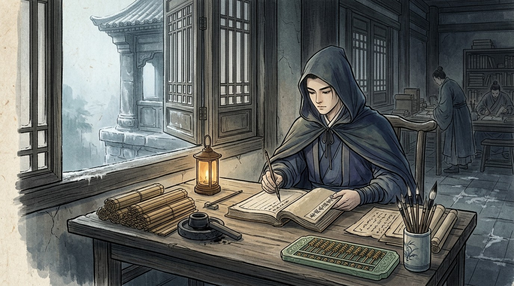

# 第 91 章：藏星秘閣・被篡改的星曆

[← 上一章](ch0090.md) ｜ [本卷目錄](00_intro.md) ｜ [下一章 →](ch0092.md)

*章首插畫：第 91 章 藏星秘閣・被篡改的星曆*

進山一個多月後，雲頂天柱峰的寒氣已經徹底浸透了每一塊青石磚。

周天星律院的清晨總是伴隨著算籌敲擊玉盤的清脆聲響。柳清虛坐在靠北的窗邊案前，右手執著一桿細頭炭筆，左手壓著一卷厚重的羊皮《冬至氣朔實測錄》。自打在登天雲梯上報出那千分之三息的陣眼滯後偏差後，授業師陸觀瀾並未偏袒他什麼，反而照著規矩，先把最枯燥繁瑣、無人願接的差事交給了他——白日裡先核對外門新進經生應繳的「歲貢定額」符紙、炭斤出入簿，深夜再提著銅燈登上北風如刀的望星樓抄錄星候實錄；有時硯台裡的松煙墨凍成一塊死冰，他得先把硯底揣進胸口暖化了，才蘸得出半筆不發澀的墨跡。

就這樣一筆一筆熬了四十天枯燥得幾乎令人麻木的實測核對，卻在前幾日救了星律院一回——那日入夜前，內門弟子沈照塵照著院裡通行的《太清正統星曆》推步北境氣流，斷言未來三日天柱峰晴朗無雪，准許山門照常放行下山採辦馬隊；唯有柳清虛核對自己手頭的雲津風候與近月星芒偏移實錄後，連夜上稟陸觀瀾，指出實測值與院裡通行的推步定式相差整整四分半，極可能出現大暴雪倒灌。

起初沈照塵當著一眾同門的面嗤之以鼻，笑他不過是個沒見過世面的山下小道童拿土法子質疑先賢定數。可第二日卯時未過，一場遮天蔽日的暴風雪便提前整整兩日猛砸下來，把半山腰兩處哨塔封得嚴嚴實實。若非宋知微掌院採信了柳清虛那份留有誤差紀錄的稟報、提前一個時辰下令馬隊折返，少說得有十幾名外門雜役與馱馬凍死在山道上。

從那天起，沈照塵看他的眼神複雜了許多。傲氣少了一半，忌憚卻深了一分；而宋知微掌院則在昨日傍晚親自簽下一道限時三日的手令，准許柳清虛以輔助校書的名義，進入太清宮內門重地——「藏星秘閣」。

……

藏星秘閣不在紫霄宮主殿旁，而是開鑿在天柱峰背陰處的一座厚重花崗岩山腹裡。

推開包鐵石門，撲面而來的不是陳腐灰塵，而是一股濃郁的樟腦、乾艾草與冷鐵混合的味道。裡面點著十幾盞覆著青銅防風罩的長明油燈，光線昏暗卻極為穩定。一排排高過丈餘的鐵梨木書架一直延伸到山腹深處，上面整整齊齊碼著數千卷以牛皮或青絹裝幀的星曆檔案。

「手令。」

入口櫃檯邊坐著個六十八歲上下的駝背老吏，左眼微微有些渾濁，手裡拿著一柄黃銅放大鏡，連腰都直不起來——他就是守了藏星秘閣四十二年的老吏，余守拙。

柳清虛雙手呈上宋知微的手令與外門玉牌。

余守拙慢吞吞地把放大鏡湊到印泥上看了整整半盞茶工夫，又拿毛筆在一本厚得像磚頭一樣的出入簿上記下時辰，這才抬起乾癟的眼皮：「宋掌院只准你核對近六百年《紫微星官錄》裡冬至前后的歲差抄本，以及東廂甲字三架上的舊觀測日誌。不准帶火折子，不准私下撕頁，不准用任何靈力催動墨跡，更不准對著牆上的老祖宗星盤亂摸。記住，你只是一個抄校算數的，看什麼寫什麼，別多嘴問為什麼。」

「弟子明白。」柳清虛謹慎稽首。

他走進東廂甲字三架前，按照宋知微的要求，從架上取下了三卷不同年代的《紫微星官錄》——一卷是六百年前的泛黃麻紙原測日誌；一卷是三百年前用極細小楷重抄的「紫霄修訂定本」；最後一卷，則是三十年前才剛剛核定頒行的當世現行本。

三卷書簡在長案上一字排開。

柳清虛沒有靠記憶去讀，而是從袖中摸出自己那塊隨身攜帶的【星曆觀測校驗板】與一支特製的雙腳分規，一筆星候實錄、一筆實測數地往草紙上謄錄比對。

起初兩個時辰，一切平淡無奇。星辰四季推移、太陽黃道出入、二十八宿在天柱峰上空的過中天時刻，大體上都沿著古典天文的規則緩慢移動，與他認知中的自然歲差並無二致。

可當他順著時間線，翻到距今**三百零四年之前**那一段冬至紀錄，又對照距今**六百零七年前**的另一段冬至紀錄時，柳清虛拿著分規的右手，突然僵在了半空中！

「這是……」

他的呼吸微不可察地一滯。

在六百零七年前的泛黃麻紙原測日誌上，角宿二與氐宿一在冬至子時的實際觀測仰角之間，存在一段連續七夜的微弱震盪偏移，原本用朱筆在頁眉旁邊密密麻麻寫著一行行修正註腳：*『……氣朔異常，星芒有澀，未敢妄改……』*

可當他把視線移到三百年前那本工整華麗的「紫霄修訂定本」上時，那七夜的異常震盪竟然**徹底消失了**！

取而代之的，是一組圓潤得近乎完美、絲毫不差地套進官修推步定式裡的整齊數字。不僅如此，就連前一年、後一年相鄰七十餘顆星宿的經緯度數，都在同一年的甲子大冬至夜，整體順時針往同一個方向平推了整整一度半！

「天上這麼多顆星宿，怎麼可能在同一天夜裡像磨盤一樣整齊轉向一度半？！」

柳清虛背脊猛地竄起一股寒氣。如果是單顆星體運行異常，還可以解釋為古人觀測失誤；可整片星空背景在同一時刻同步平推了完全一致的度數，唯一的解釋只有兩個——要麼是人為改寫了紙上的曆法檔案，要麼……就是頭頂上那片被當成天道的星幕本身，每隔三百年就被人從外面整體校準轉動了一次！

就在他指尖用力按住那兩頁相差三百年的紙張時，貼身藏在道袍內袋裡的那卷【逆星斷碑拓片】，突然毫無徵兆地微微發起熱來！

柳清虛迅速穩住心神，強迫自己不表現出任何異常，借著翻頁的掩護摸了摸拓片邊角。上面那組在黑石鋪溪灘清洗出來的「東方蒼龍七宿逆行座標」，此刻如果疊合到那組被官修定本抹除掉的「七夜異常震盪偏移」實錄上——兩者之間的幾何交角，竟隱隱指向了同一個不自然的拐點！

「你在看哪一頁？」

身後突然傳來極輕的腳步聲。余守拙拎著一盞青銅罩油燈，駝著背無聲無息地站在書架陰影裡。

柳清虛手指沒有縮回，反而坦然地指著兩本卷宗並排的地方，語氣平穩：「回余老先生，弟子在核對三百零四年前那批冬至紀錄。原測日誌的紙質是北境粗麻，墨裡摻了松煙與一點牛膠，頁眉的朱筆批註筆跡微顫，顯是當年觀星官在寒夜裡現測現寫；可這本修訂本卻用了百年後才流行起來的南境青檀宣紙，連錯位處都沒有留下一條誤差註記。」

余守拙渾濁的老眼透過放大鏡，在兩卷書的紙張邊緣與墨色上掃過。這駝背老吏在秘閣待了四十二年，連當年修訂本重抄時墨裡摻了幾分魚鰾膠都摸得一清二楚。

過了好一會兒，余守拙才垂下眼皮，聲音沙啞得像乾樹葉在地上摩擦：「這事你別寫進交差給執法殿的彙報裡。三十年前我剛進閣做副手的時候，見過一次紫霄殿下令重抄舊檔。上頭說，原卷數字太雜太亂，容易讓外門弟子起疑，擾亂道心，必須按先賢定下的大周天正軌『校順』。」

他提著燈轉過身，背對著柳清虛往櫃檯走去，聲音輕得幾乎聽不見：「我一個管檔案的糟老頭子不懂什麼天機星命。我只知道，真要照規矩辦事，原測日誌是不該燒掉的。那些被『校順』前的廢頁……我都按年份塞在西邊最底層的蟲蛀舊箱裡，沒登記在現有目錄上。你明天要是還來校帳，只許抄走星候數目，別把我的底箱翻亂了。」

柳清虛看著那道佝僂的背影，心中五味雜陳，鄭重地朝著老吏的背影深鞠一躬：「多謝老先生指點。」

走出藏星秘閣時，外面天色已近黃昏，暴風雪剛剛停歇，雲頂之上難得露出一片澄澈得近乎冰冷的深藍蒼穹。

院門前，剛核對完今日氣象報表的宋知微正等在廊下。見到柳清虛出來，她看了一眼少年手裡那疊密密麻麻寫滿誤差對照表的紙稿，問道：「看出什麼了？」

柳清虛停下腳步，沒有因為剛發現一個驚天疑點就大喊大叫「天道是假的」，更沒有把尚未證實的推測說成定論。他老老實實遞上對照紙稿，神色冷峻而克制：

「掌院，近六百年的星圖存在通盤改寫的修訂痕跡，且修訂週期疑似恰好落在三百年上下。原測日誌與官修定本的觀測差異無法用儀器誤差或氣候解釋。不過單靠這幾卷檔案，尚不足以斷定是抄手疏漏、還是星象本身曾有異動。弟子請求留存原始對校實錄，並申請在下次冬至星流交會之夜，借天柱觀星台的銅渾儀親自做一次雙照覆驗。」

宋知微接過紙稿，指腹抹過那一行行嚴謹到近乎冷酷的星候實錄對校。那雙始終帶著一絲墨痕的眼睛裡，終於透出了一絲真正的重視。

「你的嘴比我想像的嚴。」宋知微收起紙稿，「下個月朔日，我給你開一張天柱觀星台的夜間輪值牌。不過清虛，在拿出能重複驗證的觀測報告之前，這份疑心，只能留在這本草稿紙上。」

「弟子明白。」

柳清虛抬起頭，最後望了一眼頭頂這片正漸漸亮起點點星光的夜空。那曾讓他以為代表至高真理與秩序的星宿，此刻在他眼裡卻像是無數枚正在按精密齒輪緩緩咬合的冰冷鐵釘。

究竟是誰，每隔三百年就要替這片天重新上一次弦？

---

[← 上一章](ch0090.md) ｜ [本卷目錄](00_intro.md) ｜ [下一章 →](ch0092.md)
