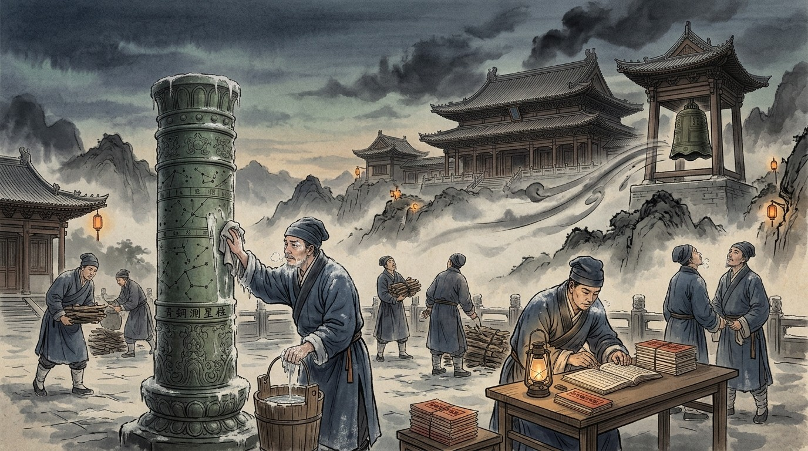

# 第 92 章：坐化真相・紫霄殿後的玉雕長老

[← 上一章](ch0091.md) ｜ [本卷目錄](00_intro.md) ｜ [下一章 →](ch0093.md)

*章首插畫：第 92 章 坐化真相・紫霄殿後的玉雕長老*

星曆對校尚未等到朔日夜間的雙照覆驗，太清玄天宮內部先傳來了一樁足以震動全山的重大消息——

這日卯時，外門經生們照例正頂著刺骨寒風，拿布片與熱鹼水一點點刮除庭院青銅測星柱上凝結的厚霜、順便結算這個月的「歲貢定額」朱砂符紙簿冊。凍僵的手指還沒捂暖，紫霄殿方向忽地傳來九聲沉緩肅穆的喪鐘：

在紫霄殿後山清修偏峰閉關整整十二年的內門傳功長老「鶴鳴真人」，修為已臻二階圓滿大境，於昨夜子時「功德圓滿，坐化飛升」。

消息一出，從外門經院到周天星律院，無數年輕弟子與世家經生紛紛仰望後山雲霧深處，眼神裡滿是嚮往與敬畏。沈照塵甚至在課堂上激動得連算籌都拿不穩，低聲對鄰座同門感嘆：「鶴鳴師伯一生循規蹈矩、奉天守律，連一絲俗念都不沾，如今終於脫去凡胎枷鎖，羽化登仙，實乃我太清道統之大幸！」

唯有授業師陸觀瀾站在窗邊，盯著後山方向濃得化不開的寒霧，指尖卻緊緊攥著腰間一條褪色的素白帕子，臉色蒼白得沒有半點血色。

「清虛，」陸觀瀾轉過頭，避開眾人的目光，聲音比平日低啞了許多，「執法殿點名要星律院派兩名手腳麻利、不亂說話的外門上等經生，隨同去後山『升仙台』外圍奉香兼記錄星氣餘韻。你……跟我走一趟。」

柳清虛心中微微一動。他看得出授業師眼底壓抑著某種極深的矛盾與恐懼，沒有多問，只默默點頭收拾好記錄用的炭筆與薄冊，跟在陸觀瀾身後踏上通往後山「清修偏峰」的積雪石道。

越往後山走，靈氣越是純淨得近乎刺骨，天地間一絲凡塵煙火氣息都感受不到。可不知為何，隨著距離升仙台越來越近，柳清虛胸口衣襟內的【逆星斷碑拓片】卻變得越來越涼，彷彿正靠近一塊巨大的萬載寒冰。

半個時辰後，兩人穿過兩道由太清雷符殿弟子持劍把守的雲紋石門，來到位於偏峰懸崖頂端的一座封閉石築靈堂前。

靈堂外圍已經跪著十幾名身穿內門紫袍的執事道士，氣氛肅穆壓抑。為首那名面容瘦削、雙目如鷹隼般陰鷙的中年道長，正是掌管太清雷符殿與刑律的執法長老——玄冥真人。

「時間已近午時三刻，香火撤下三步，不得驚擾鶴鳴師兄飛升餘韻。」玄冥長老冷冷掃了一眼新上來的陸觀瀾與柳清虛，目光只在柳清虛那身略顯陳舊的外門青袍上頓了半息，「把記錄星盤架在門檻外三十步的石台就好，不許擅自踏入靈堂帷幕之內，更不許掀簾窺視。」

「遵法旨。」陸觀瀾低頭應了一聲，神情順從，拉著柳清虛退到三十步外的石台邊。

柳清虛不動聲色地架好測算盤，開始記錄此時升仙台上空的星煞匯聚濃度。可才剛記下兩行數字，他握筆的手指卻微微停頓——

在他的感知裡，靈堂內部根本沒有所謂「羽化登仙、靈氣散歸天地」的跡象。相反，整座升仙台地下的三條主聚星陣紋，此刻正像幾根貪婪的吸管一樣，反過來死死咬住靈堂正中央某個核心，源源不斷地往靈堂上方九天高處抽取著一種極度精純、甚至帶著一絲生命餘溫的奇怪靈流！

就在這時，一陣突如其來的山谷暴風猛地撞上偏峰懸崖！

「呼啦——！」

原本應該有護山陣法穩穩遮擋的寒風，不知是因為陣眼哪處積雪過厚還是星力切換的間隙，竟然硬生生掀起了一陣罡風，從石門縫隙裡倒灌進去，將靈堂正中央垂掛著的那幅厚重青色雲錦帷幕猛地吹翻了半角！

一眾內門執事頓時驚呼變色，玄冥長老更是冷喝一聲抬手打出兩道雷符鎖死門風。

但那短短不到半息的掀簾之間，站在三十步外石台高處、神識早已遠超同輩的柳清虛，卻清清楚楚地看見了帷幕後面盤坐在蒲團上的「鶴鳴真人」——

根本沒有什麼仙風道骨的羽化肉身！

蒲團之上，坐著一尊人形的**淡青色半透明晶石雕像**！

那位號稱「功德圓滿、白日飛升」的二階圓滿傳功長老，全身的皮膚、筋肉、毛髮乃至五臟六腑，已經徹底消失，取而代之的是一簇簇如同冰凌與玉石交織般的無機質淡青晶體。那張依然保持著慈祥閉目打坐模樣的臉龐上，眼眶深處空洞無神，只剩兩團凝結成冰晶狀的星芒，而他的胸口與百會穴位置，還連著數十條細如蛛絲的淡青光脈，正一明一暗地向著頭頂天穹緩慢輸送著殘存的神魂靈力——

那根本不是飛升！

那是被「二十八宿天羅假天」活生生吸乾最後一滴人性與生命，徹底玉化為修補天地牢籠的**活體聚靈晶柱**！

「咔嚓。」

幾乎就在玄冥長老雷符落下、帷幕重新合攏的同一瞬間，或許是剛才那一陣暴風震動，一顆米粒大小的淡青色晶體碎屑，從玉化長老袖口邊緣無聲滑落，一路順著傾斜的石階滾了出來，恰好滾停在石台邊緣的積雪縫隙裡。

「退下！今日靈堂封閉，所有未曾領令的外門弟子，即刻返回各自院落！」玄冥長老臉色陰沉如鐵，袖袍一甩，一股不容抗拒的雷壓將所有外門人員往山道下驅趕。

柳清虛的反應快到了極點。他假裝蹲下身收拾被風吹倒的測算盤底座，指尖微不可察地一夾，迅速將雪縫裡那顆米粒大小、散發著冰冷無機質感卻隱隱透著一縷微弱星力的【道化晶石殘片】抓進掌心，封進早已備好的小木蠟盒裡。

退下石階百餘步後，四周只剩下呼嘯的松濤與踩雪的沙沙聲。

陸觀瀾一直走到偏峰山腰那間僻靜無人的老松亭裡，這才雙腿一軟，扶著冰冷的石柱停了下來。這位平日溫和耐心的女道師，此刻手背青筋微露，咬著下唇，半天說不出一句話。

「師長……那不是飛升，對不對？」柳清虛沒有急著指責宗門，也沒有把「假天牢籠」這種驚世駭俗的詞彙直接甩出來，而是平靜地看著自己的老師，聲音壓得極低。

陸觀瀾身軀微微一震，猛地回過頭看著他。山風吹散了她鬢邊幾縷碎髮，眼眶邊緣早已泛紅：「清虛，剛才那一幕……就當作是山風眼花，一個字也別往外說。進了太清門牆，有些事知道得越早，死得越快。」

「可您的師兄……他是不是也快變成那樣了？」

柳清虛沒忘記在金石府摘星台、乃至這一個月來在陸觀瀾案頭見過的那幾卷異常病歷與藥方——陸觀瀾自己偶爾也會悄悄向山下藥鋪托購極昂貴的安神溫脈湯，卻從不報銷進宗門帳目。

陸觀瀾閉上雙眼，長長吐出一口帶著白霧的苦氣。

「我師兄修為邁入二階高境那天，左眼開始看不見人臉上的血色，只能看見一條條發亮的星軌。」她的嗓音啞得不成樣子，「宗門裡從來不告訴外門弟子，只說是『心性未純、神魂欲化未化』。長老殿給出的法子只有兩個：要麼去請執法殿發下一種昂貴的暗紅丸藥暫壓神魂燥冷，要麼……就在偏峰找一間靜室閉關，等著那一天來臨，好替宗門留下一具『功德圓滿』的體面名聲。」

「師長知道那暗紅丸藥是用什麼煉的嗎？」柳清虛追問了一句。

陸觀瀾搖了搖頭，眼神裡既有掙扎，也有一層作為太清門人的無奈矛盾：「我不知道配方，也不願去猜。我只知道，太清宮的星律觀測確實救過山下十幾個州縣的百姓免於水旱大災，我師父當年也的確是頂著星煞反噬替北境守住了半邊天……清虛，你別拿外面那種非黑即白的眼光來看這裡。這座山門裡的人，大多不是惡魔，他們只是在等著一個沒人知道怎麼解的死結。」

說罷，陸觀瀾深深看了柳清虛一眼，轉身獨自沿著小路往偏峰更深處走去。在拐過一株枯松時，那座偏峰崖壁邊緣的簡陋石屋前，正好站著一位身穿粗布道袍、頭髮花白卻背脊挺得筆直的七十多歲老道姑——太清宮苦修派長老，簡素真人。

簡素真人遠遠朝著柳清虛所在的方向冷冷看了一眼，似乎察覺到了什麼，卻什麼也沒說，轉身關上了柴扉。

柳清虛站在雪地裡，直到那陣寒風吹透了道袍，這才緩緩把手伸進袖中，捏住那隻裝著淡青色晶屑的蠟封小盒。

他此刻腦海裡並沒有立刻獲得全部答案——一具鶴鳴真人的玉化遺蛻，只能證實「坐化飛升」的說法存在重大虛假，並證實法修高階確實存在神魂與肉身晶化失溫的危險；但究竟是不是所有坐化長老都變成了這樣？是天道如此，還是某座陣法強行抽取？而那個陸觀瀾口中「暗紅丸藥」又是否真的與血精有關？

在找到第二份、第三份能互相印證的證據之前，柳清虛絕不會把自己未經檢驗的猜想寫成定論。

只是當他轉身走下偏峰山道時，懷裡的這塊冰冷晶屑，與腦海中黑石鋪枯木老道那雙空洞淌血的眼眶，已經無聲地連成了一條線。

---

[← 上一章](ch0091.md) ｜ [本卷目錄](00_intro.md) ｜ [下一章 →](ch0093.md)
