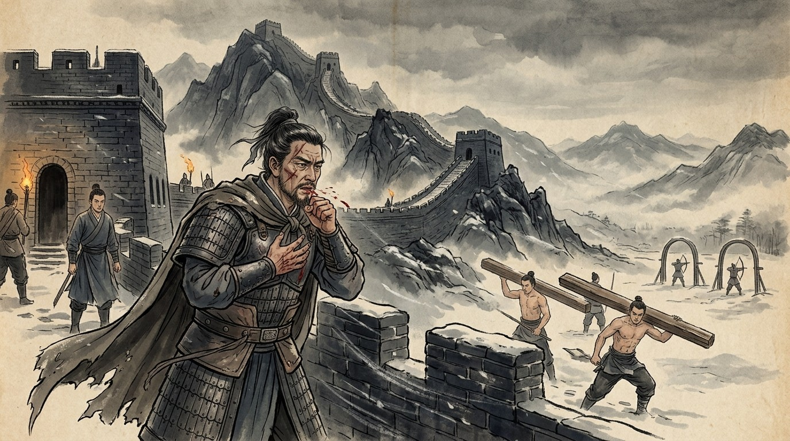

# 第 93 章：煞血霸體・黑山長城的咳血宿將

[← 上一章](ch0092.md) ｜ [本卷目錄](00_intro.md) ｜ [下一章 →](ch0094.md)

*章首插畫：第 93 章 煞血霸體・黑山長城的咳血宿將*

北風在黑山長城的雉堞之間撕扯出尖銳的呼嘯，像無數把生鐵銼刀在石壁上打磨。

入冬一個月來，燕隼幾乎有大半時間都泡在海拔最高的「煞血霸體營」與北線長城巡防牆上。八荒武山不跟弟子講究什麼玄虛大道理，每天卯時起鼓，整整兩個時辰在寒風如刀的校場上光著膀子扛巨木、踏煞血梅花樁，把大黑山陰冷暴戾的北荒煞氣硬生生逼進皮肉筋骨裡打熬氣血；下午則領著配額去破軍重弓塞練百步靶，或者跟著老兵扛條石修補城垛、用鐵鏟刮清牆根下凍硬的馬糞冰轍，再回軍需房清點這個月的箭簇損耗與「歲貢定額」皮甲修補帳。

這一日午後，警報號角驟然響徹黑山關。

「東側三號豁口外五里，一頭二階成年『鐵甲寒犛』領著十幾頭雪豺衝進了補給馬隊的轉運道！」

煞血營教頭岳停山提著一把九十斤重的精鋼重戟跨步上馬，右膝那道陳年舊傷在寒氣裡隱隱作痛，臉色卻鐵青得像塊玄鐵：「三班巡邏哨隨我出關截殺！其餘新兵守住雉堞箭樓，不准擅離射界！」

「燕隼，你跟二排弓手壓上左翼高崖！」

破軍重弓塞的女校尉唐映將一面測距紅旗插在牆垛上，凍傷過半的右眼在風雪裡瞇成一條細線，語氣冷硬得像冰塊：「把配給的那壺三十支三稜破甲箭分好。記住，一頭鐵甲寒犛夠記進軍功賞冊頭等實賞，可你要是為了搶這份賞格追進一里外的白霧雪溝裡——老娘寧可扣你半個月肉乾，也絕不派兵替你去溝裡撈屍骨！」

「明白！」燕隼背上百斤柘木弓，左腰掛著沉甸甸的黑鐵腰牌，大步踏上左翼積雪覆蓋的碎石坡。

戰局在半刻鐘後瞬間白熱化。

那頭體長近兩丈、披著厚重灰黑鱗甲的二階荒獸「鐵甲寒犛」瘋狂衝撞著山道上的拒馬，兩根彎曲的玄鐵牛角生生挑飛了一輛滿載糧草的木車。十幾名煞血營老卒在岳停山帶領下結成圓陣死死頂在前面，刀劍砍在獸皮上竟迸出一串火星，兩名衝得太靠前的武修立刻被巨尾掃斷了肋骨，口噴鮮血飛出三丈外。

站在左翼高坡上的燕隼眼神冷靜如冰。他沒有急著催動全身氣血去射什麼華麗的連珠箭，而是按照這月餘從八荒《煞血霸體訣》裡悟出來的法門——不讓那股狂暴燥熱的血氣衝進腦門，反而強壓著沉入丹田與腰背大筋，整個人像生了根的古松般釘在凍土上。

「嗖——！嗖——！」

兩支重箭在呼吸交替的死角極限破空，沒有硬射寒犛最厚的腦門骨甲，而是精準地咬進這頭巨獸前腿抬起時露出的腋下軟筋縫隙！

寒犛吃痛發出一聲震耳欲聾的咆哮，前衝之勢陡然一滯。岳停山抓準這半息戰機，大喝一聲拖著傷腿猛地欺身而上，重戟如泰山壓頂般順著傷口斜劈下去，這才硬生生將這頭堪比二階中堅武修戰力的狂暴巨獸斬翻在雪泥之中。

剩餘雪豺見頭獸倒下，頓時掉頭朝北邊白霧瀰漫的裂谷雪溝逃竄。

幾名剛立下戰功、氣血正燒得發燙的年輕外門武修雙眼赤紅，嗷嗷叫著就想追下坡去搶殺殘獸：「別放跑了！一頭雪豺也夠記一筆軍功賞冊！」

「站住！」岳停山喘著粗氣，一戟橫掃震飛半丈積雪，直接攔在幾人面前，臉色煞白地低吼，「前面是白霧雪溝，地底煞氣比關牆上重三倍，進去十步氣血就要燒穿經脈！想送死就給老子脫下黑山營的甲自己滾出去！」

燕隼也收起弓，沒有追上去撿那幾筆寫在軍功賞冊上的殘獸賞額，反而一個箭步跨下斜坡，先去檢查那兩名被掃斷肋骨的倒地同袍，用乾淨布條壓住對方湧血的胸口。這一個動作讓後方正好收旗趕來的唐映與岳停山都微不可察地點了點頭。

夜幕降臨，傷兵被抬進長城內側的「傷兵養息院」。

燕隼因為剛才兩箭封筋立下頭功，加上自願留下幫忙搬運傷員與整理殘破箭囊，直到子時換防才拖著疲憊的身子走向養息院後廊的熱水房。

「咳……咳咳咳……！」

路過一間點著暗黃油燈、門窗緊閉的內院廂房時，裡面突然傳來一陣極其壓抑、卻聽得出來五臟六腑都彷彿在撕裂般悶響的劇烈咳嗽聲。

燕隼腳步猛地頓在廊柱陰影裡。

木窗紙被裡頭的燭火映出兩條模糊的人影。透過沒有關嚴的一線門縫，燕隼看清了裡頭的情形——

坐在木榻上的，正是白天在操場上威風凜凜、彷彿連刀劍都斬不穿的獨臂老將雷烈，以及身旁另一名白髮蒼蒼的黑山營宿將！此刻這兩位在北荒外圍令荒獸聞風喪膽的二階宿將，竟然脫去了上衣，裸露出精壯卻佈滿恐怖暗紫色淤斑與龜裂乾紋的胸膛。

「將軍，您這肺腑裡的燥火已經壓不住了，不能再拖……」

站在旁邊說話的，是養息院裡那名三十三歲的女醫官杜青禾。這位曾因在煞血營練功過度導致內臟受損而退役的醫官，正一臉凝重地端著一隻黑陶藥盤。

「咳——噗！」

雷烈又是一聲劇咳，低頭往銅盆裡吐出一口粘稠得像燒焦瀝青一樣的黑紅血塊，那雙虎目在燭火下透著一股狂躁而痛苦的血絲：「別廢話……明天黎明還有一輪長城南段換防，老子不能讓外頭那些狼崽子和宗門老東西看出我半條命已經燒乾了。把『急鎮丸』拿出來！」

杜青禾咬了咬牙，還是把陶盤上的瓷瓶推了過去，語氣裡滿是不甘與壓抑：「這月已經是第三次超量了……藥裡頭那股濁勁兒越來越重，只管暫時鎮痛壓火，再這麼吃下去，您的脾胃會徹底僵掉。」

「能多撐一年把長城守到新兵長成，就算把骨頭燒成灰也值了。」

雷烈伸出僅剩的右手，直接擰開瓷瓶塞子，倒出一顆拇指大小、表面隱約泛著暗紅硫磺油脂光澤的丸藥，仰頭連水都沒喝便硬生生吞了下去！

站在廊外陰影裡的燕隼，瞳孔在這一瞬間猛地收縮如針芒！

寒風從打開的門縫捲過他的鼻尖——那顆「急鎮丸」瓶口散出來的一絲微弱卻極其刺鼻的腥甜硫磺氣息，幾乎與一年前在黑石鋪北崖深井底下、以及在濁水縣高腳浮橋暗室裡見到的【地煞血精】味道，一模一樣！

沒過兩息，門突然從裡面被拉開了一半。

杜青禾端著那只裝著黑血的銅盆走出來倒水，險些撞上站在門廊柱後的燕隼。她嚇了一跳，看清是白天剛立功的新弟子後，迅速拉上門掩住裡頭雷烈的身影，壓低聲音喝道：「子時三刻了，不回營帳歇息，在養息院外頭晃什麼？」

「我替受傷的張哥來領明天換藥的麻布。」燕隼神色沒有半點驚慌，把手裡一捲剛領到的舊布條舉了舉，目光卻坦然地看向杜青禾手裡那隻散發著怪異腥甜味的空瓷瓶，「杜醫官，雷將軍……還有營裡那些練《煞血霸體訣》的老兵，是不是每天半夜都會咳出這種焦黑的血塊？」

杜青禾臉色微變，把瓷瓶迅速塞進醫官布袋裡，警惕地盯著這個眼神比雪狼還銳利的少年。過了片刻，見他神色裡並沒有窺探陰私的幸災樂禍，只有一種沉甸甸的疑問，她才嘆了口氣，低聲道：

「進黑山營才一個多月，這雙眼睛倒毒。我勸你一句，有些病是八荒武山的老毛病——練煞血功法引地煞入髓，時間久了氣血把五臟六腑烤乾了，人就會躁狂、咳黑血、壽元大減。營裡把這種藥叫『定心急鎮丸』，沒了它，前線一半老將連一個冬天都熬不過去。」

「這藥……是用什麼東西煉的？」燕隼忍不住追問了一句。

「不知道。」杜青禾回答得乾脆而冷靜，「管後勤與丹藥的執事只負責每月按配額從丹鼎宗或雲津秘密領貨，從來不標藥單成分。我只負責記錄每個服用者的體溫、脈象、脾胃衰弱跟情緒失控的天數。有些老兵是陳年凍傷加上過度操勞才惡化，也有些確實像是在靠這藥強行吊命……但醫官講的是病案實據，在沒驗清裡頭究竟摻了什麼以前，別隨便去喊什麼黑幕。」

說完，杜青禾拎起銅盆大步走進雪夜的另一頭。

燕隼站在原地，一直望著那扇重新合攏的木門，拳頭在衣袖裡緩緩攥緊。

他沒有衝動地去質問雷烈，也沒有立刻得出「八荒武山高層全是血精買家」的武斷結論——正如杜青禾所言，一個字沒看見藥單和煉製批次之前，僅憑鼻子聞出來的一縷相似氣味，還不足以定罪整座日夜流血死守北疆防線的軍寨。

但他回營帳後，立刻撕下半角寫給泥途商棧的朔望貨單副頁，借著火盆微光寫下幾行極細的墨字：

> *「煞血營多見宿將夜咳黑血、性情漸躁；見『急鎮丸』，氣味極似黑石血精，唯來路、配方與知情層級未明。托顧玄留心丹鼎宗此類暗紅延命丸流向。」*

---

[← 上一章](ch0092.md) ｜ [本卷目錄](00_intro.md) ｜ [下一章 →](ch0094.md)
