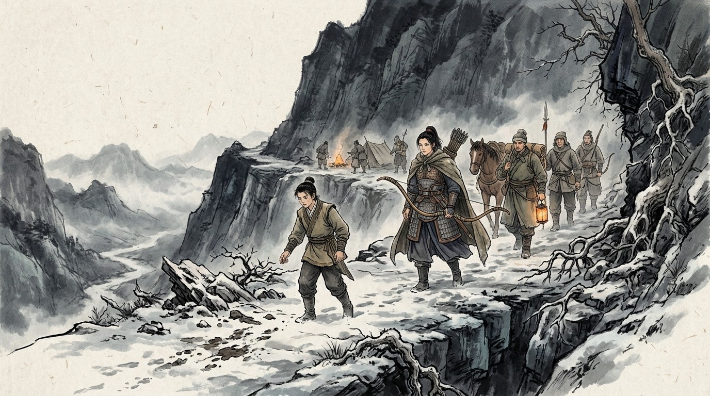

# 第 94 章：斷崖骨箭・五年前的走山血痕

[← 上一章](ch0093.md) ｜ [本卷目錄](00_intro.md) ｜ [下一章 →](ch0095.md)

*章首插畫：第 94 章 斷崖骨箭・五年前的走山血痕*

又過了十日，入冬後最大的一場寒流壓過了北荒裂谷邊緣。

這日清晨，剛在伙房領完這個月「歲貢定額」扣減後的凍硬鹹肉與新發的生牛筋弓弦、蹲在馬廄門口刮了一早上的馬蹄冰泥，黑山營便急調出一支六人輕裝巡防小隊，沿著大黑山東側從未對外開放的無人邊線巡查獸群遷徙痕跡。領隊的是破軍重弓塞女校尉唐映與二十四歲的邊民斥候祁無傷，燕隼因箭術沉穩、擅長辨識雪地足印與地煞動向，破例被點名隨行補位。

出了長城東側那扇很少開啟的鐵包邊門，世界瞬間變成了一片沒有邊際的灰白與墨黑。

「貼著岩脊背風面走，踩前一個人的腳印。」

祁無傷走在最前頭，這個二十四歲出身北荒裂谷邊民的年輕斥候嘴唇凍得泛青，手裡拎著一根綁了紅布的測冰長鐵簽，邊走邊用簽尖輕敲冰面：「前面三里就是『鬼哭冰澗』。去年雪崩把東坡壓塌了一半，底下裂縫藏著暗河，走歪半步掉下去，十根繩子都拉不上來。」

燕隼默默點頭，緊跟在隊列第三位。然而當眾人繞過一道形似巨大鷹喙的墨色風化岩脊時，燕隼的腳步卻微微一頓，手指下意識摸向胸口貼身收著的那塊物品——

那是在鎮風縣衛所舊案室裡找到的半枚【玄鐵走山令殘牌】，以及他在心裡反覆推算過無數遍的五年前北荒行進方位！

按照衛所檔案記載，五年前他大伯燕山受僱於金石商會出資組建的那支「走山勘探隊」，最後一次在官軍哨站留下補給記錄的方位，正是指向鬼哭冰澗東側的這條裂谷分支！

「唐校尉，右下方那道冰壁裂縫……積雪塌陷的形狀有點古怪。」燕隼舉手示意停下，目光死死鎖在三十步外一處被千年積冰半掩的狹窄斜坡岩縫裡。尋常雪坡崩塌是整片滑落，可那處岩壁邊緣卻有著極為隱蔽的人工鑿痕與陳舊的煙火燻黑痕跡，若非大雪剛被昨夜的罡風刮走一層浮雪，外人絕難察覺。

唐映舉起單筒遠鏡瞄了一眼，神色微肅：「祁無傷，先試冰層承重。燕隼，你隨我下去看看——如果是前兩年失蹤巡哨隊的遺物，得登記進名冊帶回去。」

三人拴上牛筋安全繩，沿著冰壁一寸寸垂降到那處狹窄的冰縫平台。

冰縫裡極為陰冷，空氣靜止得沒有半絲流動。唐映點亮一支防風油燈，昏黃的火光瞬間照亮了覆滿厚厚冰霜的墨色岩壁。

下一瞬，燕隼的呼吸徹底停住了。

在距離地面約莫三尺高的冰層內部，清晰地凍著半截已經折斷的粗木箭桿——箭桿尾部纏著的不是八荒武山制式的白羽，而是用一種極其古老的雙股黑麻線交叉纏緊的野鷹尾羽！在箭桿靠近斷口兩寸的位置，還用小刀刻著一個只有三個筆劃的極簡記號：

一筆橫折，帶兩道斜掠的鷹翅刮痕。

**那是大伯燕山的箭記！**

自從他七歲能拉開桑木小弓那天起，大伯就手把手教過他這個記號——每一支從大伯手裡射出去的狼牙重箭，箭桿這個位置都會留下這道刮痕，代表「箭出不空回，留記待後人」。

燕隼幾乎是靠著本能撲了過去，用柴刀刀背小心翼翼地敲開外層脆冰，將那半截斷裂的骨箭連同下方壓著的半塊凍硬的深褐色舊皮甲一起摳了出來。皮甲內襯一角早已發黑，上面沾滿了早已被冰封成暗紅冰渣的陳年血漬；更刺眼的是，皮甲肩帶位置上，印著一個被風霜磨掉了一半、卻依舊清晰可辨的暗印——**「八方」二字**。

這是五年前金石府城八方武館發給走山護衛隊的舊式皮甲！

「這不是我們這幾年的黑山營製式甲。」唐映蹲下身，舉著油燈仔細檢視那半塊皮甲與斷箭的斷口，「箭桿不是被獸爪拍斷的，斷茬整齊斜切，是被重斧或者軍用破甲弩從側面近距離硬生生削斷的。」

燕隼沒有說話，手背上的青筋因為用力攥緊那半截斷箭而微微凸起。他蹲下來用拇指輕輕擦過箭桿斜切處光滑得過分的木茬，聲音反而壓得比冰壁還冷：「這不是雪獸咬的，是軍用破甲弩貼近斜削。」

他沒像尋常新兵那樣急著咆哮追問，自己便先拿出一張油紙把斷箭與皮甲裹好，抬頭看向正拿出軍用繪圖炭筆的唐映：「線索斷在五年前。先記下這處溝壑步數方位，回去找管後勤與失蹤名冊的阿滿姐，核對當年這條溝的出關登記。」

當晚，回到黑山營後，燕隼沒有立刻去鬧營帳，而是照著唐映的提醒，先繞去了軍寨後方的「北線軍寨後勤區」。

炊事房外頭寒風呼呼作響，一名三十多歲、雙手泡在冷水裡洗菜的婦人正把一口剛煮好的大鐵鍋掀開，騰起的白霧遮住了她臉上早早爬上的皺紋。她叫阿滿，丈夫在三年前的一場巡哨裡失蹤在裂谷外圍，從此她就帶著兩個孩子留在軍寨炊事房幫忙，順便替整個北線軍寨管著那本誰也不太願意翻開的《歷年失蹤者與未寄家書簿》。

「天興十九年冬……走山隊？」

阿滿擦乾手上的水漬，在油燈下仔細翻了翻櫃子最底層那幾本邊角發黃的舊名冊，眼神忽然定格在一頁用粗墨筆畫了兩道黑槓的紙面上。

「有紀錄。五年前這支從金石府上來的民間勘探隊，一共十二個人，領隊嚮導叫『燕山』。」阿滿指尖點過那個讓燕隼心口發痛的名字，「當時黑山營派了一個十人小隊從外圍接應，可到了預定折返的那三天，大雪剛好封了鬼哭冰澗。我記得清楚，營裡後來傳下來一張字條，說這批外來勘探隊『私自改道越界、全數失聯除名』，連帶當初去外圍接應的兩個黑山營斥候也寫了『擅離職守失蹤』，連撫恤金都沒發給家屬。」

「連外圍接應的自己人也沒回來？」燕隼聲音嘶啞。

「那兩個斥候的妹妹現在還住在南沿入口外的互助棚裡呢，叫韓素，一直留著她哥那年的東西不肯信人死了。」阿滿嘆了口氣，把名冊推過來給燕隼核對，「孩子，你要查，就得心裡有數——名冊上的字是會被人改的，可底下等不到人回家的女人和老娘，是不會記錯日子的。」

就在這時，炊事房的木門「吱呀」一聲被推開。

披著一件厚實黑鐵大氅的獨臂老將雷烈大步走了進來，肩頭落了一層剛從外頭帶進來的細雪。他先看了一眼阿滿桌上的舊名冊，又轉過頭，目光深沉地落在了燕隼緊緊握在手裡的那半截斷箭與舊皮甲上。

「跟我來。」雷烈只說了三個字，轉身走向軍營最僻靜的城牆箭樓內室。

關上厚重的包鐵木門，室內只剩下一盆炭火發出微弱的紅光。雷烈沒等燕隼開口質問，自己先從胸口貼身的鐵夾裡抽出一卷用蠟紙包了三層、邊角早被捏出毛邊的泛黃軍用副冊，直接拍在木桌上！

「這是五年前鬼哭冰澗那一晚，我從軍需司庫房底層搶救出來的調度副本。」雷烈僅存的右手緊緊按在桌面上，指節泛白，那張一向剛硬如鐵的臉龐，此刻竟第一次露出了深深的疲憊與愧疚，「五年前，燕山那小子拿著金石商會內堂簽發的『特批走山令』來黑山營找我喝酒。他跟我說，商會出的價很高，請他帶一批人馬進去勘探一條『古代流傳下來的地脈熱口』。只要這趟回來，就能替你湊夠進府城學武和換一把好弓的銀兩。」

燕隼喉頭狠狠一哽，眼睛死死盯著那卷副冊。

「我當時只當他是帶民間隊伍走一趟險路，便私下批了兩個熟悉冰澗地形的老斥候在東口外圍等他五天接應。」雷烈閉上眼，聲音沉痛如鐵，「可到了第四天夜裡，大雪還沒落實，上頭黑山議武堂突然急傳下來一份加蓋了『防線緊急調動印』的撤防密令——說西邊三十里發現大股三階雪獸群異動，命所有東線外圍接應哨立刻拔營西調，鬼哭冰澗三日內封口禁行！我當時信以為真，就在調令上……簽了我的字。」

「咔啦」一聲，燕隼手中的木箭桿差點被生生捏碎。

「西邊根本沒有獸潮。」雷烈睜開雙眼，血絲密佈，「等我三天後醒過神帶人強行摸回鬼哭冰澗，峽口已經被大威力的軍用開山火藥從上方炸塌封死！我事後去查軍需司底冊，那份原本壓在裡頭的『金石商會走山隊外圍接應存根』已經被人抽走了，連帶著整個隊伍的撤離紀錄都被抹得乾乾淨淨。我只保下了這一份抄錄時多留了一聯的軍需糧秣出庫副本——」

雷烈將那份副本推到燕隼面前。上面清晰地記錄著當年曾有三十斤非軍中常規配給的烈性開山火藥，在「未經前線將領核簽」的情況下，由兩名掛著千機百巧門工坊印記的暗差調進了鬼哭冰澗方向！

「這事兒……我憋了五年，誰也不敢信。」雷烈看著面前這個雙眼通紅、卻死死咬牙沒吼出一句的年輕獵戶，聲音沙啞卻無比鄭重，「燕隼，我今天交給你這份副本，一來是老子對不起你大伯，當年沒看穿那紙調令的鬼名堂；二來，老子也把話撂在這兒——火藥從誰手裡批出去的還沒著落，這筆帳急不得。」

雷烈一掌按在燕隼肩頭，力道重得像塊玄鐵：「燕山是我見過最滑溜也最硬氣的獵戶。在活不見人、死不見屍之前，這條命就還沒結帳！先查清楚那批火藥的領印出處，還有他們當年究竟在鬼哭冰澗深處踩到了什麼不該看的东西！」

燕隼深吸了幾口氣，胸腔裡那股幾乎要衝破咽喉的血氣翻湧了整整半晌，才被他憑藉獵手多年在雪地裡蹲守的狠勁，一點一點強壓回肺腑深處。

他沒有喊叫，沒有發誓要血洗誰的宗門，只是緩緩伸出手，小心翼翼地從桌上拿起那份軍需副本，連同那半截帶著老鷹箭記的斷箭與染血舊皮甲，一層一層用油紙包緊、編號、貼身收進懷裡。

「將軍放心。」少年抬起頭，眼眸裡沒了衝動，只剩下一片冰原般的冷冽與堅定，「在親眼找到大伯或者找到他的屍骨之前，我不會拿自己的命去賭任何一把沒有把握的箭。」

---

[← 上一章](ch0093.md) ｜ [本卷目錄](00_intro.md) ｜ [下一章 →](ch0095.md)
