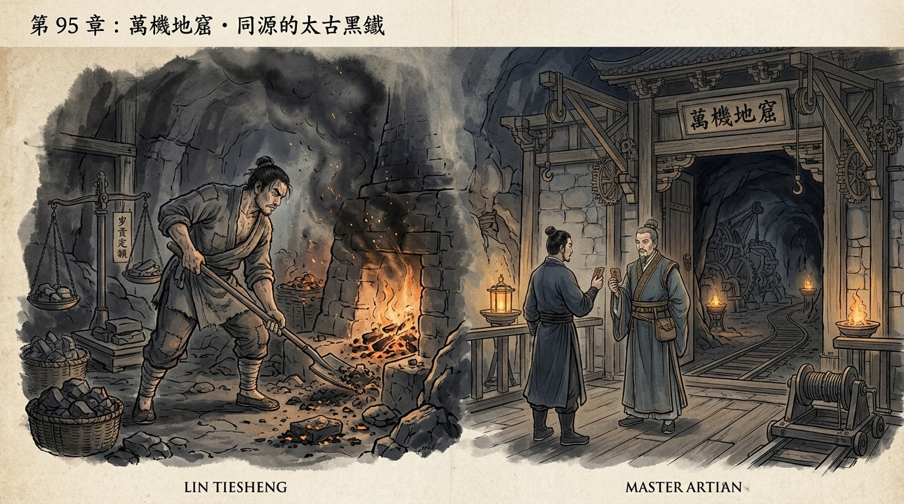

# 第 95 章：萬機地窟・同源的太古黑鐵

[← 上一章](ch0094.md) ｜ [本卷目錄](00_intro.md) ｜ [下一章 →](ch0096.md)

*章首插畫：第 95 章 萬機地窟・同源的太古黑鐵*

千機院的歲末大考剛過，林鐵生在地火鍛兵台整整清掏了一個半月的地火渣溝——每天天沒亮就得拿長柄鐵鍬把爐底凝結成硬塊的硫磺冷渣一鏟鏟刨出來、過秤登記外門「歲貢定額」的廢鐵回爐斤兩，雙手虎口震出一層厚繭——直到憑著那份「雙契榫楔力向修正圖紙」與修好十七具廢舊礦車絞盤的實績，他這才連跳兩級升入天工閣內門，拿到了一塊准許隨同值守匠師進入「萬機地窟」的雙人批令銅牌。

這日清晨，天剛矇矇亮，林鐵生便拎著工具囊，跟著地火鍛兵台總匠章百鍊與陣圖工房的女陣匠聞九，一同穿過重重包鐵石門，沿著一條傾斜向下的寬闊石道，走進了深埋在萬仞天工山腹地深處的萬機地窟。

越往深處走，耳邊那種叮叮噹噹的打鐵聲逐漸退去，取而代之的，是一種低沉、緩慢、彷彿巨獸沉睡呼吸般的地熱氣流嗡鳴。

當頭頂最後一道厚重的青銅閘門緩緩升起時，即便是向來沉穩如鐵柱的林鐵生，也忍不住停下腳步，倒抽了一口涼氣。

面前是一個足有數十丈高、宛如整座山腹被硬生生掏空出來的龐大地下岩窟。岩窟正中央，靜靜矗立著一尊高逾十丈、通體由墨青色玄鐵奇金與厚重青銅甲片拼裝而成的巨型機械人偶——

**天工閣鎮山重器，【巨靈神機】！**

巨像半跪在寬闊的玄鐵底座上，單是那一條垂落在地面的機械左臂就足有兩間屋子粗細，關節處密密麻麻嵌著數以千計大小不一的齒輪與蓄壓傳動銅管，胸腔部位敞開著一扇維修鐵門，幾道臨時搭起來的木質腳手架正緊貼在巨像胸腹之前。

「這不是普通的人形傀儡。」

站在門邊的值守匠師季衡年約三十一歲，手裡拿著一本厚厚的《地窟安全閘巡檢簿》，神色肅穆得近乎敬畏：「祖師爺傳下來的規矩，巨靈神機乃太古遺留殘骸，閣內只許對外部防塵甲片與次級聯動輪進行例行清灰與上油，**沒有長老聯署雙印與檢驗封籤，任何人不得擅自拆解核心主軸**。」

「今天只做例行除塵與主胸腔外圈油槽檢修，不動核心。」章百鍊左臉的舊火疤在幽暗的地肺火光下顯得格外剛硬，他拍了拍林鐵生的肩膀，「鐵生，你手穩，眼力細，跟著聞九姐上第三層腳手架，把胸腔主傳動軸外圈的碳灰擦乾淨，順便核對一下傳動齒距。」

「好。」

林鐵生點點頭，背上工具囊，跟著那名二十九歲的女陣匠聞九順著木梯爬上距離地面六丈高的巨像胸腔位置。

聞九性格爽利乾脆，手裡展開一大幅繪滿密密麻麻細線的羊皮分段陣圖紙，一邊拿炭筆比對位置一邊低聲道：「這些世家出身的內門弟子，畫大圖只管往上面寫自己師承的署名，遇到這種沒留全圖的太古舊物就兩眼一抹黑。你看清楚，咱們今天只測外圈這條主導輪與旁邊三道傳動齒輪的間隙，千萬別碰裡頭那根泛黑的中心大軸。」

「嗯。」林鐵生答應了一聲，取出抹布與阿鐵精鋼分寸卡尺，彎腰探進昏暗的巨像胸腔入口。

胸腔內壁散發著一股淡淡的冷金屬與陳年礦油味道。他點亮一盞防風礦燈，正要拿分寸卡尺去量外圈齒輪邊緣——

「嗡————」

掛在林鐵生腰間牛皮囊裡的某樣東西，突然極其猛烈地劇震了一下！

林鐵生心頭猛地一跳，幾乎懷疑自己是不是聽錯了。他迅速蹲下身，反手伸進牛皮囊裡，觸手處一片滾燙微麻——那枚從黑石鋪老鐵匠鋪地火中震出、連阿鐵師父都熔不動半毫的【太古不融黑鐵齒輪構件】，此刻竟然隔著厚厚的牛皮，朝著巨像胸腔深處正中心那根漆黑粗大的主軸，發出了強烈無比的磁石引鐵般的吸扯震顫！

「怎麼了？」聞九在外面察覺他動作突然僵住，探頭往裡看了一眼。

林鐵生深吸一口氣，穩住呼吸，並沒有把黑鐵齒輪掏出來，而是借著礦燈的光束，仔細朝著巨像胸腔最深處看去。

只見那根直徑超過三尺、表面刻滿毫釐絲紋般精密螺牙與導氣凹槽的中心黑色主軸，其金屬光澤、鍛打晶粒的細密程度、乃至齒牙邊緣獨特的雙曲線倒角弧度……竟與他腰間那塊只有兩指長的黑鐵齒輪，**分毫不差，宛如從同一套母模裡鑄造出來的大小兄弟**！

林鐵生順手拿起手邊的羊皮分段陣圖，借著對空間與機括力向的直覺，飛快地在心底把這十丈巨像的內部傳動方向重新拼了一遍——這尊被天工閣當成人形戰神供奉的巨像，雙腿與手臂關節的受力方向根本不符合人形格鬥重心！那兩條沉重無比的機械巨臂，一旦往後摺疊鎖死……

「聞九姐……」林鐵生退到胸腔口，指著圖紙上幾條被前人標註為「神機護心甲肋」的斜向支撐鋼樑，嗓音低沉地問道，「這幾根斜樑的受力角是往外頂的。如果是為了站穩揮拳，這麼設計只會把腰椎折斷。這東西……原本是不是裝在某個龐大船體或者超巨型平台側面，用來當成推進錨機或者轉向關節用的？」

聞九猛地一愣。這位擅長將大圖拆解成可施工分段圖紙的女陣匠，立刻接過林鐵生遞來的炭筆，按照他指出的受力方向在空白處快速畫了幾道延長線。

三息之後，聞九手裡的炭筆停住了，眼中露出極為震驚的神色：「這結構……推進力確實全都往後下方一處大基座集中！天工閣歷代祖師都拿它當戰爭傀儡修，難怪每次想強行抬起右臂超過三成高度，肩軸就要報廢崩裂！」

就在兩人同時意識到巨靈神機背後可能藏著某種遠超宗門認知的巨型構造時，下方地窟入口處，突然傳來一陣沉重急促的鐵靴踏地聲，伴隨著幾名值守弟子慌忙行禮的高喊：

「拜見赤煉長老！」

林鐵生與聞九趕忙順著木梯退下腳手架。

走進萬機地窟的，是一位身材高大、身披赤紅暗金雲紋長袍的中年男子，鬢角微霜，一雙眼睛裡跳動著近乎偏執的狂熱火光——正是天工閣實權長老，赤煉。在他身後，四名親信弟子正小心翼翼地抬著一隻厚重的鉛封鐵箱，還有一名帶著全套改裝工具的內門陣師。

「章百鍊，把胸腔外圍的檢修架撤了。」赤煉長老連看都沒多看旁邊的外門弟子，直接揮手下令，「把這批新調來的『高純度地煞精柱』，按乙字三號改裝口徑塞進神機胸膛輔助動力槽！明日北荒邊線的巡防調令又催了，這尊鎮山重器已經趴在這裡五年沒能徹底動起來，不能再等下去了！」

「長老，萬萬不可！」

一直沉默記錄的季衡臉色瞬間煞白，大步上前攔在鐵箱前面，甚至顧不上尊卑禮數：「巨靈神機的主軸與外接靈槽這月已經出現了三次不明原因的微弱突衝震動，而且我們前些日子剛拆檢出，凡是之前接觸過暗紅高能晶柱的次級銅管，內壁全都出現了嚴重的脆化麻點！在沒摸清原廠圖譜之前強行往裡面灌入烈性侵蝕的地煞精柱，一旦主軸在地下炸膛，整座萬仞天工山的地肺火脈都會跟著坍塌！」

「是啊長老！」站在一旁的章百鍊也沉聲開口，指著林鐵生剛交過來的檢修單，「銅鐵損耗早已到了極限禁線。不先清通成制散熱暗槽、換掉舊軸套，強行開機等於拿地窟裡幾十名工匠的命去賭！」

「不賭？拿什麼不賭？！」

赤煉長老猛然轉身，身上的二階巔峰靈壓轟然壓下，震得腳手架上的鐵鏈嘩啦作響。他卻並沒有一味暴跳謾罵，反而盯著季衡與章百鍊，一字一頓地冷喝：

「你們天天守著爐灰量這兩分、卡那半厘，敲了五年凡鐵，這尊祖師傳下來的鎮山神機不還是像塊死鐵疙瘩一樣跪在地底動彈不得？！尋常木石凡鐵、區區下品靈石，根本配不上太古重器！這天地間能逼出神機十成鋒芒的，只有極烈極煞的血精！只要明日能讓它當著北疆諸派的面轟然起身、一拳砸碎三階荒獸的骨頭，證明我天工閣百煉重器無敵於世——別說折幾根舊銅軸，就是把這座地窟的鐵架燒熔一半也值！」

說罷，赤煉不再理會季衡與章百鍊的勸阻，冷哼一聲：「把反對的聲音記進工單旁註裡，出了事我赤煉一力承擔！把箱子打開，準備強插精柱！」

鉛封鐵箱蓋子撬開的剎那，一股林鐵生這輩子最熟悉不過的腥甜硫磺熱浪撲面而來！

箱子裡整整齊齊臥著六根尺許長、通體呈現出濃稠暗血紅色、內部彷彿有無數怨氣與濁流在緩慢旋轉的結晶圓柱——**高純度地煞血精晶柱**！

就在赤煉長老親信把第一根血精晶柱對準神機胸腔輔助槽硬塞進去的瞬間，千機院的老者魯長老正好拄著一根烏木拐杖步履匆匆地趕到地窟門口。

「赤煉！住手！」魯長老枯瘦變形的五指死死攥緊杖頭，臉色鐵青，「《千機院安全規程》寫得明明白白，未經三名長老會簽與試壓測試的異質能源，嚴禁接入鎮山母機！」

赤煉手下動作微微一頓。這兩位同等輩分的天工閣長老在眾目睽睽之下對峙了足足五息。最終，赤煉眼神陰晴不定地看了一眼魯長老身後已經悄悄趕來的兩名監察文吏，又看了一眼正悄悄把異常震動次數記上巡檢簿的季衡，終究還是揮手讓弟子暫時蓋上了鐵箱。

「好，算你魯師兄守規矩。」赤煉冷笑一聲，將那份自己簽字強推測試的「特殊工單」拍在桌上，「這批晶柱我先封存在四號庫房。等過幾日三宗聯合勘探隊去北荒把母脈邊的壓強圖測回來，我看你們千機院還拿什麼藉口攔著天工閣重振神威！」

待赤煉一行人甩袖離去，地窟裡依舊彌漫著那股久久不散的腥甜血氣。

季衡鬆了一口氣，額頭滿是冷汗，隨即蹲下來在巡檢簿上補寫完剛才的對峙紀錄；魯長老則走到林鐵生面前，看著這少年緊抿的嘴唇和腰間鼓鼓囊囊的工具囊，低聲道：「剛才你和聞九畫的那張結構草圖，別放進公開檔裡，自己留好。地窟裡這尊老東西……我們這幾代人修了一輩子，怕是連它真正是什麼都沒弄明白。」

林鐵生默默點頭，將那張畫著推進錨機延長線的草圖疊好收入懷中。手心裡，那塊【太古不融黑鐵齒輪】已經恢復了冰涼，可上頭似乎還殘留著方才那一瞬間與十丈巨像共鳴的微弱震顫。

---

[← 上一章](ch0094.md) ｜ [本卷目錄](00_intro.md) ｜ [下一章 →](ch0096.md)
