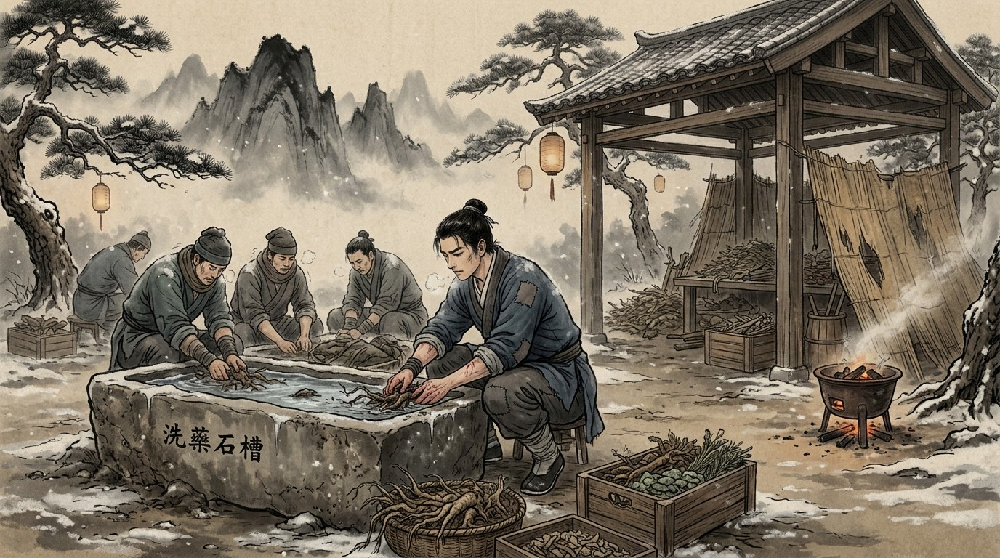

# 第 96 章：地肺丹火・逆道延命的血爐

[← 上一章](ch0095.md) ｜ [本卷目錄](00_intro.md) ｜ [下一章 →](ch0097.md)

*章首插畫：第 96 章 地肺丹火・逆道延命的血爐*

百草谷的冬日，從來不比黑山長城的哨塔暖和多少。

整整一個月裡，顧玄每日卯時便得蹲在結了薄冰的洗藥石槽旁，同十幾個外門雜役一起分揀從山外收上來的寒髓草與苦參。寒流來得急，藥庫裡積壓了一大半受潮發霉的爛根腐草，泡進冰冷的溪水裡搓洗泥垢時，顧玄兩隻手背沒幾天便凍裂出細密的血口，稍微沾上微帶酸澀的溝水便刺痛鑽心。更讓人心驚的是，好幾名沒戴厚油紙指套的新進藥童，才洗了半個月根莖，指縫裡便像當初官道上逃出來的陳青一樣滲出灰黃膿水；可外門管事只盯著月末「歲貢定額」的乾草斤兩簿，誰繳不足額，便扣減冬炭、罰去寒風口守藥棚。

顧玄一邊替那幾個藥童用自配的防風甘草膏敷手，一邊順著藥田石埂一寸寸摸排下去。他不單憑溫火冷萃法保住了那幾批受染靈草七成半的藥性，還藉著葉青枝領路巡溝的機會，用隨身帶的銀針與青石試水，查出了西坡兩道暗渠裡滲進了鄰峰廢礦流的微酸濁水。半個月後，醫理院與藥房管事核過損耗帳本，破例將這個肯吃苦又手穩的外門弟子調入丹鼎宗最核心的禁地之一——深入地下三百丈的「地肺丹火窟」，擔任丙字火區的外圍控火藥童。

進入丹火窟前，白鶴年特地在醫理院門口叫住顧玄，什麼多餘的話都沒講，只遞給他兩條泡過甘草冷水的厚棉口罩與一本極薄的《地火中毒救護手記》：

「地肺丹火窟裡頭溫度高、氣流雜，有些長老私煉的丹爐從不往外掛藥單。記住你師父葛老頭教過你的話——進了那種地方，耳朵少聽閒話，鼻子多記氣味，救得過來的人再救，救不過來的……先把自己的肺保住。」

顧玄點點頭，將白先生這句叮囑牢牢記在心底。

地肺丹火窟的夜晚與白天沒有分別。沿著開鑿在黑玄武岩裡的螺旋石階一路向下三百丈，空氣變得越來越燥熱腥嗆，四周岩壁上開著數十個大小不一的自然地肺火眼，噴吐著青中帶紅的熾烈地火。大大小小幾十座青銅丹爐分作甲乙丙丁四區排列在岩洞裡，晝夜不息地吞吐著丹氣。

顧玄日常負責的，是丙字一號到六號那幾座專門替外門弟子煉製「辟煞散」與「培元湯」的普通火眼。頭十天裡，他幾乎有一半時間都耗在苦力活上：拿長柄鐵鉤扒出爐膛底結塊的煤灰、一桶桶扛著滾燙的硫磺爐渣倒進冷卻水池，再對著「歲貢定額」的炭薪耗材簿一筆筆核重。即便戴著兩層濕棉口罩，鼻腔深處也總像塞了一把乾灰，喉嚨乾咳不止。

至於再往裡拐過一道厚重玄鐵石門的「丙字柒號秘密內窟」，向來掛著大長老鶴壽真人的專屬禁牌，門口兩班親信晝夜輪守，尋常弟子連靠近三十步都要受宗規鞭笞。每逢深夜，那道厚鐵門裡總會隱隱傳出一聲沉悶得不像尋常丹火的嗡響，像是裡頭鎖著一頭吸氣的洪荒火獸。

轉機發生在臘月初八的一個深夜輪值。

那天夜裡地肺深處突然出現一次地氣倒灌，悶雷般的熱浪順著煙道往外反撲，丙字區兩處主排煙道被硫磺結晶堵死了半邊。外區幾座正熬著辟煞散的銅爐蓋子頓時被頂得咯咯亂跳，眼看就要炸膛毀爐。管事急得直跳腳，偏生身量高大的藥師鑽不進窄道，只得喝令身板瘦削靈巧的顧玄戴上雙層濕口罩，順著牆角梯架爬進三丈高處那條狹窄的通風石夾層裡，拿鐵鉤清理風道裡的結晶灰垢。

夾層裡又悶又燙，黑石壁烤得幾乎燙手，稍一側身便能從石縫間看見下方岩窟裡明暗跳躍的火光。顧玄忍著汗水順著眼角流進眼睛的酸澀，一寸一寸往前挪動，將堵死轉彎處的幾塊黃白硫磺硬殼敲碎掃落。

就在他剛敲通一處連接內側岩壁的通風暗隙時，一陣極其濃郁、熟得幾乎讓顧玄全身汗毛瞬間豎起來的怪異氣味，順著石隙猛地湧進了他的鼻腔——

那是濃烈到極點的**血腥甜氣、焦苦硫磺、外加金石府「丙字柒號紫銅除渣坩堝」專有的熔煉氣息**！

顧玄的鐵鉤僵在半空，緩緩收住動作，不動聲色地將防風油燈遮在身後石凹裡，順著那道僅容兩指寬的暗隙往下望去。

下方石室正中央，矗立著一尊一人多高、通體銘刻著繁複鎖靈符紋的巨大紫銅丹爐。爐蓋邊緣用厚重的烈礬耐火白泥嚴嚴實實封死，僅從排氣孔裡往外吐著一縷縷暗紫色的毒煙。

爐前站著三個人。

居中那位鬚髮皆白、身穿紫金暗紋藥袍的老者，正是丹鼎宗大長老鶴壽真人！而在他左右兩側，竟分別站著兩名身披寬大灰青無標記斗篷、將半張臉完全遮在陰影裡的神秘客——從左側那名密使袖口露出的半截雷紋銅印與右側那名密使手裡拿著的測溫精鋼棒特徵來看，這兩人極可能分別來自太清玄天宮與天工閣！

「這批貨比原定少了三成半，成色也混了點水銀雜質，怎麼回事？」鶴壽真人看著面前剛撬開蓋子的兩隻沉重黑鐵箱，眉頭緊鎖，語氣裡透出一股掩飾不住的焦躁。

「金石府那邊出事了。」左側那名嗓音沙啞低沉的太清密使冷聲應道，「副會長錢百川被金石府三方會審徹底扳倒，三號大庫與所有黑市線全被封死了！這批還是從另外兩個沒暴露的檯面代理人手裡緊急拼湊出來的【地煞血精晶錠】，想要足額，得等北荒勘探隊下個月重啟那條封死的老脈才行。」

「等下個月？等得了嗎？！」鶴壽真人伸手抓起一塊在火光下閃著詭異血芒的晶錠，捏得指節喀喀作響，連那張向來養尊處優、紅潤飽滿的臉龐都微微扭曲起來，「紫霄殿那邊鶴鳴師兄前些天剛徹底『坐化』成了一尊石像，你們執法長老手底下的玄冥道兄左臂晶化已經蔓延過了肘關節！我這爐裡壓著的十二顆【逆道延命血丹】，再遲三天開爐，難不成讓咱們這把老骨頭眼睜睜看著自己變成山上那些動彈不得的晶柱，把這丹鼎宗百年的尊位讓給旁人去坐？！」

說到這裡，這位平日里在丹鼎宗弟子眼中慈眉善目的大長老，眼底湧出的卻不是什麼捨身鎮邊的悲壯，而是一種對失去長老尊位與權柄的陰冷恐懼：

「丹鼎一脈執掌三宗續命藥權百年，若連自家的玉座長老都保不住，堂堂鼎宗日後拿什麼在紫霄真人與鐵背山主面前說話？只要這十二顆丹能按時送進紫霄偏殿與執法堂，三宗長老席位便一日還得仰仗我丹鼎宗的爐火。外頭那群凡夫的生死，帳面上記成折損便罷！」

天工閣密使沉默了半晌，沒有接這句話，只是低頭核對完鐵箱側面貼著的交割封條與紅漆編號，隨後從懷裡摸出一把黑鐵鑰匙鎖上箱扣：「廢話少說，先把這爐用三階冰原荒獸心頭血配伍血精煉出來的延命丹分裝。老規矩，爐渣與廢藥水不准走明帳，直接由丙柒暗道倒去廢丹崖最底層的封閉坑。」

鶴壽真人深吸一口氣，壓下胸口一陣劇烈的翻湧喘息，親自拎起一柄紫金大勺，將整整三十塊散發著濃郁怨煞氣息的【地煞血精晶錠】，連同兩桶剛從活體荒獸胸腔裡放出來的滾燙鮮血，一股腦倒進那口號稱「丙字柒號」的紫銅丹爐之中！

「轟——！」

暗紅色的地肺丹火猛然暴漲半丈，熱浪甚至隔著三丈高處的通風暗隙撲進夾層，炙得顧玄臉頰生疼。

趴在石縫裡的顧玄死死咬緊牙關，連一口氣都不敢喘重，生怕吹落半粒岩灰驚動底下那幾位二階高人。他的眼睛一眨不眨地盯著那兩隻鐵箱側面印著的雙重交割編號——**「萬山乙零四・南十三」**、以及爐口那圈烈礬耐火白泥的獨特封泥樣式。

就在三名大人物收起剛剛成型的十二顆暗紅丹丸之際，下方那名天工閣密使忽然猛地抬頭，目光如刀般掃向三丈高處的通風排煙口：「誰在那邊？」

顧玄心臟驟然一縮，幾乎貼平在發燙的石板上。幸好就在這一刻，外區丙字二號爐的煙道裡恰巧滾落半塊剛被他敲鬆的硫磺大結晶，「啪啦」一聲砸進下方的冷水灰池，激起一團刺鼻白煙與沸水聲。

「外區幾個小雜役在通煙道吧。」鶴壽真人冷冷掃了一眼石門方向，揮袖道，「走暗道回閣，莫叫外頭的人撞見。」

直到沉重的內窟鐵閘門發出悶響落鎖，確認三道氣息全數順著另一條秘密石道消失在地下深處，顧玄這才忍著被岩壁燙起水泡的手掌，抹掉額頭淌進嘴裡的鹹澀汗水，貼著黑漆漆的石隙倒退著爬回丙字外區。

交班前，他藉著清理爐前地面灰燼的掩護，偷偷從丙字柒號通道門縫底下吹出來的一撮暗紫色殘灰裡，用小銀勺刮起指甲蓋那麼大一點點樣本，連同記下箱體編號與爐次的草紙一併封進雙層蠟管。

回到外門簡陋的木板房時，窗外早已泛起魚肚白。

顧玄沒有急著去找白鶴年或葉青枝告密——今天夜裡聽見的那段對話，比他在黑石鋪見過的任何一場惡行都更讓他脊背發涼。

鶴壽真人並非天生嗜殺成性的瘋子，可為了保住自己與長老們那身不朽玉座、為了死抓著丹鼎宗百年執掌續命丹藥的權柄不放，他可以面不改色地把底下礦工與試藥人的性命寫成帳冊上一筆輕飄飄的「折損」。

只是顧玄太清楚醫理上的鐵律：用比毒藥更霸道的地煞濁氣去強壓另一場災難，究竟是真的能續命，還是把病人拖進一座更恐怖的無底深淵？

答案，不在鶴壽真人的嘴裡，而在那座沒人願意多看一眼的「廢丹崖」底下。

---

[← 上一章](ch0095.md) ｜ [本卷目錄](00_intro.md) ｜ [下一章 →](ch0097.md)
