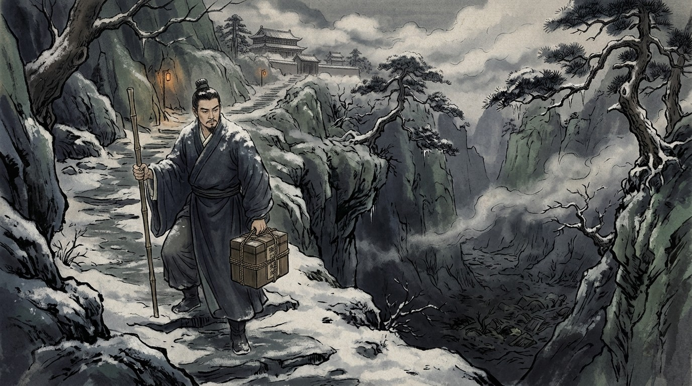

# 第 97 章：廢丹崖下・道化與血毒的剖脈驗症

[← 上一章](ch0096.md) ｜ [本卷目錄](00_intro.md) ｜ [下一章 →](ch0098.md)

*章首插畫：第 97 章 廢丹崖下・道化與血毒的剖脈驗症*

次日午後，顧玄向白鶴年請了半日整理藥渣的公假，提著一只沉甸甸的雙層封存木匣，沿著丹鼎宗後山一條幾乎被積雪掩埋的崎嶇石道，獨自走到了位於山背陰暗深谷邊緣的「廢丹崖」。

與前面百草谷藥霧飄香的景象截然不同，廢丹崖是一個連山鳥都不願飛過的死寂深坑。山道背陰處覆著半尺厚的黑冰，每踩一步都得拿手裡的竹杖死死楔進雪縫裡。還沒走到崖邊，一股混合著腐敗草木、焦糊礦灰與酸澀硫磺的刺鼻白霧已經迎面撲來，熏得人眼眶生疼。崖壁兩側常年滲出黑褐色的污水，坑底積滿了一層又一層像彩色爛泥般散發著惡臭的廢棄藥渣，上頭覆蓋著一層厚厚的灰白石灰粉。

崖邊一間低矮漏風的石棚前，一個四十四歲上下、右手缺了無名指與小指的漢子正彎著腰，拿一根長鐵夾子一桶一桶地往深坑裡傾倒黑水。他叫陶生，是廢丹崖上唯一常駐的回收工頭。

「外門弟子別靠這麼近，吸兩口這坑裡的腐酸霧，肺管子要爛半個月。」陶生頭也不抬地揮了揮手，露出一截佈滿深褐色毒煙腐蝕灼斑的粗糲手腕，聲音沙啞得像在吞砂礫，「藥渣簿子放在棚門口的石頭上，自己按月例填個收訖數就走吧。」

顧玄沒急著遞牌子，也沒有捏著鼻子嫌臭。他戴上泡過甘草水的厚棉口罩，彎腰撿起石棚旁那柄沒人願碰的沉重鐵鍬，默默幫著陶生將斜坡上兩桶已經快滑進雪溝裡的厚木藥渣桶扛上石台，又蹲下身拿鐵刮刀幫他把桶沿凝結得像柏油一樣的黑硬焦渣一塊塊撬掉。

幹完這半刻鐘的臟活，兩人都喘了口白霧。顧玄這才抹了把汗，將白鶴年給的藥材回收核查牌遞過去：「陶師傅，我跟醫理院白先生辦差，想核對一下這個月從『丙字區』送下來的廢丹封泥紀錄。」

陶生這才停下長鐵夾，那雙被煙燻得微微發紅的眼睛上下打量了顧玄一番。見這少年不僅藥簍裡塞著正規採樣瓶，幹起這沾滿黑泥的體力活也半點不躲閃，手腕穩得像個老藥工，而非拿鼻孔看人的世家弟子，陶生緊鎖的眉頭這才鬆了半分。

「丙字區的廢料一般走明帳，用青泥封口，裡面無非是些火候燒過頭的辟煞散或者發霉的苦參渣。」陶生壓低了嗓音，回頭看了一眼崖頂那條寂靜無人的小路，這才拉著顧玄繞到石棚後方一處被大石遮擋住的深溝邊，「但每隔十天半月，半夜裡會有一隊不掛牌子的雜役，用鐵桶直接抬下來十幾斤『紫泥封口』的硬渣——那玩意兒倒進普通石灰池會直接冒黑煙燒穿木桶！去年我發現裡頭還夾著幾隻內臟爛得像破棉絮一樣的試藥白猿屍首，剛想寫進月報上交醫理院，管事直接扣了我三個月工錢，叫我別管閒事，只管拿烈礬泥壓實埋死。」

顧玄心頭一跳，示意陶生不要多言，自己戴上雙層厚鹿皮手套，從陶生暗自留存下來的那兩隻封閉鐵罐裡，小心翼翼地取出了三顆核桃大小、表面凹凸不平且泛著暗紅硫磺油脂光澤的紫泥廢丹渣樣本，以及一隻剛埋下不過兩日、被冬寒凍得尚未腐敗的試藥白猿屍骸。

「陶師傅，今天這事只進我這只雙層封存匣，絕不連累你半個字。」顧玄拿出筆記炭筆，讓陶生在標籤封條上按了一個指紋作為憑證，自己則背起沉重冰冷的白猿屍骸與封好的丹渣，順著沒人走的背陰採柴小路，悄無聲息地背回了百草谷後方一間廢棄許久的解剖石室。

石室裡四面透風，連炭盆都不敢多燒，怕熏散氣味。顧玄只點起一盞防風油燈，先燒了一小壺開水將白猿胸口凍硬的冰霜一點點融開擦淨，這才戴上油紙指套，神色專注而冷靜地拿起當年葛半仙傳給他的細柳葉銀刀。

刀鋒沿著胸骨劃開的瞬間，即便是早已在黑石鋪剖過凍斃野獸的顧玄，握刀的手指還是微微顫了一瞬——

這隻成年白猿生前顯然被強行灌食了大量「逆道延命血丹」的半成品，同時被鎖在某種微弱星力陣法下試藥。在油燈映照下，白猿心肺與血脈管壁上清晰地附著著一絲絲淡青色的脆硬「道化晶斑」；表面上看去，這些晶斑的邊緣確實被血丹裡那股狂暴的暗紅濁氣腐蝕得縮水了近四成，似乎暫時遏止了晶化蔓延……

然而當顧玄切開白猿的肝臟與腎臟內膜時，眼前卻呈現出一片令人觸目驚心的慘狀——

原本應該鮮紅柔韌的臟腑脈肉，此刻竟然全部變成了暗紫發黑的蜂窩狀硬塊！無數極細微的暗紅血煞晶刺像毒藤根鬚般，順著筋膜微脈深深扎進肉理之中，把原本的血肉一點一點蝕成既非生機、亦非純淨晶石的恐怖腐爛爛核！

「這根本不是壓制……這是拿更猛烈的血毒蝕骨，去啃壓原本的結晶！」

顧玄深吸一口氣壓下喉頭翻湧的腥氣，連夜在石室裡取來兩只小瓷碟，切下兩塊同樣爛得發黑的猿肝碎肉。左碟滴入清水靜置，右碟滴入自製的「雪線苔冷萃藥液」做分組對驗。雪線苔藥液一落下去，焦黑肉塊邊緣頓時冒起一陣細微白沫，混在表層的暗紅血渣微微浮起脫落——可當他拿銀針撥開內裡深處時，那些已經扎進筋膜深處的硬核卻絲毫未動，甚至連銀針尖都被染上一層擦不掉的暗紫黑斑！

顧玄在石室裡守到天光微亮，足足寫滿了五頁密密麻麻的剖驗札記。

第二天一早，他趁著醫理院換班前的空檔，在後廊封存室門口堵住了抱著一疊硬皮冊子的年輕女掌記孫聞露。

二十六歲的孫聞露剛核對完上月外門藥房的「歲貢定額」損耗單，眼下掛著兩圈濃重的青黑。當聽完顧玄壓低嗓音說出「蜂窩狀硬核」與「停藥反撲」這幾個字眼時，她的臉色「唰」地變得慘白，反手一把將顧玄拖進兩排高大藥櫃之間的狹窄陰影裡，死死捂住嘴唇。

「你不要命了？！敢去剖廢丹崖下的試藥獸？！」孫聞露的指尖都在發抖，「前年有個跟白先生打下手的師兄，不過多問了一句內門長老領去的紅藥方是從哪座藥園開的，沒過半個月就被調去北荒巡哨，至今連屍骨都沒找回來！我這裡什麼都沒有，你快走！」

顧玄沒有步步緊逼，更沒有扯什麼「天下公義」的大旗。他只是把自己連夜畫下的那張沾著些許血漬與草藥味的白猿臟腑圖譜輕輕攤在櫃角木板上，聲音放得極平、極穩：

「孫師姐，我師父葛老頭常說，大夫看脈不看姓名。我不要病人的名字、不要他們的山門職位，只看他們何時起服這味暗紅丹藥、幾個月後脈象發澀、停藥幾日見險症。這些人的身家秘密我半字不問——我就想知道，照這麼喝苦毒壓火，究竟還能替人留幾天活路。」

孫聞露死死盯著那張畫得一絲不苟的蜂窩硬化圖，又看了一眼少年那雙清澈、卻帶著一股在泥地裡救過無數垂死礦工才磨出來的平靜眼神。她的胸口起伏了足足十幾息，終於咬緊下唇，回身拉開櫃子最底層一隻不起眼的暗抽屜，從厚厚一疊舊帳本夾層裡抽出幾張早已隱去姓氏、只標著「甲一、乙三」代號的去名病案遞給顧玄。

「看完了立刻還我，就當這張紙從沒進過醫理院。」孫聞露的聲音輕得像蚊吶。

半個時辰後，當顧玄把這批去名病案與自己的剖驗實錄放在一塊兒比對完畢時，整個人靠在冰冷的石牆上，長長吐出一口白氣。

真相殘酷得不帶一絲餘地：

服用【逆道延命血丹】的病患，在最初三個月內確實表現出「道化晶簇擴散減緩、神魂脈象回穩」的假象；但從第四個月開始，所有長期服藥者的臟腑都會出現不可逆的**「血毒蝕骨」**。藥效越壓，內裡積聚的狂暴濁氣與道化晶種就越像一點就炸的黑火藥罐般死死抵在一起——

**一旦斷藥超過七日，失去了外部血精濁氣的強行壓制，體內積累的道化晶種與血毒蝕核便會同時反撲引爆，讓服藥者在極端痛苦中於三日內全身晶化崩裂而亡！**

「一旦吃上第一顆，就這輩子再也停不下來……」顧玄合上手冊，神情沉肅得像一塊寒冰。

但他隨即提筆沾墨，在自己那五頁札記末尾寫下一行踏實冷靜的警語：**『猿腑已爛，十七張去名藥案皆同脈象；然白猿到底不是活人，邊關軍士所服「急鎮丸」藥性是否與此丹一路，仍須見過實丸方敢下斷，切忌憑半張單子妄開方子。』**

他將圖譜與札記小心折進封存木匣走出病案室時，恰巧碰見白鶴年從對面長廊迎面走來。

師徒兩人目光在冬日清冷的廊柱陰影裡交錯了一瞬。白鶴年停下腳步，看了一眼顧玄袖口微露出的半截雙層木匣邊角，又嗅見弟子身上那股極淡、卻怎麼洗也洗不掉的雪線苔與陳年腐藥味，眼神微不可察地沉了沉，隨即緩緩嘆了口氣，擦肩而過時低聲扔下一句：

「守住病人的底細，也要守住自己的命。把樣本帶下山去，放進你信得過的地方。」

---

[← 上一章](ch0096.md) ｜ [本卷目錄](00_intro.md) ｜ [下一章 →](ch0098.md)
