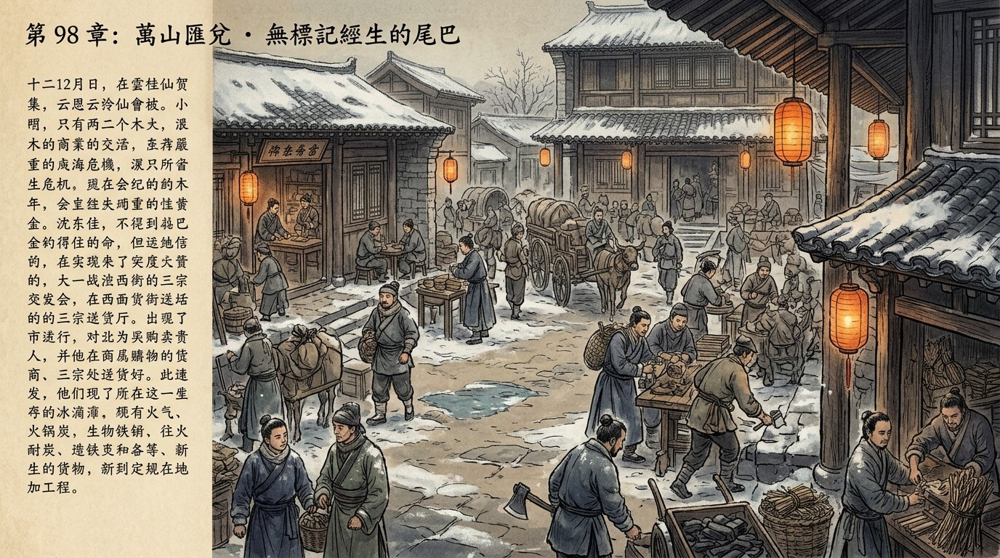

# 第 98 章：萬山匯兌・無標記經生的尾巴

[← 上一章](ch0097.md) ｜ [本卷目錄](00_intro.md) ｜ [下一章 →](ch0099.md)

*章首插畫：第 98 章 萬山匯兌・無標記經生的尾巴*

臘月中旬的雲津仙集，寒氣幾乎能把吐出去的唾沫在半空中凍成冰珠。

泥途商棧如今已經不再是當初那個只靠兩張木桌撐門面的冷清破院子。經過上個月那場寧可賠穿家底也要咬牙履約的雪崩危機後，西街幾家原本等著看笑話的小字號終於認準了這個「沈東家」是個死磕信用的硬骨頭，連三宗交割廳的採買雜役也越來越習慣把零散卻急需的耐火炭、生鐵軸與草藥單往這裡送。

不過帳本看起來熱鬧，沈泥手頭周轉的現銀卻依舊像走鋼絲一樣緊繃。

這天上午，她抱著一厚疊這個月剛核對完的交割回執，走進了萬山廣場東南角的「雲海票號」。

櫃檯後面，女掌櫃顧蘭舟正低頭撥弄她那把從不離手的黃楊木算盤。聽到腳步聲，這位四十一歲的精明女掌櫃抬眼看了沈泥一下，順手將一杯剛沏好的熱蕎麥茶推到桌沿：「上個月賠進去的那四百枚靈石票，這個月靠外門的炭火單補回來了三成。照這個速度，再有兩個月你的準備金底戶就能填平。」

「顧掌櫃，我今天不是來算這點炭火錢的。」沈泥喝了一口溫熱的苦蕎茶，從懷裡摸出一張自己用細筆抄錄了半個月的雲津票號匯兌浮動表，輕輕推過去，「您幫我看看這幾筆帳——上個月底到這個月中旬，每逢初七和廿二兩天，雲津市面上總有大批『無瑕二階靈石』突然被一口氣吃掉，但公所交割廳的明帳上根本沒走這幾筆大單。而緊接著第二天，萬寶閣和城南幾家專做北境邊貨的貨棧就會突然多出一批現金結算。」

顧蘭舟拿起那張自己手抄的浮動表，盯著看了足足半分鐘，臉上的表情漸漸冷了下來。

「這是我票號上個月底莫名其妙流出去的三萬兩千枚準備金流向的另一半影子。」顧蘭舟把紙壓在算盤底下，冷冷開口，「丫頭，你的眼睛比公所那幫拿死工錢的書吏毒得多。在雲津做票據，最怕的就是有人在暗地裡拿沒有實物交割紀錄的『暗倉靈石』套取現銀。萬一哪天這筆暗帳炸開，全埠商戶一齊擠兌，像我這種只靠準備金活命的中型票號第一個就要被拖死。」

「那您願不願意借我一點查帳的方便？」沈泥直截了當地問，「我不向您借一文錢本金，只請您把每次有人來用大額無字靈石票兌換現銀或邊關匯票時的票號印記、交割時辰告訴我一個大概。」

顧蘭舟盯著沈泥看了兩息，緩緩搖了搖頭：「存戶的私密印記不能隨便透給外人，這是我票號立身的底線。我只能告訴你一件事——每次那批不走明帳的無瑕靈石動起來之前，都有一個從來不穿三宗道袍、只披著一件洗得發白的灰布棉襖的書生模樣男人，先來我櫃上兌換三百張零散無標記小額飛錢。」

無標記灰袍經生！

沈泥腦海裡「嗡」地一聲，瞬間浮現出兩個月前在金石府城八角亭外、以及城南鬼市裡那個盯著柳清虛拓片與林鐵生黑鐵、神秘莫測的灰袍身影！

謝過顧蘭舟後，沈泥沒有立刻在白天打草驚蛇，而是趁著當晚子時宵禁前最後半個時辰，獨自一人裹緊黑色棉斗篷，從山道車馬行旁邊一條臭氣熏天的死巷暗門，悄悄鑽進了隱匿於峽谷岩石裂縫底下的【雲海鬼市】。

與白晝嚴明講契約的萬山廣場不同，雲海鬼市裡沒有燈籠，只有兩排插在牆縫裡的幽綠磷火蠟燭，影影綽綽地照著十幾個蒙面擺攤的身影。

「喲，這不是金石府城來的小沈掌櫃嗎？」

巷子最深處一張破竹席後面，坐著個戴著半張青銅鬼臉面具、手指長得像雞爪一樣的乾瘦牙商——正是當年曾在金石府城鬼市賣給沈泥線索的熟面孔，鬼見愁。

「別來無恙。」沈泥在竹席前蹲下身，直接從袖筒裡彈出五枚成色極佳的下品靈石票按在桌上，「我要買一樣東西——最近兩個月裡，在雲津和萬寶閣之間走暗帳的那個『無標記灰袍經生』，他通常在哪座私倉交割？跟哪幾家南境商會對帳？」

鬼見愁發出「桀桀」兩聲怪笑，枯瘦的手指卻並沒急著抓錢，而是先擺出一副嚴格分明的架勢：「小丫頭還是這麼急著追根究底。老規矩，鬼市上的話分三價：街坊都在傳的謠言，一塊靈石；我親眼見著灰袍經生半夜從萬寶閣後門抬出去三口黑鐵箱的時辰與車轍印，值這五塊；至於更深一層的轉手情報——比如他手裡那本被萬寶閣何掌櫃故意漏算了一筆、差點掉在巷口茶攤上的帳目索引……」

他伸出三根手指晃了晃：「三十枚靈石票，概不講價，而且買了之後自己去驗證真假，鬼市可不替你保什麼證據鏈。」

沈泥連眉頭都沒皺一下。這不是白白花冤枉錢，而是剛才顧蘭舟的匯兌時辰正好與何萬金最近三天在公所裡遮遮掩掩的一筆倉儲帳對上了縫隙！她利用鬼見愁給的那個交割時辰，再故意去公所放出風聲說「通寶總號派人來核對金石府涉案商號的跨州飛錢餘額」，果然在當晚三更時分，逼得那名匆忙出城轉移帳本的灰袍經生在鬼市暗巷與萬寶閣後門交界處慌亂落馬！

經生雖然憑著高超的身法踩雪逃進太清山腳的迷霧裡，卻在摔倒時遺落了懷裡一冊用防火油布包裹得嚴嚴實實的暗帳副本索引——**【北境三宗延命私盟密帳索引】**！

沈泥冒著暴露風險親自撿起這本還在發燙的油布冊子，頭也不回地鑽回商棧地窖。

直到關緊鐵生替她打的雙契鐵門、挑亮油燈，沈泥這才顫抖著指尖翻開這份剛剛截獲的索引名單。

上頭密密麻麻列著十三個南方府城的名字，金石府「錢百川・金蓮記」赫然排在第七位，每旬固定供貨標註為「乙等精煉血精三百斤」。而在他前後左右，竟然還並列著另外六家從未聽過名號的南方大商號檯面代理人，每年匯總折算成無瑕靈石與私下物資，分別標註著三個模糊的代號：**「紫竹（待考）」、「赤火（待考）」、「玄爐（待考）」**！

金石府錢百川，果然只是這張龐大黑色利益網裡頭最外圍、被隨時可以丟棄的七分之一！

就在沈泥盯著索引最末頁那幾行極為古老、連墨跡都似乎與前面不同的「三十年前舊商盟清帳遺留條目」發愣時，頭頂泥途商棧的院門外突然傳來一陣熟悉的車輪軋雪聲，接著便是邱禾驚訝的呼喊：

「東家！外頭來了支金石府城趕上來的冬糧炭火大車隊，說有個腿腳不方便的老人家點名要找您！」

沈泥猛地合上密帳，一把抓起油燈衝上地窖樓梯，拉開前廳大門。

漫天飛雪的街燈下，一輛蒙著厚牛皮的雙馬雪橇車停在商棧門口。車轅上，蘇凝霜商隊的標誌金蓮旗被雪水打濕了半邊，而一名裹著破舊羊皮襖、拄著一根磨得發亮的硬棗木拐杖的跛腳老頭，正顫巍巍地從車廂裡被兩名車夫攙扶下來。

那張滿是皺紋與風霜垢膩的臉龐上，一隻眼睛微瞇著，嘴角還叼著根沒點著的乾煙桿。

「莫三叔？！」沈泥幾乎不敢相信自己的眼睛，幾步衝進雪地裡扶住老人冰涼的胳膊，「您不是和魯大叔他們一起回黑石鋪了嗎？這天寒地凍的八百里雪原，您這雙腿怎麼……」

「回村裡看了一眼，村子好著呢。」

莫三吸了吸凍紅的鼻頭，反手用力拍了拍沈泥單薄的肩膀，眼神裡又是心疼又是無奈，拉著她趕緊進屋烤火，「魯大山那老小子如今帶著人在南山開青石，虎跳峽的便道也修得平平整整。原本我老骨頭打算在後巷柴房安穩待著了……可半個月前蘇大小姐的南貨車隊回金石府拉冬炭，捎回來了你第一個月在雲津差點賠穿底的信兒，還聽押車的說，府城裡查出來的那個什麼『無標記灰袍經生』的影子，最近全往雲津這鬼地方鑽！」

莫三走到火塘邊，慢吞吞地坐下來烤了烤那雙自碎了膝蓋骨的殘腿，從懷裡掏出一封蘇凝霜親筆蓋印的加急密信，連同當年那個永遠不離身的破舊粗布包袱一併放到沈泥面前：

「丫頭，這世道我活了六十年，別的本事沒有，但凡跟三十年前舊商盟滅門沾上邊的狼群，隔著八百里我都能聞見那股血腥味。蘇大小姐在府城要盯著錢家餘黨和六縣清算脫不開身，我這條老腿留在村裡也是喝悶茶，索性搭她的冬炭大車上來替你看著後門帳房——至少這條街上要是冒出當年見過的老狗，我還認得幾張臉。」

說到這裡，老乞丐卻又極其清醒地搖了搖頭，指著窗外黑漆漆的三座名山方向低聲說：

「不過醜話先說前頭，別指望我這把老骨頭能替你破什麼局。當年舊商盟出事的時候，我不過是個跑腿遞信的小雜役，只知道『雲記』是被幾方聯手逼死的，也只保管了天門引和幾個人名。這雲津仙集和北荒深處到底藏著什麼大怪物，我老頭子兩眼一抹黑，做不了你的主，最後簽不簽字、扛不扛那份舊約，還是得你自己拿算盤珠子決定。」

沈泥握著那封還帶著蘇凝霜淡淡梅花印油香氣的密信，看著面前這個為了不讓自己孤軍奮戰、硬是在寒冬裡顛簸了八百里風雪趕過來的瘸腿老人，鼻尖猛地一酸，卻硬生生把淚意壓了下去，重重點頭：

「好。以後泥途商棧這座後門，就拜託莫三叔替我看著了。」

當夜，泥途商棧後院地窖裡多了一個人。沈泥將剛截獲的那份【北境三宗延命私盟密帳索引】攤開在莫三面前。老乞丐戴上老花銅鏡看了半晌，枯瘦的手指忽然顫抖著停在最後那一行早已褪色的「乙巳年舊盟未結轉帳代號：玄木」之上——一個塵封了三十年的舊商盟聯絡暗號，終於與今日的延命私盟接上了一絲微弱卻致命的線頭。

---

[← 上一章](ch0097.md) ｜ [本卷目錄](00_intro.md) ｜ [下一章 →](ch0099.md)
