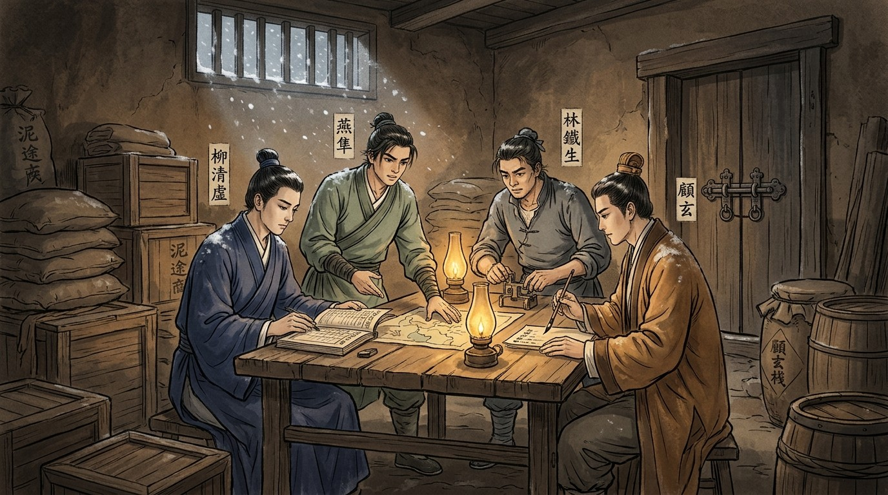

# 第 99 章：風雪夜聚・泥途商棧的五方對帳

[← 上一章](ch0098.md) ｜ [本卷目錄](00_intro.md) ｜ [下一章 →](ch0100.md)

*章首插畫：第 99 章 風雪夜聚・泥途商棧的五方對帳*

臘月廿三，大雪封山。

漫天狂雪把通往三大名山的石道徹底埋死，雲津峽谷裡難得落下一天沒有外門弟子下山採買的安靜日子。唯有西街末端的泥途商棧後院深處，那扇裝了林鐵生雙契鐵鎖的厚重地窖木門裡，正亮著兩盞沉穩的防風油燈。

四位少年的道袍、武服與工裝都還沾著未化盡的雪霜——趁著冬至後大雪封道、各宗門放開一日採買與邊防換防假期的唯一窗口，柳清虛、燕隼、林鐵生與顧玄分別順著「朔望貨單」的暗約，先後繞開各宗門眼線，悄悄匯聚在這座不屬於任何山門的地下石室裡。

屋角爐火燒得正旺，莫三跛著腳默默往炭盆裡添了幾塊烈礬耐火炭，隨後抱著他的舊煙桿坐到木梯口把風，沒去主動打斷桌邊的對話。

榆木方桌上，沒有酒肉，只有五份被油布、木匣與蠟封紙包裹得嚴嚴實實的物件與紙稿，在橘黃色的燈光下整整齊齊地一字排開。

「東西都先攤在檯面上對吧。」沈泥坐在桌案正前方，面前的黑油布密帳早已翻開到新的一頁，右手握著炭筆。

五個人沒多扯閒話，各自解開包裹，把從山門裡帶出來的實物一件件擺上了桌面。

柳清虛先推過去半疊寫滿算式的星圖校頁與一隻小小的蠟封木盒：「太清宮這三百年的星曆每次跨甲子都要整體平推一度半。九天前我親眼見著號稱白日飛升的二階圓滿長老鶴鳴真人，坐化後成了一尊仍向天幕輸氣的淡青晶石人像。這是當時從他袖邊震落的晶屑；陸師長說，高階法修想壓住晶化，只能向執法殿討一種暗紅丸藥。」

話音沒落，顧玄已揭開那隻貼著陶生手印封條的雙層木匣，把三顆紫泥廢丹渣連同白猿剖驗圖譜、十七份去名病案排在晶屑旁邊。一股淡淡的腥甜硫磺味隨即在桌心散開。

「暗紅丸藥的根子在丹鼎宗『丙字柒號』爐裡。」顧玄手指點過那幾張蜂窩狀臟腑圖，「鶴壽長老親自拿血精晶錠配荒獸鮮血煉【逆道延命血丹】。我拿白猿和去名病案核過了——血精確實能把表層晶斑暫時腐蝕壓住，可四個月後臟腑全會蝕成蜂窩爛核。只要斷藥過七日，血毒和晶種同時反撲，三日內必死。」

燕隼沉默地把半截斷裂的鷹記骨箭、染血八方皮甲，連同雷烈交給他的軍需調度副本拍到丹渣旁。油燈照著副本底角那行墨印——「未經前線將領核簽，由千機百巧門工坊印記暗差調出烈性開山火藥三十斤」。

「黑山營宿將吞的『急鎮丸』，也是這個味兒。」燕隼聲音壓得很低，「大伯那隊人不是迷路凍死的，是有人調走接應哨、用火藥炸塌冰澗封死後路。」

最後，林鐵生解開一團沾著機油味的油紙，裡頭是幾撮與府城熔渣同源的暗紫脆化鐵屑，旁邊壓著一張畫滿延長線的羊皮草圖。

「萬機地窟裡那尊十丈『巨靈神機』，根本不是人形傀儡，是某座巨型船艙側邊的推進錨機。」林鐵生把那枚黑鐵齒輪按在圖紙中心，「我這塊黑鐵跟它的中心主軸是一個模子打的。赤煉前些天想把整箱血精晶柱硬塞進去催動它，叫魯長老硬攔下來了。」

最後，沈泥伸手把那本截獲自灰袍經生的【北境三宗延命私盟密帳索引】攤在最中央，讓五條線索在燈光下一齊交會。

地窖裡安靜了片刻，只有炭盆裡耐火炭偶爾發出一聲輕微爆響。

燕隼伸出粗糲的指腹，緩緩摩挲過那份火藥調度副本與密帳索引上「紫竹、赤火、玄爐」三個待考代號，眼底並沒有半分衝動的浮躁，反而透出雪原獵手盯緊頭狼時的冷沉：

「火藥印記掛著千機門的暗號，密帳裡只有三個代號，誰也沒在上頭畫押簽名。」燕隼抬起眼，看向其餘四人，「就算咱們明天把這五堆東西全拍到雲津公所桌上，天工閣跟丹鼎宗只要推出兩個倒楣小執事頂缸，再說一句底下人私通黑市，咱們手裡拿什麼一口咬死後面那幾條大魚？」

沈泥抬眉看了燕隼一眼，微微點頭。能自己看破這一層，證明黑山營這一個多月沒白熬。

「何況『急鎮丸』我還沒拿到半顆實丸核驗藥性，太清宮裡頭也不全是一路人——苦修派的簡素真人就寧可清苦守貧也不碰那紅藥丸。」顧玄接了一句，伸手替沈泥把桌角捲邊的索引壓平，「光靠這些，壓不住三座名山。」

沈泥直接拿炭筆在自己的黑油布密帳上劃出四條短槓，條理分明：

「現在最缺的，就這四件事——第一，太清宮執法一脈究竟是誰在主事、三宗掌門又各自知情多少；第二，錢百川倒台後南邊斷供了三成，他們下個月開春前要去北荒哪處重開『血精母脈』；第三，天工閣地底那個巨型推進結構跟太清每隔三百年一次的星曆偏移，到底連著什麼太古舊物；第四，大伯當年走山隊找到的東西、還有三十年前清洗『雲記』與舊商盟的完整命令鏈，究竟壓在誰手裡。」

她將五份物證分門別類收進防潮油布袋，逐一貼上採集時間、地點與目擊人簡籤：「每樣東西先鎖進鐵箱備份。想弄清這四個缺口，留在雲津等著被人上門查封是等不來的——咱們得想辦法摸進北荒裡頭去。」

「……就這麼辦。」燕隼將那半截斷箭小心裹好貼身收起，「先把尾跡咬死，再算總帳。」

「對了，清虛。」

沈泥剛準備合上密帳，目光卻忽然落在柳清虛一直輕輕垂在桌下的左手腕上。大雪天裡大家都穿得厚實，唯有清虛那隻左手的袖口似乎稍微收得太緊了些，而且他剛才翻紙的時候，中指與食指竟然僵硬地微微抖了一下。

「你的手怎麼了？」顧玄的眼睛比誰都毒，一個箭步探身過去，一把扣住柳清虛的左腕脈門。

僅僅搭了兩息，顧玄的臉色瞬間沉了下來，毫不客氣地一把掀開了清虛的左袖——

只見少年清癯蒼白的左腕內側太淵穴上方，原本光滑的皮膚底下，赫然浮現出了一縷比頭髮絲還細、長度卻已有半寸、隱約泛著淡淡無機質青白晶光的細線，正如同活物般順著手太陰肺經緩慢向上攀爬！而他左手的食指與中指指尖，早已失去了正常的血色，冰涼得像兩塊玉石。

「你踏入二階中境之後，一直在夜裡私下推演那本《太清周天星訣》吧？」顧玄聲音沉得幾乎要結冰，「這就是早期『道化晶絲』！」

屋裡的氣氛驟然凝重到了極點。連梯口一直抽著乾煙桿的莫三，都忍不住站起身走了過來，臉色煞白地盯著那道淡青色的細絲。

「什麼時候開始的？」林鐵生低聲問，眼神裡滿是擔憂。

「五天前。」柳清虛沒有縮回手臂，神色依舊平靜，只是看著手腕上的那道微光，語氣裡卻帶著一絲連他自己都沒察覺到的冷靜近乎抽離的淡漠，「我試過用太清固元符壓制，沒用。那股星力越純淨，它沿著經脈生長得越快。我原本打算回觀後學枯木師父的法子……實在壓不住，就自己把這條經脈震斷或者……」

「閉嘴！」燕隼低吼了一聲，直接打斷了他，「老子剛認完一個不知道死活的大伯，可不准你拿刀割自己的筋骨或者剜眼珠子！」

「也不能像鶴壽那些人一樣去吃什麼狗屁延命血丹。」林鐵生沉聲道，手掌已經按在了腰間那枚黑鐵齒輪上，「咱們得想個法子，把它逼出來。」

---

[← 上一章](ch0098.md) ｜ [本卷目錄](00_intro.md) ｜ [下一章 →](ch0100.md)
