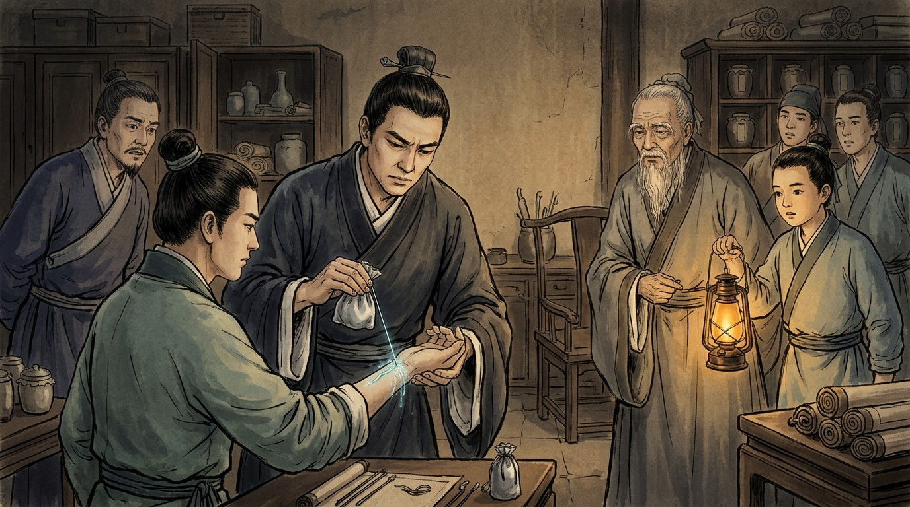

# 第 100 章：三元互濟・初試剝離道化晶絲

[← 上一章](ch0099.md) ｜ [本卷目錄](00_intro.md) ｜ [下一章 →](ch0101.md)

*章首插畫：第 100 章 三元互濟・初試剝離道化晶絲*

地窖內的空氣彷彿在這一瞬間徹底凍結了。

所有人都看著柳清虛左腕上那縷不到半寸長、卻閃爍著詭異淡青晶光的細絲。

「先別急著動手，」顧玄深吸一口氣，強迫自己壓下心頭的震動，回到醫者診脈的沉靜。他迅速取出隨身銀針囊與一隻小放大鏡，借著油燈光仔細察看那縷晶絲附著在血脈與筋膜微脈上的模樣，「這不是外物扎進去的刺，而是他體內高純度星力引動了假天規則，把原本柔韌的經絡血肉一點一點『結晶玉化』了。這才剛開始萌芽，晶絲還沒和骨髓筋脈徹底長死在一起，有機會剝離——但條件極苛刻。」

「怎麼個苛刻法？」沈泥立刻問道。

「第一，不能用太清宮那套純法道靈力去沖刷，那是拿水去澆冰，只會越沖越厚。」顧玄伸出一根手指，語速極快卻極為精準，「第二，單靠我用剖脈銀針硬挑也不行，晶絲極脆又帶微弱星煞黏性，刀尖一碰斷裂在血脈裡，碎屑會順著血氣衝進心肺，直接要命。」

林鐵生站在桌旁，看著那縷晶絲沉默了兩息，忽然從工具囊裡拿出那枚【太古不融黑鐵齒輪構件】，伸手輕輕往木桌上一敲。

「叮——」

一聲極為純淨、穿透力極強的短促細密震顫聲在石室裡蕩開。

「硬撬會崩口。」林鐵生看向顧玄，眼神裡滿是工匠特有的篤定，「鐵匠卸咬死的舊軸套，不能拿鑿子硬劈——得拿小錘貼著外緣輕敲慢震，三五下把灰白澀硬的廢礦凝渣震鬆，裡頭自己就脫扣了。那塊黑鐵敲起來性子極純，細密震勁能透進去。」

顧玄眼睛微微一亮，隨即又搖了搖頭：「你的震勁只要偏半厘，或者沒控制住力道，就會連清虛這條手臂的筋膜微脈連同血肉一塊震爛成泥！而且一旦晶絲鬆動，裡頭藏著的極寒星煞會瞬間往回竄，凍死周圍血肉——誰來撐住血肉不被震爛、又能趁隙把那股寒晶逼出體外？」

「我來。」燕隼大步站了出來，拉起袖子露出結實如鐵、隱隱流動著滾燙陽剛血氣的右臂，「《煞血霸體訣》練出來的氣血雖然狂躁，但老子現在能把這股陽火壓在筋骨裡只發三分熱力，順著他的脈門一點一點往外烘，替他護住心脈跟這條臂膀的經絡，總比讓那鬼寒氣往心口鑽強！」

「光靠熱氣不夠，火氣一過頭就會變成燒傷。」顧玄迅速轉身打開自己的藥箱，取出兩罐之前在丹鼎宗偷偷留存的『雪線苔冷萃藥液』與青河苦參膏，「我要先用雪線苔藥液調成護脈藥膜，以九轉銀針刺入他臂彎四個穴位鎖住主脈，再用藥液在皮下形成一層緩衝；鐵生必須把震勁控得極勻極細；燕隼只能按照我喊的節拍一點點送陽氣進來，多半成都不行！」

這不是一腔孤勇就能撞破的難關，而是一場幾乎容不得半毫差池的生死剖脈與五道合醫之舉。

「還少一個人。」沈泥突然開口，把袖子一挽，站到柳清虛右側的木桌旁，從包袱裡掏出一支精準刻度的沙漏與兩枚銅測溫片，「清虛本人必須清醒地運轉周天星算，像定釘子一樣死死盯住晶絲周圍未玉化的筋脈岔口，不能讓它隨著血氣亂跑；而你們三個一個管針藥、一個管震勁、一個管氣血，全神貫注之下誰也沒有多餘的心神去看時間和寒熱升降！我來替你們盯漏刻、報時辰、控藥湯冷暖——哪怕差了一息，我喊停，所有人同時收力！」

柳清虛靜靜看著圍在自己身旁的四位夥伴。

沒有人問他「值不值得冒險」，也沒有人退縮說「這超出了我的宗門本職」。

他嘴角極難察覺地柔和了一分，緩緩點了點頭：「我是這件事裡最沒退路的病人。如果成功了，我們便知道道化並非無解；萬一失手……我自己的胳膊，我自己擔後果。來吧。」

地窖內的木桌被迅速清空、擦拭得一塵不染，鋪上兩層拿沸水滾煮洗淨、烘乾的白麻布。莫三默不作聲地端來一大盆滾燙的熱水與一盆碎冰，退到兩步之外準備隨時接應。

剖脈挑針開始。

柳清虛光著左臂平放在白麻布上，閉上雙眼，將踏入二階中境的龐大法道神識徹底收束回左腕三寸見方之內。在他的內視視野裡，那條淡青色的晶絲正像一條冰冷的毒蛇般緊貼在動脈外壁上，每隔一息便吞吐一絲微弱的星煞。

「下針，封脈。」顧玄神色冷峻到了極點，右手三指連彈，九根細如牛毛的銀針在油燈下劃出九道極穩的銀芒，精準刺入柳清虛左臂肩井、曲池與太淵周邊九大要穴！

緊接著，顧玄用細琉璃管吸起半管泛著淡淡冰藍色的雪線苔藥液，沿著銀針針尾緩緩推入表皮微腔之中。清涼溫潤的生機藥液順著針路漫開，像一層柔韌的薄膜般包裹住了整條發僵的血脈與周遭脆弱的筋膜微脈。

「冷暖穩在三成，藥膜鋪齊，現在過十息準備！」沈泥緊盯著沙漏細沙流動與貼在清虛臂彎皮膚上的測溫銅片，嗓音清脆冷靜得沒有一絲雜音，「三、二、一——鐵生，起震！燕隼，三分陽氣入尺澤！」

「嗡——」

林鐵生屏住呼吸，左手捏住阿鐵精鋼小鍛錘的尾部，將那枚【太古不融黑鐵齒輪構件】穩穩貼在柳清虛左肘外側三寸的一塊木墊上，極輕、極勻速地用錘柄敲擊黑鐵邊緣的第三個齒牙！

一股人耳幾乎聽不見、卻在金鐵理數上極度純粹的密頻細微震勁，透過木墊與藥液緩衝，精準穿透皮膚傳遞到那根半寸長的晶絲之上！

同一剎那，燕隼手掌虛按在柳清虛的肩井與曲池之間，體內狂暴的煞血陽氣被他用盡生平所學強行濾去燥火，化作一股溫厚沉穩的暖流順著顧玄銀針引導的縫隙緩緩注入。

「唔……！」

柳清虛的額角瞬間滲出密密麻麻的冷汗，牙關緊咬得咯吱作響。

藥道生機護住了血肉，力道陽氣從後方頂住了寒煞反撲，物道黑鐵的細密震勁則在最核心的位置一下又一下地撞擊著晶絲表面的結晶結構——而柳清虛自己的神識就像一柄精密的挑脈鑷，忍著神魂彷彿被鋼針來回刮擦的劇痛，死死將晶絲最前端的三個星力節點從筋脈主幹上往外「推開」！

「鬆了！晶絲前端脫離了半毫！」顧玄一直盯著放大鏡，嗓音微顫卻手穩如鐵。

「還差二十息！清虛肩部體熱上升過快，燕隼收半分火候！鐵生再穩住手腕力道別滑錘！」沈泥的眼神在沙漏與測溫銅片之間飛快切換，精準報出調控口令。

燕隼額頭青筋暴起，硬生生在極度緊繃的控制下把噴薄欲出的陽氣壓退半分；林鐵生右手食指早已死死抵在齒輪側面穩住偏移角，連呼吸都幾乎停滯；顧玄指尖捻動三根主力銀針順勢往外一提——

「噗！」

一聲極其微弱、宛如冰絲斷裂的輕響。

那一縷長約半寸、通體透著詭異淡青晶光的絲狀物，竟然順著顧玄在太淵穴邊緣提前切開的那道不到米粒大的微小創口，伴隨著一滴暗紅色的淤血，整根被完完整整地擠出體外，落在早已備好的玉盤裡發出「叮」的一聲脆響！

「收力！撤針！冷敷護脈！」

隨著顧玄急促的低喝，燕隼立刻收回手掌，林鐵生一指按死黑鐵震源，沈泥抄起早已泡好雪線苔的冷紗布迅速按在柳清虛手腕創口上止血。

地窖內安靜了足足十息，只聽見幾個人粗重得像拉風箱一樣的喘息聲。

柳清虛緩緩睜開雙眼，大口喘氣。低頭看去，左腕內側那條原本泛著死亡晶光的青色細線已經消失不見，那塊皮膚恢復了淡淡的血色，只是看起來有些腫脹發紅。

「成功了……我們真的把這鬼東西剝出來了！」燕隼抹了一把滿臉的熱汗，忍不住低聲歡呼了一句，旋即卻突然停住，疑惑地看著柳清虛，「清虛，怎麼樣？手指能動了嗎？」

柳清虛沉默了一瞬，試著彎了彎左手的五根手指。

拇指、無名指與小指都能勉強握拳，可原本僵冷的食指與中指卻依然呈現出一種不正常的僵硬麻木，指腹輕敲桌面時完全感覺不到疼痛；更奇怪的是，當他皺眉抬起頭看向顧玄剛才記下的醫案手札時，眼神裡突然閃過一絲極為短暫的迷茫。

「……剛才我上來之前，在藏星秘閣看到的那頁星曆偏差，是三百零四年，還是三百四十年？」柳清虛按住太陽穴，眉心緊緊鎖起，「我怎麼記不起這半天我在算什麼了？」

顧玄心頭一沉，立刻上前檢查他的瞳孔神光與腕部脈象，連夜在紙上補記了一整頁實情。

「別硬想，先歇半個時辰。」顧玄一邊替他塗上熬得微苦的青河生肌藥膏，指腹輕輕按過他冰冷的指肚試著回溫，眉頭卻一直沒鬆開，「看清了嗎？才逼出半寸初生的小晶絲，清虛這兩根指頭就已失了痛覺，連剛才記在腦子裡的數目都震散了半截。」

他把玉盤裡那根還在微閃冷光的淡青晶絲樣本收進特製小琉璃管，拿蠟封死：「葛師父說得不錯，越是險症，越沒現成的神方。今夜能成，全靠清虛自己扛著神魂不散、加上我們五個人寸步不離湊在一起死頂。這法子連他自己這半隻手都震傷了，真要拿去治紫霄殿裡那些早就凍硬了幾十年的老脈，只怕一震就碎——沒摸出護住筋脈的穩方前，一個字也別往外說能治。」

「明白。」柳清虛雖然手腕還在隱隱作痛、記憶裡缺了半個時辰的瑣碎算式，可那雙眼睛卻重新恢復了清冽的清明，望著玉盤裡那根死去的淡青晶絲，嘴角緩緩勾起一絲冷峭的笑意：

「至少證明了，這片天加在法修身上的鎖鏈，不是不能被撬下來的鐵律。」

---

[← 上一章](ch0099.md) ｜ [本卷目錄](00_intro.md) ｜ [下一章 →](ch0101.md)
