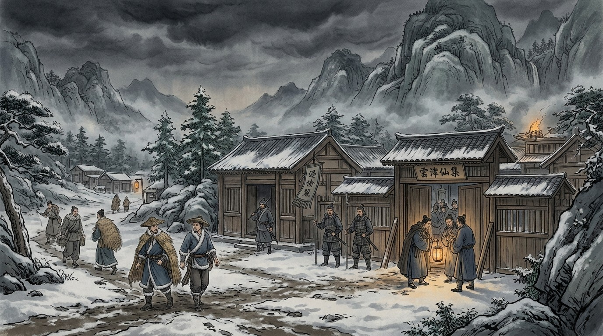

# 第 101 章：暗流反撲・延命私盟的警覺

[← 上一章](ch0100.md) ｜ [本卷目錄](00_intro.md) ｜ [下一章 →](ch0102.md)

*章首插畫：第 101 章 暗流反撲・延命私盟的警覺*

一場暴雪過後，距離過年只剩十天不到的日子，雲津仙集的冷空氣裡卻隱隱飄起了一絲山雨欲來的緊張氣息。

泥途商棧還沒等到下一次朔望送貨日，麻煩便比預料中來得更快、更狠。

這天上午辰時剛過，西街貨棧區的石板路上突然響起一陣整齊而沉重的鐵靴聲。十幾名身著雲津商埠巡檢司黑甲的兵丁，簇擁著萬寶閣掌櫃何萬金、兩名眼神陰冷的太清執法堂外院執事，以及一名提著銅印公文箱的公所監察文吏，二話不說直接封鎖了泥途商棧的街口與前院外庫！

「這是做什麼？」

邱禾當時正帶著兩名雇來的學徒在院子裡清點剛從金石府轉運上來的三十麻袋烈礬耐火炭，見到一群帶刀兵丁不由分說直接上來貼封條，立刻抄起一根門閂橫身擋在倉庫門前。

「別動粗，我們是照萬山商埠公所與三宗聯合稽查條例辦差。」

何萬金依舊穿著那件寶藍暗花緞袍，滿臉和氣地晃著手裡的翡翠扳指，語氣卻冷得像剛下的凍雨：「昨晚三宗交割廳和執法堂接到密報，稱最近兩個月有一批來路不明、未經公所報關核驗的南境高危礦渣與違禁變質草藥，偷偷透過西街新開的小貨棧流進了山門外院。這不，太清執法堂的師爺奉命查案，公所羅掌印也批了條子——例行清查泥途商棧的帳冊與西庫貨存，沒錯自然還你們清白。」

他身旁那名面容冷峻的太清執事目光更是陰鷙地掃向屋內，手裡捏著一張蓋著「玄冥」篆字私印的調核令。

沈泥站在前廳門檻後，穿著一身厚實的灰鼠皮短襖，看著這群來者不善的「稽查人馬」，心頭瞬間雪亮。

錢百川在金石府城徹底倒台，令南方十三府這條血精供應鏈斷了整整三成；前幾日鬼市那個灰袍經生又意外摔落逃竄、丟失了【延命私盟密帳索引】……哪怕對方還不確定那本索引落在了誰手裡，以丹鼎宗鶴壽長老與太清宮執法長老玄冥的警覺，必定已經開始地毯式清查近兩個月與金石府聯繫最密、且在雲津突然冒頭的新商號！

「既然有公所印信和執法堂條例，泥途商棧自然配合。」

沈泥沒有像剛出茅廬的愣頭青那樣喊冤罵街，更沒有去阻攔他們查看前院貨倉。她神色鎮定地抬手按下邱禾的門閂，自己回帳房取來這兩個月來所有的正本雙聯帳冊、雲海票號流水回執以及每一車南來貨物的金石府稅單，整整齊齊擺在院中的石桌上。

「諸位請隨意翻檢。」沈泥指了指面前的帳本，「我們商棧所有的炭火、藥草、鐵件，每一筆都有發貨窯坊主名姓、金石南關稅單與交割廳驗收簽押，絕無半克來源不明的違禁礦物。」

執法堂執事冷哼一聲，帶著人立刻衝進外庫，將成堆的煤炭袋與草藥箱逐一捅破翻檢；另一邊，何萬金與文吏一頁一頁翻開沈泥交出的帳冊，臉上的笑容漸漸收斂——帳目做得滴水不漏，就連上個月雪崩延誤賠款那四百枚靈石票都記在明面上，沒有半點走私暗帳的破綻！

「這兒沒有？」太清執事從外庫走出來，眉頭皺得死緊，顯然很不甘心就這麼空手而回。

就在這時，一名從外庫最裡側角落走出的兵丁手裡卻舉起兩包貼著青紙封條的小藥包，大喊了一聲：「執事大人！這箱子夾角裡塞著兩斤沒寫進前頭主藥單裡的乾燥深紫苔蘚碎渣，還有一瓶標著『丙類廢水樣本』的泥漿，上面連公所的化驗准運印都沒有！」

沈泥眼神微微一縮——那是前幾日顧玄隨手托採買帶下來給她研究水質比對的一包普通乾苔與礦坑外圍水樣，雖然不是什麼違禁血精，但確實沒有在公所走正規『特殊礦樣申報單』！

何萬金眼睛頓時一亮，立刻上前接過那兩包東西，誇張地嘆了口氣：「哎呀呀，沈東家，這可就說不清了！按公所商律第十七條，凡夾帶未經核驗成分之異常藥渣或不明礦泥入埠者，哪怕數量不多，也要一律暫扣涉案外庫、處貨值三倍罰金，還要帶走經手這批貨的庫房夥計進執法公所審問三日，查明幕後到底有沒有跟什麼亂七八糟的散修勾結！」

這明顯是欲加之罪的借題發揮——只要把泥途商棧的庫房夥計帶走嚴刑逼供，或者順藤摸瓜去查是哪家青河藥農、哪座烈礬炭窯暗中幫沈泥供貨，就能一口氣嚇退她上游所有的普通商戶與供應商，把泥途商棧活活逼死在搖籃裡！

站在陰影走廊邊柱旁的莫三，手裡的硬棗木拐杖猛地握緊，眼底掠過一抹三十年前被逼入絕境的森寒殺機，正要開口。

「罰款我認，人不能全帶走。」沈泥搶先一步跨出門檻，直視著那名太清執事與公所文吏，語氣清脆卻寸步不讓，「那兩包只是前線礦工送來請我們代尋大夫辨別水土毒性的雜物樣本，絕無一絲一毫買賣用途，更與給我們供貨的青河、烈礬正經商戶無關。既然公所認定這屬於『未申報夾帶樣品』，按規矩應罰多少靈石票，我泥途商棧今日當場全數認罰繳清！」

「認罰？」太清執事冷笑一聲，根本不吃這套，「光罰錢可不夠。這批夾帶是誰裝箱簽字的？總得帶一個主事的回公所對質清楚，免得你們背後還藏著什麼不可告人的黑帳。」

說著，兩名黑甲兵丁便大步上前，一把抓住了站在貨箱旁邊、年僅十九歲剛剛跟邱禾簽約半個月的年輕夥計阿四，反手就要拿鐵鍊套脖子。

「東家……這貨是我昨晚清點歸堆的，跟我家裡老娘和青河那邊的叔伯真沒半點關係啊……」阿四嚇得臉色慘白，兩條腿直打顫。

「放開他一半的鎖。」沈泥沒有求饒，卻直接從袖中掏出一枚深海玄鐵鑲金邊的【跨州特等通行信印】，重重按在石桌上的公所罰單旁邊，「我是東家，所有入庫貨物由我總核。依商埠規矩，持跨州信印者享有『東家代行保釋問訊權』，小夥計阿四可以隨你們去公所做記錄，但不得上大刑、不得扣押超過兩日；至於罰款兩百枚靈石票，現在就從雲海票號劃帳！另外，何掌櫃……」

沈泥忽然轉頭看向一旁陰陽怪氣的何萬金，嘴角勾起一抹冰冷的弧度：「今日您領著執法堂來查封我這座外庫，撕破了三十袋好炭的包裝，也耽誤了今晚八荒武山前哨的急用軍糧裝車。公所文吏在這兒記著呢——若兩日後公所核實這兩包確係無毒廢渣，萬寶閣今天這趟無憑無據的封門損耗，這筆賠償帳，明天一早我就找羅掌印替我算在萬寶閣頭上！」

何萬金臉色微微一僵，沒想到這丫頭在被查封外庫、賠掉兩百靈石票、還要被帶走夥計的絕境下，竟然還敢反咬一口算損耗賠償！

那名太清執事也微微皺眉，眼見帳冊齊全、莫三又亮出一份早在半個月前就交到公所備案的「雙聯副帳」作證，再硬鬧下去只怕會把公所掌印羅九秤與八荒武山催糧的軍官都驚動過來。最終，他們狠狠刮走了兩百枚靈石票的罰款，強行查封了半間外庫貼上待查封條，並且把嚇得魂不附體的夥計阿四帶回執法公所問訊。

人馬撤走後，泥途商棧前院一片狼藉，拆開的麻袋散落了一地黑炭灰。

邱禾忍著一肚子火氣一腳踢開地上的破麻袋，轉頭看著面色平靜卻微微泛白的沈泥：「東家！那兩包苔蘚根本不算違禁藥，咱們憑什麼低頭認下這兩百枚靈石票的冤枉罰款？還要眼睜睜看著阿四被帶去吃牢飯！」

「如果不認下這筆罰款，他們今天就要查封整座商棧的帳房，扣下我的跨州通行印，順道把遠在金石府的青河藥行與烈礬窯坊全都寫進嫌疑名單裡！」

沈泥彎下腰，默默撿起地上被踩爛的一張炭單，眼神冷峻得嚇人：「莫三叔，昨晚我藏在地窖暗格裡那份密帳索引，沒被他們翻出來吧？」

莫三拄著拐杖走出陰影，低聲道：「放心，你林哥打的那扇雙契暗門連隻老鼠都鑽不進去。只是丫頭……這次對方只是借萬寶閣的手試探了一記敲山震虎，我猜最多不超過十天，只要這兩百塊靈石票沒能打斷你的脊梁，太清宮和丹鼎宗背後那群人，一定會有更狠的後手。」

當晚深夜，藉著送炭腳夫帶回來的緊急暗號，柳清虛偷偷從後山小道繞下山來，在泥途商棧破敗的後門見到了沈泥。

聽完白天的驚險經過後，柳清虛眉頭緊皺，手腕上那道剛剛剝離過晶絲的傷口隱隱作痛：「這麼被動挨打下去不是辦法。執法長老玄冥既然已經開始查探雲津，就證明南邊血精斷供已經把他們逼急了——我猜不出半個月，他們肯定要從別的地方把血精補回來。」

「你是說……」沈泥眼神一凝，瞬間想到了什麼。

「五年前走山隊去的北荒大裂谷，還有燕隼大伯沒走完的那條線。」柳清虛從袖中摸出一張今天剛從宋知微掌院那裡看到的公開調令抄本，「就在昨天下午，三大名山聯合頒下了一道名為『冬季北荒地脈異動勘察暨長城陣基加固』的聯合公文，準備在十天後抽調三宗內門精銳，組建一支【三宗聯合勘探隊】深入北荒外荒裂谷。」

沈泥接過那張調令抄本，盯著上面「隨軍輜重與後勤雪橇招標由雲津公所統籌」那一行字，沉默了足足三息。

「他們這是打算借加固長城的名義，名正言順地派人去北荒挖新的血精母脈。」沈泥緩緩把紙折起來，那雙原本因為賠錢和被查封而略顯疲憊的眼睛裡，突然重新燃起了一簇冰冷卻無比堅定的火焰：

「既然山門裡藏著的帳見不得光，那咱們就不留在這座盆地裡等他們動手封門了。清虛，你回去讓鐵生、顧玄跟燕隼想辦法擠進那支勘探隊的名單裡；至於山外這條隨軍輜重雪橇的承運標……哪怕把最後這點壓箱底的本錢全押上去，我泥途商棧也要從萬寶閣手裡搶下這趟差事，跟著大隊一塊進北荒！」

---

[← 上一章](ch0100.md) ｜ [本卷目錄](00_intro.md) ｜ [下一章 →](ch0102.md)
