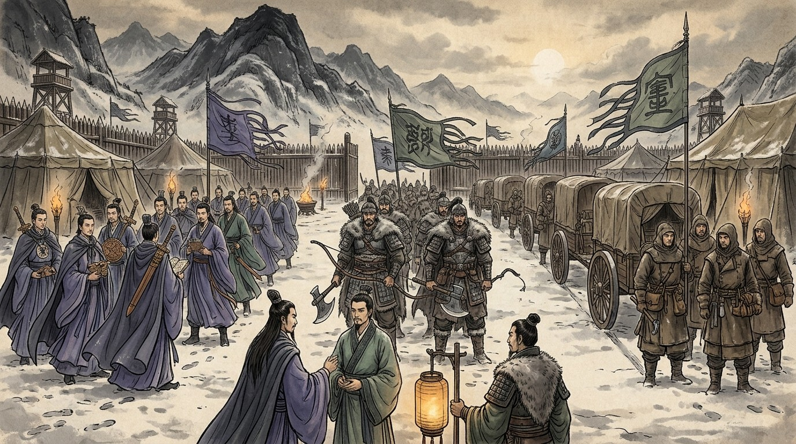

# 第 102 章：北荒冬獵・三宗聯合勘探隊

[← 上一章](ch0101.md) ｜ [本卷目錄](00_intro.md) ｜ [下一章 →](ch0103.md)

*章首插畫：第 102 章 北荒冬獵・三宗聯合勘探隊*

十日後，大雪初霽，雲海峽谷上方難得透出一絲慘白的冬陽。

八荒武山山腳外的黑山營校場前，早已聚集了一支規模龐大卻氣氛各異的隊伍。上百名精銳修士按宗門分為三列：身穿青紫道袍、背負銅製星盤與長劍的太清宮周天星律院與雷符殿弟子；披著厚重狼皮護肩、背負五石硬弓或雙刃重斧的八荒武山煞血營精銳；以及推著十幾具用油布緊緊蒙住的木輪工程機械、穿著厚實牛皮工服的天工閣與丹鼎宗內門弟子。

這便是三宗聯手組建的「北荒裂谷冬季聯合勘探隊」。

公開的軍令上寫得冠冕堂皇——「探查北荒外荒裂谷近期頻繁出現的地脈微震，加固黑山長城北側古陣基」。可誰也沒有說破的是，這次隊伍的真正總督導，竟然由天工閣的赤煉長老親自掛帥領銜，八荒武山方面則由對五年前舊案心存疑竇、主動請纓護衛防線的獨臂老將雷烈親自壓陣，雙方在出發前的帳篷裡就已經隱隱隔著一層看不見的火藥味。

隊伍的最後方，則是整整二十四輛套著高大雪橇犬與長毛北地犛牛的輜重貨橇。

貨橇最前頭那面迎風獵獵作響的灰布小旗上，繡著一個樸素得甚至有些寒酸的「泥」字。沈泥裹在一件寬大的白羊皮斗篷裡，頭戴厚實的護耳皮帽，手裡緊緊捏著剛從萬山商埠公所競標贏來的《隨軍輜重總辦紅契》——為了擊敗萬寶閣何萬金的壓價搶標，她不僅把泥途商棧僅剩的現銀全數押上去墊付了半個月的糧草預支，還聯合了本地雪橇行腳隊女領隊穆雪共同承擔保險，連商棧後門都暫時交給了重金請來代理的邱禾看守，至於剛剛繳完罰款被放出來的夥計阿四，也因受驚過度留在棧內養傷，不再隨隊冒險。

而坐在第二輛遮風篷橇裡、雙腿蓋著厚狼皮毯子仔細核對帳本與藥物清單的，正是執意要跟來的莫三。

「我說過，只要跟三十年前那些舊貨路和北荒山道沾邊，我這雙廢腿坐在雪橇上也能替你盯緊車尾貨箱。」莫三拍了拍身邊上了鐵鎖的兩隻藥箱與備用帳冊，「別操心雲津那邊，邱禾把短契延了半年，有她跟顧蘭舟掌櫃在票號互相照應，萬寶閣不敢在我們走後明著砸店。」

「沈總辦，前面已經出了黑山長城北門了。」

一名騎著矮腳黑馬、穿著雙層鹿皮襖的三十歲精瘦漢子策馬退回車尾，勒住韁繩提醒了一句。他叫祁十六，是這次三宗出重金聘請的北荒裂谷首席民間嚮導——他原本是個常年在裂谷邊緣討生活的採集戶，這次不顧危險接下宗門差事，為的只是掙足替失蹤者家屬互助會籌措冬糧的賞金。

沈泥點頭致謝，隨即抬眼望向前方那座彷彿將天地劈成兩半的黑石長城關口。

就在長城關門外側三百步的雪地邊，搭著幾間極為簡陋、被北風吹得搖搖欲墜的草頂木棚——這就是由軍寨後勤婦人阿滿幫忙牽線、二十九歲姑娘韓素常年駐守的「失蹤者家屬互助所」。

勘探隊浩浩蕩蕩穿過關口時，幾名裹著破舊棉襖的婦人與老人靜靜地站在木棚外的雪地裡，沒有人敢上前衝撞宗門大隊的馬匹，只舉著幾塊寫著親人姓名與失蹤年份的木牌。

隊列前方的世家內門弟子們（包括騎在駿馬上的太清宮沈照塵）大多目不斜視、甚至嫌惡地拉起衣領避開那群衣衫襤褸的邊民。唯有走在隊伍中段、氣血愈發凝練沉穩的燕隼，猛然勒住了馬步，跳下馬背朝著木棚外那名站在最前面、神色冷峻平靜的二十九歲女子大步走了過去。

「韓素姑娘？」燕隼抱拳行了一禮，聲音低沉，「阿滿姐托我給你帶兩袋乾淨的白麵跟兩罐傷藥。另外……五年前這支走山隊裡，有我大伯燕山。」

韓素抬起雙眼。她長得不算秀氣，常年被北境風雪吹裂的臉頰帶著一種木然的疲憊與倔強，手裡緊緊抱著一本用粗布縫補過無數遍的《北荒失蹤者登記簿》。

她先低頭看了一眼這個背著鐵胎重弓、身上穿著八荒武山煞血營親傳勁裝的少年，眼神裡沒有絲毫因為對方是名山天驕而產生的討好或激動，語氣平靜得像北荒的凍冰：

「麵和藥我收下，替互助會多謝阿滿姐和這位小哥。至於你大伯燕山……他的名字確實記在第三頁，同行失聯的還包括我親哥哥韓林和另外十名護衛腳夫。但八荒營的爺們兒這五年來進進出出裂谷十幾次，每次都說替我們順道打聽，最後帶回來的不是一句『死無對證』，就是一疊寫著『私越禁區自負其責』的廢紙。」

燕隼喉頭微微一滯，沒有拍胸脯許下「我一定把你哥活著帶回來」的虛言，只是坦然迎上她的視線，沉聲說道：

「我不敢給你畫空餅，也不知道進了前面那道大裂谷還能活著帶回幾塊骨頭。但如果這次我在裡頭找到當年那批人留下的東西，我會一筆一劃把真話帶出來記進你的本子裡，不讓人再用一張『擅離職守』把他們的命抹掉。」

韓素緊緊盯著燕隼看了足足三息，終於微不可察地點了點頭，從懷裡掏出一枚極小的銅製哨箭特徵圖遞過去：「這是我哥當年出關前配發的接應哨編號。若真見著了……哪怕只是半塊銅皮，也幫我帶回來。」

隊伍很快再度開拔。

過了南沿入口與最後一處供給整頓的「雪原行腳營地」之後，天地之間最後一絲人煙徹底消失。取而代之的，是一片綿延向北、深不見底的萬丈大裂谷陰影。

這日黃昏紮營時，沈泥帶著莫三按契約清點完第一日消耗的雪橇草料與炭火份額，林鐵生與顧玄、柳清虛也藉著「協助維修雪橇防滑鐵齒與檢查傷員防寒湯藥」的合法名義，陸續匯合到了隊伍末尾的輜重營帳旁。

「你們看出門道了嗎？」

林鐵生蹲在篝火邊，手裡拿著一根鐵條撥弄炭火，聲音壓得極低，確保不被十丈外赤煉長老那幾名天工閣親信的巡邏耳目聽見：「咱們這支勘探隊出發前說是要去『加固長城西側陣基』，可你看看祁十六大哥今天引我們走的方向——這一路全往正北偏東的深谷走，離長城陣基越來越遠！而且我看赤煉長老隊尾那三輛用雙層厚黑布死死罩著的重車，壓出來的雪轍深得嚇人，車底下裝的絕對不是什麼加固城牆用的石灰條石。」

「那是拆解下來的重型破山鑽機部件。」柳清虛捧著一隻熱水壺暖著還有些隱隱發僵的左手食指，冷靜接道，「剛才紮營前，我用星盤測過這一片谷口的風向與磁針偏角，越往北偏東，地煞濁氣就越濃，高空的星力擾動也越發劇烈。如果沒估錯，他們真正的目的地，就是五年前燕山大伯那支走山隊失蹤前最後探明的那處地方。」

正在一旁替雪橇領隊穆雪包紮一條被凍裂的小腿傷口的顧玄也抬起頭，將目光投向北荒深處那片漸漸被紫色暮霧籠罩的猙獰冰原：

「不止是地脈震動。剛才我在前哨營地替老醫師白岩搭把手的時候，發現有兩名上個月先來裂谷邊緣採冰礦的散修苦力，雙手與肺部出現的病變，竟然跟我幾天前在丹鼎宗廢丹崖看到的地煞中毒反應有七成相似。」

「也就是說，咱們腳底下這片大裂谷深處，真的藏著某種正在往外洩漏的源頭。」沈泥合上手裡的輜重交割帳，看著北方黑暗中彷彿吞噬一切天光的巨大裂口，「大家各自把宗門身份的戒條記牢——在沒摸清赤煉跟那些執事到底有多少把握之前，別擅自脫隊，一切等進了核心裂谷第二層再找機會切進五年前的舊線索。」

夜晚的北荒寒風像野獸的哀嚎般在冰崖間來回撞擊。

屬於凡俗與外門的邊界，已經徹底被拋在了這道長城身後。從明日破曉開始，他們五人要面對的，將是這片遺忘世界真正撕開血盆大口的一面。

---

[← 上一章](ch0101.md) ｜ [本卷目錄](00_intro.md) ｜ [下一章 →](ch0103.md)
