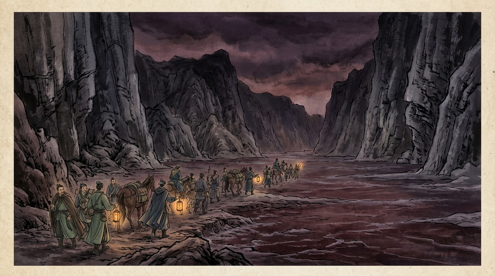

# 第 103 章：萬丈凍土・大荒凶獸之威

[← 上一章](ch0102.md) ｜ [本卷目錄](00_intro.md) ｜ [下一章 →](ch0104.md)

*章首插畫：第 103 章 萬丈凍土・大荒凶獸之威*

離開黑山營後的第四日，聯合勘探隊終於正式踏入了北荒大裂谷第二層——「永凍血原」。

這裡的天空不再是雲津那種灰白的陰翳，而是一片永遠像蒙著鐵銹般的暗紫暮色。兩側高達千仞的墨色冰崖夾著一道寬約數里的平坦凍土冰原，地面覆著一層厚厚的暗紅冰霜，彷彿大地底下滲出來的濁氣把整片雪原都染成了微弱的紫褐色。

才進血原不過半日，凍傷與地煞侵蝕便開始真正露出獠牙。

輜重營地旁那頂懸著杏林青囊白布旗的臨時前哨醫帳裡，五十八歲的常駐老醫師白岩正板著一張溝壑縱橫的臉，替一名在冰溝邊摔裂膝蓋的雪橇護衛清洗傷口。這老頭性格極其固執，對那群趾高氣昂的三宗內門弟子向來沒好臉色。

顧玄主動留了下來幫忙打下手，替傷員調製了一副以「雪線苔」配伍生薑末的「雪線續脈膏」敷上凍瘡。

「這點青苔糊糊能比得上宗門發的冰心玉露膏？」白岩斜睨著顧玄手裡那只不起眼的粗陶藥碗，嗓音冷硬，「小伙子，醫帳裡不興拿這種野草偏方拿人當試驗品。前年丹鼎宗來了個自以為聰明的小天才，拿這幫護衛試新藥，結果三個凍傷漢子半夜裡全腫成了紫茄子。」

「白大夫說得對，沒試過的藥確實不敢隨便往大面積深創上塗。」顧玄沒有爭辯，反而極其坦誠地收起木匙，「所以剛才我只給那名膝蓋表面輕微紅腫的車夫左腳腕塗了半寸做比對，右腳腕照舊用您開的凍傷膏。明天早起比一比兩邊消腫快慢和皮肉溫熱，若這味雪線苔真能拔寒又無紅疹，咱們再記進醫簿。」

白岩微微一怔。他見過太多眼高於頂的丹鼎宗弟子，頭一次見有人肯乖乖把自己調的方子壓縮成半寸「分腳比對」，還把判斷權老實交還給前哨老醫官。他哼了一聲，沒再攔著，卻悄悄拿起筆在病例簿上多添了一行註記——同時又把幾份「前些日子某幾名在更北邊採冰礦的苦力肺部出現紫黑硬斑」的舊病案推到桌角，讓顧玄自己看。

然而還沒等到第二天清晨的比對結果，一場突如其來的死亡伏擊，在黃昏雪霧最濃的一刻驟然撕破了這片寂靜的冰原！

「吼————！！！」

兩側冰崖高處幾乎同時傳來一聲彷彿能把人耳膜生生震破的恐怖咆哮！

緊接著，地面上厚逾兩尺的萬年凍冰猛然向上炸開，漫天紫黑冰塊如同暴雨般四下亂飛！一頭體長超過四丈、全身覆蓋著厚重暗藍冰鱗、竟然生著一左一右兩顆猙獰龍首的恐怖荒獸，硬生生從凍土裂縫裡撞破冰層竄了出來！

**【雙頭霜甲地龍】——稱霸北荒凍土的頂峰凶獸！**

「結陣！是雙頭霜甲地龍！快護住靈石與器物箱！」

赤煉長老的親信執事驚呼變色，幾名平日裡眼高於頂的太清、天工世家內門弟子更是大喊一聲便各自祭出護身法器與長劍，不顧前後隊形、也根本不顧後方輜重雪橇裡那些手無寸鐵的普通腳夫，只顧著搶占先機去砍那頭價值連城的妖龍角！

結果就在兩名太清世家弟子妄圖搶先發動合擊雷符之際，雙頭地龍左右兩顆猙獰頭顱竟然同時張開巨口——左首噴出一道足以凍裂金石的極寒白霧冰息，右首卻猛地吐出一口夾雜著濃郁地煞硫磺味的腐蝕暗紅毒漿！

「咔嚓——滋滋！」

兩名搶功冒進的內門弟子連慘叫都沒來得及發全，護身法衣便在冰火毒煞雙重交擊下瞬間碎裂，一人半條胳膊凍成死冰被巨尾掃飛出去十餘丈；另一人被毒漿噴中胸口，慘嚎著跌進了隊尾失控受驚的馬群之中！

全場陣腳瞬間大亂！兩輛裝滿乾糧與帳篷的輜重雪橇在受驚馱獸的拉扯下轟然側翻，眼看整頭四丈長的霜甲地龍就要順勢一頭撞進脆弱的輜重車陣裡——

「穆雪大姐！先砍斷側翻兩輛車的馱繩放馬避開，別管車裡的散糧了！莫三叔進三號鐵皮箱帳篷！」

危急關頭，沈泥尖銳卻極為穩定的喊聲撕破了混亂！四十歲的女領隊穆雪反應極快，手中雪刀刷刷兩下斬斷受驚馬匹的套索，同時吆喝著十幾名腳夫拖著受傷的車夫往側面冰溝死角裡滾！

幾乎就在同一瞬間，站在最高一輛重載雪橇頂篷上的燕隼，腳下猛地踩實車頂橫樑，手中那張百斤重石鐵胎柘木弓瞬間拉成滿月！

這一次，他從箭壺裡抽出來的，是老獵戶趙老獵臨行前贈他的三枚**【黑背雪狼頭骨破甲重箭】**之一！

「清虛！算右首轉向三息！」燕隼只喊了半句。

十步外正頂著狂暴龍威強行穩住一角星盤的柳清虛雙目清冷如電，口中只吐出兩個字：「左三尺，低兩寸，半息後吐息！」

「嗖——！」

就在霜甲地龍右首剛剛吸滿一口氣、脖頸下方鱗片因為充血擴張而微微張開一道不足兩指寬的縫隙時，燕隼的狼骨破甲重箭宛如一道撕裂紫霧的黑色雷電，以不可思議的角度斜切過漫天飛雪，精準無比地狠狠釘進了地龍右顎下方那塊翻開的逆鱗死穴！

「噗嗤！吼嗷——！！」

巨龍發出一聲震天動地的慘嚎，原本即將噴向輜重隊的毒漿硬生生在喉嚨裡炸開，大蓬暗紫色龍血灑滿了雪原！

「就是現在！封它的嘴！」

顧玄一個箭步衝上兩輛未翻的貨車夾角，手臂一抖，三枚早在雲津配好的特製皮革煙彈狠狠砸進地龍左首噴出寒息的地面位置！「砰」地幾聲悶響，刺鼻辛辣、帶著濃重雄黃與艾草高熱反應的**【沸血雄黃煙】**瞬間爆開一片三丈寬的滾滾濃煙！

地龍嗜血兇殘的嗅覺與呼吸道在極寒氣流下吸入高熱雄黃煙氣，頓時發出痛苦的劇烈打噴嚏聲，左首攻勢當場停滯了整整兩息！可站在側風口的顧玄自己也被倒灌回來的一口藥煙嗆得劇烈咳嗽，手裡的筆記本差點沒拿穩——極寒低壓之下，這種猛烈藥煙不僅封獸，連自己人的肺部一樣會受強烈刺激，這一點也被顧玄死死記進了禁忌清單裡。

「鐵生！」燕隼大喝。

早有準備的林鐵生早已抱起一具自製的雙輪鋼絲飛爪絞盤，藉著巨獸吃痛胡亂甩尾的空檔，兩腳踩住一塊萬斤凍岩借力，左手奮力一擲！精鋼四齒抓鉤「叮」地一下死死扣進霜甲地龍尾巴根部一片堅硬的背脊骨縫裡，鐵生隨即反手一拉棘輪卡榫，藉著旁邊兩輛綁滿石壓箱的重載大車當成死錨，硬生生把這頭四丈巨獸甩出去的巨尾死死扯偏了半丈！

後面終於趕上來壓陣的獨臂老將雷烈見狀大吼一聲：「全營長矛手跟上！給老子頂住左翼！」

經歷了近半刻鐘的血戰與五子默契到極點的牽制配合，這頭受了重創、又被顧玄藥煙燻得神魂顛倒的雙頭霜甲地龍，終於發出一聲不甘的低吼，拖著一條被鐵索扯出三道血口子的尾巴，撞碎冰壁逃入了北邊更深的迷霧雪溝之中。

戰場暫時歸於死寂。

所有人都大口喘著氣，看著雪地裡狼藉的血泊、翻倒的兩輛補給雪橇、兩名已經凍僵斷氣的世家外門護衛，以及四五名正在哀嚎的傷員。

沒有勝利的歡呼。顧玄拖著被藥煙嗆痛的胸口，立刻蹲下去幫白岩老醫師一齊救治那名被毒漿燒傷的護衛；林鐵生忍著手臂震麻，一聲不吭地去拆撿卡在地龍尾巴上崩壞的飛爪鋼索；沈泥則拿著算盤跟穆雪盤點這場伏擊的真實損失——

損失兩成乾糧、報廢兩輛雪橇、兩名年輕外門護衛戰死、三人重傷失去行動能力。但換來的代價是，全隊上下——包括一直用鼻孔看人的世家弟子以及暗自打量他們的赤煉親信，在這一戰之後再也沒有一個人敢把這五個從金石府一路走上來的少年當成隨手可以打發的跟班或雜役。

當晚，前哨醫帳裡。白岩老醫師親自把那張貼著分腳試藥結果的醫簿遞還給顧玄——只塗了雪線苔的左腳腕紅腫已經退了七成，皮肉完好；右腳腕卻還泛著暗紫。老醫師什麼肉麻的誇獎都沒講，只沉聲說了一句：「明天起，傷員肺部染煞的病例簿，你跟我一起簽名歸檔。」

---

[← 上一章](ch0102.md) ｜ [本卷目錄](00_intro.md) ｜ [下一章 →](ch0104.md)
