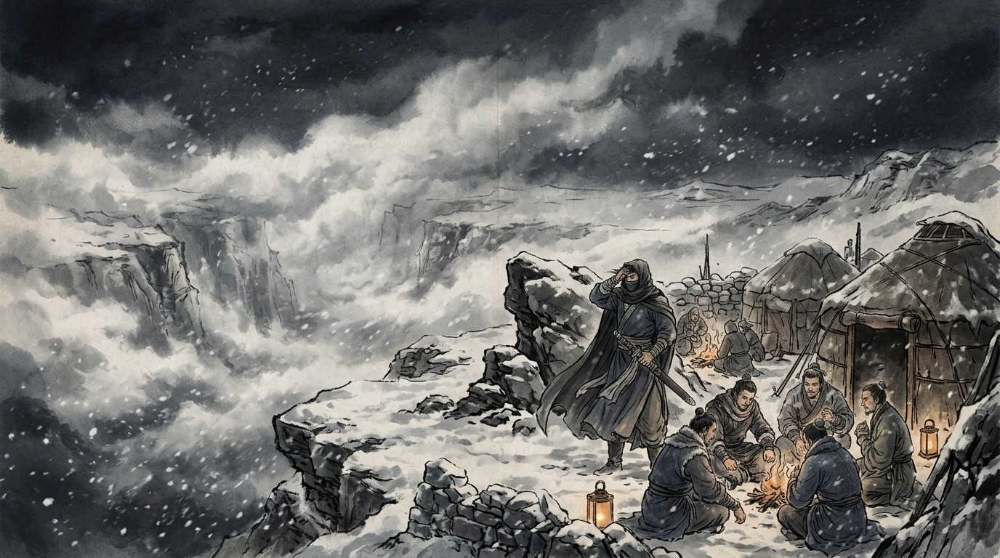

# 第 104 章：走山絕谷・五年前的背叛現場

[← 上一章](ch0103.md) ｜ [本卷目錄](00_intro.md) ｜ [下一章 →](ch0105.md)

*章首插畫：第 104 章 走山絕谷・五年前的背叛現場*

伏擊過後的第七夜，聯合勘探隊已經推進到了北荒裂谷深處三百餘里的冰脊高地。

夜色深沉，狂暴的北荒暴風雪再度呼嘯而起，將大營外十丈之外的一切輪廓徹底吞沒在白茫茫的風牆之中。

就在這場掩人耳目的大雪之夜，天工閣赤煉長老那邊的先遣隊以「探測東側深層冰脈」為由，帶著大半精英與裝滿秘密機械的重車提前兩日轉往了三十里外的另一座冰谷；留下負責護衛輜重營地與警戒的，恰恰是早就暗中默契的獨臂老將雷烈，以及對五年前改道心懷鬼胎的民間嚮導祁十六。

子時一過，五道裹在厚實白色雪地斗篷裡的身影，在祁十六的帶領下悄無聲息地避開巡夜燈籠，藉著暴風雪掩護摸下了營地西北角的一道險峻斷崖。

「再往前五里，就是當年大營原本批給那支『走山隊』走的路。」祁十六勒緊腰間的安全牛筋繩，停在一面彷彿被天神一刀切平的墨黑色巨大垂直雪壁前，回頭看向身後臉色冷峻的燕隼，「可五年前那天夜裡，這座『黑冰斷谷』的谷口被人從上頭生生炸垮了整整半座山頭。上面那些宗門大人對外只說那是自然雪崩，可老子在這片山溝裡討生活十幾年，哪裡的雪會炸出火藥焦灰味兒，我用鼻子都聞得出來。」

燕隼沒有多說一個字，只是伸手摸出懷裡那半截刻著燕家老鷹記號的斷裂箭桿與【玄鐵走山令殘牌】，緊緊對準山壁後方隱約露出的一道半丈寬深黑石隙，沉聲道：「走，下繩。」

林鐵生立刻拿出兩根特製的破冰精鋼岩釘，用阿鐵小鍛錘精準順著岩壁節理砸死進萬年堅冰裡，掛上滑輪與雙股麻繩，確保一條足夠承受五人同時緊急撤離的安全退路。

五人依序垂降而下，鑽進了那道極為狹窄陰森的冰石裂隙。穿過大約百餘步漆黑壓抑的人工爆破碎石帶後，眼前驟然出現了一片被萬年不化厚冰死死封閉在群山腹地裡的凹陷絕谷——**黑冰斷谷**！

這裡一點風也沒有，死寂得彷彿時間在五年前那一夜被硬生生按停了。

祁十六點亮了兩盞防風油燈。橘黃色的燈光貼著地面緩緩掃過，眾人隨即在靠近舊營廢墟的一片淺冰層裡，看見了這輩子也難以抹去的慘烈一幕——

十幾個早已腐朽成灰、被厚冰像琥珀一樣凍住的帆布帳篷塌在雪地上。帳篷外圍的冰層下，靜靜躺著九具扭曲僵硬的人類遺骸！

有的人還保持著死前死死抓著生鏽鐵鎬、試圖徒手挖開上方封死碎石堆的姿勢；有的人懷裡緊緊抱著一只早已凍爛的木頭水壺；其中兩具穿著八荒武山制式殘破巡哨皮甲的骸骨胸口，還明晃晃地插著三支不屬於荒獸的制式破甲鐵弩箭矢！

「韓林哥……！」

跟在後方的祁十六雙膝一軟，差點直接跪倒在冰面上，死死盯住其中一具骸骨腰間——雖然臉龐早就沒了肉，可他脖子上掛著的那枚已經生了綠鏽的銅哨，邊緣上正刻著韓素前些日子才畫給燕隼看過的那組編號：**「北線斥候・乙十七」**！

那是韓素的親哥哥韓林，也是五年前雷烈派出去、卻最終被一紙調令抹成「擅離職守」的那兩名接應斥候之一！

「九具骸骨……沒有大伯的身量。」

燕隼的聲音沙啞得像石頭摩擦。他強壓下胸膛裡翻湧的血氣，一步步走到距離這兩具斥候骸骨十步外的一處半塌岩石凹槽邊。

那裡沒有遺骸，只有一隻被砸扁了一半的鐵皮水壺、半截斷裂卻依然刻著清晰鷹翅刮痕的狼牙重箭，以及一疊被塞進生牛皮箭筒夾層裡、因受潮凍裂而變得殘破不堪的走山隊名冊殘頁和一塊沾滿早已變黑血跡的半片舊羊皮血書！

燕隼的右手在冰冷的空氣裡劇烈顫抖了一瞬，卻終究還是咬緊牙關，沒有急著徒手去扯那片已經脆化的羊皮，而是側過身讓開半步：「顧玄，你來起出來，別弄碎了字。」

「好。」顧玄立刻蹲下身，取出雙層封存木匣與極細的竹夾，小心翼翼地配合油燈烘烤的微溫融化邊角脆冰，將那塊殘缺血書與名單殘頁一寸寸剝離出來。

幾人湊近燈光，仔細辨認血書上用凍硬指血匆匆劃下的歪斜筆跡：

> *『天興十九年臘月……行至黑冰深處……忽遇暗……內堂調來之開山重藥非為開路……炸……接應未至……雷……非……』*

後面的大半截羊皮紙已經在一場致命的冰壁崩裂與坍塌中被硬生生撕扯得粉碎，只剩下最底角幾個模糊得幾乎辨不出筆順的血痕，以及最後一個依稀能認出的「山」字落款！

「『內堂調來之開山重藥非為開路』……『雷……非……』……」

燕隼死死盯著那兩個殘缺的血字，指節捏得咔咔作響，眼底爬滿了駭人的血絲，聲音卻冷得像這谷底凍了五年的寒冰：「大伯在死前看出了雷烈將軍不是內鬼，可真正派人拿開山火藥炸塌谷口、再用制式破甲弩射殺接應斥候的那個名字，正好在撕爛的那半截羊皮上。」

「這三支破甲弩箭的血槽制式，是三宗內門護衛與大商隊才配得起的精鍛鐵矢。」林鐵生蹲在骸骨旁，拿卡尺比了比箭桿尾部的凹槽，悶聲道，「不是山外散匪，是自家人動的手。」

「對得上了。」沈泥的嗓音也在發顫——不僅是因為冷，更是因為她自己何嘗不想立刻揪出當年清洗雲記沈家的仇人——但她依舊死死咬著嘴唇，「這九具遺骸、韓林大哥的乙十七號接應銅哨，加上這半張血書，正好與我們在金石府鎮風衛所查出的走山令底檔、雷將軍的軍需調度副本扣成了死環。現在只差撕掉的那半頁名字，還得往裡頭找！」

「先把這九位叔伯的遺物與方位拓下來。」柳清虛取出炭筆與麻紙，在防風燈下飛快標定岩壁角度，「等大風雪一過，上頭的浮雪隨時會二次塌下來。我們今晚若不把鐵證封存帶走，這九條人命就真成了死無對證的糊塗帳。」

沈泥拿出雙層封存匣、空白標籤紙與編號銅牌，和顧玄、林鐵生一起跪在冰冷的凍土上，忍著刺骨寒風將每一具骸骨的位置、隨身遺物、斷裂弩箭箭簇、走山隊名冊殘頁及血書持炭筆手繪詳圖並標註方位，雙人簽字編號封入封存匣內，唯獨把韓林的那枚銅哨妥善收進一個單獨的小木盒裡。

燕隼站在這九具保持著絕望抓爬姿勢的骸骨面前，胸口劇烈起伏了足足十數息。

冰冷的淚水剛冒出眼眶，就被酷寒凍在眼睫毛上。這位從黑石鋪一路走來的獵戶少年，看著地上被韓林死死攥在指骨裡的銅哨，又看著身旁幫他一筆一筆拓下鐵證的同伴，雙膝一彎，重重朝著面前這九具冰封的遺骸磕下了一個頭。

「大伯，韓林大哥，還有各位叔伯……你們且在這兒再忍幾日。」

燕隼站起身，抹去眼角冰霜，神情冷硬得宛如一塊萬載黑冰：「今天我動不了他們，不是怕死，是我要讓那些把你們當成石頭隨便埋在這兒的人，在全天下的眼皮子底下，連賴帳的餘地都找不到半點。」

就在此刻，谷底最深處那面高聳的冰壁後方，隱約傳來了一聲極為沉悶、彷彿無數塊萬斤巨石在地下深處緩慢摩擦的奇怪震動——

「轟……隆……」

震動來的方向，正是黑冰斷谷最深處被厚冰半掩著的一道古老石門輪廓。而燕隼胸口貼身放著的那塊【太古戰神獵獸圖騰骨片】，竟在這一刻猛然發出一陣幾乎燙傷胸口皮膚的熾烈灼熱！

---

[← 上一章](ch0103.md) ｜ [本卷目錄](00_intro.md) ｜ [下一章 →](ch0105.md)
