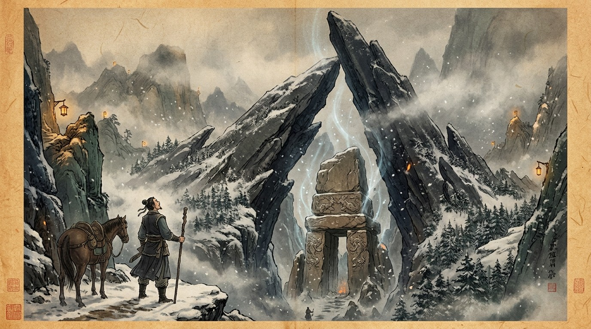

# 第 105 章：荒古戰神遺塚・不屈的血脈共鳴

[← 上一章](ch0104.md) ｜ [本卷目錄](00_intro.md) ｜ [下一章 →](ch0106.md)

*章首插畫：第 105 章 荒古戰神遺塚・不屈的血脈共鳴*

順著震動傳來的方向往斷谷最深處再摸索半里，眼前的景象讓一直見慣荒原奇觀的祁十六也徹底呆立在了雪地裡。

在兩座如劍鋒般交錯插進冰層的巨大黑曜石崖壁夾角下方，靜靜矗立著一座高逾三十丈、完全不屬於當世任何建築風格的太古巨石建築——**【荒古戰神巨石遺塚】**！

沒有飛簷斗拱，沒有精緻的雕花玉欄，整座遺塚僅僅由十二根十人合抱不過來的粗糙黑色巨柱支撐著一塊龐大得如同山岳截面的扁平玄石穹頂，巨柱表面粗糙地鑿刻著獵人追殺太古凶獸的古拙線條。歷經萬載歲月與冰雪侵蝕，石面早已斑駁不堪，卻依舊透出一股直衝雲霄的莽荒戰意。

而在遺塚底座最右側、靠近一面陰暗岩壁的地方，露出一條寬約丈許、不知通往地下多深處的幽暗裂隙。

「燕隼！看地上！」

走在最前面的林鐵生蹲下身，將油燈湊近裂隙入口處三尺見方的一塊光滑黑石板。

只見冰冷的黑石板邊緣上，清晰地烙著一條長約五尺、顏色早已凍成暗紫發黑的粘稠拖拽血跡——那不是多人混戰濺出來的血點，而是一個人在身受重傷、幾乎無力站立的情況下，拖著一條斷腿或重傷軀體，一路死命朝著那道幽暗地底裂隙爬過去留下的拖痕！

而在血跡盡頭、裂隙邊緣的石縫裡，靜靜躺著一面被巨力砸凹進去半邊、邊緣已經磨得發亮的舊精銅圓鏡。鏡背上用粗鑿子刻著一個有些歪斜的「燕」字！

**燕山的隨身護心鏡！**

「大伯……他當時還沒死在外面！」

燕隼猛地衝上前去，一把抓起那面冰冷的護心鏡。鏡面凹陷的深度足以震碎尋常武夫的五臟六腑，顯然五年前大伯在遭到毒殺與伏擊後，憑著一股匪夷所思的悍勇硬是殺出重圍、身負重傷拖著殘軀一路爬進了這座古遺塚深處！

然而當他把油燈探向那道幽暗裂隙深處時，裡頭卻只是一片看不見底的冰霧與微微扭曲的冷氣流，既沒有骸骨，也沒有生還留下的生火痕跡或字跡。

「五年前發生的事……他到底是爬進裂隙躲過了追殺活著去往別處，還是傷重死在了下面看不見的深淵裡？」祁十六低聲問了一句，隨即搖了搖頭。

燕隼手指死死摩挲著鏡背上那個熟悉的「燕」字刀痕，眼神沉如寒鐵。身為老獵手教出來的孩子，他比誰都清楚荒野的規矩：沒有見著屍骨，就不能給活人立墳；沒有見著活人，也不能拿幻想當真。這面護心鏡和這道血痕，至少告訴他大伯最後爬進了這道裂隙——路還沒斷！

就在眾人盯著裂隙沉默之際，燕隼忽然像是感應到了什麼，抬起頭望向頭頂那根離裂隙最近、佈滿古拙獸紋的巨大黑色石柱。

他緩緩將那枚從黑石鋪一直貼身帶在身上的【太古戰神獵獸圖騰骨片】，輕輕按上了石柱中央一處大小正好相符的粗糙凹痕！

「轟隆————」

整座三十丈高的巨石遺塚並未綻放出什麼神仙般的耀眼金光，更沒有任何神靈聲音在腦海裡直接傳授無上神功。相反，石柱內部只傳出一陣極為沉重、如同遠古巨人心跳般的深沉石音共鳴！

在燕隼手掌貼住骨片的接觸面處，無數道微弱卻極其粗獷的暗紅血紋順著石縫瞬間蔓延開來，在他的視野與心神感知裡，強行展開了一段殘缺不全、斷斷續續的太古戰鬥留影——

畫面裡沒有仙氣飄飄的劍客，只有十幾個光著膀子、渾身浴血的荒古巨人手持粗重骨弓與石矛，在狂暴如刀的太古地煞風暴裡背靠背死守著後方的老弱族群。其中領頭一名肩抗巨弓的身影，既沒有燃燒全部壽元去發瘋強攻，也沒有用狂躁的煞氣亂噴，而是每一次吸氣都把地煞與熱血精準鎖進骨髓深處，出弓的剎那整個人靜止如萬年寒石，直到把最後一分多餘力氣都壓成箭矢貫出的極致勁道，隨後立刻收力退後半步由身旁的同伴補位輪替！

一段極為簡短、與八荒武山當今那套一味壓榨生機的《煞血霸體訣》截然不同的古老呼吸節律，順著骨片的震顫一拍一拍地敲進了燕隼的心口之中。

這套節律不是幫他憑空變出力量，而是在逼他面對自己最大的弱點——

*如果一個獵手只會為了復仇和拼命去燃燒自己全部氣血，那他連第一輪群獸的圍撲都撐不過去，更別提守住身後還要活著回家的人。*

「呼……哈……」

燕隼閉上雙眼，胸膛隨著那道沉重古樸的節律緩緩起伏。原本因看見大伯血跡與兄長們骸骨而沸騰到極點、差點燒傷經脈的狂暴煞血，在這一吸一吐之間竟然奇異地冷靜沉澱下來，彷彿燒得通紅的生鐵被放進了冰冷的油脂裡慢慢淬火收斂，轉化為一種更加凝練、深沉且毫無火毒躁氣的強悍勁力！

「小心！谷口有東西進來了！」

一直守在後側警戒的林鐵生突然發出一聲低喝！

眾人猛然回頭，只見剛才順著眾人留下的一絲人味與血氣，一頭身高近丈、渾身覆蓋著厚厚冰晶毛皮的巨型「北荒冰熊王」竟然穿過了狹窄的爆破石隙，雙眼血紅地堵住了眾人原路退回斷崖繩索的唯一通道！

這頭顯然在冬季餓紅了眼的北荒巨獸，此刻發出一聲狂暴咆哮，兩隻如磨盤大小的熊掌狠狠拍向站在最靠外面的沈泥與祁十六！

若是換作以前在金石府城甚至黑山營剛入山時的燕隼，此刻一定會怒吼一聲，燃燒全部氣血跟這頭巨熊硬碰硬搏命換傷，甚至就算把冰熊打傷逃竄也要追上去一刀劈碎它的腦袋。

但這一瞬，剛從遺塚戰神留影裡學會第一式節律的燕隼，整個人安靜得像一塊沉進深水的鐵。

他沒有喊殺，也沒去跟這頭皮糙肉厚的畜生近身搏命消耗，而是左腳重重往後踏實半步——

**《八荒破天弓》第一式：沉岳引！**

全身原本在經脈裡橫衝直撞的八荒陽剛氣血，順著剛掌握的那套古老節律，一分不剩、一毫不錯地精準壓縮進左臂骨骼與拉弦的右臂大筋之中；與此同時，他特意留出了三分餘力與退路節奏，在出箭前先用眼角餘光確認顧玄、沈泥與祁十六已經全數退進遺塚石柱背後的死角！

「嗡——！」

百斤重石鐵胎柘木弓發出一聲彷彿弓臂都要被拉斷的悲鳴！最後兩支黑背雪狼頭骨破甲箭之一，帶著一股凝練到極點卻絲毫沒有外洩半點熱浪的純粹穿透勁道，破開暴風雪直接貫入冰熊王剛揚起前掌時露出的咽喉軟毛下方三寸處！

「噗嗤！」

箭矢雖未將這頭體型龐大得像座小山的巨熊當場貫穿斃命，可那股精準凝聚的震盪力道卻直接震傷了它的氣管與半邊前肩大筋！

冰熊王發出一聲驚怒交加的悶吼，噴出一大口血沫，原本撲過去的巨掌硬生生砸偏在旁邊的石柱上。燕隼並未乘勝追擊上去補刀，而是反手抓起兩根預先綁好的火把甩在通道雪地上隔斷視線，隨即一把拎起幾乎驚魂未定的祁十六，低喝一聲：

「別貪殺！走裂隙後面那道氣流通道！這裡被冰熊堵死外口了！」

冰熊王吃痛忌憚之下不敢盲目衝進火圈與陌生的遺塚石柱群裡，咆哮了兩聲後拖著傷腿退出了窄隙。而五人也順著大伯燕山當年血跡爬去的方向，舉起防風油燈，小心翼翼地鑽進了遺塚後方那道深邃幽暗、吹著微弱奇異暖風的岩層裂隙！

這一次，燕隼徹底收斂了獵手狂躁的追殺欲。他緊緊攥著懷裡那面被砸凹的護心鏡，心裡明白了一件比復仇更重的事：

想找出大伯究竟去了哪裡，首先得帶著這四個同袍，活著走出這片冰原。

---

[← 上一章](ch0104.md) ｜ [本卷目錄](00_intro.md) ｜ [下一章 →](ch0106.md)
