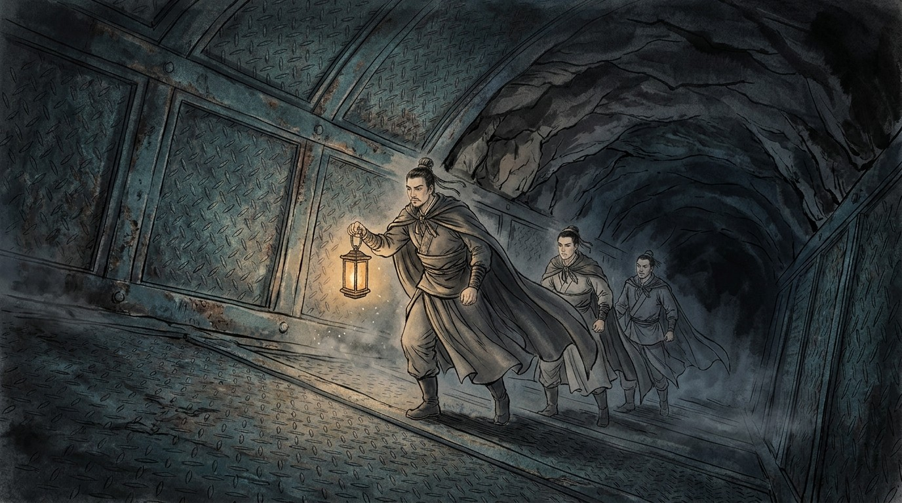

# 第 106 章：地底方舟艙段・北荒破界主陣基

[← 上一章](ch0105.md) ｜ [本卷目錄](00_intro.md) ｜ [下一章 →](ch0107.md)

*章首插畫：第 106 章 地底方舟艙段・北荒破界主陣基*

穿過荒古戰神遺塚後方那條幽暗狹長的天然岩層裂隙後，本該越往下越寒冷刺骨的地底深處，氣溫竟然莫名回升了不少。

腳下的碎石漸漸消失，取而代之的是一條顯然經過某種巨型刃具整齊切削過的斜坡甬道。兩側壁面並非天然山岩，而是一塊塊厚逾三尺、表面烙滿細密菱形咬合紋的暗青色玄金護板。靴底踩在上面，傳來的不是泥土的沉悶，而是某種中空巨物深埋地底萬載後依然隱隱回蕩的幽深空響。

又順著這條斜坡甬道向下行了約莫兩里，前方黑沉沉的石壁驟然消失，視野猛地豁然開朗！

六人（連同緊跟在後的嚮導祁十六）同時停住腳步，連呼吸都忘了半拍，怔怔地望著手裡防風油燈所能照亮的那一角龐然大物——

這根本不是什麼地底天然溶洞，而是一座掩埋在永凍冰層下方數百丈深處、方圓目測足有數十里、幾乎將整座北荒大裂谷地底硬生生撐起來的**太古巨型玄金遺構**！

頭頂上方是厚逾百丈的萬年幽藍堅冰，冰層下方卻密密麻麻支撐著無數根直徑超過五丈、通體漆黑如墨卻泛著冷硬折角光澤的巨型玄金樑柱。在無邊無際的黑暗深處，靜靜臥著一艘宛如傾覆巨鯨般的超巨型船體艙段殘骸——高達數十丈的玄鐵裝甲側壁上佈滿了恐怖的焦黑熔痕與萬年凍土壓迫出來的扭曲凹坑，無數條水桶粗細、早已斷裂或半凝固的暗紫色引流銅管像巨獸乾涸的血管一樣垂掛在半空中！

這就是橫跨萬載歲月、一直深埋在北境冰雪之下的太古謎團核心——

**【太古破界方舟・北荒主陣基】**！

「老天爺……」一向只信算盤和實物的祁十六雙腿一軟，直接坐在了冰冷的玄金地板上，手裡的防風燈差點脫手，「這……這他娘的到底是什麼神仙造出來的鐵城？比整個雲津仙集加起來還要大十倍不止吧！」

沒有人回答他，因為林鐵生已經快步走到距離他們最近的一座高達三丈、佈滿大型傳動齒輪與破損銅閥的圓柱形主樞台前。

他摘下鹿皮手套，用那雙滿是老繭的手掌貼在冰冷的黑色鐵殼上，指尖順著一道深達半寸的鍛接焊縫緩緩滑過，隨即從工具囊裡掏出阿鐵精鋼分寸卡尺，又取出那塊始終貼身帶著的【太古不融黑鐵齒輪構件】，湊近主樞台破裂外露的一處斷裂傳動軸邊緣。

分毫不差。

這座地底巨構所使用的烏黑玄金材質、鍛打紋理、乃至每一個齒牙的弧線傾角，竟然與他在黑石鋪地爐裡震出的黑鐵齒輪、以及天工閣萬機地窟裡供奉的那尊十丈高【巨靈神機】完全出自同一套模具——天工閣奉若神明的巨靈神機，放在這座龐大無朋的船體面前，竟只不過是船翼下方拆落的一具輔佐錨機！

「雙層中空鐵殼，內壁有螺旋導流槽。」林鐵生蹲在破裂的管口旁，敲了敲足有四指厚的管壁，短促而篤定地說道，「這不是兵器，是給整座大船散熱洩壓的主鎮熱槽。你們看這邊裂開的紫黑粗管——」

顧玄早已提著油燈蹲在那幾根斷裂垂落的巨型銅管下方。

在管口斷茬與下方萬年冰層交匯的地方，淤積著一片方圓數十丈、呈現出濃稠暗血紫色、宛如半凝固岩漿般散發著刺鼻腥甜硫磺熱氣的巨大結晶池！

顧玄綁緊浸過苦參汁的厚棉面巾，戴上雙層鹿皮手套，小心翼翼地用小銀匙從那片半凝固的暗紅粘稠結晶邊緣刮下一點樣本，放進隨身的小瓷盅裡，滴入一滴雪線苔冷萃汁液。

「滋——」瓷盅內立刻騰起一縷熟悉的紫黑酸煙，底部析出一層細碎的銀白鉛汞重渣。

三息之後，顧玄緩緩轉過身，臉色在橘黃的燈光下白得沒有半點血色：

「根本沒有什麼天地孕育的『北荒地煞血精母脈』。」

他的聲音在這座龐大空曠的玄金遺構裡顯得格外清晰、格外冰冷：

「這根粗管裡封存的，是太古先民用來替巨型船體核心降溫壓火的『鎮熱玄漿』與重汞髓液。所謂的『萬年血精母液』和各地挖出來的『地煞血精』，根本就是這艘太古方舟當年墜毀破裂時，**從鎮熱主槽管裡洩漏出來的劇毒廢漿**！這些混著重鉛與狂暴火煞的廢漿滲進北境地底岩縫，順著暗河一路往下流，才污染出了黑石鋪、濁水縣乃至這條北荒裂谷裡的所謂『血精礦脈』！」

「拿大船漏出來的鎮熱毒漿……當成延壽成仙、催動神機的靈丹妙藥？」燕隼看著那片冒著紫泡的腥甜泥沼，胃裡一陣翻湧。

「不止是毒。」林鐵生臉色凝重地指向旁邊那座還在發出沉悶「嘶嘶」聲的丈許青銅總閥，「這團半凝固的母液結晶正好糊住了主鎮熱槽的裂口，替地底深處還沒散盡的太古爐火壓住了八成火氣。要是有人從外頭拿鑽山機把這層結晶強行掏空，底下壓了萬年的火脈與地氣當場就會炸開——到時候整片北荒冰原加上半座大黑山長城，全得塌進地底深淵裡！」

一直站在高處一截斷裂玄金橫樑上、低頭凝視著手中【水銀渾天鏡】的柳清虛，也在這一刻緩緩收起羅盤，印證了兩人的判斷：

「從踏進這座船體開始，上方的星位引線就全部向地底正中央塌陷扭曲。這座墜毀的太古方舟，早已經和北境三百里的地脈長在了一起。動它的主鎮熱槽，就是抽北境三山的脊梁骨。」

「也就是說，」沈泥扶著冰冷的鐵欄杆，望向遠處黑暗中那片彷彿還在無聲喘息的鋼鐵巨獸殘骸，聲音微沉，「三宗私盟花了三十年心血、不惜滅門殺人也要來北荒重開的『母脈』，其實是栓住整個北境不塌下來的最後一根死栓。」

雖然他們眼下才剛剛摸到這座龐大船體外圍的一處鎮熱管槽，既沒看清整艘方舟當年為何墜落，也還不知道太古那一戰的始末；但腳下這片正在發燙的玄金甲板與刺鼻的血精毒池，已經把最迫在眉睫的生死危機擺在了五人眼前——

外頭的赤煉長老，可是帶著整整三車重型破山鑽機進谷的！

「先往主艙圓台走！」柳清虛抬起手，指向這座巨型陣基更深處——在一片錯綜複雜的斷裂玄金廊道盡頭，隱約透出一座高出地面三丈、呈八角形狀的暗沉金屬圓台輪廓，「從剛才開始，我懷裡的逆星拓片就一直在朝那個方向發燙。」

「我的圖騰骨片也是。」燕隼按住胸口。

「天門引和青銅契版也是。」沈泥點頭。

五人對視一眼，讓驚魂未定的祁十六帶著最外圍的採樣記錄先行守在甬道入口負責接應警戒，五位少年則握緊各自的手中兵器與防風油燈，頂著地底深處湧來的乾燥熱風與金石嗡鳴，一步一步踏上了那座沉睡了萬載歲月的八角形主陣基核心圓台。

---

[← 上一章](ch0105.md) ｜ [本卷目錄](00_intro.md) ｜ [下一章 →](ch0107.md)
