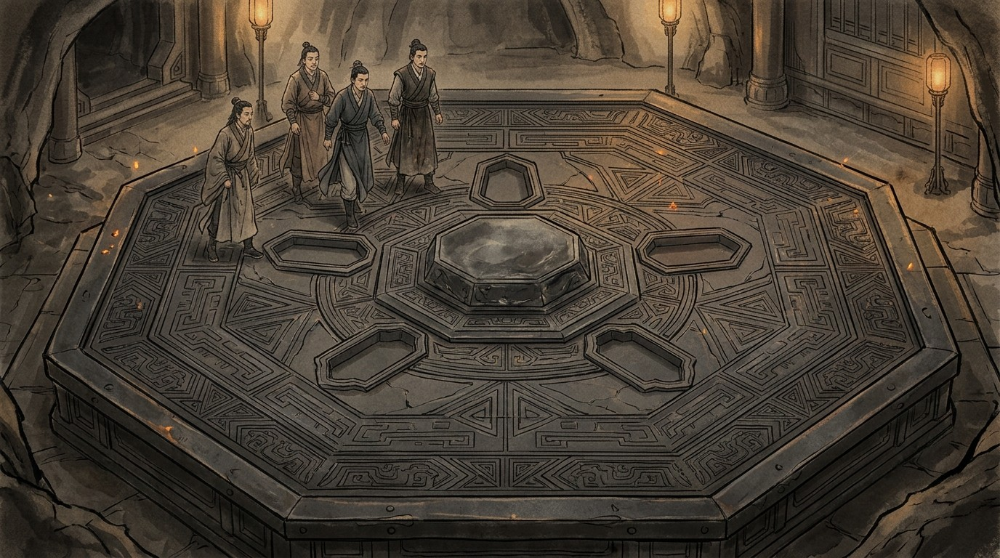

# 第 107 章：五件遺物再鳴・太古影像殘篇

[← 上一章](ch0106.md) ｜ [本卷目錄](00_intro.md) ｜ [下一章 →](ch0108.md)

*章首插畫：第 107 章 五件遺物再鳴・太古影像殘篇*

踏上這座八角形玄金主圓台時，五個人不約而同地放輕了腳步。

圓台直徑約有十丈，表面鋪著一整塊不知何種材質的暗銀色冷硬石板，上面刻著一圈與金石府南關小棧那夜共鳴時極為相似、卻繁複精密了千百倍的幾何凹槽與星軌導流槽。正中央是一座已經熄滅不知多少萬年的多邊形晶石底座，底座周圍整整齊齊環列著五個形狀截然不同的嵌入式凹龕。

「你們看這五個凹槽的排列順序。」柳清虛舉著防風油燈繞行半圈，眼睛微微瞇起，「正北位刻著倒轉的星辰度數；東北位是一組互相咬合的傘齒輪；西北位鑿著粗獷的遠古獸首線條；西南位帶著深層地脈晶簇導流紋；而正南位——」

他停下腳步，看向臉色同樣凝重的沈泥：「正南位是一方印著九條橫縱交錯商路徽記的方正插槽，旁邊還有一個細長的銅契卡榫口。」

沒有多餘的猜測與推辭。當年在大荒黑石鋪五個不同角落各自拾起的命運碎片，乃至在金石府小棧桌案上僅憑氣機合鳴成針的五條線索，終於在萬里雪原之下的太古遺構中央，嚴絲合縫地對上了它們原本的位置。

「先試試看。」林鐵生第一個站到東北位凹槽前，謹慎地先拿小鍛錘輕輕敲了兩下石槽邊緣確認沒有觸發暗藏機括，這才取出那枚【太古不融黑鐵齒輪構件】，緩緩放進傘齒輪槽內。

緊接著，柳清虛站定正北位，攤開那卷伴隨他走出破落道觀的【逆星斷碑拓片】輕覆其上；

燕隼立於西北位，將【太古戰神獵獸圖騰骨片】按進獸首凹龕；

顧玄立於西南位，小心翼翼地從藥囊最深處取出那塊來自黑石古礦深井、絕非任何宗門玉化晶石可替代的【古礦地煞晶核殘片】，嵌入地脈導流槽內；

而沈泥則深吸了一口氣，站定正南位。她雙手分別拿出莫三保管了三十年的青金古令【萬物行商・天門引】，以及在金石府鬼市拍得的【史前商盟青銅契版殘片】——兩件分屬於同一商盟遺物線的器物先後對準了主卡榫口與旁側的契版插槽！

「嗡————！」

幾乎就在五條不同道途的太古遺物同時歸位的剎那，整座死寂了不知幾萬年的八角金屬圓台，猛然自地底深處震顫了一下！

沒有天崩地裂的巨響，只有一陣細密而低沉的金石導流共鳴聲順著五道凹槽迅速匯向正中央的晶石底座。五種截然不同的太古氣機被依序喚醒、合契：

正北的拓片亮起一縷微弱卻堅定的銀白星芒，正與上方冰層透下來的天星方位隱隱呼應；東北的黑鐵齒輪在玄磁牽引下悄然無聲地自行咬合旋轉半圈，顯露出底層精密至極的承力榫頭；西北的圖騰骨片釋放出一陣厚重凝實的荒古血脈律動；西南的古礦晶核與下方的方舟鎮熱管脈殘留地煞相互激發，騰起一縷穩定的暗紫流光；最後，正南的【天門引】發出一聲清脆的青金微鳴，與青銅契版上刻著的古老商盟勘合篆紋嚴密咬定！

五道流光匯聚於中央的瞬間，那座多邊形晶石底座上方三尺處，突然折射出一片微微晃動、佈滿歲月裂痕與殘缺暗紋的青金色半透明留影！

五人同時屏住了呼吸。

留影畫面殘損得極為厲害，顯然這座封存於太古晶石內的記史陣盤早就因為方舟墜毀與萬年冰壓而碎裂過半。

只見模糊的青金光霧之中，一片浩瀚得令人窒息的漆黑星海之上，無數條交織如鐵網般的青白色光鏈構成了一座遮蔽整個天穹的巨大球形大陣——大陣邊緣閃爍著二十八個古老的星宿符印，**正是太清宮孤本典籍裡偶有隱晦提及、卻從未見過全貌的「二十八宿天羅大陣」**！

畫面一顫，大片焦黑的裂斑吞噬了左下角。

緊接著浮現出來的，是一座龐大到難以用言語形容、由萬千玄金巨構與星陣拼合而成的破界方舟全貌——天工閣視為鎮派神物的十丈【巨靈神機】，在這幅完整的方舟留影裡，竟渺小得只是方舟右翼下方不起眼的一座輔助推進錨機！

留影中的古語早已在萬載時光裡磨損得幾乎聽不清字句，只剩下斷斷續續、夾雜著劇烈金石哀鳴的殘音與星算陣圖：

畫面顯示，太古時代曾有一支集合了整個人族百工與修士之力的先民大軍，試圖駕馭這座巨型破界方舟衝出頭頂那座不斷收緊的二十八宿天羅牢籠。在方舟的原始編制上，清楚地劃分出三大協同部司——負責推演星軌與尋覓天網縫隙的「領航演算部」（即後世法道之源）、負責於外荒險境護衛船體與劈開阻礙的「破陣護衛部」（即後世力道之源）、以及負責維持方舟萬千機括動力與艙內百萬生靈藥理生機的「百工造物部」（即後世物道之源）！

那時的法、力、物三道，根本不是互相鄙夷或各自偏科的死路，而是同一艘渡世方舟上缺一不可的三根支柱！

然而，就在畫面即將推進到「方舟逆衝天羅大陣」與「大清洗降臨」那最關鍵的一幕時——

「咔嚓……嗡！」

一道如同被九天巨雷硬生生劈穿晶核的焦黑裂痕猛地橫貫光幕，伴隨著一陣刺耳的晶石碎裂聲，整段太古留影在最緊要的關頭驟然斷裂熄滅，圓台中央重新恢復了一片冰冷的死寂！

地底艙室內，只剩下五盞防風油燈微弱跳動的橘黃火光，以及五個人沉重的呼吸聲。

「這就斷了？」燕隼向前跨出半步，盯著空蕩蕩的晶石底座，眉頭擰成了一個死結，「當年這艘大船到底衝出去沒有？頭頂那個二十八宿天羅陣到底是誰架起來的？那三撥負責領航、護衛和修船的先人後來又落到了什麼下場？」

柳清虛緩緩收回那卷已經恢復冰冷的【逆星斷碑拓片】，望著面前布滿裂紋的晶石底座，神色比來時更加冷峻：「晶石後半截的記憶已經被當年那一擊徹底抹去了。我們現在能親眼確認的，是太古時代確實有過這場試圖衝破天羅牢籠的破界之役，而且法、力、物三道原本同出一源、互為表裡。至於當年為何功敗垂成、頭頂那張網背後站著的究竟是什麼存在……這座墜毀的北荒殘艙裡沒有答案。」

「至少咱們現在親眼見著了，頭上這片天不是天生就該把人練成石頭的，咱們五個走的道從根子上就是連在一起的。」

林鐵生拍了拍手上剛剛記滿整個圓台榫槽分寸的麻紙冊子，轉過身指了指圓台後方另一扇此刻正因為剛才五器共鳴而緩緩滑開半尺縫隙的暗沉玄金門廊：

「那邊還有一道暗門。大船既然有領航、護衛和百工三個部司，旁邊那間多半就是管錢糧調度和契約文書的後勤總樞了。沈泥，你的青銅契版和天門引剛才在圓台上只對了一半吧？」

沈泥眼中閃過一抹亮光，立刻捏緊懷裡那兩件依然隱隱發燙的商盟信物，點了點頭：「走，去後勤艙室把剩下的帳對完！」

---

[← 上一章](ch0106.md) ｜ [本卷目錄](00_intro.md) ｜ [下一章 →](ch0108.md)
