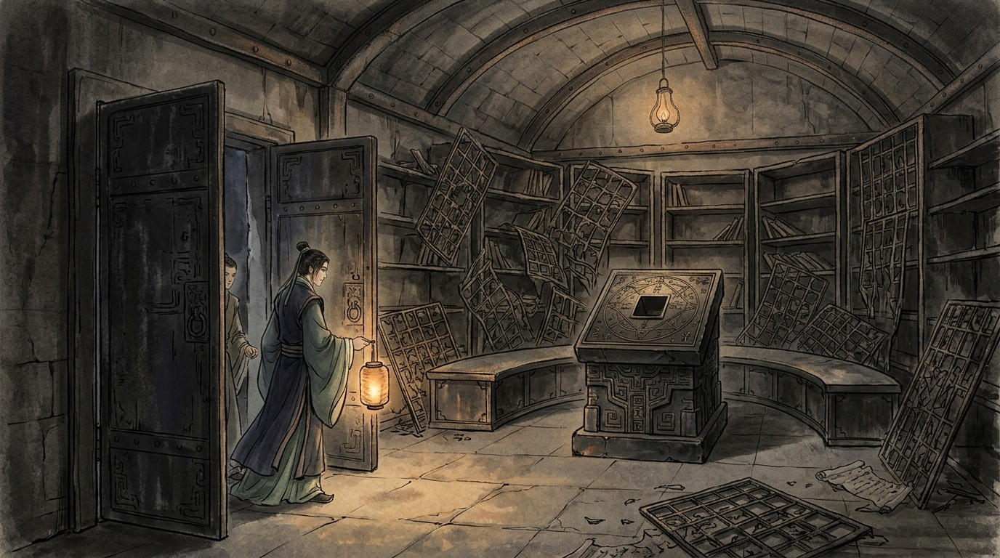

# 第 108 章：九城銅券合璧・雲記舊約重現

[← 上一章](ch0107.md) ｜ [本卷目錄](00_intro.md) ｜ [下一章 →](ch0109.md)

*章首插畫：第 108 章 九城銅券合璧・雲記舊約重現*

穿過圓台後方那扇緩緩敞開的暗沉玄金門廊，裡面是一間遠比主艙小巧、卻保存得相對完好許多的高拱頂石鋼廳室。

廳室四周的牆壁上原本嵌滿了一格格類似卷宗檔案櫃的金屬格柵，如今絕大多數早已在當年方舟墜毀時的劇烈衝擊下震塌變形，唯有大廳正中央那座半人高的玄鐵主控台依舊完好地立在原處。主控台表面刻著極為繁複的九宮星羅格子，正中央預留著一處缺了左半邊的青銅契版嵌槽——右半邊的青銅厚板正死死嵌在槽位之中，表面雖已爬滿綠鏽，卻依然能看清上頭深鑿的太古商業篆文。

沈泥站在玄鐵主控台前，雙手微不可察地緊了緊。

柳清虛、林鐵生、燕隼與顧玄四人默默散開在廳室四個角落替她警戒護法。

她緩緩從貼身內袋裡取出那塊在金石府鬼市從死人堆與暗標中拼死拍下來的【史前商盟青銅契版殘片】，小心翼翼地對準主控台嵌槽左側那道參差不齊的古老斷口，輕輕按了下去。

「咔噠。」

一聲極其清脆、嚴絲合縫的金屬咬合聲在安靜的後勤廳室裡響起！

斷裂了不知多少千年的左右兩半青銅契版，在這一刻重新熔合咬定為完整一體——【九城古商盟總契銅版】！

然而正如莫三曾經告誡過的那樣，這枚契約銅版並沒有因為她體內流著沈家血脈就生出什麼血脈感應的異象。兩半銅版合璧之後，反而是控台一側那處窄長的青金驗印槽亮起了一道微弱的待核幽光——

沈泥立刻掏出莫三保管了三十年的那枚黑鐵青金古令【萬物行商・天門引】，毫不猶豫地插進驗印槽內！

「嗡……！」

天門引表面的黑色氧化層在幽光掃過下發出輕微的共鳴震顫。合璧後的整塊【九城古商盟總契銅版】上，原本被歲月鏽跡掩埋的數十行太古暗金小字一行接著一行緩緩亮起，連帶著控台後方一根尚未完全損毀的銅製捲軸匣「咔」地彈開了鎖扣，吐出一疊用耐腐蝕金箔壓製而成的古老後勤契約卷宗！

沈泥屏住呼吸，湊到油燈與微弱青光前，在柳清虛協助辨認幾個太古古篆變體字眼的幫助下，一字一頓地讀出了這份塵封萬古的契約核心內容——**那樁跨越三十年滅門風暴的【舊約核心】終於浮出水面**：

「……太古破界之役既啟，萬物總調度使奉『九城萬物商盟』總約：凡法、力、物三院離界衝關之日，不與仙宮爭權，不入宗門奪道，唯負統合凡間九州糧秣、精鐵、藥材、苦力之責，並以九城商路備用通道保人間十萬凡民避難之火種……」

沈泥的指尖猛然在金箔後半段那張「各分區物資補給節點與鎮熱暗閥維護條約」的圖紙上停住了！

只見金箔上面清楚無比地畫著北荒這座破界方舟的地脈鎮熱穩壓總圖——其中特意用朱砂一樣醒目的紅線框出了**「主艙鎮熱玄漿母液封存區」**，下面用古篆寫著一條嚴厲到了極點的商盟鐵律禁令：

> **【九城總約・禁毀條例第七條】**：*凡執掌九城銅券之後世調度商盟，須嚴守方舟各處地脈鎮熱玄漿封存紅線。無論何等勢力以何等名義求購開採，皆當死守禁令、絕不交出開採與滲透圖紙；一旦抽空母脈鎮熱層，北境地脈必致失衡陸沉，萬民無所遁逃！*

「原來如此……！」

站在旁邊的林鐵生倒抽一口涼氣，猛地看向剛才那疊金箔角落裡夾雜著的一張明顯屬於近幾十年前手寫謄抄的泛黃皮紙副本——

那是一份三十年前的民間商盟密信摘錄殘頁！紙頁邊角印著一個熟悉得讓沈泥呼吸驟停的記號：**一朵殘缺的雲紋「雲記」暗章，以及「乙巳年舊盟未結轉帳：玄木」的筆跡！**

沈泥的手指控制不住地抖了一下，終於將這段跨越三十年的血案脈絡拼出了核心的輪廓——

三十年前，統領九州民間貨路的「舊商盟」（沈泥家族「雲記」所屬的總盟），透過代代相傳的祖訓與殘缺銅券圖紙，察覺三大名山背後的延命私盟竟企圖在北荒偷偷抽乾這座太古地底鎮熱「母脈」來煉製延命血丹與強催古傀！

舊商盟核心掌門與沈家直系、旁支為了死守「九城舊約」不肯交出北境地脈水文與暗閥開採圖紙，更嚴禁民間商號替名山私運高濃度母液……結果迎來的，是一場自金石府到北境十三州有組織的血腥清洗！

先是奪權除名，繼而是抹除帳冊名分，直到十五年前旁支家破人亡、年幼的「沈雲妮」在追殺中失散流落黑石鋪，成為靠老乞丐莫三養活的乞兒「沈泥」！

而在控台最角落的幾條近十年的交易補充備忘紙頁上（不知是五年前走山隊還是更早之前潛入者留下的紀錄），雖然字跡殘缺且沒有簽下完整姓名，卻清晰記錄著銀錢與調度指令的流向：

*『……乙字批母液採辦銀流……經金石商會內堂副席轉撥……對接「丹鼎丙柒」、「天工赤火」、「太清雷律」三處專責執事……』*

「金石商會內堂……錢百川……還有丹鼎、天工、太清這三處的執事……」沈泥盯著那幾張紙，指尖捏得泛白。

「沈泥，這幾頁紙鎖死了三處專責堂口，卻還沒露出最上頭落筆簽字的人名。」柳清虛站在她身邊，一面飛快拿炭筆將金箔與皮紙副本上的文字完整臨摹下來，一面低聲道，「『丹鼎丙柒』、『天工赤火』和『太清雷律』正對得上鶴壽、赤煉與玄冥三條線。至於三宗掌門是否知情、當年下令清洗舊商盟的還有沒有更高層的黑手，得帶回山門當面對質才能掀出底牌。」

沈泥長長吸了一口冰冷的空氣，強行壓下胸膛裡翻滾了十五年的悲憤與驚濤駭浪，沒有立時紅著眼發誓要以「雲記沈雲妮」之名血洗三宗。

她反而看著手中那兩件終於合璧的【九城古商盟總契銅版】與【萬物行商・天門引】，沉默地思考著一個更沉重的問題：

三十年前，舊商盟為了守住這份不讓人挖穿地脈的死約，全族差點被屠戮殆盡。如今這份沉甸甸的「人間總調度使」舊約就壓在她沈泥的掌心裡——

她可以選擇把這份圖紙和契版藏起來當作跟三宗談判保命的籌碼，甚至可以就這麼悄悄丟開這個足以招來滅門之禍的「沈雲妮」名分，一輩子做個在雲津精打細算的小東家……

「走吧，先把這些拓本和合璧後的總契銅版收妥，原版金箔留在暗格裡別全撬壞，只取關鍵的轉錄皮紙。」沈泥聲音沙啞卻異常沉穩，「等回到營地，我還得拿『玄木』這個舊盟代號去跟莫三叔對一次帳，查清當年這份皮紙究竟是誰留到這兒來的。至於這份『總約』到底怎麼扛……等咱們先活著走回雲津再說！」

就在五人剛收妥【九城古商盟總契銅版】與所有拓錄副本、準備沿著原路撤出後勤廳室的一瞬間——

「轟隆隆隆————！！！」

整座掩埋在永凍冰層下方數百丈深的龐大金屬遺構，突然毫無徵兆地發出了一聲猶如垂死巨獸心臟炸裂般的恐怖哀鳴！

頭頂上方萬年不化的幽藍冰層開始發出令人毛骨悚然的「咔嚓、咔嚓」爆裂聲，數塊磨盤大小的冰稜砸落下來，把遠處的精鍛玄金支架砸得火星四濺！

「怎麼回事？我們剛才沒碰主艙機括啊！」燕隼一把護住差點被氣浪掀翻的沈泥，大喝道。

林鐵生已經幾步撲到牆邊一根劇烈震顫、彷彿隨時要炸開的粗大鎮熱銅管旁，手裡按著阿鐵精鋼分寸卡尺貼在管壁上感應了兩息，臉色瞬間變成了死灰色：

「不是我們碰的！是暗槽另一頭——東邊三里外的主洩壓閥位置！有人正拿重型破山鑽強行鑿穿方舟外殼、硬抽裡頭封存的鎮熱母液！整條鎮熱管脈的內壓已經快頂穿管壁了！！」

---

[← 上一章](ch0107.md) ｜ [本卷目錄](00_intro.md) ｜ [下一章 →](ch0109.md)
