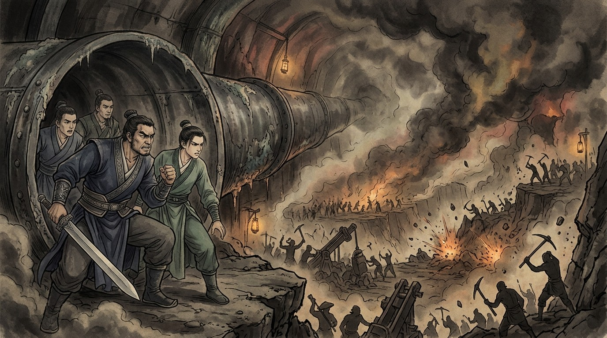

# 第 109 章：母脈危機・赤煉長老的瘋狂盜掘

[← 上一章](ch0108.md) ｜ [本卷目錄](00_intro.md) ｜ [下一章 →](ch0110.md)

*章首插畫：第 109 章 母脈危機・赤煉長老的瘋狂盜掘*

順著主鎮熱槽管的檢修暗道向東狂奔三里，越往前跑，耳膜邊那股金屬撕裂與岩石爆破的轟鳴聲就越發震耳欲聾，連空氣中都瀰漫著一股濃得幾乎令人窒息的腥甜硫磺酸霧！

當五人從一根直徑兩丈的巨型黑色通風管側面探出頭去時，眼前的景象讓林鐵生與顧玄幾乎同時怒火中燒。

在太古破界方舟東側鎮熱外殼的巨大豁口前，早已架起了一座臨時搭建的鋼鐵施工高台！整整三十具身高近兩丈、雙臂裝著飛旋精鋼鑽頭的天工閣重型「鑽山傀儡」，正在刺耳的靈石轟鳴聲中冒著黑煙瘋狂運轉，將厚達數尺的太古黑色玄金鎮熱殼體生生撕開了一個丈許寬的大口子！

濃稠得如同滾燙暗紅岩漿般的【萬年血精母液】，正伴隨著高熱地脈毒煞的白氣從缺口裡狂噴而出！十幾名穿著天工閣與丹鼎宗服色的親信弟子與幾十個衣衫單薄的雇來礦工苦力，正手忙腳亂地把一個個特製白玉大罐往噴湧的缺口底下塞！

站在施工台最高處親自督工的，赫然正是本次聯合勘探隊的總督導——天工閣長老，**赤煉**！

「別停！把二十二號到三十號傀儡的靈石風門再擰開半圈！」赤煉長老那張鬚髮微霜的臉龐在暗紅母液的映照下顯得狂熱而偏執，死死盯著面前那個測壓銅針早已頂死紅線的臨時集流槽，「只需要再抽滿最後五十罐純淨母液，夠『巨靈神機』撐起三年護山大陣與明年開春防線！區區地底古殼滲點熱氣算什麼？等五十罐裝箱，立刻用耐火泥封死缺口撤隊！」

「長老！這口子的氣壓不對啊！」一名負責看守銅閥的丹鼎宗執事嚇得臉色發白，對著漫天狂噴的紫紅毒霧大喊，「外頭這股毒煞已經衝破冰層冒出地面了，西邊十里外的裂谷通道剛剛傳來地裂回響，咱們再鑽下去，整個冰原上面的野獸群全都要發瘋衝進來，這三十個苦力也快中毒吐血了！」

「這點代價天工閣和丹鼎宗賠得起！閉嘴幹活！」赤煉眼神沒有半點動搖，甚至為了防止母液噴濺損失，直接下令兩具重型鑽山傀儡頂上去把已經快被毒霧燻倒的幾名工役往外拖開半步、換上第二批人繼續接罐。

而在上方的萬年凍土表面與裂谷外圍，正如那名執事所擔心的——這場強行鑿穿方舟鎮熱總閥的瘋狂舉動，已經引發了整個北荒地底的劇烈連鎖反應！

「吼————！嗚嗷————！」

透過上方裂開的幾道十丈深冰縫，遠處永凍血原方向已經隱約傳來了成千上萬隻北荒荒獸受驚暴走、踏碎冰面的沉悶雷鳴般蹄聲！

「再抽半炷香，整個主洩壓閥就要從裡面炸開！」林鐵生瞳孔驟縮，抓起工具囊裡那柄鍛錘，「他這是拿整座北境的地脈死栓當自家的酒缸在鑿！」

「別硬衝！」燕隼一把按住他肩膀，指了指赤煉身邊護衛著的四名氣息深沉的心腹死士與三十具正在飛旋轉動鑽頭的重型傀儡，「正面衝出去，我們五個連人帶證據都會被他們活埋在這兒！看上面！」

順著燕隼的手指望去，在距離地面高台約兩丈高處、正對著噴湧缺口主管道後方的玄金牆壁上，露出一座直徑丈許、原本用來緊急切斷這條分支鎮熱槽管的太古手動總閘門！只是這座萬載不曾轉動過的總閘門早已在墜毀時卡死了半邊齒牙，閥門旁還少了一個核心撥齒接頭，才讓赤煉有空子從末端外殼鑽洞抽液。

「我能扳動那道總閘！」林鐵生目光掃過整套齒牙尺寸，立刻報出底數，「但那邊全是噴出來的滾燙毒霧和母液，沒法徒手靠近！而且閘門一旦強行合上七成，裡頭倒湧的母液會在十息內把赤煉底下那幾根接液銅管和前排鑽山傀儡直接頂爆——得先把底下那幫被逼著接罐的苦力趕開，再壓住這股毒煙！」

「我去壓煙！」顧玄二話不說，一把拉上浸滿雙倍雪線苔冷萃液的厚棉面巾，「我的極寒藥霧能短暫把噴出來的毒煞液滴凍凝半成，給鐵生搶出二十息動手時間！清虛、燕隼和沈泥，你們負責打斷那幾具靠著工役的傀儡導管、把普通工役往西側逃生口趕！」

分工在三息內瞬間敲定！

「動手！」

隨著燕隼在上方黑暗玄金橫樑陰影裡的一聲低喝，三支帶著火石磷粉的冷箭精準射向施工台邊緣那幾盞正在給工役照明的強光靈石風燈與引火銅線——

「啪！嘩啦！」

刺眼的靈石風燈瞬間碎裂兩盞，高台右側頓時陷入一片昏暗混亂。幾乎同時，柳清虛甩出四枚早在雲津畫好的【太清急凍寒霧符】精準貼在通往主槽管的一截銅製接液管外緣！極寒靈力瞬間讓那幾條赤煉用來引流母液的銅管凍硬脆裂，「咔嚓」一聲從中崩斷，滾燙的暗紅母液頓時潑了一地，嚇得底下原本就不願賣命的幾十名民間苦力發一聲喊，扔下手裡的玉罐就朝著西側逃生通道狂奔逃命！

「敵襲！有人破壞母脈採集！」赤煉的親信大執事猛然拔出長刀怒吼，「結陣！護住玉罐與鑽山傀儡，誰敢亂跑格殺勿論！」

就在赤煉一行人手忙腳亂應對突如其來的混亂、幾具鑽山傀儡調轉鑽頭試圖封鎖西側通道的這寶貴二十息空檔裡——

顧玄早已冒著被高溫血煞炙烤的劇痛，單手持著一個特製銅噴壺猛然滑下主槽管斜坡，直接站在距離那道狂噴毒漿的缺口不到兩丈處！

「青河冷萃，凝！」

顧玄咬緊牙關，將自己丹鼎宗控火術逆向運轉至極限——這不是升溫煉丹，而是強行抽走周遭熱氣！伴隨著藥囊裡最後半斤極寒雪線苔粉末配伍冰魄散化作一大片幽藍色的冰寒藥霧撲向缺口，原本四散狂噴、氣化成紫紅毒煙的萬年血精母液，遇冷之下竟真的「滋滋」作響，表面凝出一層半固態的厚重血冰膜，硬生生將毒霧擴散壓回了三成！

「鐵生！只有十息！這層冰膜頂不住裡面熱浪多久！」顧玄嘴角溢出一絲被毒氣嗆傷的鮮血，大聲嘶吼。

而林鐵生早就踩著管道支架像猿猴一樣翻到了上方那座高達丈許的太古總閘門前！

沒有花俏的符咒，林鐵生左手抓起阿鐵精鋼分寸卡尺在缺了一角的閘門轉軸卡榫上飛快一量——分寸正好！

他毫不猶豫地從腰間掏出那塊陪他走過無數生死的**【太古不融黑鐵齒輪構件】**作為臨時撥齒主輪，卡進總閘門傳動牙盤最核心的空缺槽位，右手抽出隨身攜帶的一根百煉精鋼長撬棍當作止退死楔，將全身千錘百鍊的筋骨氣力與百工應力盡數灌入阿鐵小鍛錘，順著黑鐵齒輪咬合的節律連砸三錘！

「鏗！鏗！鏗————！！」

黑鐵齒輪瞬間帶動太古方舟原本的轉動牙盤，發出一聲彷彿跨越萬載歲月的清越金鐵長鳴！那扇已經生鏽卡死了無數年的巨大玄金閘門，竟然在第三錘落下的瞬間轟然合攏了七成！林鐵生趁著齒盤回彈前的半息空檔，一錘將那根百煉精鋼死楔狠狠釘進棘輪止退槽內卡死閘板，左手順勢將卸去受力的【太古不融黑鐵齒輪構件】一撥收回懷中！

「咔——嘣！！」

隨著主鎮熱槽管流量瞬間被死楔截斷七成，後方那三十具正在飛旋狂鑽的重型鑽山傀儡的傳動銅管立刻因為內壓倒灌，「轟轟轟」接連炸毀了最前排的五具傀儡！飛濺的玄金碎塊與崩斷的內造精鋼鑽頭四處亂飛，赤煉長老狼狽地撐起護體赤紅火罩擋開碎鐵，看著那個僅僅過去十幾息就被強行釘死七成、連同五具貴重鑽山傀儡都炸成廢鐵的噴湧缺口，氣得雙目幾欲噴火！

「是誰？！給老夫攔住那條檢修暗道，一個不留，全部抓起來！！」

赤煉憤怒的咆哮在整座金屬洞窟裡來回迴盪。他無法理解究竟是哪路鬼神竟然連天工閣都拆不開的太古總閘都能徒手釘死，但眼下外圍冰原的獸潮震動已經越來越強、陣基劇烈搖晃，赤煉即便心有不甘，也不敢拿自己的命去陪這座隨時會崩塌的冰洞一塊兒埋葬，只得咬牙下令心腹大執事：「你帶兩隊死士和剩下能動的機關獸沿著東側岔道封死退路，抓活口奪回所有流出去的母液與樣本！我先帶人搶運已裝箱的這二十八罐撤出裂谷！」

說罷，赤煉抓起已裝箱的貨箱率先朝著上層逃生梯撤離。

而下方那片混亂的高台角落裡，顧玄強忍著肺部火燒般的劇痛與半邊手套被腐蝕穿孔的灼傷，順手撿起兩截剛炸飛出來的、印著天工閣內造編號的【鑽山傀儡鑽頭殘件】，以及一隻剛剛裝滿一半尚未被赤煉搶走、封口依然完好的【血精母液封裝玉瓶】，與收妥黑鐵齒輪翻身滑下的林鐵生飛快匯合，順著原路朝燕隼他們掩護的冰谷通道全速撤退！

他們雖然保住了七成封口沒有釀成北境陸沉的即時大劫，可剩餘三成裂口仍在微弱滲漏，加上冰層震盪引發的北荒獸群大遷徙已經徹底被驚動——

而身後黑暗中，赤煉那位殺氣騰騰的心腹大執事，正帶著殺氣凜冽的死士與十幾具重裝武裝機關獸，封死了他們回去大營的所有前路！

---

[← 上一章](ch0108.md) ｜ [本卷目錄](00_intro.md) ｜ [下一章 →](ch0110.md)
