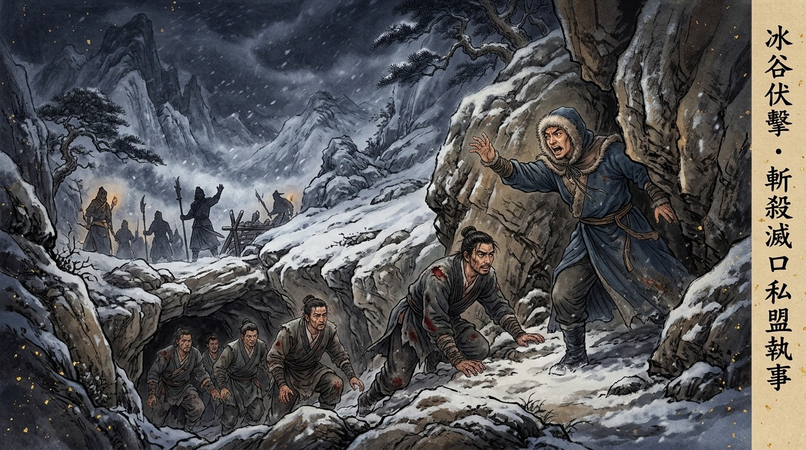

# 第 110 章：冰谷伏擊・斬殺滅口私盟執事

[← 上一章](ch0109.md) ｜ [本卷目錄](00_intro.md) ｜ [下一章 →](ch0111.md)

*章首插畫：第 110 章 冰谷伏擊・斬殺滅口私盟執事*

剛剛順著方舟廢棄的應急通道爬回到距離地表僅剩半里的一處狹窄冰谷出口時，刺骨的暴風雪迎面撲來，幾乎讓人睜不開眼睛。

守在冰谷出口岩石後面警戒的嚮導祁十六正焦急地張望著，見到五人渾身沾滿血污黑灰爬出來，正要鬆一口氣，突然臉色猛地一僵：「快趴下！那邊谷口被人封死了！」

五人迅速縮身躲進兩塊十丈高的黑色冰岩後方。

只見前方通往聯合勘探隊大營的唯一雪地狹道上，不知何時已經列開了一道森冷嚴密的封鎖線——兩側冰脊上站著八名身披天工閣與丹鼎宗暗衛制式黑甲、手持強弓連發破甲靈弩的死士；正中央則矗立著六具身高八尺、通體披覆精鐵重甲的「虎煞戰鬥機關獸」，在暴風雪中閃爍著冰冷的赤紅眼眸。

站在機關獸陣列最前方、手握一柄刻著金紋赤火符文長刀的中年男子，正是赤煉長老的心腹頭號大執事，一身煞氣已臻宗門上等執事之境！

「裡面的老鼠聽著！把從地底下帶出來的鑽頭碎片、玉瓶樣本，還有在黑冰斷谷裡翻出來的那些舊破爛全部留下！」大執事的聲音透過真氣震盪穿透風雪，冷酷得不帶一絲感情，「再把剛才那幾個看見母液的民間苦力一併交出來——否則，今天這座冰谷就當你們的墳場！殺！」

「他們連那幾個剛才幫忙搶救出來的苦力也要滅口！」顧玄低罵了一句，反手護緊腰間那隻裝滿所有物證的雙層封存木匣。身後石縫裡，那四名剛被五子從地底毒霧中順道拉出來躲避的普通工役與祁十六正瑟瑟發抖。

「前路只有三十丈寬的冰谷窄口，對方八把破甲重弩居高臨下盯著，加上六頭硬抗術法的虎煞機關獸和那名領頭的大執事。」燕隼飛快掃了一眼地形，語氣沉穩冷冽，「硬衝必死。沈泥，這座冰谷上頭的雪簷還撐得住多久？」

沈泥沒有半點慌亂，迅速抬頭目測了一遍冰谷兩側幾乎垂直的百丈懸崖積雪厚度，又算了算剛才地底主管道鎖閘門傳上來的地脈微震節奏：「左上方那道凸出來的萬年雪簷已經裂了一條橫縫，按現在這種風勢和腳下餘震，只要再受一次猛烈的火藥爆鳴震波就會整片崩塌！只要把它引下來砸進對方左側兩丈的溝裡，就能壓死那四個弩手並切斷他們退回大營的後路——但不能把我們自己這邊的證據匣砸埋在雪裡！」

「我來壓陣定位！」柳清虛一步跨到最前方一塊半人高的凍石後，左手握緊那枚剛剛收回的【逆星斷碑拓片】，右手兩指凌空虛劃，不顧經脈還留著前幾日拔除晶絲後的微弱麻木感，將凝練無比的法道神識全數散開，硬生生在風雪中勾勒出一座方圓五丈的小型【紫微偏轉星陣】！

「放箭！」大執事一聲令下，對面八名死士扣動扳機，十六支帶著破甲旋風的精鋼重弩矢如蝗蟲般撕裂飛雪激射而來！

然而就在弩箭飛進柳清虛身前五丈範圍內的剎那，空氣中的星力與地磁微流彷彿被一股無形的大手輕輕撥動了半寸——原本筆直鎖定五人頭顱胸口的致命箭雨，竟然齊齊在半空中詭異地劃出了一道微小的弧線，全部擦著岩石邊緣「叮叮噹噹」地釘進了空處！

「這小子竟能偏折箭路？！虎煞獸，給我踩扁他們！」大執事怒喝一聲，親自提刀踏雪衝鋒，六具精鐵重甲機關獸同時轟隆隆邁開大步，朝著岩石後方的五人碾壓過來！

最前方兩具虎煞獸剛撲到岩石前兩丈，顧玄早已抓起兩大包早在黑石鋪與丹鼎宗廢丹崖改良過的「腐金濁毒煙袋」狠狠砸在雪地上！

「砰！」

濃烈的酸黃色腐蝕煙霧順著風勢瞬間將六具衝鋒的機關獸連同衝在最前的四名近身死士吞沒！只聽「滋滋滋——」一陣刺耳至極的酸蝕爆響，這種專門針對百煉精鋼軸套與生鐵接縫配製的腐金毒煙，在極短時間內讓那幾具依靠精密關節活動的虎煞機關獸關節發出卡死的咯吱聲，動作立刻遲緩了整整一半；而那四名死士的護體面甲也被腐煙咬穿，慘叫著捂眼後退！

「鐵生，左前腿第三轉軸！」顧玄在毒煙散開前大喊一聲。

林鐵生早就等在岩石左側陰影裡！他像一頭狂奔的鐵犀牛般迎著一具剛揮爪拍過來的虎煞獸低身滑步鑽入其腹下死角，左手阿鐵小鍛錘精準無比地照著它被腐煙咬軟的左膝承壓樞閥「當！當！」連砸兩記！

伴隨著齒輪在重擊下瞬間崩碎的脆響，這頭重逾千斤的戰鬥機關獸轟然單膝跪地砸斷了半邊山石！林鐵生毫不停留，反手拔出這具報廢機關獸背後的備用靈石火柱，借著旋轉慣性甩向後面第二具機關獸的胸膛接縫處！

「小雜碎找死！！」

領頭的大執事終於徹底暴怒，人隨刀走，一道長達丈餘的赤紅灼熱刀芒直接避開煙霧，貼著地面狂暴劈向站在最後方護著物證箱的沈泥與顧玄！這一刀蘊含的酷烈殺機，遠非一般外門弟子所能正面硬接！

然而，他忽略了一直安靜站在冰崖側上方三丈高處、宛如一塊雪石般一動未動的那個獵戶少年。

從戰局開始至今，燕隼一直沒有在亂戰裡浪費一絲氣血與哪怕半支箭。他的全部心神都沉入在荒古戰神遺塚剛領悟到的那套古老呼吸節律之中，雙眼死死鎖住大執事出刀時露出的那唯一半息空門——**為了劈出那道丈餘赤紅刀芒，大執事左腳死死釘在冰面上發力，頸部與鎖骨位置為了吸氣發聲而徹底向後仰開了三寸！**

同一剎那，山谷下方沈泥算準時機，突然朝著左上方那塊已經布滿裂紋的雪簷甩出一枚顧玄塞給她的炸藥爆鳴筒——

「轟！！！」

劇烈的震波精準引爆了上方那座懸崖萬年雪簷，數十萬斤積雪如白色的九天瀑布般轟然傾瀉而下，瞬間將大執事身後四名弩手與最後的撤退之路徹底封死！

大執事心神在聽到頭頂雪崩轟鳴的那千分之一息出現了一絲極細微的動搖，揮刀的速度緩了微不可察的一分——

而在百步外高岩之上，早就將百斤重石鐵胎柘木弓拉成極致滿月的燕隼，手指終於鬆開了弓弦！

**《八荒破天弓》第一式：沉岳引！**

壺中最後那支珍藏已久的【黑背雪狼頭骨破甲重箭】，化作一道撕破暴風雪的墨色寒星，無聲無息地穿過漫天雪霧與飛沙，在刀芒距離沈泥還有三步遠的極限時刻，精準無比地從大執事因仰頭驚望雪崩而微微張開的護頸領口縫隙穿入，直接貫穿其咽喉從後頸透出！

「呃……咕……」

這名氣焰滔天的私盟大執事，甚至沒能發出一句像樣的臨終遺言或威脅自白，手中赤紅長刀「哐當」一聲墜落雪地，高大的身軀直挺挺地向前砸進雪堆之中，瞬間斷絕生機！

失去主將指揮，剩下的兩名殘餘死士與兩具受損機關獸見退路被雪崩斷絕、夥伴瞬間斃命，頓時魂飛魄散，拋下兵器轉身往另一側峭壁逃竄。

燕隼沒有去追逃兵。他立刻收起弓跳下高岩，顧玄與沈泥第一時間衝上前確認所有同袍及四名苦力皆無重傷性命之憂（唯有林鐵生左肩被飛濺的鐵片劃開一道兩寸血口，顧玄立刻敷藥止血）。

「快！收他的隨身腰牌和文書，雪崩震動還沒完全停！」沈泥蹲在大執事屍體旁，戴著手套冷靜地從他腰間解下一枚刻著天工閣千機堂副執印的暗金令牌、一疊未燒毀的【近期人員調遣密令與交割簽領紀錄底頁】，以及那把在護手處印著與黑石鋪炸礦雷管相同雙聯印記的軍械批號配刀。

「把他的配刀批號和調令原件單獨封死。」柳清虛一邊協助檢查四周退路，一邊沉聲道，「回山之後直接拿這批調令去對天工閣的出庫底簿，看赤煉還怎麼推給死人！」

五人動作極快地將所有新獲物證分別裝箱封條、標好時辰與採集者（連同祁十六與四名獲救工役的共同見證手印），隨即趁著雪崩餘波尚未引來赤煉的援軍前，沿著冰谷另一側只有祁十六熟識的隱蔽冰槽通道，快速朝著主力營地安全撤回！

---

[← 上一章](ch0109.md) ｜ [本卷目錄](00_intro.md) ｜ [下一章 →](ch0111.md)
