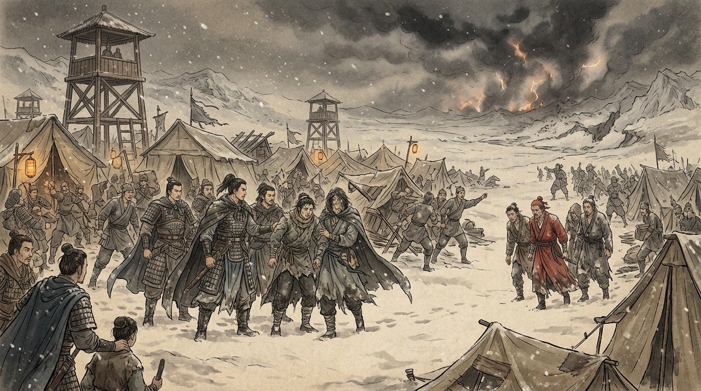

# 第 111 章：攜證歸山・暴風雨前的寧靜

[← 上一章](ch0110.md) ｜ [本卷目錄](00_intro.md) ｜ [下一章 →](ch0112.md)

*章首插畫：第 111 章 攜證歸山・暴風雨前的寧靜*

當五人領著祁十六與那四名差點被滅口的天工閣雇工、頂著尚未停歇的漫天飛雪跌跌撞撞撤回到黑山營外側輜重營地時，整個大營其實已經亂成了一鍋粥。

遠方永凍血原方向不斷傳來悶雷般的地面微震與隱約可聞的獸群遷徙長嘯。天工閣赤煉長老領著一眾灰頭土臉、衣甲沾滿泥雪的殘部剛從東面趕回來不到一個時辰，只對營地眾人宣稱「東側冰脈突發劇烈自然地熱噴發與局部雪崩，被迫損失數具工程傀儡與一名親信大執事，勘探隊必須立刻收攏物資全軍撤回雲津」。

雙方在營地雪地上碰面的一瞬間，空氣頓時僵冷到了極點。

赤煉長老那雙佈滿血絲的眼睛像毒蛇一樣死死盯在林鐵生左手還沾著的那點黑灰、顧玄背後背著的雙層封存木匣、以及這四個竟然剛好活著帶回四名本該「凍死在冰裂裡」的工役身上！然而因為獨臂老將雷烈就橫刀立在五人側後方三步處、且黑山營兩百名鐵甲精銳正冷冷盯著這邊的動靜，赤煉甚至連當場搜身的藉口都找不出來——畢竟公開名義上他自己剛才報上去的損失理由是「自然雪崩」，總不能當著全軍的面自己戳穿自己派人去地底私挖母脈、還半路殺人滅口！

「回山。」

赤煉極深地看了五人一眼，嘴唇緊抿成一條冷硬的直線，甩袖轉身便帶人催促撤離。

三天後，歷時近半個月的北荒聯合勘探隊，終於狼狽不堪地撤回了黑山長城關口，重新看見雲津峽谷那片灰白色的炊煙。

這趟出入死地歸來，經過遺塚吐納、地底絕境鎖閘與冰谷生死突圍的連番淬鍊，五位少年的體魄、神識與百工控度都不約而同地跨越了一道全新的無形門檻——柳清虛星算凝神更加清明、燕隼氣血收放穩如山嶽、林鐵生感應結構細入毫釐、顧玄的藥理微控已近爐火純青、沈泥對全局風險與帳務節奏的拿捏也愈發老辣。

過關口時，隊伍特意停在南沿入口外那座破舊木棚前。

當燕隼親手把那枚已經發黑生綠鏽、刻著「北線斥候・乙十七」編號的銅哨交到二十九歲的女子韓素手裡，並與柳清虛、祁十六一齊將五年前黑冰斷谷裡九具遺骸的位置實測圖與登記名單副本交給她時，這個一直強忍著淚水、守著木棚五年的堅毅女人，終於捂住嘴蹲在雪地裡無聲痛哭起來。

「韓林大哥不是擅離職守的逃兵。」燕隼半蹲在她面前，聲音低沉而鄭重，「他死在崗位上，一直到最後一刻還攥著軍哨等接應。這份實測圖和現場編號，我已經聯同雷烈將軍與兩位公證書吏簽押封存了副本。不出十天，我會替這筆抹掉了五年的帳，在三宗面前討回一個白紙黑字的說法。」

回到雲津西街「泥途商棧」已是當晚二更。邱禾早把屋裡火塘燒得旺旺的，剛剛釋放出來、還在左臂纏著繃帶養傷的小夥計阿四也紅著眼眶端上一大鍋熱粥。莫三坐在帳桌後面，一邊接過沈泥遞來的一厚疊拓印文書——尤其是那份【九城古商盟總契銅版】旁夾帶的「乙巳年舊盟代號」抄本——一邊默默將商棧這十幾天來在雲海票號顧蘭舟協助下重新穩住的帳冊攤給沈泥過目。

「這是從北荒帶回來的所有證物原件。」

地窖密室裡，沈泥將新取得的四組重量級物證一一擺上長桌，親手貼上字號標籤與雙重火漆：

1. **【天工閣內造鑽山傀儡鑽頭殘件】**（附四名目擊獲救工役手印與現場採集記錄）；
2. **【北荒方舟鎮熱母脈血精母液封裝玉瓶】**（與顧玄在丹鼎宗取得的丙柒廢丹渣、白猿病變樣本同源）；
3. **【黑冰斷谷走山隊名冊殘頁、燕山血書、護心鏡與大執事調遣密令】**（含雙聯火印軍械批號配刀）；
4. **【九城古商盟總契銅版與太古留影抄錄】**（九城商盟嚴禁抽毀母脈之舊約條款及近十年銀流摘錄）。

「四條線全都扣上了。」燕隼手指輕輕點在桌上的護心鏡邊緣，眼神冷冽如刀，卻沒有像過去那樣急躁地拍桌子喊打，而是轉頭看向沈泥，「但赤煉今天在營門口的眼神，分明已經起疑了。要是我們單獨去八荒議武堂或天工閣遞狀子，他們隨時能閉門壓下案卷。沈泥，我們選哪一天動手？」

沈泥看著徹底沉下心來的燕隼，眼底閃過一絲讚許，隨即拿起一張剛從雲津萬山廣場送來的鎏金請帖抄本，拍在桌面正中央：

「不用我們去敲那些關著的門——再過十天，就是三宗十年一度把所有山門打開的大日子。」

眾人定睛看去，只見那份請帖上面用朱砂寫著六個字：

**【雲頂三宗論道會武】**！

每隔十年，三大名山便會聯合在雲津仙集上方雲海邊的「問道天台」舉辦一場公開盛會，名義上是校閱三宗二十五歲以下內門天驕的術法、武技與百工丹器實學，實則直接掛鉤未來十年北境靈脈配額、長城軍費撥款以及萬山商埠的稅賦歸屬。更重要的是，這場大比不對外界封鎖，三大名山掌門、所有實權長老、雲津公所掌印乃至各州商號代表都會親自到場觀禮！

「這是公開的場子，也是唯一一個誰也無法私底下悄悄抹掉檔案、把人滅口的地方。」沈泥眼中閃爍著精明冷冽的光，「更妙的是，我剛跟莫三叔和顧蘭舟掌櫃核對完票號底冊——因為這趟咱們替赤煉釘死了七成母脈、加上金石府錢百川倒台，萬寶閣和私盟手裡的血精存貨已經徹底見底了！我打聽到，鶴壽、赤煉和玄冥已經急著往各自的幾個心腹大弟子身上強行灌服或配給了『九轉增元丹』與精煉血劑，企圖讓他們在會武上壓倒群雄奪魁，好在會武後名正言順地獨攬北荒裂谷的『全權封鎖開採令』！」

「原來打的是這個主意！」林鐵生冷哼一聲，「拿有問題的東西催出來的假功夫，碰上真錘子遲早露餡。」

「但光靠咱們五個小輩在台下呈證，三宗掌門未必肯當眾翻臉。」柳清虛沉思片刻，拿過筆開始寫下四個名字，「在會武開始前這十天，我們必須先聯絡三宗內部願意站出來替規矩與實據說話的宿老。」

首先，八荒武山那邊，雷烈將軍在知道燕山當年極可能因「不交圖紙或勘探禁區」而遭黑手封殺後，早已和傷兵養息院醫官杜青禾、女校尉唐映悄悄整理好了近三年退役傷兵的《急鎮丸依賴與死因錄》，只等一個足夠震動三宗的公開契機；

其次，天工閣這邊，林鐵生當天夜裡便借送修圖紙的機會，找上了在萬機地窟門口苦等的千機院魯長老與總匠章百鍊——當那截印著天工閣絕密庫存批號的【鑽山傀儡鑽頭殘件】連同現場分寸實錄擺到老匠師面前時，魯長老那雙因打鐵變形的手指沉默地抖了半晌，最終什麼豪言壯語沒說，只冷冷扔下一句：「會武百工試那天，老夫親自坐裁判席盯著材料批次檢驗簿。」

最麻煩的，卻是道統最森嚴、表面上看去一片冰清玉潔的太清玄天宮。

第三日清晨，柳清虛藉著與授業師陸觀瀾匯報冬季星曆修正圖譜的機會，避開了沈照塵與執法堂耳目，隨著臉色蒼白卻神色決絕的陸觀瀾一同踏上了清修偏峰，敲響了那座偏僻簡陋的石屋木門——拜訪了那位七十餘歲、長年拒服延命丹而被宗門排擠的苦修派長老，**簡素真人**。

然而，這位鬚髮皆白的老道姑聽完柳清虛帶來的鶴鳴真人遺蛻觀察、星曆三百年偏移表乃至對執法長老玄冥的疑點後，卻並沒有立刻拍案而起答應幫忙。

簡素真人冷冷地端起一杯冰涼的山泉粗茶，甚至連看都沒多看那疊紙張一眼，枯槁的手指指著屋外寒風中瑟瑟發抖的松枝：

「年輕人，太清玄天宮裡每天想借著揭發長老博出位、或者拿幾張真假難辨的字紙來撼動掌門法座的狂徒，老尼這輩子見過不少。你說『假天吞人』、說那暗紅丹藥有毒、又說你們五個小輩摸索出一種不用血精也能剝離早期道化晶絲的法子……話說得這麼輕巧，老尼憑什麼拿自己七十年清譽和全峰十幾個徒孫的性命陪你去賭？」

柳清虛不卑不亢，平靜稽首：「弟子從未指望長老憑幾句空話去賭。長老信不過口說無憑，弟子請長老親出一道實證考題。」

簡素真人那雙渾濁卻極具穿透力的老眼猛地釘在柳清虛臉上，沉默了足足五息，忽然轉身推開裡屋一扇垂著厚棉簾的小木門：

「我手下有個叫元青的閉關老弟子，入山苦修四十載，半年前在觀星台染上了道化晶絲，如今兩根手指與半條小臂已經開始僵化發青，死活不肯吃執法殿送來的紅藥丸。你們不是說五個人能合手剝離嗎？先在會武前三天之內，當著我的面把他的早期晶絲穩妥逼出來、且不讓他落下半條殘廢命——做到這一點，會武當天太清玄天宮的觀禮席上，我簡素才替你們說第一句話！」

這是一道毫不講情面的硬門檻。

沒有半點免費得來的政治同盟，一切都得拿真本事、實證結果與敢不敢承擔風險去換！

柳清虛看著裡屋那名正在痛苦咬牙忍耐寒晶蔓延的老弟子，拱手沉聲應道：「三日後子時，弟子帶四位同伴攜針藥與器材前來偏峰。屆時成與不成，請長老親自為病人掌眼。」

---

[← 上一章](ch0110.md) ｜ [本卷目錄](00_intro.md) ｜ [下一章 →](ch0112.md)
