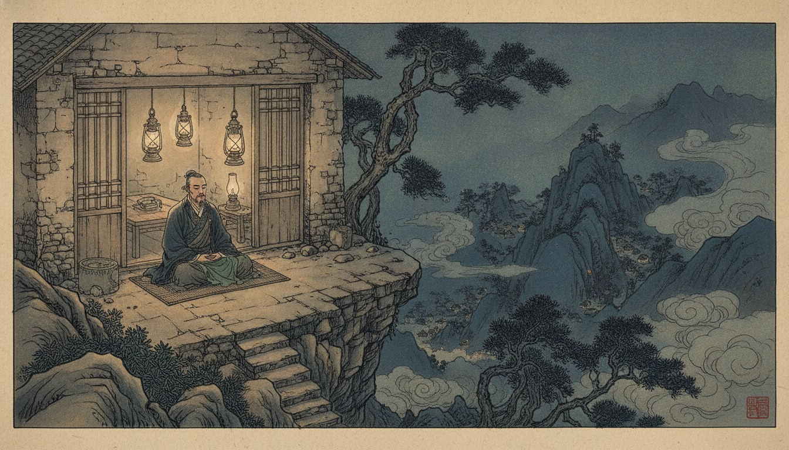

# 第 112 章：雲頂盛會・十年一度的三宗會武

[← 上一章](ch0111.md) ｜ [本卷目錄](00_intro.md) ｜ [下一章 →](ch0113.md)

*章首插畫：第 112 章 雲頂盛會・十年一度的三宗會武*

三日後子時的清修偏峰，沒有傳來什麼驚天動地的法術光芒。

石屋裡點著四盞防風油燈，窗外山風颳得木欞咯吱作響，屋裡卻靜得能聽見燈芯爆裂的輕聲。

老弟子元青赤著左肩坐在矮凳上，牙關緊緊咬著一截折疊起來的粗麻布，冷汗順著花白的鬢角不斷往下淌。他左臂肘下已經泛起一層詭異的青白玉色，皮膚底下彷彿埋著幾條極細的冰針，每逢心跳搏動，便跟著微弱地閃起一絲寒光。

簡素真人端坐在牆角的硬木凳上，灰白的道袍一塵不染，枯瘦的手指搭在膝頭一動不動。她沒說半句安慰的話，只用那雙深不見底的老眼盯著桌前五個年輕人，像是隨時準備在他們失手的第一瞬便出手封死元青的心脈。

「元青師叔的晶絲已經長了半年，尾梢探進尺澤旁的深脈，硬挑必斷。」顧玄的聲音壓得很低，手指還留著前兩日在藥爐旁被蒸汽燙出的薄繭，指腹間沾著洗不淨的苦參褐汁。他打開藥囊，先取出一塊在雪線苔冷湯裡浸透的厚棉布，緊緊裹住元青手腕以上三寸的皮肉，「待會兒若是針感滑進骨縫裡，弟子寧可停手不取，也絕不拿師叔的性命去賭那半寸。」

簡素真人眼皮微不可察地抬了抬，沒吭聲，算是默許了這句劃清底線的承諾。

顧玄深吸一口氣，雙指夾起九根細如牛毛的銀針，在燈焰上掠過半瞬，手腕一沉，「噗、噗」幾聲輕響，九枚銀針穩穩封住元青肩井與肘彎的大脈。青白寒氣剛順著針尾往外冒出一絲冷霧，林鐵生已經蹲到木桌另一側，將一塊厚榆木墊穩穩抵在元青肘骨下方三寸，左手捏緊【太古不融黑鐵齒輪構件】，右手握住小鍛錘的木柄末端。

「起了。」林鐵生吐出兩個字，手腕以極細密均勻的節奏輕輕叩擊齒輪邊緣。

沒有刺耳的鐘鳴，黑鐵只發出一陣低沉、幾乎連成一線的細密連震，順著榆木墊與浸藥濕布透進元青的筋骨之間。原本死死攀附在血肉裡的淡青晶絲遇到這股純淨沉實的震波，頓時發出一陣極微弱的「哢哢」鬆動聲，震得元青喉嚨裡漏出一聲壓抑的悶哼，緊咬麻布的嘴角滲出一絲血線！

「就是這股寒氣反撲！」燕隼立刻半蹲上前，右手掌心懸停在顧玄落針的穴位上方半寸。他咬緊牙關壓制住《煞血霸體訣》平時那股狂暴燥火，把體內陽剛氣血拆成一縷極慢極穩的三分溫流，順著針路徐徐烘過去，像替一條凍僵的河床慢慢化開表層薄冰。

「肩頭過熱了！燕隼收一分火候，鐵生再往肘外側偏半毫！」守在旁邊的沈泥眼睛一眨不眨地盯著桌上細沙漏刻與貼在元青肩頭的兩枚測溫銅片，嗓音清亮冷冽，沒有一絲慌亂。燕隼額頭青筋暴起，硬生生將已到掌心的三分陽氣收退一分。

整個石屋裡最靜的人是柳清虛。他站在元青左前方半步，神識收束到只餘絲線粗細，沿著經絡節點一路探進那片寒氣逼人的青白脈絡之中，精確辨認晶絲與血肉粘連的最後幾處細小岔口。每逢晶絲欲向心脈回縮反彈，他便只吐出極簡的方位——「尺澤下二分」「少海偏內半毫」——字句少得像在石板上刻字，眼神卻冷靜得彷彿已經把這條胳膊上的每一寸脈絡看了千遍。

整整一個半時辰過去，四盞油燈的燈油燒去大半。當顧玄指尖捻住最後三枚主力銀針往外緩緩一提，伴隨著一聲微不可聞的冰絲斷裂輕響，那縷蔓延了半年的淡青晶絲終於連根帶尾地順著米粒大小的針口滑了出來，裹著一滴暗紅瘀血「叮」地落入白玉盤裡。

「收手！冷敷止血！」

沈泥立刻將浸滿苦參冷汁的紗布按住創口。元青長長吐出一口濁氣，整個人像剛從冰水裡撈出來一樣虛弱地靠向椅背，不久便昏睡過去。

石屋裡靜了十幾息，簡素真人才緩緩起身走到矮凳旁。她沒急著看盤子裡的晶絲，而是親自伸出兩根枯瘦的手指搭上元青左腕寸關尺三部，又試了試他指尖尚存的一點微溫與握力——那截左臂確實還留著一片無法立刻恢復痛覺的麻木，指尖的寒意也沒能瞬間消散，但那股順著經絡往心脈啃噬過去的青白晶光，確確實實停了下來。

簡素真人整整盯著那只盛著淡青晶絲的玉盤看了半盞茶工夫，最終只從懷裡摸出一枚代表太清苦修偏峰長老身分的暗灰木牌放上木桌，沙啞地道：「元青這條胳膊雖然沒完全好利索，但他這條命從今天起不用再吃那些見不得光的紅藥丸吊著了。會武那天，你們五個把實打實的證據擺上問道天台——只要程序合規、對得住人命，太清宮的觀禮席上，老尼替你們壓住第一道妄議之聲。」

這已經是這位固執的老長老能給出的最大承諾。

……

轉眼間，三宗十年一度的大盛會——**【雲頂三宗論道會武】**，在冬末初春交接的一場晴雪晨光裡，正式拉開了帷幕。

會武地點設在雲津仙集上方、三大名山交界處一座懸崖突出的巨大平頂石坪之上，名喚「問道天台」。天台方圓數百丈，四周立著二十四根刻滿太清星宿、八荒戰紋與千機齒輪的合抱石柱，站在台邊俯瞰，底下便是雲海翻湧、宛如螞蟻般熙熙攘攘的雲津萬山商埠。

晨鐘連響九聲。

天台北側那座鋪著青紫錦緞的高台正中央，並肩端坐著三大名山當代掌門：太清玄天宮紫霄真人、八荒武山鐵背山主、以及千機百巧門兼轄天工與丹鼎的玄樞門主；而在他們身後兩側的長老席位上，太清執法長老玄冥、丹鼎大長老鶴壽與天工閣赤煉長老各自神色沉凝地端坐其間。再往側邊幾步，則是千機院魯長老、周天星律院掌院宋知微、八荒黑山營獨臂老將雷烈、苦修派簡素真人，以及特地受邀列席監督萬山商埠稅賦分配的公所掌印羅九秤與雲海票號女掌櫃顧蘭舟。

高台下方四周石階上，密密麻麻坐滿了近三千名三宗內外門弟子、各府商會代表與受邀觀禮的雲津大商戶。

「今日之會武，一為校閱三宗後起之秀實學，二為重定未來十年北境各處靈脈份額、長城軍費撥款與萬山商埠交割稅率。」紫霄真人緩緩起身，朗聲傳遍全場，「望三宗門徒秉公比試，切磋百工丹器、武道神通，莫負先祖鎮守北疆之重託！」

台下頓時爆發出如雷鳴般的山呼喝采。沈照塵站在太清內門方陣前排，神色比兩個月前沉穩許多；而在另一側天工與丹鼎的候場區裡，林鐵生與顧玄沉默地檢查著各自背囊裡的工具與銀針，燕隼倚著石柱閉目養神，柳清虛則靜靜抬頭看著這座天台四周那幾根其實並不算嚴密的導星石柱。

「台面上熱鬧得像過年，可你們瞧見長老席最左邊那幾個嫡傳弟子沒有？」

站在天台通道口邊緣的沈泥抱著雙臂，一身剪裁利落的深青色行商短襖在風中微動，壓低嗓音對身旁四位同袍點出自己剛才在台下轉了半圈看到的門道：

「赤煉長老座下那位叫趙烈的大弟子，今早進檢錄區時眼白裡帶著不正常的紅絲，推著那箱參賽機關偶走路時呼吸沉得像打風箱；鶴壽長老那位最得意的親傳弟子李青雲，袖口裡隱約透出一股跟我上周在你們藥渣樣本上聞見過相似的甜腥氣；至於太清執法長老玄冥身邊那個叫韓蒼的親傳弟子……」

沈泥看向柳清虛：「他眉心緊緊貼著一塊遮光青玉佩，整張臉平靜得幾乎看不見血色波動——和你在升仙台見過的那些症狀幾乎是一個模子刻出來的。」

「他們急著拿這場會武的頭名。」柳清虛冷靜點頭，「只要太清、丹鼎、天工的幾個嫡傳能聯手拿下這一屆的丹器、武技雙魁，按照會武老規矩，未來十年的『北荒高危裂谷封鎖開採主導令』就會名正言順地歸入這幾位長老名下。到時候只要把北荒徹底列為三宗長老直轄禁區，別說泥途商棧，連雷烈將軍跟魯長老都沒法合法伸手過去查帳。」

「但這回，他們踢到鐵板了。」

林鐵生拍了拍腰間那柄烏黑沉重的六十斤阿鐵特製長柄鍛錘，厚實的嘴唇緊緊抿成一條線。

「別急著在第一輪就掀桌子把所有底牌一次砸完。」沈泥目光掃過高台上高坐的三大掌門與台下近三千雙眼睛，聲音壓得低而穩，「這場會武我們還沒有拿到站在高台上公開質證的合法席位。鐵生、顧玄、燕隼、清虛——你們四個的任務，是先在堂堂正正的比試台上，把那群靠血精催出來的『假威風』當著全天下人的面拆穿、把異常的物證樣本合規留在檢材席上！」

「至於台下的錢袋子和帳本……」沈泥抬眼望向遠處高台上那名臉色有些發緊、正不停拿絲巾擦汗的萬寶閣掌櫃何萬金，嘴角緩緩勾起一抹森冷的笑意：

「等到台上丹器武技雙雙失手、私盟正準備拿備用錢庫砸銀子強買封口的時候，我就在下面的交割大廳裡，替他們把那張挪用了五百萬靈石準備金的底褲，當著羅掌印和各派供應商的面，連根扯下來！」

「好！」燕隼站直身體，雙目寒光微閃，「第一場百工丹器試，看你們兩個先把場子燒熱。」

鐘聲再次敲響，三宗會武第一場重頭戲——**【百工丹器雙絕試】**，正式登台！

---

[← 上一章](ch0111.md) ｜ [本卷目錄](00_intro.md) ｜ [下一章 →](ch0113.md)
