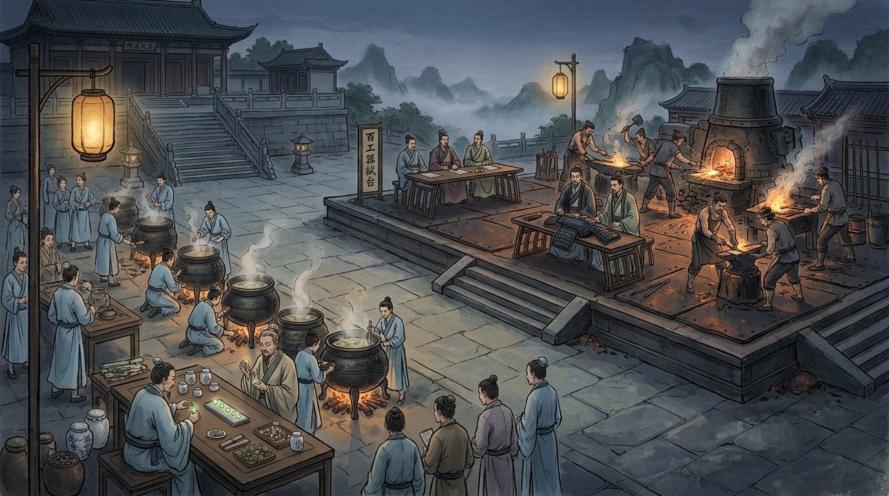

# 第 113 章：百工丹器試・不融黑鐵與無瑕清丹

[← 上一章](ch0112.md) ｜ [本卷目錄](00_intro.md) ｜ [下一章 →](ch0114.md)

*章首插畫：第 113 章 百工丹器試・不融黑鐵與無瑕清丹*

問道天台中央的石坪此刻被劃分成了東西兩座十丈見方的比試台。

東側為「百工器試台」，青石板上鋪著厚重的耐火生鐵板，四名裁判立於場邊，居中端坐的正是面色如鐵的天工閣千機院魯長老與地火鍛兵台總匠章百鍊；西側為「丹鼎藥試台」，青銅丹鼎一字排開，白鶴年與醫理院掌記孫聞露親自守在檢驗藥性與病患禁忌的評鑑席旁。

東台之上，第一輪淘汰賽過後，場中央只剩下兩道身影。

對面站著的是赤煉長老座下最受器重的首徒趙烈。這位二十四歲的內門天驕身披赤金雲紋匠袍，面容瘦削卻帶著一股躁動不安的亢奮。他用力一扯手中鐵鏈，將一具高達丈二、通體覆蓋暗紅重甲、關節縫隙不斷往外噴吐著濃烈硫磺黑煙的二階頂峰戰偶推上了試台中央——**「煞火魔偶」**！

「此偶乃師門改良重機，以特製熾火晶柱驅動，單臂可舉千五百斤生鐵，連扛二十錘而不傷半毫！」趙烈冷笑著看向對面那個只穿了件粗布工裝、手裡提著一柄烏黑長柄鍛錘的敦厚少年，「林鐵生，據說你在萬機地窟只會拿卡尺量點兒破銅爛鐵。今日規矩是『以器試器，三合分高下』。你那把土鐵錘，扛得住這具魔偶一拳麼？」

赤煉長老坐在高台上撫鬚微笑，眼神陰冷地盯著場中。在他看來，只要趙烈這具不計材料代價、硬塞進半截血精濃縮柱強行超載的魔偶當眾碾碎對手，今天天工閣「奪天派」的路線便再無人能動搖。

林鐵生沒有多言，甚至沒去看場邊無數世家子弟的哄笑。他右手舊傷早已痊癒，此刻雙手穩穩握住這柄六十斤重的烏金長柄鍛錘，雙腳微微分開踏實鐵板，整個人彷彿與腳下堅硬的台面融為一體。

心神沉靜如水，【百工格物心眼】瞬間開啟！

沒有花俏的靈光，在林鐵生的視線裡，那具氣勢洶洶、彷彿連鋼牆都能撞塌的煞火魔偶，全身上下竟然像一張攤開在眼前的筋骨承壓脈絡——

「轟——！」

趙烈發動總攻！煞火魔偶胸膛裡的暗紅核心驟然發出刺耳的嘶鳴，左臂化作一柄百斤重鐵撞錘，裹挾著滾燙的熱浪與硫磺腥氣，朝著林鐵生當胸狠狠砸落！

林鐵生沒有硬碰硬去對轟這記正面蠻力。他腳下踩著在鐵匠鋪拉風箱煉出來的沉穩小碎步，身子微側半尺避開鋒芒，手中烏金鍛錘順勢借著魔偶前衝的慣性斜挑向上，精準無比地磕在魔偶右肩肘外緣一處看似厚實、實則因為高熱結晶腐蝕而早已變得極為脆弱的銅製承重銷上——

**「第一錘，震鬆虛牙！」**

「當————！！」

一聲沉悶刺耳的金屬斷裂爆音！趙烈臉色猛地一變，剛想操縱魔偶回肘橫掃，林鐵生早已順著反震之力大步欺進魔偶胸腹內側死角，根本不給對面操作手調整暗銅機閥的機會，雙臂筋肉賁張如老樹盤根，手腕微抖，藉著阿鐵傳授的「瘋魔借力疊震訣」照著那條正傳導著狂暴暗紅烈氣的主軸銅管——

**「第二錘，破脆化點！」**

「咔嚓！！滋滋滋——」

沒有震天動地的爆炸，林鐵生甚至在最後半毫的落錘瞬間刻意收了三分外溢勁氣，以免炸飛出來的滾燙晶渣崩傷對面還沒來得及退後的趙烈！但這一錘連環疊震精準無比地貫入軸心內部，竟硬生生將那根被地煞血精腐蝕出暗紫脆化麻點的傳動主軸從內裡震斷成了三截！

失去主軸傳動的丈二魔偶瞬間全身僵死，高舉的右臂像一根廢鐵般沉重砸落鐵板。林鐵生舉起烏金鍛錘，輕輕點在魔偶胸口裂開半寸的機匣護蓋上——

**「第三錘，定軸停機！」**

「叮！」一聲清越脆響，整具煞火魔偶徹底熄火癱瘓，從接縫裡冒出一縷夾雜著焦黑紫粉的刺鼻濃煙。

全場驟然一片鴉雀無聲！

「不可能……這主軸明明用的是三倍厚度的玄鐵精鋼……」趙烈呆若木雞地看著眼前這堆剛開局三招就徹底啞火的龐然大物，臉色瞬間白如死灰。

「玄鐵精鋼原本不斷。」林鐵生收起大錘，轉過身朝裁判席抱拳，神色坦蕩磊落，嗓音洪亮得傳遍半座天台，「但有人為了強催三倍爆發力，往玄石槽裡硬塞了帶烈性蝕鐵毒氣的『異常暗紅晶柱』，把主軸內壁咬出了整圈脆化麻點！這種東西能打得贏一兩場比試，卻會在關鍵時刻讓前線操控它的弟子自己炸死在鐵殼裡！」

高台上，赤煉長老臉色驟然鐵青！千機院魯長老與章百鍊則立刻大步走上東台，當著數千名觀禮弟子的面從癱瘓魔偶胸口刮出一撮散發著熟悉腥甜臭味的暗紫脆化鐵粉與半截未燒盡的暗紅晶塊，直接用火漆封入檢材盒送往評鑑席！

「器試，千機院林鐵生勝！涉事異常晶柱樣本封存待檢！」魯長老那張布滿老繭與疤痕的臉上冷得像一塊玄鐵，一槌定音！

東台餘波未平，西側的「丹鼎藥試台」也剛好同時迎來了開爐驗丹的最後關頭！

鶴壽長老座下親傳首徒李青雲，此時正滿臉得意地揭開面前的紫銅藥鼎，取出一顆表面泛著九道瑰麗赤金藥紋、藥香濃郁得隔著十丈都能讓人精神一振的二階上等靈丹——**「九轉增元丹」**！

「李師兄果然名不虛傳！這九道丹暈足見火候醇厚！」台下不少丹鼎宗與世家弟子紛紛驚呼讚嘆。

而在李青雲對面，顧玄面前只擺著一隻再樸素不過的粗泥小藥爐。爐蓋揭開時沒有半絲驚天動地的異香飄散，反而只有一股微涼清苦的草木幽香，爐底靜靜躺著三顆色澤淡青溫潤、宛如露水凝結而成的普通藥丸——**「三元生機丹」**。

「哼，一顆連丹暈都凝不起來的淡青草丸，也敢拿來跟九轉增元丹同台？」李青雲輕蔑地笑了一聲，端起玉盤呈往評鑑席。

高台之上，鶴壽真人眼中閃過一絲鬆了口氣的得意，正欲開口示意裁判宣布丹試結果——

「請留步。」

顧玄不緊不慢地拿出一隻小巧潔白的青瓷藥缽，將自己煉製的一顆淡青「三元生機丹」放進清水裡，隨即平靜地望向丹鼎宗評鑑席的白鶴年與孫聞露，拱手行禮：

「依會武丹試規矩，凡二階增元療傷之丹藥，除了看藥力成色外，須經掩名雙試銀針與活草試毒複驗，確保不留後患方算及格。弟子自願交出一顆成丹接受三宗公驗，也請李師兄這枚價值連城的『九轉增元丹』，同台一試。」

「試便試！我這九轉增元丹難道還怕你的土方子不成？」李青雲冷笑一聲，毫不猶豫地同意——他壓根不知道自己師尊偷偷混進那份「秘製引子」裡的半滴東西究竟有多毒。

白鶴年深吸一口氣，神色肅穆地拿起兩根完全相同的純銀試針與兩片剛採來的新鮮「雪線苔活葉」，分別放入兩隻盛著丹液的藥碗裡。

一息、兩息、三息……

顧玄那碗淡青藥水清澈見底，雪線苔葉片在其中舒展青翠，試毒銀針拔出時光潔如新；

而李青雲那碗散發著濃郁迷人紅金香氣的「九轉增元丹」藥水之中——純銀試針才剛放進去不到兩息，針尖接觸水面的一截便在數千雙眼睛的死死盯視下，「滋」地騰起一縷極細微的灰黑煙霧，雪線苔葉片瞬間捲曲發黑枯死，整隻銀針拔出來時，表面已經爬滿了一層觸目驚心的**暗紫色斑駁鏽斑**！

全場瞬間炸開了鍋！

「黑……黑針？！二階增元丹裡怎麼會有腐蝕雪線苔的猛毒？！」

「我上個月在丹鼎外門換了兩顆差不多的丹丸吃下去，怪不得這幾天夜裡覺得肺腑發燙燥熱！」

李青雲整張臉瞬間失去了所有血色，踉蹌後退兩步不敢置信地回望高台上的鶴壽長老：「師……師父……這味紅血引子不是您親自配給弟子說是『百年赤參精髓』的嗎？怎麼會毒死雪線苔？！」

高台上，鶴壽長老端著茶杯的手猛然一顫，滾燙的茶水潑在袖口上卻渾然不覺！

然而就在群情激憤、幾乎所有人都在等著顧玄大喊「鶴壽謀財害命」之時，站在西台正中的顧玄卻並沒有像得勝的鬥雞那樣直接喊打喊殺。

他極為冷靜地拿起兩塊潔淨的題籤素布，在孫聞露當眾記錄之下，親手將這兩碗丹液、變黑的銀針與那顆剩下的一半九轉增元丹分別封進雙層琉璃罐內。他一雙被常年藥汁染得微褐的手穩穩按在罐口封蠟上，這才對著台下與高台三位掌門沉聲稟報：

「回稟諸位掌門與宗親，這份成丹確實驗出烈性礦毒與未知地煞濁氣，長期吞服極易傷損臟腑、令血脈僵冷。但究竟是生藥採辦環節遭人調換、還是丹方本身出了差錯，在沒有核對煉丹房原始領藥簿與藥引來路之前，弟子不敢妄斷是哪一位故意為之——只請三宗裁判席即刻封存藥渣與原液，查明此毒從何而來！」

不卑不亢，步步合規。

偏偏是這種不急著扣帽子的極度克制，反倒像一把最冰冷的重錘，狠狠砸碎了台上台下所有人對「丹藥沒問題」的最後一絲僥倖。

連戰連捷，器丹雙魁盡歸黑石鋪出身的兩名年輕匠醫之手；而兩大私盟長老精心布置的首徒牌面，卻當眾變成了鎖死他們咽喉的兩份公開物證！

---

[← 上一章](ch0112.md) ｜ [本卷目錄](00_intro.md) ｜ [下一章 →](ch0114.md)
