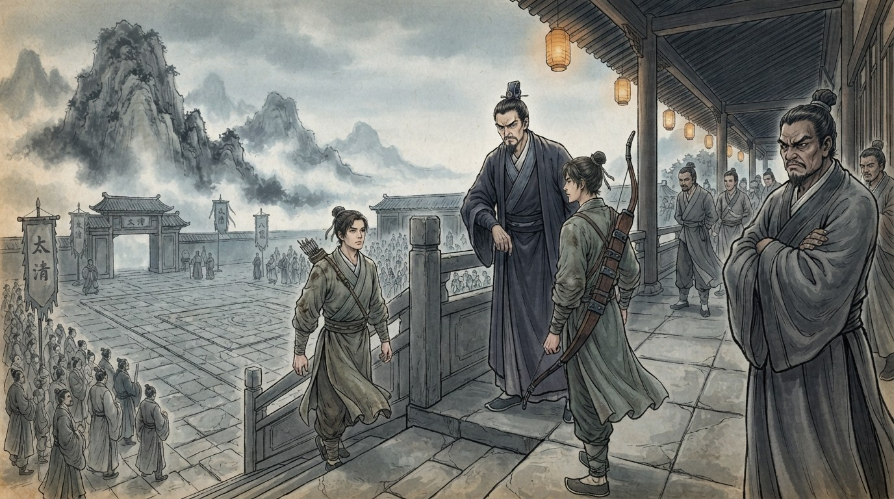

# 第 114 章：雲頂演武・破軍重弓對決紫霄神雷

[← 上一章](ch0113.md) ｜ [本卷目錄](00_intro.md) ｜ [下一章 →](ch0115.md)

*章首插畫：第 114 章 雲頂演武・破軍重弓對決紫霄神雷*

百工丹器試掀起的軒然大波還未平息，午時過後，雲頂會武的第二場重頭戲——**【力法演武大比】**，隨即在問道天台最寬廣的北側主武場上拉開序幕！

因為上午接連兩場爆出異常結晶與丹毒殘留，此刻高台之上的氣氛早已變得詭異而緊繃。太清宮執法長老玄冥緊鎖眉頭，目光如刀般掃向準備登台的門下首徒韓蒼；而八荒武山高台一側，一名平素與岳停山、雷烈不合的霸戰派旁支長老則面色陰沉地拍了拍自家推出來的壯碩武修肩膀，低聲叮囑了一句什麼。

「力道組決賽，八荒武山黑山營燕隼，對陣武山內門霸戰派王鐵牛！」

隨著裁判高喝落音，燕隼提著那張已經拉過無數次生死的百斤重石鐵胎柘木弓，大步踏上由整塊厚重青鋼岩鋪成的演武場。

對面走上來的，是一名身高接近九尺、渾身肌肉虯結如鐵水澆鑄般的壯漢，手裡拎著兩柄足有兩百斤重的血紋宣花大斧。剛一站定，王鐵牛那雙充血的眼眸裡便泛起一絲不正常的狂暴血紅，周身毛孔隱約往外滲透著一股極為濃烈的焦燥熱氣與微弱硫磺甜味。

他體內強行催動起來的氣血波動，竟然在瞬間硬生生衝到了接近二階九十重的虛浮狂暴氣勢！

「他吃了過量的『急鎮丸』！甚至可能吞了帶血精的烈性催血劑！」站在場邊醫療區的八荒傷兵養息院醫官杜青禾臉色微變，立刻對身旁的岳停山低呼了一聲，「這小子平時修為只有八十出頭，脈象浮躁虛高，再讓他這麼狂燒氣血打下去，五臟還沒等對手劈死就得先自己燒裂了！」

場中戰鼓一響，王鐵牛發出一聲宛如野獸般的瘋狂咆哮，兩柄大斧捲起兩道足有兩丈長的暗紅血煞罡風，不管不顧地朝著燕隼頭頂狠狠劈砸下來！

這一擊的力道足以劈開城門樓石柱，換作普通同階弟子，只怕在接觸的瞬間便要被震碎五臟！

然而站在場中的燕隼，眼神裡卻沒有半點對敵的憎恨或暴戾。他看著對面那個雙眼血紅、顯然已經被體內燥火折磨得幾乎失去理智的同門武修，只覺得對方可憐得像一頭被主人灌了毒藥趕上鬥獸場的耕牛。

燕隼沒有選擇以血還血、更沒有像以前那樣靠拼命燃燒壽元去跟對方對撞！

左腳猛然往後沉重踏出半步，青鋼岩台面被他踏出一聲「咚」的悶響——**八荒磐石千斤墜！**與此同時，他胸腹間運轉起在荒古戰神遺塚中感悟出來的古老長呼吸節律，全身氣血沒有半絲外洩浪費，而是像一張拉得極緊的牛筋網般死死護住全身關節。

「當————！！」

兩柄血斧挾著狂暴血浪狂劈而下，燕隼竟沒拔刀也沒逃避，只把那張百斤重石鐵胎弓的精鋼弓背橫在身前硬生生一架，隨即腳下沿著卸力圓弧滑退半丈！狂暴的血煞餘波將他身後青石地磚震裂了十幾條細紋，可燕隼本人竟只抖了抖袖口灰塵，半口血都沒吐！

「不可能！你怎麼扛得住老子的煞血狂斧？！」王鐵牛狂吼著再度雙斧齊出，招式卻因為五臟燥火反撲而變得越發混亂僵硬，每跨出一步，嘴角已經開始控制不住地往下淌出粘稠的黑紅血沫。

「你連自己肺裡燒著什麼都不知道，還跟老子拼命？」

燕隼眼神微沉，不再給他繼續燃燒臟腑的機會。就在王鐵牛高舉雙斧力竭、胸腹門戶大開的千分之一息間，燕隼身影如獵豹般貼地閃身繞過斧風，右手閃電般從箭壺裡抽出兩支早已經卸去尖銳狼骨簇、換成包鐵鈍頭的震盪重箭，抵在弦上甚至只拉開了七分弧度——

「《八荒破天弓》・點星震！」

「嗡——啪！」

兩支鈍頭重箭以毫釐之差前後追尾，幾乎同時重重轟擊在王鐵牛胸口那面不斷往外滲血的護心銅甲正中央！

「咔嚓！」

厚達半寸的精鋼護心甲被這股凝練到了極點的穿透震波應聲震成兩半碎裂！暗藏在護心甲內層夾袋裡的一隻小瓷瓶隨之震破飛出，滾落到裁判台腳下，幾顆散發著刺鼻腥甜氣味的暗紅丸藥滾了一地！

王鐵牛整個人被這股極巧的卸力鈍震撞退十步，一屁股重重跌坐在台邊，氣血瞬間散開卻並未傷及性命與心脈。一直在場邊嚴陣以待的杜青禾醫官與唐映校尉立刻衝上台去，一人按住狂躁失神的大漢灌下清熱降燥湯，另一人當眾捏起地上滾出來的那幾顆暗紅丸藥，當場封存留證！

「力道組，黑山營燕隼勝！」

全場一片譁然！那名坐在高台一側推舉王鐵牛的霸戰派長老臉色頓時漲成了豬肝色，急忙低頭假裝整理袍袖，不敢再去接雷烈將軍射過來的森寒目光。

緊接著，最後一場決定整個大比壓軸格局的比試——**【法道演武壓軸戰】**，在萬眾矚目之下正式登場！

柳清虛一襲洗得發白的樸素外門青布道袍，左手自然垂在袖中（手腕上那道剛剛剝離晶絲的舊疤已經結痂脫落），從容步入由八根避雷銅柱圍成的巨大法陣演武台。

他的對手，是太清宮執法長老玄冥親自調教出來的得意首徒——韓蒼。

二十六歲的韓蒼早已是二階九十重的成名內門天才，身穿一襲繡著九天銀雷紋路的紫袍，神色冷峻得沒有一絲人間煙火氣，甚至連眼瞳深處都隱約泛著一抹死寂冰冷的淡青微光。

「聽說你在周天星律院靠著點兒歪門小算贏了沈照塵幾次？」韓蒼聲音平淡得像冰塊碰撞，「柳清虛，術法之道講究的是順應九天正軌、借太清神雷代天行罰，豈是你那幾張拿炭筆劃拉出來的偏方算草能撼動的？」

玄冥長老在觀禮席上緩緩靠上椅背，眼角冷冷掃過一眼旁邊閉目養神的簡素真人。只要韓蒼在這場大比裡以絕對壓倒性的天雷神威徹底碾碎這個不識抬舉的小道童，上午那點丹藥器物的雜音就能被「天道正統」這四個字強行壓下去一半！

「請師兄賜教。」柳清虛淡然稽首。

話音未落，韓蒼雙手猛然結出太清雷印，口吐真言：「九霄引律，紫霄雷網——降！」

「轟隆隆——！！」

演武台上空頃刻間風雲變色！十六道宛如水桶粗細的熾白紫霄神雷憑空炸現，順著地面預埋的八根避雷銅柱瞬間編織成一張覆蓋方圓八丈、嚴絲合縫的毀滅電網，朝著台中央那個瘦削的青袍少年當頭罩落！

如此規模的二階頂峰紫霄雷網，台下許多外門弟子看得臉色煞白，幾乎以為柳清虛下一瞬便要被劈成焦炭。

但站在電網正下方的柳清虛，卻連眼皮都沒有眨一下。

在他的神識視野與懷中微微發燙的【逆星斷碑拓片】共鳴之中，眼前這張看似天衣無縫、無懈可擊的紫霄雷網，引雷行氣的根基依然死死依循著太清宮官方那本已經被人改寫修訂過的《正統星曆定式》！

只要它還按這套「假星軌」去接引天雷，那麼每當八根銅柱之間完成一次星力節點交替時，必定會不可避免地產生那道極為微小的星軌錯隙！

「東北偏三度，半息滯後，落！」

柳清虛不退反進！在所有人驚駭欲絕的目光注視下，他的青色身影竟然提前了整整半息，如同一條游在刀尖縫隙裡的水蛇般，毫釐不差地直接踩進了左前方那根銅柱電弧尚未完全閉合的千分之三息「星雷空門」之中！

「嗤啦——！」

熾烈的紫霄雷網在距離柳清虛肩膀不到半寸的地方轟然擦身而過，將他身後青石地磚劈出一道焦黑深坑，卻連少年半片衣角都沒能擦著！

韓蒼瞳孔驟然一縮：「巧合？！」他雙印再變，漫天紫雷瞬間化作三十二道密集追蹤雷矛從四面八方絞殺過去！

然而，一次是巧合，連續十次呢？

柳清虛雙手負在身後，腳步踏著一組旁人根本看不懂的奇異逆星步法，在漫天毀滅雷矛的縫隙裡閑庭信步般連閃十餘步——每一道原本必中的太清神雷，總是在臨近他身體前那微不可察的半寸處詭異地慢了一絲、偏了半毫！

轉眼之間，少年青袍獵獵，竟然已經在萬眾目瞪口呆的注視下穿過整片雷網死地，悄無聲息地逼近到了韓蒼身前僅剩三尺之處！

「這……怎麼可能？！」韓蒼心神大亂，剛要強行壓榨體內過盛星力催動最後一道護身雷盾，可就在他神識震盪失衡的那一剎那——

柳清虛右手並指如劍，沒有帶著什麼摧毀一切的殺招，只是調動體內經過顧玄、鐵生、燕隼以三元互濟法門反覆調理過、最為溫和平正的一縷純淨混元清氣，隔空在韓蒼眉心正中央那塊一直被青玉佩遮擋的位置輕輕一點！

「嗡——」

護體青玉佩瞬間從中裂成兩半墜落地面，韓蒼那股強行維持著的紫霄神雷頓時如潮水般消散！緊接著，令人毛骨悚然的一幕當著高台上三宗掌門與台下三千名弟子的面清晰地浮現出來——

韓蒼那張英俊蒼白的額頭眉心正中，皮膚底下竟然赫然爬滿了一條條如冰裂琉璃般的**淡青色結晶細紋**！在晴朗的日光下，這名太清內門天驕的左眼瞳孔深處，正一點一點失去人類應有的漆黑血色，變成一顆冷漠、死寂、彷彿隨時要化作石像的淡青玉珠！

「哇啊——！！」韓蒼猛地抱住額頭跪倒在地，口中發出一聲壓抑許久、痛苦絕望的低嘶，整個人再也維持不住那副不食人間煙火的謫仙模樣！

「韓師兄……他的額頭怎麼結起青色石頭了？！」

「這跟宗門平時說的白日飛升功德圓滿……怎麼長得跟山石毒瘡一樣？！」

台下數千名太清宮內外門弟子頓時陷入了一片前所未有的震驚與混亂之中！高台之上，一直安坐在太清觀禮席首位的玄冥長老猛然拍案而起，臉色猙獰得幾乎要滴出血來！

「大膽狂徒！竟然在會武比試中暗施妖法污損我派門徒道體！！」

玄冥正要仗著執法長老之威強行出手拿下柳清虛毀滅現場，一側早已等著這一刻的簡素真人緩緩站起身來，手裡拿著那塊暗灰木牌重重一敲青銅欄杆！

「玄冥！當著三宗掌門和數千弟子的面，還輪不到你一言堂！」簡素真人蒼老卻威嚴無比的聲音壓住全場，「醫療席與周天星律院宋掌院就在旁邊！韓蒼體內的晶化是剛才這一點造成的，還是早就壓了半年靠吞藥遮住的——讓醫官和掌院當場驗脈便知！」

醫理院孫聞露與太清宮宋知微掌院立刻上前接管倒地的韓蒼，將其送往場邊醫療區隔離留痕記錄。柳清虛收指退回台邊，神色平靜無波地朝三大掌門拱手一禮，既沒有大喊大叫揭發黑幕，也沒有急著把未查清的帳目強加在誰頭上——因為此刻，台下所有人的眼睛已經徹底睜開了。

就在這問道天台上方風雲激盪的同一時刻，山腳下的雲津仙集「三宗交割大廳」裡，一場更加致命的金融總攻，也已經被沈泥悄悄按下了引信。

---

[← 上一章](ch0113.md) ｜ [本卷目錄](00_intro.md) ｜ [下一章 →](ch0115.md)
