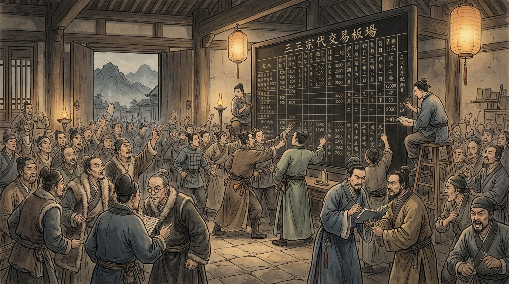

# 第 115 章：萬山商戰・靈石期貨與血精斷供

[← 上一章](ch0114.md) ｜ [本卷目錄](00_intro.md) ｜ [下一章 →](ch0116.md)

*章首插畫：第 115 章 萬山商戰・靈石期貨與血精斷供*

問道天台上韓蒼眉心晶斑暴露的同一時辰，山腳下的雲津仙集「三宗交割大廳」內早已人聲鼎沸。

與山上那場講求門派榮辱的比試不同，這座青石大殿裡決定的是未來十年三千名三宗弟子的吃穿用度與全埠各大商號的生死存亡。大廳中央那塊高達兩丈的烏木交割掛牌前，此刻已經擠滿了上百名來自南北各地的供貨商、車馬行東家與三宗採辦管事。

「怎麼回事？萬寶閣昨天傍晚開出來的三十萬靈石票『北境特供礦炭遠期承兌單』，今天早上在雲海票號怎麼突然不給貼現了？」

「何止礦炭單！我們上個月墊付給萬寶閣轉交三宗外門的五百車草藥尾款，今天一大早去帳房結算，管事竟然支支吾吾說要改簽下季度期票，連一成現靈石都拿不出來！」

大廳裡的嘈雜與焦慮如野火般迅速蔓延開來。

端坐在大廳最裡側貴賓紅木椅上的萬寶閣掌櫃何萬金，此刻早已沒了往日那副和氣生財、指間晃著翡翠扳指的從容模樣。他額頭滲出一層細密的冷汗，死死攥著手里剛從山上秘密傳下來的一張字條——原本指望鶴壽、赤煉、玄冥三位長老的弟子在問道天台奪魁後，立刻把「北荒禁區封鎖採掘令」拿下來當作萬寶閣新一批高價期貨抵押品，好補上這兩個月因南方十三府血精斷供與金石府錢百川倒台捅出來的巨大資金窟窿！

誰知上面剛傳下急報：器丹雙試雙雙失手、連帶著血精丹毒跟晶斑都在台上露了餡，山上自顧不暇，哪裡還批得下來新的抵押令？

「穩住……絕對不能在這時候露了底！」何萬金暗自咬牙，對身邊臉色慘白的帳房低喝道，「去西街地下私庫，把上個月以『三宗外門應急儲備金』名義託管在咱們名下的那批五百萬下品靈石票準備金先挪兩成出來頂帳！只要扛過今天交割廳盤點，晚上自然有山上的大人出來平事！」

然而就在那名帳房剛轉過屏風準備往後門溜走的剎那，大廳正門外突然大步走進來三個人——

為首的是穿著深青短襖、懷裡抱著一隻沉甸甸鐵皮文件箱的沈泥；緊跟在她左右兩側的，分別是手持公所稽核銅印的掌印羅九秤，以及臉色冷峻、手裡捧著一本厚重流水總冊的雲海票號女掌櫃顧蘭舟！

「何掌櫃急著派人往哪裡去調銀子啊？」

沈泥清脆平靜的聲音在大廳裡驟然響起，壓過了周圍嗡嗡的議論聲。她沒有去拿什麼江湖喊打喊殺的口氣，反而一步一步穩穩走到交割廳中央的公證台前，啪地打開手裡那隻鐵皮箱子，從裡面取出一疊加蓋著通寶總號大印與金石商會總堂聯署紅印的跨州信用匯票。

「萬山商埠交割律第十一條寫得清清楚楚。」沈泥抬起眸子，直視著瞬間僵在椅子上的何萬金，「凡在雲津登記掛牌之甲等大商號，若受託保管『三宗外門年度供奉準備金』，每逢十年會武當日申時前，必須接受公所與合作票號對實物倉單、靈石現儲與遠期期貨的交叉核驗，確保準備金專款專用、不得挪作私投。」

她轉頭看向羅九秤與身後二十幾名早就接到通知趕來的中小商戶與外門採辦管事：「就在昨日與今日上午，泥途商棧受託整合了金石府通寶總號匯來的三宗外門緊急貨款，並接手了這十七家被萬寶閣拖欠尾款的中小供應商的債權委託。現在依契約規定，請萬寶閣按期分批交割應付的四十萬靈石現票，並由顧蘭舟掌櫃現場核驗萬寶閣名下那『五百萬靈石三宗外門託管準備金』的封存庫單！」

「這……這是泥途商棧在藉機惡意擠兌！！」何萬金猛地拍案站起，肥胖的臉龐漲得通紅，「你們不過是個連倉租都差點付不起的小貨棧，哪來的資格聯合幾家小商販查我萬寶閣的準備金庫單？！按公所老規矩，大商號資金調度允許七日週轉緩衝期！」

「七日緩衝期的前提是『帳實相符、且未將託管公款挪用於黑市期貨』。」

一直沉默不語的顧蘭舟冷冷走了上來，直接將雲海票號近兩個月的跨州大額異常匯兌總冊「啪」地展開在公證台上！

「何萬金，我跟了雲津的銀盤子二十年。上個月初七到這個月中旬，萬寶閣從我票號裡先後套走了四筆合計一百八十萬靈石票的資金，全數拿去高價強吃黑市上斷貨的『無標記南境特殊礦藥期貨』。」顧蘭舟指尖點在兩張紅印交錯的倉單副本上，「你以為在帳面上掛成『購買外門越冬燃料預付款』就能瞞天過海？公所剛核對過三宗外門炭房實際入庫數量——這批燃料根本連一根炭條都沒進過山門倉庫，你的實物倉單和交割紀錄，對不上！」

大廳四周的中小商戶與外門採辦管事們頓時炸開了鍋！

「好哇！拿著我們外門弟子的歲貢準備金去黑市炒買高價私貨，怪不得連我們的藥錢和炭錢都要拖成遠期白條！」

「交出準備金實物底帳！否則我們現在就把萬寶閣在雲津西街的倉房全部貼條封起來抵債！」

眼看上百名情緒激動的債主與外門管事瞬間湧向公證台，何萬金這才真正慌了神。他嘴唇劇烈哆嗦著，卻依舊硬撐著最後一絲大商號掌櫃的體面，試圖啟動公所條例裡的合法逃生門：

「諸……諸位別亂！萬寶閣在北境還有三十幾間大倉房和十萬擔囤貨！今日確實因南方大雪與黑市波動導致現票一時調轉不靈，我們……我們願意依照萬山商埠章程第二十四條，即刻申請啟動『七日延期交割與產業抵押清償舊例』，絕不賴帳！」

沈泥卻並沒有天真地以為只要當眾喊一聲「交割」就能讓萬寶閣這樣盤踞雲津幾十年的龐然大物在瞬間灰飛煙滅。

面對啟動「延期抵押」企圖拖延時間等待山上長老救援的何萬金，沈泥反倒平靜地點了點頭：「按商埠法規，萬寶閣確實有權申請七日延期與抵押。既然如此，公所就必須對萬寶閣名下所有用來抵押的倉房、暗庫與往來帳冊做一次『封存公開核查』。」

她轉向公所掌印羅九秤，語氣斬釘截鐵：「羅掌印，萬寶閣帳目出現準備金挪用與假倉單矛盾已屬確鑿事實。若不趁現在凍結其名下資產並派稽核封存其西街後庫所有帳冊，萬一這七天內有人偷偷把裡頭真正見不得光的黑帳燒掉或者轉移走，到時候這五百萬準備金的虧空與雲津全埠的擠兌風波，誰來買單？」

羅九秤緊盯著面前已經大汗淋漓、眼神閃爍不定不斷往後庫方向瞟的何萬金，又看了一眼旁邊神情堅決、手中握著足額金石府通寶信用保單的沈泥與顧蘭舟。這位守了一輩子中立程序的五十五歲公所掌印，終於下定了決心——

「來人！」羅九秤重重蓋下萬山商埠公所的鐵印，「依照商埠危機處置律，即刻起凍結萬寶閣雲津分號全部待交割抵押倉房與票號帳戶！公所稽核隊立刻進駐萬寶閣後庫封存所有近三年實物帳冊與暗標紀錄，公開查帳七日！在準備金缺口核實補足之前，萬寶閣一切對外期貨交易暫停！」

「不……你們不能查封我萬寶閣的內庫帳冊！這件事跟山上大人有關……」何萬金終於徹底軟倒在椅子上，面無血色。

然而場下的風波並未隨著萬寶閣被凍結查帳而立刻平息。

果然不出顧蘭舟先前所料，萬寶閣這尊龐然大物突然爆雷，立刻引發了整個雲津仙集劇烈的信用恐慌！十幾家原本壓了大半身家在萬寶閣期票上的中小商號當場急紅了眼，甚至連幾名把貨押在泥途商棧旁邊的合作車馬行東家，都開始急著跑來找沈泥要求退單撤資、把靈石票全數換成冷冰冰的現銀塊帶回家藏起來！

大廳門外亂作一團，剛趕過來替沈泥搭把手的邱禾急得直冒汗：「東家！外頭好幾家供貨的糧商怕受連累，正圍在咱們商棧門口吵著要提前撤回下個月的冬糧約呢！這怎麼辦？」

沈泥看了一眼混亂的街市，沒有半點後悔，反而異常鎮定地拿過自己的帳本和雲海票號保書大步迎了出去：

「別慌。告訴所有跟泥途商棧簽了實貨契的供貨商——誰今天想退約拿回押金現銀的，只管進門排隊，我按契紙原價一分不少當場退清；願意繼續按期交貨給三宗外門的，我用我們自己壓在雲海票號的實物儲備戶加上蘇大小姐簽發的金石跨州信印雙重擔保，絕不讓任何一家老實供貨的商戶陪著萬寶閣一起死！」

她承受著巨大的現銀擠兌險局、將原本計畫用來擴張的最後一筆準備金全數頂了出去，硬生生替這座搖搖欲墜的中立商埠兜住了半邊底盤。

而就在公所稽核隊撞開萬寶閣後庫鐵門、抬出七口貼滿了「太清、丹鼎、天工」暗標與血精交割索引對得上的沉重黑鐵帳箱時——

沈泥接過莫三從帳房夾層裡送出來的一份蓋好封條的最後文件，抬頭望向雲海之上那座仍然傳來陣陣鐘聲與喧囂的問道天台。

「下面清得差不多了。」沈泥深吸一口氣，對身旁早已整裝待發的顧蘭舟與羅九秤點了點頭，「現在，該請各位隨我一塊兒上山，在三宗掌門與幾千名弟子的面前，把這本封存了三十年的總帳，一頁一頁翻開來對質了！」

---

*場域圖誌：雲津高台・問道天台五方聽審席*

---

[← 上一章](ch0114.md) ｜ [本卷目錄](00_intro.md) ｜ [下一章 →](ch0116.md)
