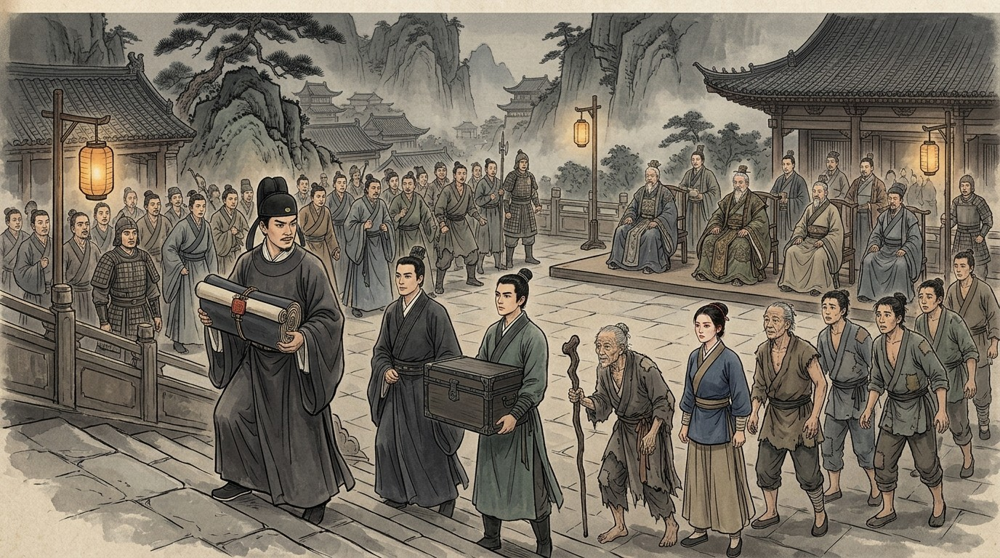

# 第 116 章：當眾質證・三十年血債與走山鐵證

[← 上一章](ch0115.md) ｜ [本卷目錄](00_intro.md) ｜ [下一章 →](ch0117.md)

*章首插畫：第 116 章 當眾質證・三十年血債與走山鐵證*

申時正刻，問道天台上原本喧鬧混亂的氛圍，被從山腳下急步登上台階的一支特殊隊伍徹底打破了。

公所掌印羅九秤親自捧著蓋有雲津公所鐵印的緊急查封卷宗走在最前，身旁是帶著從萬寶閣後庫剛剛封存起獲的兩口黑鐵帳箱的顧蘭舟與沈泥；而在他們身後，拄著棗木拐杖的瘸腿老乞丐莫三、雙眼泛紅卻腰桿挺得筆直的失蹤者家屬代表韓素、雙指殘缺的廢丹崖工頭陶生，以及四名差點被滅口的天工閣北荒苦力，一字排開踏上了那座平日里只容許高階仙師登臨的問道天台！

高台上方，太清紫霄真人、八荒鐵背山主與千機百巧門玄樞門主三位掌門同時站起身來，臉色凝重至極地盯著台下驟然匯聚到一處的五位年輕人與這群底層見證者。

「這便是雲津公所緊急提請的三宗聯席公開質證？」千機百巧門玄樞門主聲音沉厚如鐘，帶著上位者特有的審慎與威嚴，「羅掌印，沈姑娘，這裡是三宗十年一度論道會武之處，不是州縣衙門。你們帶這麼多人上山，指控我派長老私挖北荒禁地、煉製毒丹，甚至牽涉三十年前舊案——若拿不出經得起反覆核驗的鐵證，煽動三宗弟子內亂的罪名，你們誰擔得起？」

「弟子們不靠煽動，只憑跨來源互鎖的實物證據與人證保管鏈說話。」

沈泥沒有被三位二階巔峰（乃至半隻腳觸及三階邊緣）宗門掌門的龐大威壓震懾退後半步。她將手裡那疊早就按「源流・物證・人證・帳目・限度五項分錄」整理完畢的公證副本，透過魯長老、簡素真人與雷烈將軍三名宗門內應宿老的手，整整齊齊呈上了高台案桌之前！

緊接著，四條從未對外連通、卻在這一刻嚴絲合縫交叉咬合的證據鏈，在數千名震驚失語的內外門弟子面前被逐一展開：

第一線，**【北荒母脈盜掘與工程材料鏈】**——林鐵生抬出那截刻著天工閣絕密庫存編號的【鑽山傀儡鑽頭殘件】與四名差點遭滅口的苦力手印證詞；魯長老與章百鍊當場比對萬機地窟領用簿副本，指出此批編號之三十具重型鑽山傀儡正是半個月前由赤煉長老簽署「密試調撥單」調出山門！現場還呈上了上午東台比試中「煞火魔偶」被腐蝕斷裂的鐵軸脆裂殘塊，與北荒母脈溢出的地煞晶渣性狀高度吻合！

第二線，**【地肺丹火窟與延命血丹病理鏈】**——顧玄聯合廢丹崖工頭陶生、醫理院病案掌記孫聞露及前哨老醫師白岩，當眾攤開那瓶封存完整的【血精母液玉瓶】、丙柒爐紫泥封口廢丹樣本、解剖白猿臟器病變圖以及十七例匿名病患追蹤紀錄，並與上午丹試台李青雲所煉變黑銀針交叉印證！證明丹鼎宗「丙字柒號秘密內爐」長期以高毒地煞血精煉製【逆道延命血丹】，雖短期壓低皮肉晶化病徵，實則在服藥者體內種下不可逆的血毒蝕骨之患，一旦斷藥七日即生劇烈反撲！

第三線，**【五年前走山隊棄置血案與軍需調度鏈】**——燕隼與獨臂老將雷烈大步跨前，當眾擺出在黑冰斷谷起獲的九具骸骨定位實測圖、韓素哥哥的【北線斥候・乙十七】銅哨、刻有燕山鷹翅記的斷折骨箭、寫有「火藥自內……勿信接應」的【燕山血書殘頁】，以及雷烈保存了五年的「軍需調度副本」！證明五年前確實有人未經前線將領核簽，自千機工坊秘密調撥三十斤烈性開山火藥，配合偽造調防令炸毀黑冰斷谷封殺走山隊！

第四線，**【三十年舊商盟血債與資金暗網鏈】**——沈泥與莫三取出從雲海鬼市灰袍經生身上截獲的【延命私盟密帳索引】、剛剛從萬寶閣後庫查封起獲的【對帳暗標箱】，以及從北荒方舟後勤主控室轉錄的【九城古商盟禁毀母脈總約副本】與三十年前「雲記・玄木」轉帳殘頁！指出萬寶閣挪用五百萬準備金的暗線資金，最終匯流向三個代號——**「丹鼎丙柒」、「天工赤火」、「太清雷律」**！

「一派胡言！！血口噴人！！」

高台長老席上，赤煉長老終於忍無可忍，猛然一拍石桌站起身來，鬚髮皆張地喝道：「那批鑽山傀儡確實是我調往北荒的！可我是為了開採加固長城防線所需的地下聚火玄石礦晶，好讓『巨靈神機』趕在開春獸潮前站起來護住整個北境！至於那個擅自帶隊去冰谷伏擊你們的死鬼執事，根本是他個人貪圖寶物違抗軍令私下行動，憑那半塊破死士令牌，你們憑什麼血口噴人說是我下令殺的他？！」

「我也未曾私吞過一文錢！」鶴壽長老臉色蠟黃卻咬緊牙關，聲音嘶啞地辯駁，「我一生鑽研醫理，煉製延命丹藥是為了救治我三宗為守護天地正軌而不幸染上結晶絕症的功臣師兄們！那群病患自己求生不能、自願試藥，你們這群連二階大門都沒摸熱的毛頭小子，懂什麼叫『拿人命扛著山門不倒』的無奈？！」

太清執法長老玄冥則顯得比這兩人更加陰冷老辣，袖袍一甩，冷冷指向台下幾處證據縫隙：「更何況，你們呈上來的這所謂『三十年舊商盟密帳』，全是一份連完整簽名都沒有的殘缺索引與幾張民間自己抄的副本！沒有原件印章比對、沒有太清雷符殿的內庫領用底冊，你們便敢當眾給一位執法長老定罪？荒謬！」

這三句反問，確實精準地刺中了目前證據鏈裡尚未徹底補全的合法程序缺口——正如沈泥與柳清虛早就預料到的，赤煉雖承認調用傀儡卻否認下令滅口、鶴壽把煉丹說成救治門內病患、玄冥則死咬著缺乏原件直接簽名不放！

一時間，高台下方數千名弟子再次陷入了劇烈的動搖與面面相覷之中。許多原本同情五子的普通弟子也忍不住皺起眉頭：如果沒法證明那些長老真是貪圖私利、而且對方確實說是為了保護山門與抗擊獸潮……這件事究竟該算誰對誰錯？

「赤煉師弟、鶴壽師兄、玄冥師兄。」

一直沉默坐在主位上、雙目緊閉彷彿在推算什麼的太清玄天宮紫霄真人，終於緩緩睜開了雙眼。那雙歷經百載滄桑的眼眸裡，此刻沒有半點偏袒，也沒有立刻順著熱血少年的說詞拍板定罪，只有一種執掌龐大宗門體制數十年後的深沉冷靜：

「今日所呈各項物證、人證、病理樣本及萬寶閣查封帳冊，雖有部分細節尚待交叉核驗，絕不能單憑一場公開質證便直接定下諸位謀逆大罪……」

紫霄真人轉頭看了一眼身旁的八荒鐵背山主與千機玄樞門主，三位掌門在眾目睽鼎之下迅速交換了一個極其沉重的眼神，隨即同時拿起了桌上的宗門掌印！

「——但如此多跨宗門的異常死傷、毒丹檢測結果、方舟母脈壓力異常與準備金虧空擺在眼前，任何一宗皆不可敷衍遮掩！」

紫霄真人的聲音如九天雷霆般壓住整座問道天台：

「三宗聯席掌門令即刻頒行：第一，即日起無限期暫停北荒裂谷一切礦脈與遺跡採掘作業，封存丹鼎宗『丙字柒號』及所有相關秘爐；第二，成立由宋知微、簡素真人、魯長老、雷烈將軍及雲津公所羅九秤五方共同組成的**『跨宗門聯合查核席』**，徹底清查五年前走山隊軍需調度與三十年前舊商盟清洗原檔；第三，在查核席交叉比對完成之前，**暫時解除鶴壽、赤煉、玄冥三人一切宗門執法與資源調度職權**，勒令即刻交出各自名下所有內庫帳冊、印鑑與密室鑰匙，就地軟禁待審！」

話音落定，高台周圍立刻大步走上來三十名由三宗掌門直屬親衛隊組成的玄甲執劍侍衛，森嚴地圍住了三名面色各異的長老！

沒有一紙判決書立刻砍頭大快人心，沒有一口氣宣稱所有真相水落石出——這是一場嚴謹、沉重、每一步都必須留給交叉查核席慢慢剝繭抽絲的真正制度追責！

台下數千名弟子靜默片刻，隨即自發地讓開了一條通道。韓素緊緊抱著哥哥那枚染血的銅哨跪在通道邊緣無聲痛哭；莫三靠著拐杖站在沈泥身旁，枯瘦的老手微微顫抖地捂住了自己這三十年來第一次感到有一絲公道光亮的雙眼。

然而，就在衛隊上前準備收繳三人印鑑與鑰匙、所有人都以為這場風暴終於要被納入審判軌道的那一剎那——

高台右側突然傳來一聲極為恐怖的骨骼摩擦「喀嚓」聲！

只見被幾名執劍衛士逼在角落裡、原本就已經強行斷絕【逆道延命血丹】整整七日之久的鶴壽長老，在聽見「徹底封存丙柒丹爐、即刻收押軟禁」這句話的瞬間，那雙原本充血的眼眸深處突然閃過一抹徹徹底底的絕望與瘋狂——

「停藥三天……全身晶化爆裂……呵呵……這就是你們要的公道……老夫偏不死成一塊冷冰冰的死石頭！！」

在誰也來不及攔阻的半息之間，鶴壽猛然從貼身藥囊最底層抓出兩隻自己偷偷私藏下來的濃稠暗紅水晶管，仰頭直接把裡頭那兩管足以毒死十頭三階荒獸的高濃度**【北荒血精母液原液】**一口氣全數灌進了喉嚨裡！

與此同時，站在另一側的太清執法長老玄冥看著逼近的執劍衛士，眼神陰沉到了極點。他沒有像鶴壽那樣喝毒液自救，反而趁著全場被鶴壽吸走視線的那一息間，猛地反手拍碎了自己腰間那塊總領問道天台護山大陣的執法主令，厲聲嘶吼道：

「你們想查內庫底帳？！這座天台底下壓著我們太清宮百年的祕密，誰也別想撬開看！！給我封山鎖陣！！」

兩位長年靠同一套黑色利益網苟延殘喘的長老，在面臨徹底失勢的那一秒，卻各自做出了完全不同、卻同樣將整座問道天台推入深淵的致命選擇！

---

[← 上一章](ch0115.md) ｜ [本卷目錄](00_intro.md) ｜ [下一章 →](ch0117.md)
