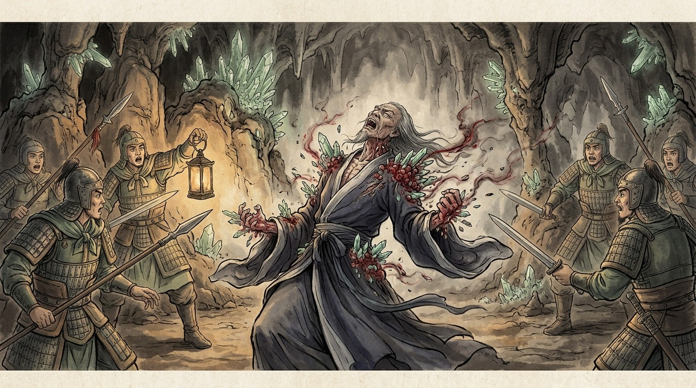

# 第 117 章：道化驚變・半山晶簇的活體地獄

[← 上一章](ch0116.md) ｜ [本卷目錄](00_intro.md) ｜ [下一章 →](ch0118.md)

*章首插畫：第 117 章 道化驚變・半山晶簇的活體地獄*

高台之上，巨變就在呼吸之間爆發！

強行一口吞下兩管高濃度【北荒血精母液】的鶴壽長老，連半步都沒能邁出衛隊的包圍圈，整個人便猛然弓起脊背，發出一聲完全不似人聲的淒厲哀號！

只見他枯瘦的頸側與雙手手背上，幾乎在同一瞬間爆開了無數道觸目驚心的裂紋——裂紋裡面滲出來的不是鮮紅血液，而是無數簇交錯生長、如同白骨與血絲纏繞在一起的**淡青色結晶尖刺與暗紅血煞腫塊**！正如顧玄在廢丹崖解剖那隻白猿得出的醫案推演一般，體內積壓百年的「假天道化晶種」在遇到極高濃度的狂暴母液衝擊後，不僅沒有被壓下去，反而和血毒徹底失控逆反，把這名丹鼎大長老的身軀變成了一個不斷往外噴吐冰寒晶塵與腐血毒霧的活體爐膛！

幾乎就在同一時刻，高台另一側企圖拍碎主令、強行啟動封存護山陣法銷毀證據的太清執法長老玄冥，也遭遇了截然不同的慘烈反撲——

「咔嚓……嗡！！！」

問道天台周圍二十四根導星石柱早已因為上午幾輪高強度比試加上陣紋老化而負荷過重。玄冥強行逆轉封山陣眼，妄圖將整個高台連同上面的人證物證一起封進冰寒雷陣裡；誰知他自己那條早已暗中晶化過肘關節的左臂在強行牽動九霄天羅星力的剎那，整座失衡的大陣竟然倒過頭來將狂暴的星力全數反灌進他體內！

玄冥發出一聲悶哼，左肩以下的整條手臂瞬間像凍透了的琉璃薄片般徹底玉化爆裂！失控的陣法光柱轟然炸毀了高台東北角的兩根星宿石柱，無數道混雜著極寒星煞的淡青晶塵順著爆裂的氣浪橫掃整座問道天台！

「散開！所有人立刻掩住口鼻！往南側下山石階有序撤離，不准推擠！」

紫霄真人與千機玄樞門主臉色劇變，同時騰身而起聯手撐開兩道厚實的防護光幕擋在崩潰的陣眼與下方數千名驚慌失措的觀禮弟子之間；雷烈將軍則拔出寬背單刀嘶吼著指揮八荒武修守住下山階梯兩側，防止踩踏發生。

然而那片從高台邊緣裂開、由鶴壽體內失控擴散的血煞晶霧與玄冥炸毀陣眼洩漏出來的極寒結晶毒氣，並未因為兩位掌門的阻攔而立刻消散——相反，兩種截然不同的災厄在半空中交匯融合，沿著天台向山腰緩緩下沉，在問道天台周邊方圓半里內形成了一片不斷向外蔓延的恐怖**「結晶毒域」**！

毒域邊緣所過之處，青石板地面竟以肉眼可見的速度結滿一層泛著微弱青芒的冰晶苔蘚，幾名站在最前排沒來得及撤退的執劍衛士與太清弟子剛吸入兩口淡青毒霧，便捂住喉嚨慘叫著跪倒在石階上，手指關節迅速開始僵硬發白！

「赤煉呢？！混帳，赤煉那老東西趁亂往哪裡跑了？！」

千機院魯長老在濃霧邊緣厲聲大喝，目光掃過剛剛還站在側席角落的位置，那裡此刻卻只剩下一件被丟棄的赤紅披風和一塊還在微弱冒煙的迷煙銅殼——就在玄冥炸開大陣、全場視野受阻的最初三息裡，對萬仞天工山地下構造瞭如指掌的赤煉長老早已一頭撞開旁邊通往暗道井的石門，順著天工閣地底暗渠逃得無影無蹤！

「先別追逃犯了！半山毒域正在往雲津方向下壓！」

顧玄早已從隨身藥囊裡抓出兩把浸過雪線苔液的濕布巾，一把捂在臉上，另兩塊塞給正在幫著疏散人潮的沈泥與孫聞露，嗓音穿過喧囂直衝上前：「白先生！孫師姐！這不是一般的毒氣，是烈性晶塵混雜血煞毒霧！讓所有醫者立刻退到天台下方一百五十步的『石牌坊迎風口』設立隔離線，把吸入過毒霧出現指尖發僵或咳血的傷患單獨圈出『甲區』，絕不能讓他們跟還沒感染的弟子和百姓混在一起下山！」

「明白！」白鶴年沒有半句廢話，立刻帶起丹鼎宗一眾未曾涉案的普通醫官奔赴石牌坊下風口側翼布設隔離營帳。

就在眾人全力搶建防線之時，原本已經跟著人群退到毒域邊緣線外的柳清虛卻猛地停住了腳步！

在濃密翻滾的青紫晶霧之中，隱約傳來兩聲微弱的拍打石柱求救聲——兩名剛才負責護衛在證據案桌旁的八荒年輕執劍衛士因為護住其中一隻證物木箱慢了一步，被倒塌的半截石柱壓住了小腿，此刻正被困在毒域核心邊緣不到十丈的地方！

「我去拉他們出來！」一直跟在後側壓陣的燕隼挽起弓箭就要往霧裡衝。

「別去！你不懂這座失控陣法的星力流向，沒有護脈藥物衝進去三息肺葉就會結冰！」

一直並肩站在柳清虛身旁、平素溫和得彷彿連大聲說話都不會的授業師陸觀瀾，此刻看著那兩名快被晶霧吞沒的年輕衛士，咬緊下唇，眼中閃過一抹決絕。她猛地從腰間摘下一面刻著周天星律院印記的紫銅護身鏡，塞進柳清虛手裡，反手卻抓起幾張高階鎮風避煞符拍在自己雙肩！

「清虛，你在剛才的演武台上證明過你能看穿這座陣的死角縫隙！」陸觀瀾嗓音微顫卻異常堅定，「毒域東側那兩根沒全倒的副陣柱還在往外漏氣，我去替你們死死壓住那道副陣眼的引流機閥三十息，替你擋開頭頂的星煞餘波——你只管帶著顧玄剛配好的浸藥濕布去把那兩個小兵拉出來！快去，過了三十息我壓不住！」

「師長！」柳清虛心頭一震，深知以陸觀瀾二階七十多重的修為強行去按住失控的二階巔峰副陣眼意味著什麼代價！

「我是星律院的師長，我的授業師兄弟就是死在這場糊塗的晶化夢裡！別讓我白看你一場！」陸觀瀾頭也不回，青袍鼓盪，義無反顧地衝向東側那根正在狂噴雷芒與青光的斷裂石柱，雙手死死按在忽燙忽冷的陣紋鎖扣上！

「唔——！」一口鮮血瞬間從她嘴角溢出，可那股原本朝著石柱底下亂噴的恐怖星煞風暴，硬生生被她用全身靈力強行壓偏了三尺！

「走！」顧玄紅著眼眶一把將兩小瓶現調的雪線苔護喉藥露塞進柳清虛手裡，自己也死死跟在半步之後。

兩人藉著柳清虛對陣法氣流誤差的極限預判，在能見度不足三步的毒霧邊緣貼地疾行，短短二十息內用鋼釺撬開壓住小腿的碎石，一人架起一條胳膊，拼盡全力將那兩名已經半昏迷的年輕衛士硬生生拖出了結晶毒域界線之外！

然而就在此時——

「轟！」

後方東側陣眼傳來一聲沉悶爆鳴！陸觀瀾終究還是沒能扛過第三十息的星陣反衝，整個人被炸開的陣法氣浪掀飛出兩丈外重重摔進雪堆裡，左肩袍袖徹底碎裂，露出一道佈滿淡青細密晶紋的可怕傷口！

柳清虛與宋知微掌院同時搶上前去將她抬進了石牌坊下的隔離醫療區。陸觀瀾雖然保住了一條性命，卻因強行鎮壓狂暴星煞而徹底損毀了半邊經絡，連帶早期被壓抑的晶化隱患也提前誘發，從此已再無繼續修行的可能。

醫療區內外哭嚎聲與忙碌的腳步聲交織成一片。

顧玄顧不得自己雙手也被毒霧灼出幾道水泡，跪在雪地裡和白鶴年、孫聞露一起給被抬出來的三十多名輕重傷員逐一清洗呼吸道、做分區登記與隔離看守——救出了十幾個原本必死的弟子和衛士，可這場危機卻依然已經徹底演變成一場波及整個名山的嚴峻公共災難。

半山腰上，那團翻滾著死亡青芒的結晶毒域雖在紫霄真人與玄樞門主聯手布下的外圍封鎖大陣下暫時被困在百丈方圓內，但高台核心處依舊傳出鶴壽與玄冥兩人失控陣力相互撕扯的恐怖轟鳴——

更沒人注意到，隨著問道天台這座連結整個北境三山靈脈樞紐的主陣徹底崩潰失調，正北方大黑山方向的天際線盡頭，一股宛如墨汁般濃重黑壓壓的恐怖陰霾，正夾雜著萬千野獸踏碎凍土的沉雷震動，朝著這座剛剛經歷過內亂的名山關口狂撲而來！

---

[← 上一章](ch0116.md) ｜ [本卷目錄](00_intro.md) ｜ [下一章 →](ch0118.md)
