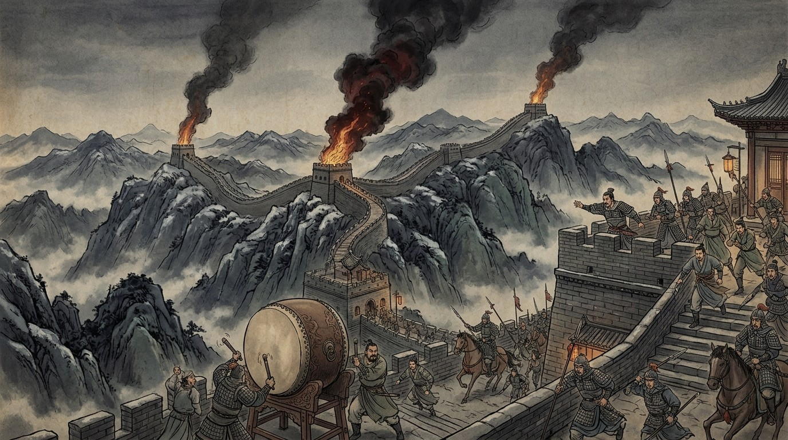

# 第 118 章：北荒破關・內外夾擊的滅頂之災

[← 上一章](ch0117.md) ｜ [本卷目錄](00_intro.md) ｜ [下一章 →](ch0119.md)

*章首插畫：第 118 章 北荒破關・內外夾擊的滅頂之災*

問道天台失控的訊息還沒完全傳回雲津底部的千家萬戶，大黑山北線的警世烽煙，已經在不到半個時辰內同時衝天而起！

三道接連不斷、象徵「十萬火急、關防面臨破城」的赤黑狼煙筆直刺破北境灰暗的蒼穹。伴隨著沉重急促得彷彿要敲裂銅皮的牛皮戰鼓聲，整個八荒武山與黑山長城頓時陷入了百年未見的滅頂危機之中！

過去半個月來，赤煉長老在北荒方舟鎮熱外殼強行鑽鑿引發的高壓毒煞噴發，早已迫使居住在永凍血原外圍的荒獸群失去了賴以棲身的領地；加上今日問道天台主陣因玄冥反噬徹底崩壞，導致整條連貫太清峰與八荒長城的協同鎮山陣脈在一息間斷流了一半以上！原本死死壓在北荒裂谷南沿的鎮山靈壓驟然撤除，上千頭早就躁動不安的二階冰原荒獸——鐵甲寒犛、雪原巨熊、成群的鐵背荒狼——終於像決堤的洪水一般，順著積雪冰道朝著南方溫暖一點的谷地與人類城寨瘋狂南衝！

而馳騁在獸潮最前端、猶如一座會移動的萬丈冰山般將黑夜撞碎的，是一頭體長超過六丈、全身覆蓋著彷彿萬載冰髓澆鑄而成的慘白骨甲、雙翼展開遮天蔽日、實力早已達到二階極限甚至半隻腳踏入三階門檻的恐怖荒獸之王——

**【冰獄骨龍】！**

這頭連八荒武山歷代典籍裡都極少記載的太古亞龍種荒獸王，左肋下方帶著一道明顯是最近才被高壓熔岩或地脈裂縫燙傷的焦黑舊創，雙眼中沒有半分嗜血的狡詐陰謀，只有被棲息地毀滅逼到絕路後的狂暴瘋狂！

「全軍上牆！！開三號連發重弩！！！」

黑山長城西段雉堞之上，獨臂老將雷烈聲嘶力竭地怒吼著，一刀劈翻一頭剛順著積雪堆爬上城垛的二階雪豺。但在他身邊，平日裡傲氣十足、習慣單打獨鬥的幾名世家內門弟子，卻在這頭幾乎帶著三階威壓逼近城牆的【冰獄骨龍】咆哮聲中瞬間面無人色！

「三……三階門檻的獸王……這不是二階防線能扛得住的！！」

「山上太清宮跟丹鼎宗的支援呢？！天台的護山大陣怎麼熄火了？！」

一名心理防線崩潰的弟子連手裡的長劍都沒拿穩，轉身就想往長城內側階梯逃跑，頓時帶動周圍十幾名年輕武修陣腳大亂！而就在這防線搖搖欲墜的一瞬，天空中盤旋俯衝下來的冰獄骨龍猛然張開巨口，一道寒徹骨髓的恐怖幽藍冰煞吐息如九天瀑布般狠狠砸在黑山長城西側最薄弱的三號門樓之上——

「轟隆隆隆————！！」

厚達丈餘的條石城牆在極寒與巨力的雙重碾壓下發出令人絕望的哀鳴！整整三十丈長的西段長城垛口連同兩座重型弩樓在剎那間徹底凍結、爆裂、轟然垮塌！十幾名來不及躲開的武山守卒連同兩位世家外門弟子瞬間被埋進碎石與冰渣之中，缺口外頭上百頭眼睛血紅的荒獸發出震天嚎叫，潮水般湧入缺口！

「西門破了！！二線內關撤退道還沒清空，底下還有三十幾個在北線互助棚來不及進城的小孩子跟家屬！」

破軍重弓塞女校尉唐映半邊臉都被飛濺的碎石劃破了血口子，死死拽住剛殺退兩頭荒狼趕上城頭的燕隼肩膀，指著長城內側下方那條正在擁擠逃難的泥濘山道嘶聲大喊：

「岳停山教頭在死死頂著缺口右側，可骨龍馬上要往內城二道門俯衝了！咱們人手不夠——要麼把僅剩這隊弓手調去二道內城門架盾死守等山上援軍，放棄外面互助棚那幾十個沒進門的平民；要麼我們親自下牆衝進獸群裡掩護他們最後半里退路！」

燕隼低頭看了一眼下方雪道——

那條泥濘不堪的撤退路線上，二十九歲的女子韓素正和三十多歲的阿滿死命架著兩個跌倒在地的老人和幾個哭喊的孩子往內門方向拼命奔跑，而一隊二十多頭鐵背荒狼已經繞過西門缺口截斷了他們側翼的石橋！

「別放棄平民，也別讓缺口徹底潰爛！」

燕隼眼神冷靜得可怕，幾乎沒有一息猶豫，一把抓起唐映手裡的調度測距紅旗插回牆垛：「唐校尉，你帶著所有二營弓手就地依托東側完整城牆往缺口傾瀉覆蓋箭雨壓制狼群側翼！我帶祁無傷這隊精銳巡哨斥候下去斷後把韓素和阿滿他們拉進內門——至於西門主缺口，有人會替我們頂住！」

話音未落，燕隼已經縱身躍下高達三丈的城牆，在半空中穩穩踩在一處突出的石垛借力卸去衝力，落地瞬間反手抽出腰間精鋼柴刀一刀劈開一頭撲到韓素背後不到三尺的惡狼頭顱！

「跟緊我！往東側這條排水石道進內關！」燕隼一聲低喝，將那柄百斤重石柘木弓護在身前，與隨後躍下城牆的祁無傷背靠背硬生生替這幾十名哭喊的普通家屬與工役殺出一條三丈寬的血路！

與此同時，就在西側那道崩塌了三十丈的恐怖缺口正中央——

岳停山右膝舊傷早已徹底撕裂出血，整個人拄著一把卷了刃的重戟單膝跪在冰礫堆裡，眼睜睜看著那頭體長六丈的【冰獄骨龍】收斂雙翼、帶著摧毀一切的絕望陰影再度俯衝下來！

「完了……」身邊幾名精疲力竭的老卒閉上了眼睛。

可就在骨龍的前爪距離殘破門樑不到十丈的剎那，長城西側下方一座原本從未啟用過、直通萬仞天工山腹地的巨型玄鐵暗門，突然在一聲震耳欲聾的蒸汽與齒輪轟鳴中「轟隆」一聲向外炸開！

緊接著，一隻高逾一丈、由厚重暗沉玄金打造的巨型機關鐵臂猛然從地底通道裡探出，五根水桶粗細的精鋼指節帶著萬鈞巨力，在千鈞一髮之際硬生生往上托住、並死死扣住了那條正向下轟然砸落的崩塌石城樑柱！

「咔——嘎吱吱吱——！！」

大地劇烈震顫！一尊高達十丈、胸口冒著滾滾熾白地肺蒸汽與純淨高壓熱流（絲毫沒有一絲血精腐臭黑煙）的龐然大物，在無數守軍絕望又震撼的注視下，一步步踏出地底通道，用它那寬闊得如同鋼鐵堡壘般的肩背，生生頂住了黑山長城西關即將全面塌毀的第二道內門門洞！

**天工閣鎮山重器——【巨靈神機】！！**

在巨靈神機胸腔上方那座拆掉了半邊護罩、完全裸露在風雪之中的臨時手操鐵架上，林鐵生光著半條被高熱蒸汽燙紅的左臂，右手死死抓著與自己腰間【太古不融黑鐵齒輪】咬合在一起的簡易承壓拉桿，身後緊跟著滿臉煤灰卻咬牙幫忙調整副機閥氣壓的千機院魯長老、章百鍊總匠與女陣匠聞九！

「不是用血精強催……老子把這東西右翼錨機的原始幾何反力支撐角度調回來了！！」

林鐵生大口喘著粗氣，看著這尊在沒有注入一滴血精的情況下、全憑天工地肺純淨地火氣壓與精密齒牙咬合勉強支撐起門樑的十丈鐵像，雙眼死死盯著前方空中憤怒咆哮盤旋的【冰獄骨龍】，嗓音沙啞地吼道：

「但地火供壓最多只能再撐這套齒輪扛住兩刻鐘！！柳清虛！顧玄！沈泥！你們再不合攏陣線，等長城這半邊門樑一斷，整個雲津盆地底下數萬老百姓誰也跑不掉！！」

內有半山不斷滲出結晶毒孢的災區，外有隨時可能踏破內門的六丈冰獄骨龍與無邊獸潮——三大名山百年來最深重的一場滅頂之災，將所有宗門成見、世家傲慢與恩怨算計，徹底碾成了同一艘隨時會沉沒的破船！

---

[← 上一章](ch0117.md) ｜ [本卷目錄](00_intro.md) ｜ [下一章 →](ch0119.md)
