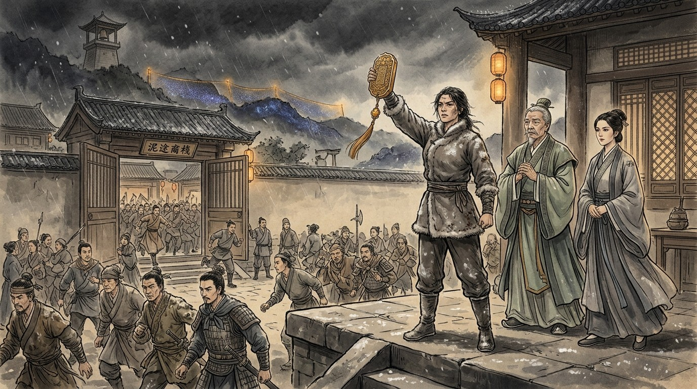

# 第 119 章：五子合擊・三元大陣鎮山河

[← 上一章](ch0118.md) ｜ [本卷目錄](00_intro.md) ｜ [下一章 →](ch0120.md)

*章首插畫：第 119 章 五子合擊・三元大陣鎮山河*

生死存亡的最後半個時辰裡，沒有人再去爭論什麼「名門正統」或「一階凡俗出身」。

山腰之下，雲津仙集的鐘樓早已敲響了最急等的避難警鐘。泥途商棧的大門此刻徹底敞開，沈泥沒有躲進地窖避難，而是穿著那件沾滿雪泥的灰鼠皮短襖站在萬山廣場最高的一處銅鑼石台上，腰間那枚【金石商會與通寶跨州特等通行信印】高高舉起，身側並列站著公所掌印羅九秤與雲海票號女掌櫃顧蘭舟！

「所有還想明天繼續在這座盆地裡做買賣、留一條活路的商號、車馬行與腳夫聽著！」

沈泥的聲音借著旁邊幾名熱血行商弟子敲響的銅鑼間隙傳遍廣場：「山上三宗長老與護衛隊正在黑山關口拿命替咱們擋著獸王！萬寶閣那些被封存了但還沒分發的庫存火油、精鐵破甲箭矢、清心散、生石灰粉還有三百具守城床弩備用鐵件，公所已經批下緊急徵用令——」

「所有今天願意出車、出馬、出人往黑山二道關口和石牌坊醫療區送這批救命貨的民間商隊與行腳夫，按雙倍戰時高危運價計算！一文不少，我泥途商棧拿雲海票號的準備金聯保底契作擔保，事後公所與三宗共償！」

原本因為萬寶閣暴雷和獸潮警報而陷入恐慌搶糧、甚至準備拉家帶口逃出盆地的上百名中小商戶與幾十名雪橇領隊，在聽到這句「戰時運價公證擔保」與看到面前莫三、邱禾、穆雪已經帶頭套好雪橇往車上猛搬火油桶的身影後，終於咬牙穩住了陣腳！

「幹了！總比等著那頭大骨龍衝進盆地裡把我們連人帶貨嚼碎了強！」

短短一刻鐘內，超過八十輛民間雪橇與五百多名青壯腳夫在邱禾與穆雪的統一編組調度下，踩著沈泥與羅九秤緊急劃定的「東線物資上行、西線平民避險分流道」，有條不紊地冒著風雪湧向兩處危機前線！

……

山腰石牌坊下的隔離醫療線前，這批搶運上來的數十車生石灰、青河雪線苔乾粉、苦參與雄黃藥草及時到位！

顧玄顧不上擦去臉上的汗水與黑灰，立刻指揮白鶴年、葉青枝與幾十名願意冒險留守的丹鼎醫徒和退門藥工，沿著問道天台下方的半山環狀階梯架起二十口大鐵鍋，將大量碾碎的雪線苔、苦參、甘草與微溫礦灰調成濃烈濕潤的「百草中和藥霧」隨風向上噴灑！

「這霧殺不死鶴壽體內的毒瘤，但能像濕棉被一樣把往山下飄的晶化毒塵壓死黏住！」顧玄一邊用銀針急救兩名呼吸受阻的弟子，一邊對前來支援的杜青禾喊道：「把生石灰線撒在石牌坊下十丈！所有撤下來的軍士一旦在霧區外緣出現皮膚發青，立刻進隔離區用冷水沖洗換衣！」

憑藉顧玄親手調配的這道草木解毒煙障，原本持續往雲津市井下沉擴散的致命「結晶毒域」，終於在距離盆地邊緣不到半里處被硬生生遏止住了蔓延勢頭！

……

同一時刻，高高矗立在問道天台最高處與天柱峰頂端斷崖上的柳清虛，正和太清掌院宋知微、苦修派簡素真人並肩立於狂風怒號的殘破星台之上！

沒有一人使用血精丹藥，這三位掌握著太清最深奧曆算的法修，竟當場採用柳清虛在藏星秘閣與黑石鋪拓片裡推導出來的《逆星歲差實測圖錄》，重新撥正了那十二根受損的周天導引星柱角位！

「東三度七分，借天柱北風星力做斜向補償——定！」

柳清虛一聲清喝，手裡緊緊握著那卷幾乎要碎裂的【逆星斷碑拓片】，將體內二階九十重上下的神識毫無保留地接入這座臨時改組的跨山門陣眼之內！

奇異的一幕發生了。

天穹之上原本混亂狂暴、彷彿隨時要炸開的暗沉星力雲團，在這座不順從傳統僵化規律、而是順應實測誤差隨時校準的「逆星陣盤」引導下，竟然再度發出一陣沉穩有力的青金色共鳴波紋！數十道細密純淨的青白光柱從天柱峰頂垂落下來，一邊穩穩壓在半山腰毒域中心遲滯了鶴壽與玄冥的失控星煞對沖，另一邊則化作一道巨大的星力重壓網，死死罩在了黑山長城缺口前方那頭正準備再次騰空撲擊的【冰獄骨龍】背脊之上！

「吼————！！」

被這座憑空重組的**【三元鎮脈陣】**星力一壓，冰獄骨龍龐大的身軀驟然一沉，雙翼揮動的速度硬生生慢了三成！

「就是現在！長城火油車！所有重弩齊射！一隊退，二隊上！！」

黑山關內門城牆之上，燕隼與獨臂老將雷烈、右膝流血的岳停山以及女校尉唐映，將剩下還能站立的三百名八荒武山守卒與援軍精準分成了三個輪替戰陣！

第一排重盾武卒與沈泥送上來的長城滾木火油車頂上缺口，藉著林鐵生操縱【巨靈神機】那雙死死撐住崩塌門樑、又騰出半邊左臂揮舞數千斤玄金護腕砸碎兩頭衝進門洞巨熊的掩護，點燃烈火燒斷骨龍的地面視野；

第二排破軍重弓塞的五十名精銳射手在唐映的測距紅旗指揮下三段齊射，每一箭都只消耗自身三分餘力，射空即退後換氣吞服顧玄送上來的【沸血降燥湯】由第三排接上！

整整一炷香的血戰分段輪替之下，這頭堪比三階門檻的恐怖獸王【冰獄骨龍】，體力終於被龐大陣線的協同消耗撕開了最後一道缺口！當它憤怒地仰起龍首、試圖強行吐出一口極寒龍息震碎撐住城門的【巨靈神機】左臂時——

一直靜靜伏在巨靈神機寬闊的鋼鐵肩甲高處、跟著這尊十丈巨神共同抵住門樑的燕隼，抓住了這整場戰役中唯一的一線勝機！

他體內氣血在之前三輪輪替防禦中並未透支，而是借著荒古戰神遺塚那套古老節律蓄到了最沉渾凝練的極限！在林鐵生猛然拉動控制桿讓巨靈神機往右側微傾半尺、硬生生把骨龍甩過來的冰尾架住半息的那一剎那，燕隼雙腳在滾燙震顫的玄金肩甲上踏出一個沉穩至極的弓步！

百斤重石鐵胎柘木弓拉滿了最後極限——箭壺裡最後一支【黑背雪狼頭骨破甲重箭】，順著天柱峰頂柳清虛精準鎖定骨龍左肋舊傷位置的星光指引線，脫弦而出！

**《八荒破天弓》・破核！**

「轟——噗嗤！！」

這一箭沒有幻化成什麼金色神龍，卻帶著五個人從黑石鋪一路帶出來的商業補給、醫療阻隔、機械應力、星陣定位與血肉精準算計的極致合力，穿透重重冰霧與骨甲縫隙，毫釐不差地狠狠炸穿了冰獄骨龍左肋那道原本已經焦黑開裂的舊創核心！

「嗷————！！」

一聲震徹百里雪原的凄厲龍吟衝上雲霄！冰獄骨龍巨大的身軀在半空中猛烈抽搐翻滾，砸垮了十幾丈長早已搖搖欲墜的外城殘垣，終於明白這道看似殘破的防線背後有著自己啃不動的鋼鐵筋骨與算計。它不敢再戀戰，雙翼艱難地拍擊捲起漫天暴雪，發出一聲撤退長嘯，領著殘存的數百頭傷痕累累的北荒荒獸掉頭朝著永凍裂谷方向狼狽遁逃而去！

半山腰那邊，幾乎就在獸王退走的同時，原本失控碰撞的半山結晶毒域也在紫霄真人、玄樞門主聯手顧玄的藥霧中和與柳清虛的星力抽離之下，終於漸漸熄滅了狂暴的光芒——

鶴壽長老倒在毒域中央早已昏迷不醒，半邊身軀半結晶半血肉焦黑，被戴上隔離鎖鏈抬入特製鐵籠醫療區看守；執法長老玄冥則因為左臂與陣法徹底炸毀，在僅剩一息尚存之際被幾名太清掌門直屬衛士當場拿下繳械。

長城上空漫天大雪悄然飄落下來，覆蓋了黑紅相間的殘垣斷壁與倒在雪地裡的屍骸。

沒有驚天動地的慶功歡呼。林鐵生癱坐在巨靈神機冰冷下來的操機鐵席裡大口大口喘著粗氣，看著那根因受力過猛而徹底扭曲報廢的黑鐵備用連接桿；燕隼跪在城牆邊看著底下傷亡名單裡兩名熟悉的老哨兵的名字，雙手默默攥緊了弓身；顧玄則抹了一把臉上結冰的血汗，轉身去救治那幾名剛在二道門被壓斷了腿腳的民間雪橇車夫。

他們守住了這座商埠、這座山門、和這數萬生靈的活路；但黑山長城西側崩塌的那三十丈城牆與雪地裡整整八十多具守軍及平民冰冷的屍骨，也像一道永遠洗不掉的烙印，深深鑿進了這片山河之中。

---

[← 上一章](ch0118.md) ｜ [本卷目錄](00_intro.md) ｜ [下一章 →](ch0120.md)
